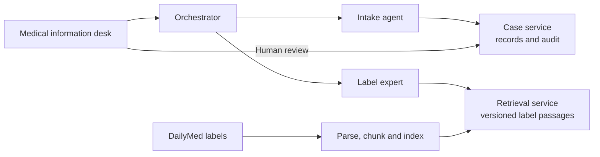

# AI on AWS

A local playground for understanding how agents work as part of a larger system: how they interpret requests, call tools, retrieve evidence, carry authority across services, and recover when something fails. The agents serve the Amazon Bedrock AgentCore Runtime contract. A local retrieval pipeline provides the document preparation and search capabilities that Bedrock Knowledge Bases would otherwise manage.

The application is a medical information desk. A clinician's inquiry can contain both a question about a medicine and a report of an adverse reaction. An orchestrator sends the message to intake for screening and delegates label questions to an expert. Intake records cases through a tool service; the expert retrieves passages from versioned drug labels. Staff review the resulting cases and draft replies through the web app. Inquiries and people are synthetic; the labels come from DailyMed.

The same intake agent is implemented twice, with a handwritten loop and with Strands. Both use the same rules and tool contracts, so the framework choice can be examined separately from the application's responsibilities. Evaluation harnesses exercise retrieval and answer quality, security boundaries, and failure handling.

Everything runs locally in containers, with three vLLM model servers on an NVIDIA GPU. No AWS account is needed for this setup. The repository includes the AgentCore-compatible agents and local supporting services; it does not deploy them to AWS.

## How the system fits together



Each agent runs in its own container. Keycloak supplies local identity and token exchange, and the receiving services enforce their own access rules. The agents use the chat model for inference; retrieval can use the embedding model and reranker. The [runtime](docs/architecture/agent-runtime.md), [identity](docs/architecture/identity.md), and [retrieval](docs/architecture/knowledge.md) documents describe those boundaries.

The web app has two views of the system. The desk presents inquiries, replies, and case review according to the signed-in person's role. The lab explorer exposes the agents and their execution steps so the same message can be compared across implementations. The explorer requires no sign-in and can read every run; the web app is bound to the local machine.

## Getting started

Run the commands below from the repository root. The development machine needs a shell and Docker with Compose. The model host is either an NVIDIA machine, with the NVIDIA Container Toolkit, the same machine or a separate host; or an Apple silicon Mac, which runs the model servers itself. GPU, driver, memory, and disk requirements are in the [model setup guide](model/README.md#what-you-need). No host Node installation is required.

### Run the model server

On an Apple silicon Mac:

```bash
model/setup.sh --cache-dir <directory>
```

The servers run on the Mac with vLLM-Metal, and the lab's containers reach them at `host.docker.internal`. The Mac also needs `uv`, `git` and `curl`; see [On an Apple silicon Mac](model/README.md#on-an-apple-silicon-mac).

When the NVIDIA GPU is on the same machine:

```bash
model/setup.sh --bind <address> --cache-dir <directory>
```

Use an IPv4 address the lab's containers can reach. Do not use `127.0.0.1`: inside a container, that address refers to the container itself. The cache directory must already exist and be given as an absolute path.

For a separate GPU host, run setup from the development machine:

```bash
model/setup.sh --host ssh://<user>@<gpu-machine> --bind <address> --cache-dir <directory>
```

Here, the address and cache directory belong to the GPU host. Setup selects the largest configured chat model that fits the free GPU memory, starts the chat, embedding, and reranker servers, and checks them before reporting success. It writes `model/.env` in the checkout where setup runs, so the rest of the lab can reach those servers. See the [model guide](model/README.md) for tier selection, restarts, and setup failures.

### Run the lab

Prepare the label corpus and local identity settings, then start the services and build the search index:

```bash
knowledge/fetch.sh
knowledge/parse.sh
knowledge/chunk.sh
platform/identity/setup.sh
docker compose up -d --build --wait
knowledge/embed.sh ai-on-aws
knowledge/index.sh ai-on-aws
```

The corpus commands fetch the pinned label versions, parse their structure, and produce citable chunks. The embed command asks the embedding server for a vector of every chunk, and the final command loads the chunks and their vectors into OpenSearch. Retrieval requires this index; starting the containers alone does not build it. Search fuses keyword and vector ranking and reranks the result. The other strategies, keyword search without the model servers among them, are covered in the [knowledge guide](knowledge/README.md).

Identity setup writes `platform/identity/.env` with generated service credentials and the synthetic users below. Compose reads that file and `model/.env`; if either is missing, startup stops with an explanation.

Open [the desk](http://localhost:3000). Use `localhost`, not `127.0.0.1`, because sign-in redirects back to `localhost`.

| Username | Role | Access |
|---|---|---|
| `dana.desk` | Desk staff | Submit inquiries and run intake or the orchestrator |
| `morgan.medinfo` | Medical information | Desk access, plus direct questions to the label expert |
| `riley.reviewer` | Safety reviewer | Read cases and record review decisions |
| `avery.auditor` | Auditor | Read cases, audit trails, and execution traces; make no changes |

Each synthetic user's password is their username. For a first look, open [the lab explorer](http://localhost:3000/lab), select a prepared scenario, and inspect the resulting run. The [client guide](client/README.md) explains the desk, contact form, explorer, and role boundaries.

### Check the running services

The gates exercise the running services and report whether their contracts hold:

```bash
platform/identity/stack-gate.sh ai-on-aws
platform/identity/gate.sh ai-on-aws
knowledge/gate.sh ai-on-aws
```

The stack gate checks sign-in, permissions, and agent calls across the application. It submits four synthetic inquiries and may create three test cases. The identity gate checks the provider's token behavior; the knowledge gate checks the built index and retrieval tools. Each emits a JSON report and exits successfully only when its checks pass. Details are in the [identity guide](platform/identity/README.md) and [knowledge guide](knowledge/README.md).

### Stop the lab or clear its data

```bash
docker compose down
```

This stops the services and keeps the inquiries, the cases, the stored traces and the label index. Adding `-v` deletes all four, and the index then has to be built again with `knowledge/index.sh`.

To empty the inbox and the review queue but keep the label index, run:

```bash
./reset-demo-data.sh
```

It deletes the client's inquiries and the case system's cases, starts those two services again with empty stores, and waits until both are healthy. Every other service, and the label index, is left as it is. It asks before deleting; `--yes` skips the question. It acts on the Compose project `ai-on-aws`, or on the one named by `COMPOSE_PROJECT_NAME`, and works from any directory.

### Check the code

This check needs Docker but no GPU or running stack:

```bash
toolchain/check.sh
```

It typechecks, lints, tests, and builds the React app in an isolated container. The [toolchain guide](toolchain/README.md) also covers the VS Code dev container.

## Repository layout

| Path | Responsibility |
|---|---|
| [`client/`](client/README.md) | Web app and server: inquiries, agent runs, case review, and the lab explorer |
| [`agents/`](agents/README.md) | Handwritten and Strands intake agents, label expert, and orchestrator |
| [`tools/`](tools/README.md) | Agent-facing tools, including the case service and its review API |
| [`knowledge/`](knowledge/README.md) | Label ingestion, parsing, chunking, indexing, and retrieval |
| [`model/`](model/README.md) | vLLM chat, embedding, and reranker servers, setup, and capacity checks |
| [`platform/`](platform/README.md) | Local supporting services: Keycloak identity and token exchange, and the trace store for execution evidence |
| [`shared/`](shared/README.md) | Agent and service contracts, schemas, and access-token validation |
| [`evaluation/`](evaluation/README.md) | Quality evaluation, datasets, and security and fault scenarios |
| [`toolchain/`](toolchain/README.md) | Container builds, dependency management, and repository checks |
| [`test-support/`](test-support/README.md) | Test-only dependencies, excluded from application images |
| [`docs/architecture/`](docs/architecture/) | Component boundaries, data flow, invariants, and failure behavior |
| [`docs/write-ups/`](docs/write-ups/README.md) | Essays and research explaining the architectural reasoning |

The root `compose.yaml` starts the application services together. Root package, lockfile, TypeScript, and lint configuration apply across the repository. Each component owns its runtime configuration and source; shared code lives in `shared/`. Images and dependencies are pinned, and machine-specific settings stay in ignored environment files. [AGENTS.md](AGENTS.md) defines the contribution and testing rules; `.claude/agents/` defines the implementation, research, and review roles.

## Reading the architecture

Start with [the intake agent as an actor](docs/architecture/intake-agent-as-actor.md) for the division between inference and deterministic control. Follow the [orchestrator](docs/architecture/orchestrator.md) to see delegation, then [identity](docs/architecture/identity.md) for the authority carried across those calls. The [knowledge pipeline](docs/architecture/knowledge.md) and [label expert](docs/architecture/expert-agent.md) explain how source documents become evidence for an answer. [Evaluation](docs/architecture/evaluation.md) describes how the system's behavior is assessed.

For the reasoning behind those choices, the [essay series](docs/write-ups/README.md) follows agents, tool reliability, retrieval, security, and telemetry. The architecture documents describe the implementation; the essays also explore designs beyond it.

## Licence

MIT: see [LICENSE](LICENSE). The drug labels and benchmark fetched by the lab carry their own terms.
