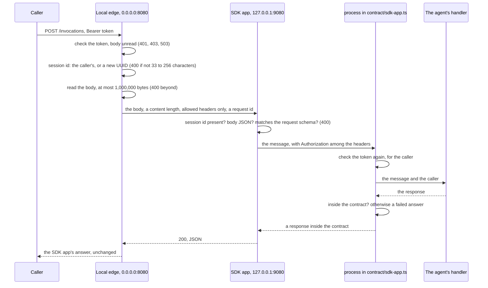
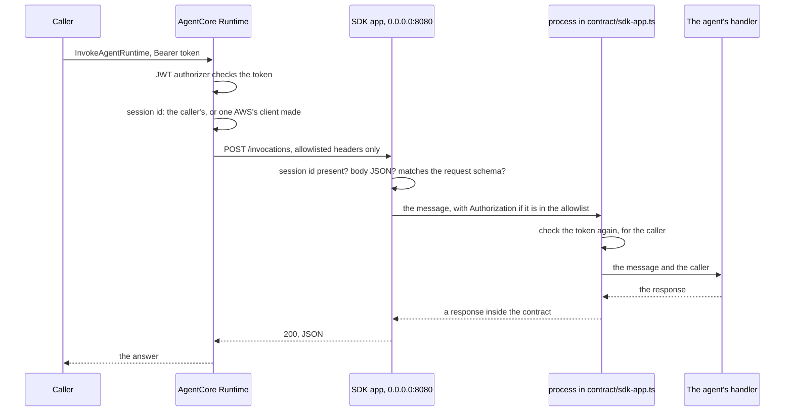

# How an agent serves the Runtime contract

All four agents accept `POST /invocations` using the request and response
contract in `shared/agent-contract.ts`, and expose `GET /ping` for health
checks. Both routes listen on port 8080. Two implementations serve this
Amazon Bedrock AgentCore Runtime contract:

| Agents | Server | Responsibility |
|---|---|---|
| Hand-written intake | `agents/src/contract/server.ts` | HTTP handling, token checks and contract validation |
| Strands intake, label expert and orchestrator | `BedrockAgentCoreApp` from `bedrock-agentcore` 0.4.6 | SDK HTTP handling, with this repository's token checks and handler adapter |

Each agent selects its server through `serveAgent` in
`agents/src/run/serve.ts`. The hand-written path loads no AgentCore SDK. The
SDK path loads `contract/runtime.ts`, which starts the SDK app and, when
`LOCAL_RUNTIME_EDGE=on`, a local edge in the same process.

## The local boundary

AgentCore Runtime checks the caller before forwarding a request to the
container. The SDK server expects that boundary: it requires a session id
but does not check access tokens itself. Locally,
`agents/src/contract/edge.ts` supplies that boundary. It checks the token,
sets or validates the session id, and limits the body and forwarded headers.
The SDK app listens on loopback behind it.

The edge belongs to this repository, not to AgentCore. With
`LOCAL_RUNTIME_EDGE=off`, the SDK app listens directly on port 8080 for
Runtime to call.

## One request

Locally, `LOCAL_RUNTIME_EDGE=on`:

On AgentCore Runtime, `LOCAL_RUNTIME_EDGE=off`:

## Edge responsibilities

| Boundary | Local edge | AgentCore Runtime |
|---|---|---|
| Access token | `shared/access-token.ts`, before reading the body | JWT authorizer with the same discovery URL, audience and client ids |
| Session id | Accepts 33 to 256 characters; generates a UUID when absent; otherwise 400 | `X-Amzn-Bedrock-AgentCore-Runtime-Session-Id`; AWS clients generate one when absent |
| Request body | At most 1,000,000 bytes, forwarded with a content length | Runtime's payload limit |
| Health | Passes `GET /ping` to the SDK without headers | Runtime calls `/ping` |

The edge forwards `Content-Type`, `Accept`, `Authorization`, `traceparent`,
headers starting `X-Amzn-Bedrock-AgentCore-Runtime-Custom-`, the session id,
and a generated `X-Amzn-Bedrock-AgentCore-Runtime-Request-Id`. It drops all other headers,
including cookies and `X-Forwarded-For`. On Runtime, `Authorization` must be
in the request header allowlist; Runtime also forwards the custom headers.

The edge uses the hand-written server's refusal shapes. An invalid token
gets 401 with `WWW-Authenticate: Bearer error="invalid_token"`. A token that
lacks every required scope gets 403 with `error="insufficient_scope"` and the
required scopes. If the identity provider cannot be reached, it gets 503.

| Edge failure | Response |
|---|---|
| Unknown path | 404, in the hand-written server's shape |
| Method other than POST on `/invocations` | 405 with `Allow: POST`, in the hand-written server's shape |
| SDK app does not answer | 502 `{"error":"bad_gateway","detail":"The agent's server did not answer."}` |
| Edge cannot handle the request | 500 `{"error":"internal_error","detail":"The request could not be handled."}` |

If the response has already begun, a connection failure closes it instead
of sending another response. The edge sets no response time limit. It logs
one line for a 502 with the connection error's code, or a fixed line for a
500, without a token or message text.

## SDK and repository responsibilities

The SDK owns `/ping`, `/invocations`, JSON parsing, the session id
requirement and validation against the supplied request schema. The
repository supplies the schema and the `process` adapter that connects a
validated request to an agent handler.

| Repository file, under `agents/src/` | Owns |
|---|---|
| `contract/sdk-app.ts` | Request schema, second token check, handler call, response validation and logging policy |
| `contract/runtime.ts` | SDK app, edge and signal handling |
| `contract/runtime-contract.ts` | `LOCAL_RUNTIME_EDGE`, listener addresses, header names and failure reasons; no SDK imports |
| `run/serve.ts` | Shared startup and server selection; loads the SDK path only when selected |

The second token check supplies the caller's identity to the handler. The
SDK's `process` adapter cannot return HTTP 401, so a refused token at this
point produces a response with `outcome: failed`. This includes a request
that reaches the SDK directly without a valid token, or a Runtime request
whose `Authorization` header was not allowlisted. If the token cannot be
checked, the response also has `outcome: failed`, with a reason explaining
the identity-provider failure.

The SDK logger remains enabled. Requests are logged as method and path,
without query, headers or body. Errors are logged as type, code and status,
without their message or stack; the log line's message uses the error code.
The SDK also prints Fastify's FSTDEP023 deprecation warning
(`disableRequestLogging`) at startup.

## Where the two servers differ

For the intake agent on Strands, the label expert and the orchestrator, compared with the hand-written contract server:

| Situation | Hand-written contract server | SDK server, edge on | SDK server, edge off |
|---|---|---|---|
| JSON that does not match the contract | 400 `{"error":"bad_request","detail"}` | 400 `{"error":"Invalid request body format","details":[the schema's issues]}`, from the SDK | The same |
| A body that is not JSON | 400 `{"error":"bad_request","detail":"The request body is not JSON."}` | 400 `{"statusCode":400,"code":"FST_ERR_CTP_INVALID_JSON_BODY","error":"Bad Request","message"}`, from the SDK | The same |
| A body over the limit | Over 1,000,000 bytes: 400 `bad_request` | Over 1,000,000 bytes: 400 `{"error":"bad_request","detail":"The request body is too large."}`, from the edge | Over 1,048,576 bytes: 413 `{"statusCode":413,"code":"FST_ERR_CTP_BODY_TOO_LARGE","error":"Payload Too Large","message"}`, from the SDK |
| `GET /ping` | `{"status":"Healthy"}` | `{"status":"Healthy","time_of_last_update":<seconds>}` | The same |
| No session id | Not needed | The edge makes one | 400 `{"error":"Missing sessionId. ..."}`, from the SDK |
| A session id under 33 or over 256 characters | Not read | 400 `bad_request`, from the edge | Passed to the handler's context unchecked |
| The agent's own code answers outside the contract | 500 `{"error":"internal_error","detail":"The agent produced a response outside its contract."}` | 200, `outcome: failed`, reason "The agent produced a response outside its contract.", no steps | The same |
| No valid token | 401 | 401, from the edge | 200, `outcome: failed`, reason "The request reached the agent with no valid access token. ..." |
| A token that lacks only the agent's scope | 403 | 403, from the edge | The same 200 `failed` as for no valid token |
| The identity provider cannot be asked | 503 | 503, from the edge | 200, `outcome: failed`, reason "The request reached the agent, and its access token could not be checked: ..." |

In all three layouts, a handler that throws produces HTTP 200 with
`outcome: failed` and "The agent failed unexpectedly." A valid handler
response is returned unchanged.

With the edge off, the SDK can reject an oversized declared `Content-Length`
with 413 before reading the body, then close the connection. A client that
waits before sending the body can read that response. A client still sending
the body may instead see a connection failure ("fetch failed" in Node's
`fetch`), depending on timing.

## Runtime layout

| Setting | Values | Meaning |
|---|---|---|
| `LOCAL_RUNTIME_EDGE` | `on` | The edge on `0.0.0.0:8080`, the SDK app on `127.0.0.1:9080` behind it. Set in `agents/compose.yaml` for the three agents on Strands |
| | `off` | The SDK app alone on `0.0.0.0:8080`, as it runs on AgentCore Runtime |

`LOCAL_RUNTIME_EDGE` is required for SDK agents and has no default. A missing
or invalid value stops startup with exit 2 and names the variable. Failure
to load `contract/runtime.ts` and the SDK stops startup with exit 1 and an
explanation. The hand-written agent does not read this setting.

At startup, SDK agents log their server, listener addresses and
`LOCAL_RUNTIME_EDGE` value. The hand-written agent logs its name and address.

## Always true

1. Wherever this repository runs an agent, a request with no valid access token is refused with 401 before its body is read, one whose token lacks every scope the agent requires gets 403 naming those scopes, and one whose token cannot be checked gets 503: by the edge, or by the hand-written server. The SDK app itself cannot set a status and answers a token without the scope as it answers any refused token, which is why the edge stands in front of it. With the edge off, that is AgentCore Runtime's JWT authorizer.
2. On the SDK server, a valid request with a valid token always gets an answer inside the contract, unless the edge itself answers 502 or 500. Nothing the handler does surfaces as the SDK's 500 with an error's own message. On the hand-written server the same holds, except that an answer of the agent's own outside the contract is 500.
3. No line written by the SDK's logger, the edge or `contract/sdk-app.ts` carries a token, a message's text, or an error's message. The SDK's logger stays on with its request lines; a request is logged as its method and path, an error as its type, code and status, and a line about an error has the error's code as its message. What Strands itself writes to the log is in the [Strands document](intake-agent-strands.md#not-present-in-addition).
4. On the SDK server, SIGTERM and SIGINT end the process with exit 0. The SDK registers no handler of its own. The hand-written agent closes its server and every open connection on either signal.
5. An agent sends a tool server only a token it got for that server: it exchanges the token it was called with, as itself, for one naming that server's audience and scopes, once per run, before it connects. The caller's token goes to the identity provider's token endpoint and nowhere else. An exchange that is refused or cannot be made ends the run failed with the reason: nothing is connected and the model is not asked.
6. The hand-written server passes a request's `traceparent` to the handler: each accepted request is one `agent.run` span of kind `server`, carrying the agent's id and the message's id, that the handler runs inside, a child of the request's `traceparent` when it has a usable one and a new trace otherwise. It ends with the response's outcome, and `failed` when the handler throws, with the answer to a throw unchanged. The edge forwards `traceparent` to the server behind it. The SDK app gives its handler no trace context, and the agents on it record no spans.

`agents/test/runtime.test.ts` has one test for each item, `runtime 1` to `runtime 6`, and one probe, `runtime P1`, that the hand-written agent's model client reads a text answer and a tool call from a model server.

## Not present

| Missing | What follows |
|---|---|
| Streaming | The SDK can stream an answer as server-sent events. These agents answer with one JSON body |
| WebSocket | The SDK's `/ws` route is not registered: no WebSocket handler is given |
| Session memory | The session id is carried to the SDK app and not used. Every request is handled on its own |
| Closing the SDK app in-process | `run()` returns no handle and the app has no close method. The process ends on SIGTERM, and tests start the app in a child process |
| Deployment to AgentCore Runtime | Nothing here deploys an agent. The edge-off layout is the one Runtime would call |
