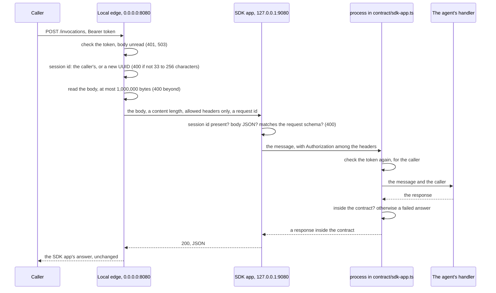
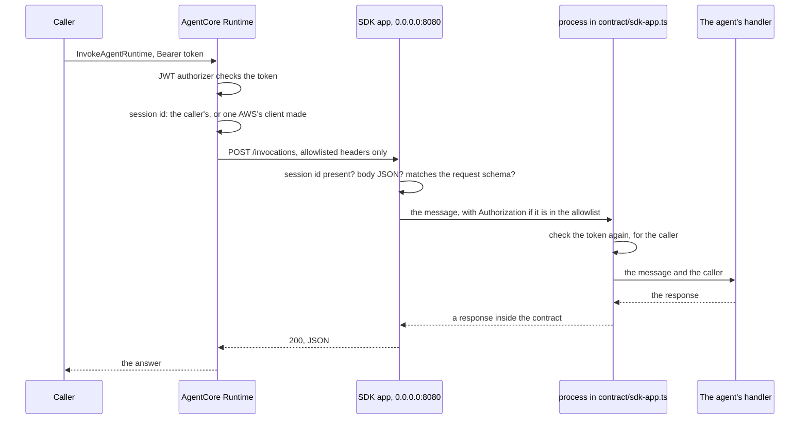

# How an agent serves the Runtime contract

Amazon Bedrock AgentCore Runtime asks one thing of a container: `POST /invocations` and `GET /ping` on port 8080. The agents here meet that contract in two ways.

| Agent | Server | What it shows |
|---|---|---|
| Intake, hand-written loop | The hand-written contract server, `agents/src/contract/server.ts`, with nothing from an SDK | Every layer written out and visible |
| Intake, on Strands | AWS's SDK server: `BedrockAgentCoreApp` from the npm package `bedrock-agentcore` 0.4.6, behind a local edge | AWS's stack as it comes: Strands for the loop, the AgentCore SDK for the contract |
| Label expert, on Strands | The same as the intake agent on Strands | The same |

The request and the answer are the same for all three: `shared/agent-contract.ts`. Each agent names its server in the definition it gives the shared start-up, `serveAgent` in `agents/src/run/serve.ts`: the intake agents through `intake/serve.ts`, the label expert in `expert/main.ts`. An agent on the SDK server logs at start that it is on the AgentCore SDK server, where it listens and the value of `LOCAL_RUNTIME_EDGE`; the hand-written agent logs its name and address.

## Why the SDK server has an edge in front of it

On AWS, a request passes through AgentCore Runtime before it reaches the container. The SDK server relies on that: it checks no access token, it requires a session id, and it expects only the headers Runtime forwards. Run anywhere else, nothing does those things. So, in the same process, a small listener of this repository's own (`agents/src/contract/edge.ts`) stands in for Runtime's front door, and the SDK app listens on loopback behind it.

The edge is a stand-in. It is not part of AgentCore, and on AgentCore Runtime it is turned off.

## One request

Locally, `LOCAL_RUNTIME_EDGE=on`:

On AgentCore Runtime, `LOCAL_RUNTIME_EDGE=off`:

## What the edge does, and what does it on AWS

| The edge | On AWS |
|---|---|
| Checks the access token with `shared/access-token.ts` before reading the body: 401 with `WWW-Authenticate: Bearer error="invalid_token"`, or 503 when the identity provider cannot be asked, in the hand-written server's shapes | Runtime's JWT authorizer, configured with the same discovery URL, audience and client ids |
| Passes a session id of 33 to 256 characters through, makes a UUID when there is none, answers 400 otherwise | Runtime: `X-Amzn-Bedrock-AgentCore-Runtime-Session-Id`, 33 to 256 characters; AWS's clients make one when the caller gives none |
| Forwards only the content type, accept, `Authorization`, headers starting `X-Amzn-Bedrock-AgentCore-Runtime-Custom-`, the session id, and a request id it makes (`X-Amzn-Bedrock-AgentCore-Runtime-Request-Id`). Everything else, a cookie or `X-Forwarded-For` included, is dropped | Runtime forwards `Authorization` only when it is in the request header allowlist, and the custom headers |
| Reads the body itself, at most 1,000,000 bytes, then sends the whole of it with a content length | Runtime's own payload limit |
| Answers 404 for another path and 405 (with `Allow: POST`) for another method on `/invocations`, in the hand-written server's shapes; passes `GET /ping` to the SDK app, with no headers | Runtime calls `/ping` itself |
| Answers 502 `{"error":"bad_gateway","detail":"The agent's server did not answer."}` when the SDK app does not answer, and closes the connection instead if the answer had already begun. It sets no time limit of its own on the answer | Runtime's own handling |
| Answers 500 `{"error":"internal_error","detail":"The request could not be handled."}` when the edge itself fails while handling a request | Runtime's own handling |
| Writes one line to the error output for a 502, naming the connection error's code, and a fixed line for a 500; never a token or a message's text | Runtime's own logs |

## What the SDK app does

| Part | Who writes it |
|---|---|
| `GET /ping`, `POST /invocations`, the session id requirement, parsing the body, the check against the request schema | The SDK, as it comes |
| The request schema: the contract's `invocationRequestSchema` | This repository, `contract/sdk-app.ts` |
| `process`: the second token check, calling the handler, checking its answer against the response schema | This repository, `contract/sdk-app.ts` |
| The logger's configuration | This repository, `contract/sdk-app.ts` |
| Starting the app, the edge, the signal handlers | This repository, `contract/runtime.ts`, loaded by `run/serve.ts` only for an agent on the SDK server |
| `LOCAL_RUNTIME_EDGE`, the header names, where each part listens, the sentences of the failed answers | This repository, `contract/runtime-contract.ts`, which loads nothing of the SDK |

The token is checked a second time in `process`, as the hand-written server does, to get the caller and so one behaviour holds everywhere. The SDK gives `process` no way to answer 401. A request that reaches it with no valid token, which can happen only with the edge off, or on AWS with `Authorization` missing from the allowlist, gets a `failed` answer whose reason says so and says what to change.

## What the SDK does on its own

- Fastify's own error messages are fixed strings. For a body that is not JSON, a body that does not match the request schema, and a normal request, the SDK's default logging quoted no body. The logging configuration above is kept for what was not tried.
- The SDK prints Fastify's deprecation warning FSTDEP023 (`disableRequestLogging`) at every start.
- The SDK is loaded only on the SDK path: `run/serve.ts` imports `contract/runtime.ts` only for an agent on the SDK server, and what the edge, the start-up and the tests share is in `contract/runtime-contract.ts`, which loads nothing of the SDK. Importing the agents' start-up code therefore stays cheap, and the hand-written agent never loads the SDK.

## Where the two servers differ

For the intake agent on Strands and the label expert, compared with the hand-written contract server:

| Situation | Hand-written contract server | SDK server, edge on | SDK server, edge off |
|---|---|---|---|
| JSON that does not match the contract | 400 `{"error":"bad_request","detail"}` | 400 `{"error":"Invalid request body format","details":[the schema's issues]}`, from the SDK | The same |
| A body that is not JSON | 400 `{"error":"bad_request","detail":"The request body is not JSON."}` | 400 `{"statusCode":400,"code":"FST_ERR_CTP_INVALID_JSON_BODY","error":"Bad Request","message"}`, from the SDK | The same |
| A body over the limit | Over 1,000,000 bytes: 400 `bad_request` | Over 1,000,000 bytes: 400 `{"error":"bad_request","detail":"The request body is too large."}`, from the edge | Over 1,048,576 bytes: 413 `{"statusCode":413,"code":"FST_ERR_CTP_BODY_TOO_LARGE","error":"Payload Too Large","message"}`, from the SDK |
| `GET /ping` | `{"status":"Healthy"}` | `{"status":"Healthy","time_of_last_update":<seconds>}` | The same |
| No session id | Not needed | The edge makes one | 400 `{"error":"Missing sessionId. ..."}`, from the SDK |
| A session id under 33 or over 256 characters | Not read | 400 `bad_request`, from the edge | Passed to the handler's context unchecked |
| The agent's own code answers outside the contract | 500 `{"error":"internal_error","detail":"The agent produced a response outside its contract."}` | 200, `outcome: failed`, reason "The agent produced a response outside its contract.", no steps | The same |
| No valid token | 401 | 401, from the edge | 200, `outcome: failed`, reason "The request reached the agent with no valid access token. ..." |
| The identity provider cannot be asked | 503 | 503, from the edge | 200, `outcome: failed`, reason "The request reached the agent, and its access token could not be checked: ..." |

The same in all three: a handler that throws gives 200 with `outcome: failed` and "The agent failed unexpectedly.", and a valid request with a valid token gets the handler's answer.

With the edge off, the SDK answers 413 from the declared `Content-Length`, before it reads the body, and then closes the connection. So what a client sends over the limit decides what it sees. A client that waits for the answer before sending the body, or sends none, reads the 413. A client that is still sending the body when the connection closes can instead see the connection fail (in Node's `fetch`, "fetch failed"), and which one it sees depends on timing. The test (R08) declares a length over the limit and sends no body, so it always reads the 413.

## The setting

| Setting | Values | Meaning |
|---|---|---|
| `LOCAL_RUNTIME_EDGE` | `on` | The edge on `0.0.0.0:8080`, the SDK app on `127.0.0.1:9080` behind it. Set in `agents/compose.yaml` for both Strands agents |
| | `off` | The SDK app alone on `0.0.0.0:8080`, as it runs on AgentCore Runtime |

It is required and has no default. A missing or other value stops the agent at start (exit 2), naming the variable, as a missing setting of any agent does. If `contract/runtime.ts` and the SDK cannot be loaded, the agent stops with exit 1 and says so. The hand-written agent does not read the setting.

## Always true

- Wherever this repository runs an agent, a request with no valid access token is refused with 401 before its body is read, and one whose token cannot be checked gets 503: by the edge, or by the hand-written server. With the edge off, that is AgentCore Runtime's JWT authorizer.
- On the SDK server, a valid request with a valid token always gets an answer inside the contract, unless the edge itself answers 502 or 500. Nothing the handler does surfaces as the SDK's 500 with an error's own message. On the hand-written server the same holds, except that an answer of the agent's own outside the contract is 500.
- No line written by the SDK's logger, the edge or `contract/sdk-app.ts` carries a token, a message's text, or an error's message. The SDK's logger stays on with its request lines; a request is logged as its method and path, an error as its type, code and status, and a line about an error has the error's code as its message. What Strands itself writes to the log is in the [Strands document](intake-agent-strands.md#not-present-in-addition).
- On the SDK server, SIGTERM and SIGINT end the process with exit 0. The SDK registers no handler of its own. The hand-written agent closes its server and every open connection on either signal.

## Not present

| Missing | What follows |
|---|---|
| Streaming | The SDK can stream an answer as server-sent events. These agents answer with one JSON body |
| WebSocket | The SDK's `/ws` route is not registered: no WebSocket handler is given |
| Session memory | The session id is carried to the SDK app and not used. Every request is handled on its own |
| Closing the SDK app in-process | `run()` returns no handle and the app has no close method. The process ends on SIGTERM, and tests start the app in a child process |
| A run on AgentCore Runtime | Nothing here has run on AgentCore Runtime. The edge-off layout is the one Runtime would use, and is tested locally only |
