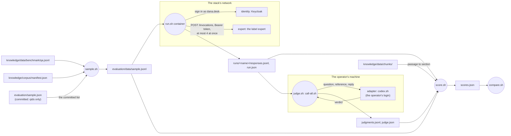

# Evaluation

A harness that measures the label expert ([expert-agent.md](expert-agent.md)) on a fixed sample of FDARxBench questions, so that the retrieval service's four strategies ([knowledge.md](knowledge.md)) can be compared on the same questions. It calls the agent exactly as a client does and never reaches inside it. The commands are in [evaluation/README.md](../../evaluation/README.md).

## Terms

| Term | Meaning |
|---|---|
| Benchmark | FDARxBench's questions over the corpus's labels (`knowledge/data/benchmark/qa.jsonl`): 17,207 questions, each with `qid`, `set_id`, `question`, `answer`, `references` (the section names the answer comes from) and `question_type` (`factual`, `numeric`, `list`, `multihop`, `refusal`) |
| Refusal question | A question the label cannot answer: its benchmark answer is "Information not found!" |
| Answerable question | Any other question |
| Sample | The questions drawn by `sample.sh`: 250 by default (refusal 60, factual 100, multihop 40, numeric 25, list 25) |
| Run | One pass of the sample through the agent under one search strategy, named by the operator |
| Record | One call: the qid, when it was sent, its duration, its status, whether the response kept to the contract, the reason it failed, and the response whole |
| Call failure | A call with no answer in 185 s, a status other than 200, a body that is not JSON, or an answer outside the agent contract |
| Declined | A completed response whose `label_answer` is not `answered` |
| Judge | A model that grades a reply against the benchmark's answer, reached through an adapter command |

## What each stage reads and writes

| Stage | Runs in | Reads | Writes |
|---|---|---|---|
| `sample.sh` | The piece's image, no network | `knowledge/data/benchmark/qa.jsonl`, `knowledge/corpus/manifest.json`, `evaluation/sample.json` | `evaluation/data/sample.jsonl`; with `--record`, `evaluation/sample.json` |
| `run.sh` | The piece's image, on the stack's network | The sample; the identity provider (to sign in); the label expert | `responses.jsonl`, `run.json` |
| `score.sh` | The piece's image, no network | The sample, the run, the chunks (`knowledge/data`, for each passage's section), the judgments and the filled check file if present | `scores.json` |
| `compare.sh` | The piece's image, no network | Two runs' `run.json` and `scores.json` | `compare-<run-a>.json` beside run B |
| `judge.sh` | The image for writing requests and reading verdicts; the operator's machine for the calls | The sample, the run, the adapter's answers | `judgments.jsonl`, `judge.json`; with `--check`, `judge-check.csv` |

## The sample

Only questions whose label is in the corpus manifest are drawn. For each question type, in a fixed order, the eligible qids are sorted and shuffled by Fisher-Yates with a stream of numbers made from SHA-256 of the seed, the type and a counter; the first *n* are taken. The same benchmark file, manifest and settings always give the same sample. The committed `evaluation/sample.json` holds the list of qids and the hashes of the files it was drawn from, and `sample.sh` fails when its draw differs from that list. A stratum with fewer eligible questions than asked fails, naming it.

## The measures

All are computed in code from the sample, the run's last record for each qid, and the chunks; every share is reported with its numerator, its denominator and a 95% Wilson score interval, and marked too few to read under 20 items.

| Measure | Over | Counted when |
|---|---|---|
| Outcomes | All sampled questions | Each response's `outcome` (`completed`, `stopped`, `failed`); a question whose call failed is a call failure |
| Stop reasons | Stopped and failed runs | Each distinct `stop_reason` (a sentence the agent's code writes, holding no label text), with its count |
| Label answers | All sampled questions | Each `label_answer`; "none" when there is none |
| Refusal questions declined | Refusal questions | The response is declined |
| Answerable questions answered | Answerable questions | `label_answer` is `answered` |
| Declined that were refusal | Declined questions | The question is a refusal question |
| Right label | Questions answered | There is at least one citation, and every citation's `set_id` is the question's |
| Citation precision, by section | Distinct cited passages of answered answerable questions with references | The passage's section matches a reference |
| Citation recall, by section | References of answered answerable questions | Some cited passage's section matches that reference |
| Retrieval, any search | Answerable questions with references | A passage shown to the model in any retrieval step is of a section matching a reference |
| Retrieval, first search | The same | The same, in the first retrieval step |
| Numbers | Numeric questions answered whose benchmark answer holds a number | Every number in the benchmark's answer is a number in the reply, read by the expert's own rule (`numbersIn` in `agents/src/expert/checks.ts`) |
| Effort | Questions with a response | Searches (retrieval steps), corrections (refused `answer` or `cannot_answer` calls), seconds (the call's duration), tokens in and out (summed over model steps): median and 95th percentile |
| Correct, partly correct, incorrect | Judged questions, all and by type | The judge's verdict. A question whose reference answer holds no letter (only section numbers and punctuation) gives no fact to grade against: it is not judged, a judgment stored for it is not counted, and the table says how many were left out |
| Judge agreement | Items a person graded in the check file that the judge also graded | The judge's verdict equals the person's |

The table also gives, of the cited passages the two citation measures read (each distinct cited passage of each answered answerable question with references: the precision's denominator), how many have neither a section number nor a title to match on, or are in no chunk. Each of those counts as not matching in precision and can cite no reference in recall.

A section matches a reference by the rule the knowledge gate uses, shared from `knowledge/src/references.ts`: the section's number equals the number the reference starts with, or its title equals the reference, ignoring case and spacing. A passage's section is read from the chunk with that passage id. A reference given as one string is taken as a list of one.

`compare.sh` pairs the yes-or-no measures question by question (declined rightly, right label, retrieved in any search, in the first, numbers, judged correct): both right, only A, only B, neither, and the exact two-sided sign test on only A against only B. It refuses runs made on different samples.

## Who decides what

| Decision | Decided by | Held in check by |
|---|---|---|
| Which questions are asked | Code: the seeded draw | The committed list of qids; the draw fails when it differs |
| How the agent answers | The agent | Nothing here: the harness records what came back |
| Whether a call failed | Code | The agent contract's schema, the status, the time limit |
| What counts as right, for every measure but correctness | Code | The definitions above, and tests Q07 to Q09 |
| Whether an answer is correct | The judge (a model) | Its agreement with a person, measured on a check sample |

## Always true

1. The harness calls the agent as a client does: `POST /invocations`, the agent contract's request, a real bearer token got by signing in. It reads only the response.
2. A token is replaced before it has under 200 s left, since an agent refuses one with under 150 s.
3. At most 4 calls to the agent, and at most 4 to the judge, are in flight at once.
4. Every call is recorded once with its result. A failed call is recorded with its reason and counted; it is sent again only when the operator asks. Nothing is retried quietly or dropped.
5. One run holds responses of one search strategy; a second strategy stops the run.
6. The judge is given the question, the benchmark's answer and the reply without citation markers, and nothing else. A judge call that fails or answers outside the schema is recorded as a failure, never guessed.
7. No question, answer, reply or judge's reason is written to a tracked file or printed. The data folder holding them is ignored by git and kept out of every image.
8. Every figure is reported with its count and its interval.
9. The same benchmark file, manifest and settings give the same sample.

## How each command fails

| Failure | Result |
|---|---|
| The benchmark file or manifest missing or not readable; a line not JSON or not a benchmark question | `sample.sh` exits 2, naming the file and line, quoting nothing |
| A stratum with too few questions | `sample.sh` exits 2, naming the stratum |
| The draw differs from the committed list, or there is none | `sample.sh` exits 2 and says which |
| `platform/identity/.env` missing, the stack's network missing, sign-in failing | `run.sh` exits 2 |
| A call failure | Recorded with its reason; `run.sh` exits 1 |
| A 401 from the agent | Recorded as `status 401`, not retried |
| A run file made with another sample | `run.sh` exits 2 |
| Two strategies in one run | `run.sh` records the response, sends nothing more, and exits 2 |
| A run without `run.json`, or not scored | `score.sh` or `compare.sh` exits 2 |
| Two runs on different samples | `compare.sh` exits 2 |
| The adapter cannot describe itself | `judge.sh` exits 2 |
| A judge call that exits non-zero, runs out of its 300 s, or answers outside the schema | Recorded as a failure; `judge.sh` exits 1 |
| A check file with a verdict that is not one of the three | `score.sh` exits 2, naming the row |

## The numbers, and where each is set

| Number | Value | Set in |
|---|---|---|
| Sample size by type, and the seed | refusal 60, factual 100, multihop 40, numeric 25, list 25; 20261122 | `evaluation/sample.json` |
| Calls to the agent at once; one call's time limit | 4; 185 s | `evaluation/src/run.ts` |
| A token replaced when it has less than | 200 s | `evaluation/src/sign-in.ts` |
| Judge calls at once; one call's time limit | 4; 300 s | `evaluation/judge.sh` |
| The judge's model and effort | `gpt-6-astra`, `high` | `evaluation/judge/codex.sh` |
| Too few to read | under 20 | `evaluation/src/stats.ts` |
| Check items, and their seed | as asked; 20261123 | `evaluation/judge.sh --check`, `evaluation/src/judge.ts` |

## Measured by the planner, 2026-11-22

Two runs of the 250 sampled questions on a trial stack from this repository, with the real chat model (qwen3.5-9b), the real embedding model and reranker, and the 640-label index with vectors: `keyword`, then `fused_reranked`. Each: 250 sent, 250 responses, no call failure, about 13 and 17 minutes at 4 at once. Every command ran end to end on macOS; the judge (`codex`, `gpt-6-astra`, effort `high`) graded 158 and 160 answers with no failure.

| Measure | `keyword` | `fused_reranked` |
|---|---|---|
| Completed; stopped | 231; 19 | 234; 16 |
| Refusal questions declined | 57 of 60 [86.3%, 98.3%] | 56 of 60 [84.1%, 97.4%] |
| Answerable questions answered | 158 of 190 [77.2%, 87.8%] | 160 of 190 [78.4%, 88.7%] |
| Answered, every citation from the right label | 148 of 160 [87.3%, 95.7%] | 155 of 164 [89.9%, 97.1%] |
| Cited sections that match a reference | 124 of 274 [39.5%, 51.2%] | 129 of 293 [38.5%, 49.8%] |
| References cited | 115 of 189 [53.7%, 67.5%] | 123 of 190 [57.7%, 71.2%] |
| A referenced section shown, first search | 125 of 190 [58.8%, 72.2%] | 140 of 190 [67.0%, 79.4%] |
| A referenced section shown, any search | 134 of 190 [63.7%, 76.6%] | 143 of 190 [68.7%, 80.9%] |
| Numeric answered, every reference number given | 18 of 21 [65.4%, 95.0%] | 19 of 20 [76.4%, 99.1%] |
| Left out of judging: the reference answer holds no letter | 3 | 3 |
| Judged correct, partly correct, incorrect | 96, 49, 10 of 155 | 97, 51, 9 of 157 |

Paired, both / only `keyword` / only `fused_reranked` / neither, sign test: first-search retrieval 120 / 5 / 20 / 45, p = 0.0041; any-search retrieval 129 / 5 / 14 / 42, p = 0.0636; declined rightly 200 / 15 / 16 / 19, p = 1; judged correct 84 / 8 / 7 / 45, p = 1. The full table, with every measure, is in [evaluation/README.md](../../evaluation/README.md#measured-by-the-planner-2026-11-22).

Readings, stated as readings: reranking put a referenced section in the first search more often (20 questions against 5); it changed neither whether the agent answers nor how often the judge calls the answer correct; 7% of runs with `keyword` and 6% with `fused_reranked` (18 and 16 of 250) ended with no reply because an answer did not pass the checks after 2 corrections.

## Not present

- A judge of answer correctness is a model and can be wrong. That is why its agreement with a person is measured on a check sample, and why every other measure is computed in code.
- Multi-hop questions are scored like any other: nothing checks that an answer joins more than one section.
- The benchmark's references name sections, so citation and retrieval scores are by section, not by passage. A cited passage from the right section counts even if another passage of that section held the answer.
- Nothing here measures latency under load: calls are at most 4 at once, and the seconds reported are each call's own.
- Only one agent is evaluated: the label expert.
- The judge has not been checked against a person: the 40-item check file is written and not filled in.
- One run of each strategy: run-to-run variation is not measured.
- The sample is 250 of the benchmark's 17,207 questions.
