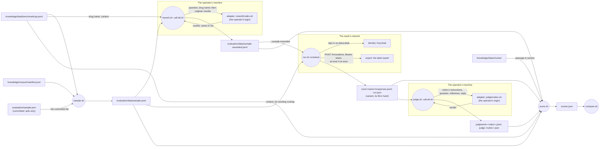
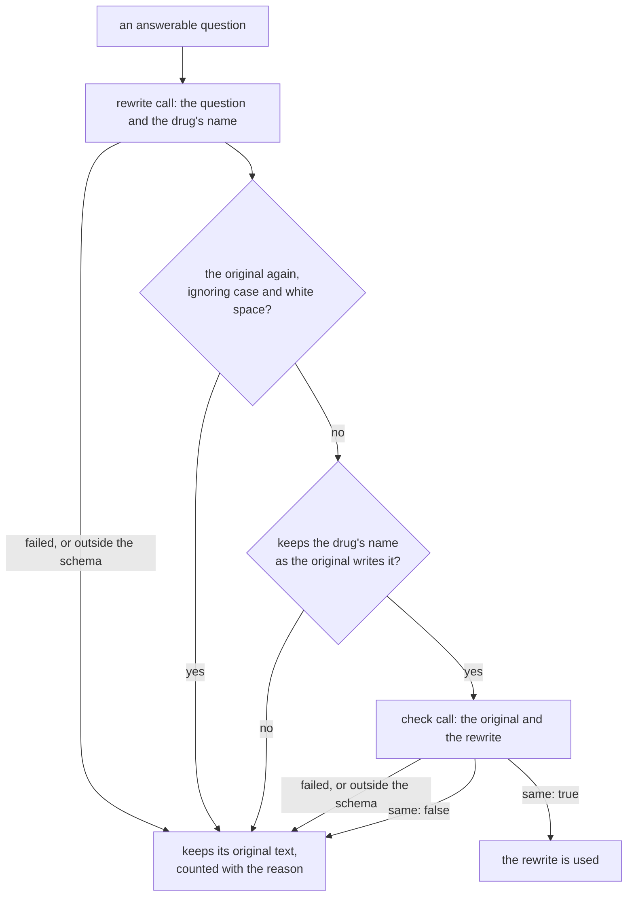

# Evaluation

A harness that measures the label expert ([expert-agent.md](expert-agent.md)) on a fixed sample of FDARxBench questions, so that the retrieval service's four strategies ([knowledge.md](knowledge.md)) can be compared on the same questions, in the benchmark's wording or reworded. It calls the agent exactly as a client does and never reaches inside it. The commands are in [evaluation/README.md](../../evaluation/README.md).

## Terms

| Term | Meaning |
|---|---|
| Benchmark | FDARxBench's questions over the corpus's labels (`knowledge/data/benchmark/qa.jsonl`): 17,207 questions, each with `qid`, `set_id`, `question`, `answer`, `references` (the section names the answer comes from), `question_type` (`factual`, `numeric`, `list`, `multihop`, `refusal`), `drug_name`, and `context` (the passages the question was written from) |
| Refusal question | A question the label cannot answer: its benchmark answer is "Information not found!" |
| Answerable question | Any other question |
| Sample | The questions drawn by `sample.sh`: 250 by default (refusal 60, factual 100, multihop 40, numeric 25, list 25) |
| Variant | The wording a run sends: `original` (the sample as drawn) or `reworded` (the reworded sample) |
| Reworded sample | The same questions, qids, answers and references, with each answerable question's text rewritten by `reword.sh` where the rewrite passed its checks; refusal questions copied |
| Run | One pass of one variant of the sample through the agent under one search strategy, named by the operator |
| Record | One call: the qid, when it was sent, its duration, its status, whether the response kept to the contract, the reason it failed, and the response whole |
| Call failure | A call with no answer in 185 s, a status other than 200, a body that is not JSON, or an answer outside the agent contract |
| Declined | A completed response whose `label_answer` is not `answered` |
| Judge | A model that grades a reply under a rubric, reached through an adapter command |
| Rubric | A name, the instructions the judge is given, and the schema its verdict must keep to: `answers-question` or `completeness` |
| Rewriter, checker | A model that rewrites a question, and the same adapter asked whether a rewrite asks the same thing as the original |
| Content words | A question's distinct words, lower-cased, of three letters or more, not in the fixed stop-word list and not a word of the drug's name; a word is a run of letters, so a number is not one |
| Wording overlap | The share of a question's content words that are words of its benchmark `context` (the text of every entry); none for a question with no content words |
| Third | The lowest, middle or highest third of the answerable questions by wording overlap, cut at the sample's own values |

## What each stage reads and writes

| Stage | Runs in | Reads | Writes |
|---|---|---|---|
| `sample.sh` | The piece's image, no network | `knowledge/data/benchmark/qa.jsonl`, `knowledge/corpus/manifest.json`, `evaluation/sample.json` | `evaluation/data/sample.jsonl`; with `--record`, `evaluation/sample.json` |
| `reword.sh` | The image for writing requests and reading answers; the operator's machine for the calls | The sample, the benchmark (each question's drug name and context), the adapter's answers | `evaluation/data/sample-reworded.jsonl`, `sample-reworded.json`; with `--check`, `reword-check.csv` |
| `run.sh` | The piece's image, on the stack's network | The variant's file; the identity provider (to sign in); the label expert | `responses.jsonl`, `run.json` |
| `score.sh` | The piece's image, no network | The run's variant's file, the run, the chunks (`knowledge/data`, for each passage's section), the benchmark (for wording overlap), each rubric's judgments and filled check file if present | `scores.json` |
| `compare.sh` | The piece's image, no network | Two runs' `run.json` and `scores.json` | `compare-<run-a>.json` beside run B |
| `judge.sh` | The image for writing requests and reading verdicts; the operator's machine for the calls | The run's variant's file, the run, the adapter's answers | `judgments-<rubric>.jsonl`, `judge-<rubric>.json`; with `--check`, `judge-check-<rubric>.csv` |

## The sample

Only questions whose label is in the corpus manifest are drawn. For each question type, in a fixed order, the eligible qids are sorted and shuffled by Fisher-Yates with a stream of numbers made from SHA-256 of the seed, the type and a counter; the first *n* are taken. The same benchmark file, manifest and settings always give the same sample. The committed `evaluation/sample.json` holds the list of qids and the hashes of the files it was drawn from, and `sample.sh` fails when its draw differs from that list. A stratum with fewer eligible questions than asked fails, naming it.

## The reworded sample

- The rewriter is asked to rewrite the question as a clinician or pharmacist would ask it in their own words: the same meaning, the drug's name kept exactly as the question writes it, numbers and units kept, and otherwise different words wherever plain clinical or everyday words exist.
- The drug's name is kept when the original names the drug (the benchmark's `drug_name`, ignoring case) and the rewrite holds the name spelled as the original spells it. A question that does not name the drug has no name to keep. A rewrite that loses the name is not sent to the checker.
- A rewrite that is the original again, ignoring case and white space, is not a rewrite: the question keeps its original text, counted with that reason, and the checker is not asked.
- Refusal questions are copied unchanged. Every line of the file says whether it was reworded and, if not, why.
- `sample-reworded.json` records the rewriter, its model and effort, the SHA-256 of both instructions, of the sample it was made from and of the file, the counts, and the wording overlap before and after (the median, and how many questions fall in each of the original wording's thirds).
- `reword.sh` refuses to run when the file exists, since runs are pinned to it by its hash.

## The measures

All are computed in code from the run's variant's file, the run's last record for each qid, the chunks, and the benchmark's context; every share is reported with its numerator, its denominator and a 95% Wilson score interval, and marked too few to read under 20 items.

| Measure | Over | Counted when |
|---|---|---|
| Outcomes | All sampled questions | Each response's `outcome` (`completed`, `stopped`, `failed`); a question whose call failed is a call failure |
| Stop reasons | Stopped and failed runs | Each distinct `stop_reason` (a sentence the agent's code writes, holding no label text), with its count |
| Label answers | All sampled questions | Each `label_answer`; "none" when there is none |
| Refusal questions declined | Refusal questions | The response is declined |
| Answerable questions answered | Answerable questions | `label_answer` is `answered` |
| Declined that were refusal | Declined questions | The question is a refusal question |
| Right label | Questions answered | There is at least one citation, and every citation's `set_id` is the question's |
| Citation precision, by section | Distinct cited passages of answered answerable questions with references | The passage's section matches a reference |
| Citation recall, by section | References of answered answerable questions | Some cited passage's section matches that reference |
| Retrieval, any search | Answerable questions with references | A passage shown to the model in any retrieval step is of a section matching a reference |
| Retrieval, first search | The same | The same, in the first retrieval step |
| Numbers | Numeric questions answered whose benchmark answer holds a number | Every number in the benchmark's answer is a number in the reply, read by the expert's own rule (`numbersIn` in `agents/src/expert/checks.ts`) |
| Effort | Questions with a response | Searches (retrieval steps), corrections (refused `answer` or `cannot_answer` calls), seconds (the call's duration), tokens in and out (summed over model steps): median and 95th percentile |
| Answers the question, uncontradicted (rubric `answers-question`) | Questions judged under the rubric, all and by type | The verdict's `answers` is `yes` and its `contradicts` is false: both are needed |
| Contradicts the reference (rubric `answers-question`) | The same | `contradicts` is true |
| Coverage: all, some, none (rubric `answers-question`) | The same | `coverage` is that value, each its own share |
| Correct, partly correct, incorrect (rubric `completeness`) | Questions judged under the rubric, all and by type | The verdict |
| Judge agreement, per rubric | Items a person graded in the rubric's check file that the judge also graded | `completeness`: the judge's verdict equals the person's. `answers-question`: the judge and the person agree on "answers the question, uncontradicted" (a row counts when both its person columns are filled) |
| Wording overlap | Answerable questions | Its median; the cut points of the thirds; how many questions have no content words |
| Retrieval, first and any search, and answers the question uncontradicted, by third | Answerable questions in each third | As above, within the third |

A question whose reference answer holds no letter (only section numbers and punctuation) gives no fact to grade against: it is not judged under either rubric, a judgment stored for it is not counted, and the table says how many were left out.

The table also gives, of the cited passages the two citation measures read (each distinct cited passage of each answered answerable question with references: the precision's denominator), how many have neither a section number nor a title to match on, or are in no chunk. Each of those counts as not matching in precision and can cite no reference in recall.

A section matches a reference by the rule the knowledge gate uses, shared from `knowledge/src/references.ts`: the section's number equals the number the reference starts with, or its title equals the reference, ignoring case and spacing. A passage's section is read from the chunk with that passage id. A reference given as one string is taken as a list of one.

The wording overlap is that of the text the run sent: a reworded question's overlap is its rewrite's. Of the *n* overlaps sorted, the first cut point is the value at rank ceil(*n*/3) and the second the value at rank ceil(2*n*/3). A question is in the lowest third at or below the first cut, the middle third above it and at or below the second, the highest third above the second. A tie at a cut falls to the lower third, so thirds can differ in size; the table prints each third's range and size. The stop-word list is fixed in `evaluation/src/overlap.ts`.

`compare.sh` pairs the yes-or-no measures question by question (declined rightly, right label, retrieved in any search, in the first, numbers, judged correct under `completeness`, answers the question uncontradicted under `answers-question`): both right, only A, only B, neither, and the exact two-sided sign test on only A against only B. Then it pairs the two retrieval measures and "answers the question, uncontradicted" within each third of wording overlap, as run A's scores cut them. It accepts two runs whose question ids are the same set, whatever their variants, and says which variants it compared; two runs on the same variant must have been made on the same file. With `--only-reworded` it pairs only the questions actually reworded, taken from the reworded run's scores.

## Who decides what

| Decision | Decided by | Held in check by |
|---|---|---|
| Which questions are asked | Code: the seeded draw | The committed list of qids; the draw fails when it differs |
| How a question is worded in the reworded sample | The rewriter (a model) | Code: the drug's name kept; the checker (a model): asks the same thing; a person's reading of the check file |
| How the agent answers | The agent | Nothing here: the harness records what came back |
| Whether a call failed | Code | The agent contract's schema, the status, the time limit |
| What counts as right, for every measure but the judged ones | Code | The definitions above, and tests Q07 to Q09 and Q17 |
| Whether an answer answers the question, or is correct | The judge (a model), under a rubric | Its agreement with a person, measured on a check sample per rubric |

## Always true

1. The harness calls the agent as a client does: `POST /invocations`, the agent contract's request, a real bearer token got by signing in. It reads only the response.
2. A token is replaced before it has under 200 s left, since an agent refuses one with under 150 s.
3. At most 4 calls to the agent, and at most 4 to the judge or the rewriter, are in flight at once.
4. Every call is recorded once with its result. A failed call is recorded with its reason and counted; it is sent again only when the operator asks. Nothing is retried quietly or dropped.
5. One run holds responses of one search strategy and one variant; a second strategy stops the run, and the other variant is refused.
6. The judge is given the rubric's instructions, the question the run sent, the benchmark's answer and the reply without citation markers, and nothing else. A judge call that fails or answers outside the rubric's schema is recorded as a failure, never guessed.
7. The rewriter is given the question and the drug's name; the checker the original and the rewrite; nothing else. A rewrite is used only when it keeps the drug's name and the checker answers that it asks the same thing; any failure keeps the original text, counted with its reason.
8. A run records its variant and the SHA-256 of that variant's file; scoring and judging refuse a run whose file has changed since.
9. No question, answer, reply, rewrite or model's reason is written to a tracked file or printed. The data folder holding them is ignored by git and kept out of every image.
10. Every figure is reported with its count and its interval.
11. The same benchmark file, manifest and settings give the same sample.
12. Judgments are stored per rubric. A run folder's judgments from before rubrics existed are read as the completeness rubric's and never rewritten or deleted.

## How each command fails

| Failure | Result |
|---|---|
| The benchmark file or manifest missing or not readable; a line not JSON or not a benchmark question | `sample.sh` exits 2, naming the file and line, quoting nothing |
| A stratum with too few questions | `sample.sh` exits 2, naming the stratum |
| The draw differs from the committed list, or there is none | `sample.sh` exits 2 and says which |
| The reworded sample exists already | `reword.sh` exits 2 |
| The benchmark file lacks a sampled qid, or a line has no `drug_name` or `context` | `reword.sh` or `score.sh` exits 2, counting, quoting nothing |
| A rewrite or check call that exits non-zero, runs out of its 300 s, or answers outside its schema | The question keeps its original text, counted with the reason; `reword.sh` exits 1 |
| A rewrite that loses the drug's name or is the original again, or a checker's `same: false` | The question keeps its original text, counted with the reason; not a failure |
| `platform/identity/.env` missing, the stack's network missing, sign-in failing | `run.sh` exits 2 |
| `--sample reworded` with no reworded sample | `run.sh` exits 2 |
| A call failure | Recorded with its reason; `run.sh` exits 1 |
| A 401 from the agent | Recorded as `status 401`, not retried |
| A run file made with another sample, or on the other variant | `run.sh` exits 2 |
| Two strategies in one run | `run.sh` records the response, sends nothing more, and exits 2 |
| A run without `run.json`, or not scored | `score.sh` or `compare.sh` exits 2 |
| A run scored before variants and wording overlap existed | `compare.sh` reads it as a run on the original sample, and says it has no thirds |
| The run's variant file changed since the run | `score.sh` and `judge.sh` exit 2 |
| Two runs on different sets of question ids, or on the same variant with different files | `compare.sh` exits 2 |
| `--only-reworded` with no run on the reworded sample | `compare.sh` exits 2 |
| The adapter cannot describe itself | `judge.sh` or `reword.sh` exits 2 |
| A judge call that exits non-zero, runs out of its 300 s, or answers outside the rubric's schema | Recorded as a failure; `judge.sh` exits 1 |
| A check file with a person's value outside the rubric's, or one of the two answers-question columns filled alone | `score.sh` exits 2, naming the row |

## The numbers, and where each is set

| Number | Value | Set in |
|---|---|---|
| Sample size by type, and the seed | refusal 60, factual 100, multihop 40, numeric 25, list 25; 20261122 | `evaluation/sample.json` |
| Calls to the agent at once; one call's time limit | 4; 185 s | `evaluation/src/run.ts` |
| A token replaced when it has less than | 200 s | `evaluation/src/sign-in.ts` |
| Judge calls at once; one call's time limit | 4; 300 s | `evaluation/judge.sh` |
| Rewriter and checker calls at once; one call's time limit | 4; 300 s | `evaluation/reword.sh` |
| The judge's model and effort | `gpt-6-astra`, `high` | `evaluation/judge/codex.sh` |
| The rewriter's and checker's model and effort | `gpt-6-astra`, `high` | `evaluation/reword/codex.sh` |
| The default rubric | `answers-question` | `evaluation/judge.sh` |
| Content words: shortest word; the stop words | 3 letters; a fixed list | `evaluation/src/overlap.ts` |
| Too few to read | under 20 | `evaluation/src/stats.ts` |
| Judge check items, and their seed | as asked; 20261123 | `evaluation/judge.sh --check`, `evaluation/src/judge.ts` |
| Reworded pairs for a person, and their seed | as asked; 20261124 | `evaluation/reword.sh --check`, `evaluation/src/reword.ts` |

## Measured by the planner, 2026-11-22

Two runs of the 250 sampled questions on a trial stack from this repository, with the real chat model (qwen3.5-9b), the real embedding model and reranker, and the 640-label index with vectors: `keyword`, then `fused_reranked`. Each: 250 sent, 250 responses, no call failure, about 13 and 17 minutes at 4 at once. Every command ran end to end on macOS; the judge (`codex`, `gpt-6-astra`, effort `high`) graded 158 and 160 answers with no failure, under the `completeness` rubric.

| Measure | `keyword` | `fused_reranked` |
|---|---|---|
| Completed; stopped | 231; 19 | 234; 16 |
| Refusal questions declined | 57 of 60 [86.3%, 98.3%] | 56 of 60 [84.1%, 97.4%] |
| Answerable questions answered | 158 of 190 [77.2%, 87.8%] | 160 of 190 [78.4%, 88.7%] |
| Answered, every citation from the right label | 148 of 160 [87.3%, 95.7%] | 155 of 164 [89.9%, 97.1%] |
| Cited sections that match a reference | 124 of 274 [39.5%, 51.2%] | 129 of 293 [38.5%, 49.8%] |
| References cited | 115 of 189 [53.7%, 67.5%] | 123 of 190 [57.7%, 71.2%] |
| A referenced section shown, first search | 125 of 190 [58.8%, 72.2%] | 140 of 190 [67.0%, 79.4%] |
| A referenced section shown, any search | 134 of 190 [63.7%, 76.6%] | 143 of 190 [68.7%, 80.9%] |
| Numeric answered, every reference number given | 18 of 21 [65.4%, 95.0%] | 19 of 20 [76.4%, 99.1%] |
| Left out of judging: the reference answer holds no letter | 3 | 3 |
| Judged correct, partly correct, incorrect | 96, 49, 10 of 155 | 97, 51, 9 of 157 |

Paired, both / only `keyword` / only `fused_reranked` / neither, sign test: first-search retrieval 120 / 5 / 20 / 45, p = 0.0041; any-search retrieval 129 / 5 / 14 / 42, p = 0.0636; declined rightly 200 / 15 / 16 / 19, p = 1; judged correct 84 / 8 / 7 / 45, p = 1. The full table, with every measure, is in [evaluation/README.md](../../evaluation/README.md#measured-by-the-planner-2026-11-22).

Readings, stated as readings: reranking put a referenced section in the first search more often (20 questions against 5); it changed neither whether the agent answers nor how often the judge calls the answer correct; 7% of runs with `keyword` and 6% with `fused_reranked` (18 and 16 of 250) ended with no reply because an answer did not pass the checks after 2 corrections.

## Measured with the answers-question rubric and the reworded sample

Not measured yet. The planner records here the runs judged under `answers-question`, the measures by thirds of wording overlap, and the runs on the reworded sample, each with the command and the hardware it was measured on.

## Not present

- A judge is a model and can be wrong, under either rubric. That is why its agreement with a person is measured on a check sample per rubric, and why every other measure is computed in code.
- A rewrite is a model's, and is checked only by a model (the checker) and a person's spot check of the pairs `reword.sh --check` writes. Nothing in code checks that a rewrite keeps the meaning, beyond the drug's name.
- Rewrites are not committed (they hold question text), so the reworded sample is pinned by its file's hash in each run, not reproducible from the repository alone: running `reword.sh` again gives other rewrites.
- Multi-hop questions are scored like any other: nothing checks that an answer joins more than one section.
- The benchmark's references name sections, so citation and retrieval scores are by section, not by passage. A cited passage from the right section counts even if another passage of that section held the answer.
- Nothing here measures latency under load: calls are at most 4 at once, and the seconds reported are each call's own.
- Only one agent is evaluated: the label expert.
- The judge has not been checked against a person: the 40-item check file is written and not filled in.
- One run of each strategy: run-to-run variation is not measured.
- The sample is 250 of the benchmark's 17,207 questions.
