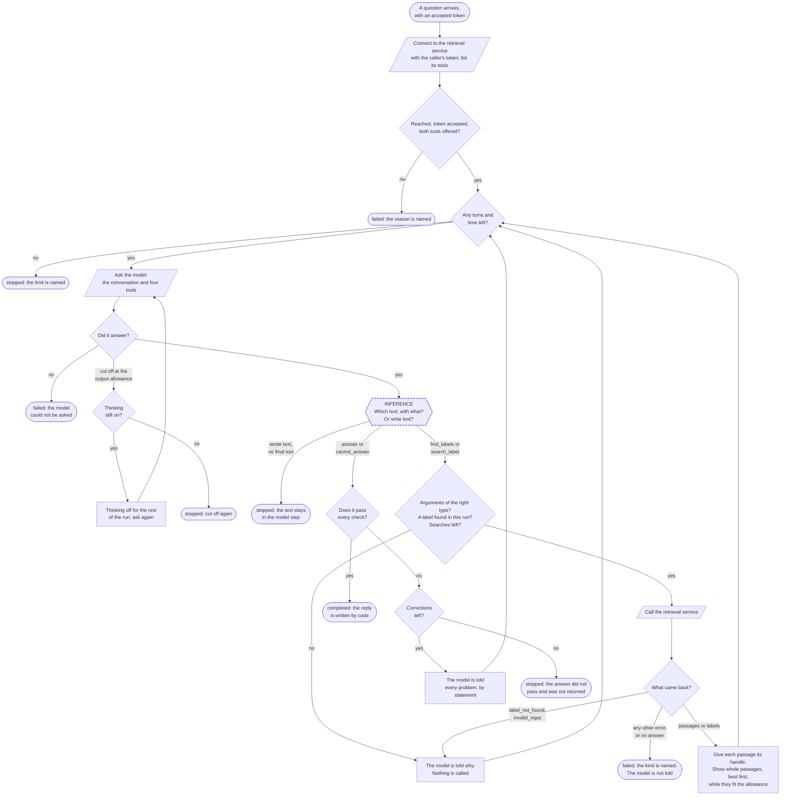

# Label expert, on Strands

One agent in one container. It receives a question about a medicine and answers it only from the text of that medicine's approved label, as the [retrieval service](knowledge.md#search-and-retrieval) returns it. Every statement it returns has been checked in code against the passage it cites. It writes nowhere: it calls the model and the retrieval service's two tools, nothing else. To run it, see [agents/README.md](../../agents/README.md).

It serves the same contract as the intake agents, through the same startup (`run/serve.ts`), on AWS's SDK server behind the local edge, as the intake agent on Strands does ([agent-runtime.md](agent-runtime.md)). Its loop is Strands', used as the [intake agent on Strands](intake-agent-strands.md) uses it.

## Terms

| Term | Meaning |
|---|---|
| Label | One approved drug label, one version of it, identified by its set id |
| Passage | One chunk of a label's text, as `search_label` returns it: its text, section, part (body or Highlights), type and the label's version, date and page |
| Handle | The short name the model is shown for a passage: `P1`, `P2`, … in the order first seen in the run. A passage seen again keeps its handle |
| Shown | A passage whose whole text the model was given. Only a shown passage can be cited |
| Reading allowance | The characters of passage text the model may be shown in one run |
| Statement | One sentence of an answer, with the handles it cites and a quote |
| Quote | One continuous span copied from one cited passage |
| Final tool | `answer` or `cannot_answer`. Once one is accepted the run ends |
| Correction | A final tool that was not accepted, told to the model with every problem found |
| Label answer | `label_answer` in the response: `answered`, `no_label`, `label_does_not_answer` or `not_a_label_question`. Set on every completed run, absent otherwise |

## Modules and what each owns

| Module | Owns | Knows nothing about |
|---|---|---|
| `expert/main.ts` | Starting the agent through `run/serve.ts` on the AgentCore SDK server; this agent's output allowance | The rules of a run |
| `expert/serve.ts` | Reading `KNOWLEDGE_MCP_URL`, beside what `run/serve.ts` reads | Everything else |
| `expert/settings.ts` | Every number of this agent: limits, output allowance, searches, reading allowance, answer limits | Where they are used |
| `expert/prompt.ts` | What the model is told, and the message laid out for it (its text only, inside `<message>`) | Everything else |
| `expert/strands.ts` | The run: the four tools, the hooks, which calls are made, what the model is shown, how the run ends, the reply | HTTP, the token check, the search engine |
| `expert/checks.ts` | Whether a final tool is accepted, and the reply it gives. Pure functions | Strands, the retrieval service, the clock |
| `expert/retrieval.ts` | How an answer of the retrieval service is read, the sentence for each way it fails, how a section is named | The model, the loop |
| `tools/mcp-answers.ts` (shared with the intake agents) | Reading why connecting to an MCP service failed and the payload of a tool result, in the words of the service named | Which service, the model, the loop |
| `run/*`, `contract/sdk-app.ts`, `contract/edge.ts`, `contract/runtime.ts`, `contract/runtime-contract.ts`, `model/served.ts` (shared) | The state every run keeps, the record, the shared endings, startup, the HTTP contract on the SDK server, the wording of a model failure | This agent |

The shared endings in `run/endings.ts` take no `label_answer`. `expert/strands.ts` adds it to a completed response, and gives its three `stopped` endings of its own to the shared `stopped(run, reason)`.

## One message

A six-sided box is decided by inference. A diamond is decided by code. A slanted box is a message sent to another actor. A rounded box is an ending.

Two calls asked for in one turn are run one at a time, in order, so a search on a label the same turn's `find_labels` returned is made after it. Once a final tool is accepted, or a search fails, the run is stopped through a cancel signal: anything else asked for in that turn is not called and the model is not asked again.

## Who decides what

| Decision | Decided by | Held in check by |
|---|---|---|
| Whether the message asks what a label says, or reports something | Inference | The prompt. No code checks it |
| Which drug name to look up | Inference | The retrieval service: exact names first, then every word |
| Which of several matching labels to search | Inference | Nothing. Visible in the citations, which name the label |
| Whether a search is made | Code | `SearchLabelTool` in `expert/strands.ts`: the set id must be one `find_labels` returned in this run; at most 4 searches |
| What the model is shown of a passage | Code | The reading allowance; whole passages only |
| Whether a search that could not be made ends the run | Code | `readAnswer` in `expert/retrieval.ts`: only `label_not_found` and `invalid_input` are told to the model; every other answer fails the run |
| What each statement says | Inference | `checkAnswer` in `expert/checks.ts`: citations, quote, numbers, units |
| Whether a reason for not answering stands | Inference proposes it | `checkCannotAnswer`: `no_label` only after every `find_labels` answered with no label; `label_does_not_answer` only after a search was answered |
| What the reply says | Code | Accepted statements and code's own sentences only |
| How the run ends | Code | The endings in `run/endings.ts` and `expert/strands.ts` |

## What code checks about an answer

For each statement, in this order; every problem is told to the model at once, by statement number:

1. The text is not empty, at least one passage is cited, and every handle cited was shown in this run.
2. The quote is 15 to 600 characters and is found in one cited passage. Both sides are compared after removing footnote marks (`[^…]`), turning each run of white space into one space, and ignoring case. Nothing else is forgiven.
3. Every number in the text is a number in a cited passage. A number is a run of digits with an optional decimal part. Before comparing, on both sides: footnote marks are removed, `^{x}` and `_{x}` become `x`, and thousands separators are removed.
4. A number in the text followed by a unit from the closed list (mcg, µg, mg, g, kg, mL, L, %, IU, unit, units, mEq, mmol; one space between is allowed) needs that unit somewhere in a cited passage, ignoring case. `%` also matches `percent`; `unit` and `units` match each other; µ (micro sign) and μ (Greek mu) are the same letter.

No statements, or more than 8, is a problem. Only a passage's text is compared, never its handle, its label's names or its section path.

What the model is told when an answer does not pass, one line per problem, each naming its statement. Nothing of a passage's text is put into the message beyond the model's own quote words that matched:

| Problem | What the model is told |
|---|---|
| A cited handle was not shown | "it cites P5, which is not a passage shown to you." |
| The quote is too short or too long | "its quote is 14 characters; a quote must be 15 to 600." |
| The quote is in a shown passage the statement does not cite | "its quote is in P2, which the statement does not cite. Cite P2 as well, or quote from a passage it cites." Every such passage is named |
| The quote is in no shown passage, and its start matches a cited passage | "its quote is not in P3 word for word. It matches as far as "…" and then the passage differs.", with the matching start of the quote, at most its last 12 words, from the cited passage it matches longest |
| The quote's first words are in no cited passage | "its quote is not in P3 word for word. Its first words are not in that passage." |
| The quote contains "..." | One more sentence: a quote is one continuous span, with nothing left out and no "..." |
| A number or a unit is not in a cited passage | "1300 is not written in P1."; "the unit mcg is not written in P1." |

After the problems, always one closing line: "Send the whole answer again, by calling answer, with these corrected. A statement that cannot be supported from the passages shown may be left out." A refused `cannot_answer` is told why and closes with "Call answer or cannot_answer again."

Readings chosen where the rules leave a choice, each pinned by a test:

| Question | Reading | Test |
|---|---|---|
| After a passage that does not fit, is a smaller one after it shown? | Yes. Each passage is judged on its own, best first | E11 |
| A passage shown in an earlier search comes back: is it `shown`? | Yes, and it is named as above, at no cost | E11 |
| Does a search the service refused count towards the 4? | Yes. Every call sent to the service counts; one refused before it is sent does not | E10, E13 |
| `10^{6}` in a text | Reads as `106`, on both sides alike | E22 |
| `mcg` against `µg` | Different units: neither finds the other | E22 |
| `g` inside `µg`, `L` inside `µL` | Not that unit: a unit is bounded by letters, µ and μ included | E22 |
| One space between a number and its unit | Read as that number's unit; two spaces are not | E22 |
| `unit` against `units` | Each finds the other | E22 |

## Always true

1. The agent writes nowhere. It calls the model and `find_labels` and `search_label`, and nothing else.
2. Text the model writes reaches the reply only as statements that passed every check. No other sentence of the reply carries model text: each is written by code, from what the retrieval service returned at most (a label's names, version and date), and so is every stop reason. What the model searched for is in its tool steps.
3. Every citation names the passage the quote was found in, and that passage's label, version, date and page, as the retrieval service returned them.
4. A search that could not be made is never told to the model and never repeated. An unknown error code, or an error the agent cannot read, counts as one.
5. The caller's token goes to the retrieval service on every request of the run. The model is given the message's text only: not the sender, not the receipt time.
6. No passage is cut. A passage is shown whole or named as not shown.
7. Runs share no state. A new Agent and a new MCP client are made for every message.

## How it ends

| Ending | When | Stop reason |
|---|---|---|
| `completed` | `answer` accepted | none. `label_answer` is `answered`; one citation per statement |
| `completed` | `cannot_answer` accepted | none. `label_answer` is the reason; no citations |
| `stopped` | The turn limit, or the time limit | The same sentences as the intake agents |
| `stopped` | A third final tool that does not pass | "The answer did not pass the checks after 2 corrections, and was not returned." |
| `stopped` | The model ended its turn with text and no final tool | Names the finish reason; the text stays in the model step |
| `stopped` | A turn cut off at the output allowance after the one retry with thinking off | Says so; nothing written is returned |
| `failed` | The model could not be asked | The same sentences as the intake agents |
| `failed` | The retrieval service could not be reached, refused the caller's token, could not check it, or does not offer both tools | One sentence each |
| `failed` | `find_labels` or `search_label` answered `index_not_built`, `search_timed_out`, `search_unreachable`, `search_error` or `search_unexpected_answer` | One sentence each |
| `failed` | Either tool answered an error code no list names | "The label search answered with an error this agent does not know: " and the code |
| `failed` | Either tool answered an error that is not `{ error, detail }`, or a success of a shape the agent does not expect | One sentence each |
| `failed` | No answer within the tool limit | Names the limit |

A `stopped` or `failed` run has no reply, no citations and no `label_answer`.

## The numbers, and where each is set

| Number | Value | Set in |
|---|---|---|
| Model turns in a run | 8 | `EXPERT_LIMITS`, `expert/settings.ts` |
| Time for a run | 150 s | `EXPERT_LIMITS` |
| Time for one model request | 90 s | `EXPERT_LIMITS` |
| Time for one tool call | 10 s | `EXPERT_LIMITS` |
| Output allowance | 4,096 tokens | `OUTPUT_ALLOWANCE`, `expert/settings.ts`; applied in `expert/main.ts` |
| Temperature and seed | shared | `run/sampling.ts` |
| Searches in a run | 4 | `EXPERT_SETTINGS.search`, `expert/settings.ts` |
| Passages asked for in each search | 5 | `EXPERT_SETTINGS.search` |
| Characters of each passage kept as the excerpt in a retrieval step | 300 | `EXCERPT_CHARACTERS`, `expert/settings.ts` |
| Reading allowance | 30,000 characters | `EXPERT_SETTINGS.search` |
| Statements in an answer | at most 8 | `EXPERT_SETTINGS.answer` |
| Quote length | 15 to 600 characters | `EXPERT_SETTINGS.answer` |
| Corrections | 2 | `EXPERT_SETTINGS.answer` |

## Measured before it was built

Measured by the planner's probe, 21 runs, with the real model and the 640-label index:

- Passage ids of about 83 characters were miscopied by the model in 1 of 3 runs. Short handles were copied correctly in all 18 runs that used them. So the model is shown handles.
- A structured final answer took 84 to 1,232 output tokens. One long answer ran out at 2,048. So the output allowance is 4,096, and a cut-off turn is asked again once with thinking off.
- The model ignored a search limit written in its prompt in 1 run. So the search limit is enforced by code.
- Told what was wrong with a quote, the model corrected it in the next turn.
- The model derived a number, a daily total, that no passage writes. The number check refuses that.
- The largest passage in the index is 22,467 characters. The model's context is 32,768 tokens.

Measured by the planner, 18 real questions: 16 ended as expected; in 2 runs a failed quote was resent unchanged, which is why a correction says where the quote stops matching.

Passage text costs a median of 0.24, a 99th percentile of 0.59, and at most 0.75 tokens a character, measured by the planner over 2,000 chunks with the chat model's tokenizer. At the worst rate, the 30,000-character allowance is about 22,500 tokens, which leaves room in the context for the output allowance, the prompt and the turns.

## How it is tested

`agents/test/expert.test.ts`, E01 to E23. Each run uses the scripted model stand-in, the real retrieval service in-process over the search engine stand-in, and real tokens from the stand-in issuer; every response is checked against the contract schema. A labelled stand-in MCP server (`startOddRetrieval` in `agents/test/expert-helpers.ts`) gives the answers the real retrieval service cannot: an error code no list names, an error or a success of another shape, and a service offering one tool.

The tests' limits are real time limits, shorter than the agent's own: a model request has 0.5 s (kept by the OpenAI client), a tool call 2 s (kept by the MCP client; it also bounds connecting to the retrieval service), and the run 5 s (kept by a real timer as well as by the test's clock). At a 0.3 s tool limit a first, cold connection under the full suite once ran out; at 2 s it has not. A slower machine could still run out.

## Not present

- A number taken from the wrong row or column of the right passage passes the number check: the check asks only that the number is written in a cited passage.
- A unit is checked for presence in a cited passage, not for standing next to its number there.
- The wording of a statement is not checked against the passage beyond its quote and its numbers. A statement can say something its quote does not.
- Which of several matching labels is used is the model's choice. It is visible only in the citation.
- Whether a message is a report or a question is the model's judgement. A bare report of a side effect is declined as `not_a_label_question` by instruction, not by a check.
- The reading allowance is counted in characters, not tokens, so it is safe only up to the worst rate measured. A passage denser than that could still overflow the context, and the run would then end `failed` with the model server's status.
- No choice of how passages are ranked: the retrieval service ranks by its own setting (`SEARCH_STRATEGY`: keyword, vector, fused or fused_reranked; keyword in the lab's compose file), and the retrieval step records the strategy the service reports it ran, with each hit's score as the service returned it.
- One implementation, on Strands. The two intake agents exist to show what a framework's loop does and what it leaves to the agent's own code, and that comparison is made. This agent's subject is retrieval and what code checks about an answer. Evaluation scores an agent, so a second loop would double what is scored and show nothing new.
- No hand-off to the intake agent when a message reports an adverse event: it is declined, and the caller must send it to intake.
