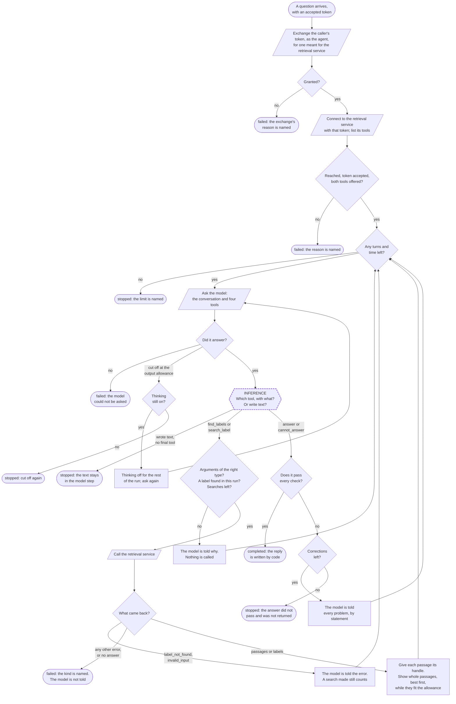

# Label expert, on Strands

The label expert answers questions about a medicine from its approved label, supplied by the [retrieval service](knowledge.md#search-and-retrieval). The model selects passages and proposes an answer; code checks its citations, quotes, numbers and units before returning it. These checks establish specific relationships to the cited text, not whether the text supports every claim.

The agent makes no case changes and has two retrieval tools: `find_labels` and `search_label`. For startup instructions, see [agents/README.md](../../agents/README.md).

It shares the intake agents' contract and startup (`run/serve.ts`). The [AgentCore SDK server and local edge](agent-runtime.md) serve requests, and Strands runs the model loop with the same integration pattern as the [Strands intake agent](intake-agent-strands.md).

## Terms

| Term | Meaning |
|---|---|
| Label | One approved drug label, one version of it, identified by its set id |
| Passage | One chunk of a label's text, as `search_label` returns it: its text, section, part (body or Highlights), type and the label's version, date and page |
| Handle | A stable passage identifier within the run: `P1`, `P2`, … in first-seen order. Retrieval steps record every handle; the model receives handles only for passages it has been shown |
| Shown | A passage whose whole text the model was given. Only a shown passage can be cited |
| Reading allowance | The characters of passage text the model may be shown in one run |
| Statement | One sentence of an answer, with the handles it cites and a quote |
| Quote | One continuous span copied from one cited passage |
| Final tool | `answer` or `cannot_answer`. Once one is accepted the run ends |
| Correction | A final tool that was not accepted, told to the model with every problem found. A refused `answer` and a refused `cannot_answer` count alike |
| Label answer | `label_answer` in the response: `answered`, `no_label`, `label_does_not_answer` or `not_a_label_question`. Set on every completed run, absent otherwise |

## Modules and what each owns

| Module | Owns | Knows nothing about |
|---|---|---|
| `expert/main.ts` | Starts the AgentCore SDK server through `run/serve.ts` with implementation `Strands`; sets the output allowance | Run rules |
| `expert/serve.ts` | Reading `KNOWLEDGE_MCP_URL`, beside what `run/serve.ts` reads | Everything else |
| `expert/settings.ts` | Run limits, output allowance, search count, reading allowance and answer limits | Enforcement |
| `expert/prompt.ts` | What the model is told, and the message laid out for it (its text only, inside `<message>`) | Everything else |
| `expert/strands.ts` | The run: the four tools, the hooks, which calls are made, what the model is shown, how the run ends, the reply | HTTP, the token check, the search engine |
| `expert/checks.ts` | Whether a final tool is accepted, and the reply it gives. Pure functions | Strands, the retrieval service, the clock |
| `expert/retrieval.ts` | Retrieval response parsing, failure messages and section names | Model, loop |
| `tools/tool-token.ts` (shared with the intake agents) | Token exchange, retrieval audience and scope, and exchange failure reasons | Model, loop, MCP |
| `tools/mcp-answers.ts` (shared with the intake agents) | MCP connection errors and tool payload parsing, using the supplied service name | Service-specific rules, model, loop |
| `run/*`, `contract/sdk-app.ts`, `contract/edge.ts`, `contract/runtime.ts`, `contract/runtime-contract.ts`, `model/served.ts` (shared) | The state every run keeps, the record, the shared endings, startup, the HTTP contract on the SDK server, the wording of a model failure | This agent |

`expert/strands.ts` adds `label_answer` to completed responses. It passes the reasons for its three agent-specific stopped outcomes to the shared `stopped(run, reason)` function.

## One message

A six-sided box is decided by inference. A diamond is decided by code. A slanted box is a message sent to another actor. A rounded box is an ending.

Tool calls run sequentially in the order requested. A search can therefore use a label returned by `find_labels` earlier in the same turn. Accepting a final tool, encountering a fatal search failure, or exhausting the corrections cancels the loop: later tools in that turn do not run, and the model receives no further turn. If the deadline has already passed when a tool is requested, no call is made and the run stops at its time limit.

Before connecting, the agent exchanges the caller's token through `tools/tool-token.ts` for audience `knowledge` and scope `labels:search`. The exchange is attempted once, within the tool limit or the run's remaining time. Failure ends the run before retrieval or inference: a refusal includes the provider's reason; an unavailable exchange uses a fixed sentence with no address.

Connection and tool discovery share a separate tool limit, bounded by the time left after the exchange. Every retrieval request carries the exchanged token in `Authorization: Bearer`, with no message context headers. The retrieval service checks that token using `knowledge/compose.yaml`; it never receives the caller's token.

Code reports each refused call to the model and records a tool step with `is_error` and the refusal as its result:

| Refusal | When |
|---|---|
| `invalid_input` | `drug` empty or not a string; `set_id` not a string, `query` empty or not a string, or `part` other than `body` or `highlights` |
| `label_not_returned` | The set id is not one `find_labels` returned in this run |
| `search_limit_reached` | The run has sent its 4 searches |
| `answer_not_accepted` | A final tool that did not pass. The step's result lists every problem |
| `unknown_tool` | A tool the model named that does not exist. Strands answers it in its own words; the step records them |

Successful searches present passages in ranked order. A new passage is shown whole with its handle if it fits the remaining reading allowance. A passage shown earlier is referenced by handle at no further cost. A passage that does not fit is described by section, part, type and size, without a handle. The result also gives the remaining search count.

The `retrieval` step records the query, reported search strategy and each hit's label names, section, score, first 300 characters, passage id, handle and shown status. Every passage gets a recorded handle, including those withheld from the model. `find_labels` calls and unsuccessful searches are `tool` steps containing the service's response.

## Who decides what

| Decision | Decided by | Held in check by |
|---|---|---|
| Whether the message asks what a label says, or reports something | Inference | The prompt. No code checks it |
| Which drug name to look up | Inference | The retrieval service: exact names first, then every word |
| Which of several matching labels to search | Inference | Nothing. Visible in the citations, which name the label |
| Whether a search is made | Code | `SearchLabelTool` in `expert/strands.ts`: the set id must be one `find_labels` returned in this run; at most 4 searches |
| What the model is shown of a passage | Code | The reading allowance; whole passages only |
| Whether a search that could not be made ends the run | Code | `readAnswer` in `expert/retrieval.ts`: only `label_not_found` and `invalid_input` are told to the model; every other answer fails the run |
| What each statement says | Inference | `checkAnswer` in `expert/checks.ts`: citations, quote, numbers, units |
| Whether a reason for not answering stands | Inference proposes it | `checkCannotAnswer`: `no_label` only after every `find_labels` answered with no label; `label_does_not_answer` only after a search was answered |
| What the reply says | Code | Accepted statements and code's own sentences only |
| How the run ends | Code | The endings in `run/endings.ts` and `expert/strands.ts` |

## What code checks about an answer

Code checks each statement in the following order and reports all detected problems together, by statement number. Wrong field types or failure of check 1 prevent further checks on that statement:

1. The text is not empty, at least one passage is cited, and every handle cited was shown in this run.
2. The quote is 15 to 600 characters and is found in one cited passage. Both sides are compared after removing footnote marks (`[^…]`), turning each run of white space into one space, and ignoring case. No other normalization applies.
3. Every number in the text is a number in a cited passage. A number is a run of digits with an optional decimal part. Before comparing, on both sides: footnote marks are removed, `^{x}` and `_{x}` become `x`, and thousands separators are removed.
4. A number in the text followed by a unit from the closed list (mcg, µg, mg, g, kg, mL, L, %, IU, unit, units, mEq, mmol; one space between is allowed) needs that unit somewhere in a cited passage, ignoring case. `%` also matches `percent`; `unit` and `units` match each other; µ (micro sign) and μ (Greek mu) are the same letter.

An answer must contain 1 to 8 statements. Checks compare only passage text, excluding handles, label names and section paths.

Correction feedback identifies each statement, with one line for quote problems and another for its remaining problems. It repeats no passage text beyond the matching words from the model's own quote:

| Problem | What the model is told |
|---|---|
| A cited handle was not shown | "it cites P5, which is not a passage shown to you." |
| The quote is too short or too long | "its quote is 14 characters; a quote must be 15 to 600." |
| The quote is in a shown passage the statement does not cite | "its quote is in P2, which the statement does not cite. Cite P2 as well, or quote from a passage it cites." Every such passage is named |
| The quote is in no shown passage, and its start matches a cited passage | "its quote is not in P3 word for word. It matches as far as "…" and then the passage differs.", with the matching start of the quote, at most its last 12 words, from the cited passage it matches longest |
| The quote's first words are in no cited passage | "its quote is not in P3 word for word. Its first words are not in that passage." |
| The quote contains "..." | One more sentence: a quote is one continuous span, with nothing left out and no "..." |
| A number or a unit is not in a cited passage | "1300 is not written in P1."; "the unit mcg is not written in P1." |

After the problems, always one closing line: "Send the whole answer again, by calling answer, with these corrected. A statement that cannot be supported from the passages shown may be left out." A refused `cannot_answer` is told why and closes with "Call answer or cannot_answer again."

The checks handle boundary cases as follows:

| Case | Behaviour |
|---|---|
| After a passage that does not fit, is a smaller one after it shown? | Yes. Each passage is judged on its own, best first |
| A passage shown in an earlier search comes back: is it `shown`? | Yes, and it is named as above, at no cost |
| Does a search the service refused count towards the 4? | Yes. Every call sent to the service counts; one refused before it is sent does not |
| `10^{6}` in a text | Reads as `106`, on both sides alike |
| `mcg` against `µg` | Different units: neither finds the other |
| `g` inside `µg`, `L` inside `µL` | Not that unit: a unit is bounded by letters, µ and μ included |
| One space between a number and its unit | Read as that number's unit; two spaces are not |
| `unit` against `units` | Each finds the other |

## Always true

1. The agent does not write business records. Its external calls are limited to the model, identity exchange, and retrieval through `find_labels` and `search_label`.
2. Only model statements that pass every check reach the reply. Code writes all other reply sentences and stop reasons, using at most the retrieval service's label names, version and date. The model's search terms appear in tool and retrieval steps.
3. Every citation names the passage the quote was found in, and that passage's label, version, date and page, as the retrieval service returned them.
4. A fatal retrieval failure ends the run without a retry or a tool result sent to the model. Unknown error codes and unreadable errors count as fatal failures.
5. Every retrieval request uses the exchanged token, never the caller's token or message context headers. The model receives only the message text, without the sender or receipt time.
6. No passage is cut. A passage is shown whole or named as not shown.
7. Runs share no state. A new Agent and a new MCP client are made for every message.
8. Every run returns an outcome within the contract. No unchecked or rejected model text appears in the reply.

## How it ends

| Ending | When | Stop reason |
|---|---|---|
| `completed` | `answer` accepted | none. `label_answer` is `answered`; one citation per statement |
| `completed` | `cannot_answer` accepted | none. `label_answer` is the reason; no citations |
| `stopped` | The turn limit, or the time limit found reached before a turn or before a tool call | The same sentences as the intake agents |
| `stopped` | A third final tool that does not pass | "The answer did not pass the checks after 2 corrections, and was not returned." |
| `stopped` | The model ended its turn with text and no final tool | Names the finish reason; the text stays in the model step |
| `stopped` | A turn cut off at the output allowance after the one retry with thinking off | Says so; nothing written is returned |
| `failed` | The model could not be asked, or the run's time ran out while a request to it was in flight | The same sentences as the intake agents |
| `failed` | The model wrote tool arguments that are not JSON | "The model wrote tool arguments that are not JSON, and Strands stops the run when that happens." |
| `failed` | The identity provider refused to exchange the caller's token for one meant for the retrieval service | "The agent could not get a token for the retrieval service: " and the provider's refusal |
| `failed` | The exchange could not be made: no answer in time, the provider not reached, or an answer it cannot read | "The agent could not get a token for the retrieval service: the identity provider could not be reached or did not answer in time." |
| `failed` | Retrieval service unreachable, token refused or unverifiable, or either required tool missing | Identifies the connection failure or missing tools |
| `failed` | `find_labels` or `search_label` returns `index_not_built`, `search_timed_out`, `search_unreachable`, `search_error` or `search_unexpected_answer` | Identifies the reported search failure |
| `failed` | Either tool answered any other error code, the retrieval service's vector, embedding and reranker codes among them | "The label search answered with an error this agent does not know: " and the code |
| `failed` | Either tool returns an error outside `{ error, detail }`, or an unexpected success shape | Identifies the unreadable error or unexpected response |
| `failed` | No answer within the tool limit, or the run's time ran out while a tool call was in flight | Names the limit |
| `failed` | A search answered with a passage from another label than the one searched | "The retrieval service returned a passage from another label than the one searched." |
| `failed` | Strands stopped the run with an error no row above names | "Strands stopped the run with" the error's type |

A `stopped` or `failed` run has no reply, no citations and no `label_answer`.

## The numbers, and where each is set

| Number | Value | Set in |
|---|---|---|
| Model turns in a run | 8. A turn asked again with thinking off is not counted, as in the intake agent on Strands | `EXPERT_LIMITS`, `expert/settings.ts` |
| Time for a run | 150 s | `EXPERT_LIMITS` |
| Time for one model request | 90 s | `EXPERT_LIMITS` |
| Time for one tool call, for the token exchange, and for connecting and listing the tools | 10 s each, or what the run has left when each starts | `EXPERT_LIMITS` |
| Output allowance | 4,096 tokens | `OUTPUT_ALLOWANCE`, `expert/settings.ts`; applied in `expert/main.ts` |
| Temperature and seed | shared | `run/sampling.ts` |
| Searches in a run | 4 | `EXPERT_SETTINGS.search`, `expert/settings.ts` |
| Passages asked for in each search | 5 | `EXPERT_SETTINGS.search` |
| Characters of each passage kept as the excerpt in a retrieval step | 300 | `EXCERPT_CHARACTERS`, `expert/settings.ts` |
| Reading allowance | 30,000 characters | `EXPERT_SETTINGS.search` |
| Statements in an answer | at most 8 | `EXPERT_SETTINGS.answer` |
| Quote length | 15 to 600 characters | `EXPERT_SETTINGS.answer` |
| Corrections | 2 | `EXPERT_SETTINGS.answer` |

## How it is tested

`agents/test/expert.test.ts` maps tests `expert 1` through `expert 7` to the corresponding invariants. `expert 8` covers a refused token exchange, no final tool, a failed model server and an answer that never passes, checking that each returns a contract outcome without unchecked model text.

The tests call the handler through the real Strands loop and MCP client, with a caller value, scripted token exchange, and scripted model and retrieval servers on loopback. They sign no tokens and validate every response against the contract schema. They do not establish agreement with the real retrieval service. `agents/test/runtime.test.ts` tests the SDK server and edge with a separate test handler.

Model and tool clients enforce real-time limits. These tests use generous limits to avoid timing-dependent failures; they do not verify timeout behaviour.

## Not present

- A number taken from the wrong row or column of the right passage passes the number check: the check asks only that the number is written in a cited passage.
- A unit is checked for presence in a cited passage, not for standing next to its number there.
- The wording of a statement is not checked against the passage beyond its quote and its numbers. A statement can say something its quote does not.
- Which of several matching labels is used is the model's choice. It is visible only in the citation.
- Whether a message is a report or a question is the model's judgement. A bare report of a side effect is declined as `not_a_label_question` by instruction, not by a check.
- The reading allowance counts characters rather than tokens. It assumes at most 0.75 tokens per character (`expert/settings.ts`); denser text can overflow the context and fail the run with the model server's status.
- The agent cannot choose passage ranking. The retrieval service uses `SEARCH_STRATEGY`: `keyword`, `vector`, `fused` or `fused_reranked` (`fused_reranked` in the lab compose file). Retrieval steps record the reported strategy and returned scores.
- One implementation, on Strands. There is no hand-written loop for this agent.
- No hand-off to the intake agent when a message reports an adverse event: it is declined, and the caller must send it to intake.
