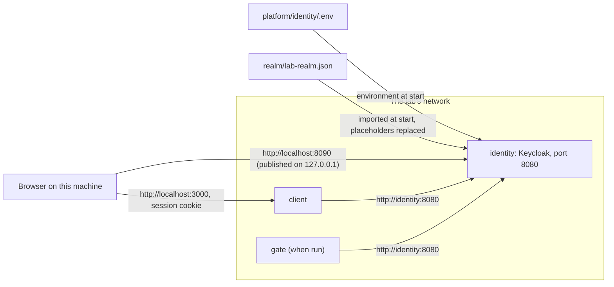
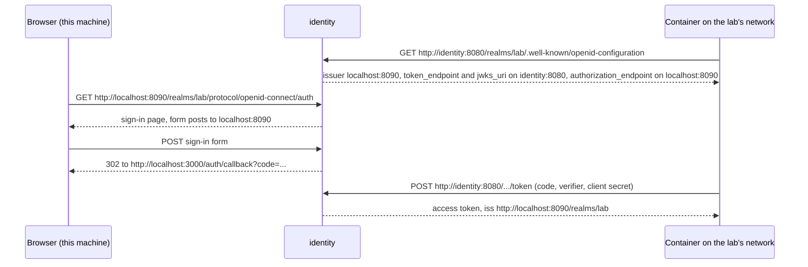

# Identity provider

The lab's OpenID Connect provider: Keycloak in development mode, one realm, imported from a file at every start. It stands in for the identity provider that AgentCore's JWT authorizer trusts. To use it, see [platform/identity/README.md](../../platform/identity/README.md).

Three pieces consume its tokens. The client's server signs desk staff in, keeps their tokens, and sends the access token on every call to an agent and to the case system. The agents require a valid access token on `POST /invocations` and pass it on to the case system. The case system requires a valid access token on every request but `/ping`, records the user an agent acted for, and takes the reviewer and the reviewer role from the token.

## Terms

| Term | Meaning |
|---|---|
| Provider | The `identity` service: Keycloak 26.8.2, pinned by digest, started with `start-dev --import-realm` |
| Realm | `lab`, defined by `platform/identity/realm/lab-realm.json` |
| Identity secrets | `platform/identity/.env`: the administrator's username and password, the `desk` client's secret, each user's password. Ignored by git |
| Front channel | Requests a browser makes: the sign-in page and sign-out |
| Back channel | Requests a server makes: discovery, token exchange, keys, userinfo |
| Gate | `platform/identity/gate.sh` and `platform/identity/gate/`: the check that decides whether a running provider issues the tokens described here |
| Client | The desk's server, `client/src/`, the relying party registered as `desk` |
| Session | The client's record of one signed-in user: who they are and their tokens, in the client's memory, found by a random identifier |

## What runs



| Property | Value |
|---|---|
| Image | `quay.io/keycloak/keycloak:26.8.2`, by the digest of its index for `linux/amd64` and `linux/arm64` |
| Mode | Development (`start-dev`) |
| Database | `dev-file` (H2) under `/opt/keycloak/data`, on a tmpfs |
| Published | `127.0.0.1:8090` to container port `8080`; nothing else |
| Ready | When `GET /realms/lab/.well-known/openid-configuration` answers 200 inside the container |
| State between starts | None. Each start imports the realm from the file and makes new signing keys |
| Container | `cap_drop: ALL`, `no-new-privileges`, `init`, tmpfs on `/tmp` and `/opt/keycloak/data`. Root filesystem writable: `start-dev` rebuilds the server into `/opt/keycloak/lib/quarkus` at every start |

## The realm

| Client `desk` | Value |
|---|---|
| Type | Confidential, client secret from the identity secrets |
| Grants | Authorization Code only |
| PKCE | Required, `S256` |
| Redirect URI | `http://localhost:3000/auth/callback` |
| Post-logout redirect URI | `http://localhost:3000/` |
| Default scopes | `basic`, `profile`, `email` |
| Mappers | Audience `lab-agents`; audience `lab-case-system`; hard-coded claim `client_id` = `desk` (access token); realm roles as top-level `roles` (access token and ID token) |

| User | Name | Email | Realm roles | Password |
|---|---|---|---|---|
| `riley.reviewer` | Riley Reviewer | `riley.reviewer@example.org` | `reviewer`, `default-roles-lab` | Identity secrets, permanent |
| `dana.desk` | Dana Desk | `dana.desk@example.org` | `default-roles-lab` | Identity secrets, permanent |

`default-roles-lab` is Keycloak's default role for the realm; it includes `offline_access` and `uma_authorization`. Every user holds it, so no user's `roles` claim is empty, and Keycloak omits an empty one.

Access tokens live 600 seconds.

## The access token

A JWT signed with RS256 by a key at the realm's `jwks_uri`.

| Claim | Value | Read by AgentCore's JWT authorizer as |
|---|---|---|
| `iss` | `http://localhost:8090/realms/lab` | The issuer of the discovery URL |
| `aud` | Contains `lab-agents` and `lab-case-system` | Allowed audiences |
| `client_id` | `desk` | Allowed client IDs |
| `roles` | Array of the user's realm role names, composites expanded; contains `reviewer` only for reviewers | A custom-claim rule (a string array contains a value) |
| `sub`, `preferred_username`, `name` | The user's id (fixed in the realm file), username and full name | — |
| `exp` − `iat` | 600 | — |

## The ID token

Signed the same way, issuer `http://localhost:8090/realms/lab`, audience `desk`. The client reads `sub`, `name`, `preferred_username` and `roles` from it; `reviewer` in `roles` makes the user a reviewer.

## Two addresses



| Party | Address | Uses |
|---|---|---|
| Browser | `http://localhost:8090` | Authorization endpoint, sign-in form, sign-out |
| Container on the lab's network (the client, the gate) | `http://identity:8080` | Discovery, token endpoint, `jwks_uri`, userinfo, revocation |

| Discovery field, fetched at `http://identity:8080` | Address given |
|---|---|
| `issuer`, `authorization_endpoint`, `end_session_endpoint` | `http://localhost:8090`, the browser's |
| `token_endpoint`, `jwks_uri`, `userinfo_endpoint`, `introspection_endpoint` | `http://identity:8080` |
| `revocation_endpoint` | `http://localhost:8090`, the browser's, which a container cannot reach. The client does not read it: it is configured with `OIDC_REVOCATION_ENDPOINT` = `http://identity:8080/realms/lab/protocol/openid-connect/revoke` |

| Setting | Effect |
|---|---|
| `KC_HOSTNAME=http://localhost:8090` | Issuer and every front-channel URL, whatever address the request came in on |
| `KC_HOSTNAME_BACKCHANNEL_DYNAMIC=true` | Back-channel URLs use the address the request came in on |

## Signing in through the client

```mermaid
sequenceDiagram
  participant B as Browser
  participant C as client (localhost:3000)
  participant K as identity
  B->>C: GET /auth/login
  C->>K: GET http://identity:8080/.../.well-known/openid-configuration (first need only; issuer must equal OIDC_ISSUER)
  C->>C: pending sign-in: state, nonce, PKCE verifier, browser binding (256 bits each)
  C-->>B: 302 to authorization_endpoint (localhost:8090) with state, nonce, S256 challenge; Set-Cookie desk_signin (binding, Path=/auth, 10 minutes)
  B->>K: sign in
  K-->>B: 302 to http://localhost:3000/auth/callback?code, state, iss
  B->>C: GET /auth/callback, with desk_signin
  C->>C: take the pending sign-in for state (unused, under 10 minutes, binding equals the cookie); clear desk_signin
  C->>K: POST token_endpoint (code, verifier, client secret)
  K-->>C: access, refresh and ID tokens
  C->>K: GET jwks_uri
  C->>C: ID token: signature, issuer, audience desk, nonce, expiry; session created
  C-->>B: 302 to /, Set-Cookie desk_session (HttpOnly, SameSite=Lax, Path=/)
```

| Step | Refused when | Answer |
|---|---|---|
| Callback | State unknown, used, or 10 minutes old; no `desk_signin` cookie, or another sign-in's; the provider sent `error` | 400 page, no session; the pending sign-in is used up |
| Code exchange, ID token | The provider refuses the code; the ID token fails any check | 502 page, no session |
| Discovery | Unreachable, or `issuer` is not `OIDC_ISSUER` | 502 `identity_unreachable` |

### Sessions and where tokens live

| Held | Where | For how long |
|---|---|---|
| Access, refresh and ID tokens; the user's subject, name, username and roles | The client's memory, in the session | Until sign-out, a failed renewal, or the client stops |
| Pending sign-ins (state, nonce, verifier, binding) | The client's memory | Until their callback, 10 minutes, or 1000 newer ones |
| A pending sign-in's binding | The browser that started it, in the `desk_signin` cookie | Until the callback clears it, or 10 minutes |
| Session identifier | The browser, in the `desk_session` cookie | Until sign-out clears it |
| Who entered an inquiry and started a run: subject and name | The client's SQLite file | With the inquiry |

No token is written to disk or to the store, and no token is in any response body or in any header but `Set-Cookie`, which carries none either.

### Signing out

| Step | What happens |
|---|---|
| `POST /auth/logout` | The session is removed and `desk_session` cleared |
| Revocation | The refresh token is revoked (RFC 7009) at the configured `OIDC_REVOCATION_ENDPOINT`, authenticating as `desk`; with `none`, no call. A refusal or no answer is logged; sign-out goes on |
| Answer | 200 with `sign_out_url`: the provider's `end_session_endpoint` with `client_id` and `post_logout_redirect_uri`, and no token |

### What the client sends downstream

| Call | `Authorization` | Access token must have left |
|---|---|---|
| Agent `POST /invocations` | `Bearer <access token>` | 180 s, the time the client waits for an agent |
| Case system: list, get, review | `Bearer <access token>` | 30 s |
| Health checks (`/ping`) | None | — |

With less time left the client renews the access token with the refresh token first. If the provider refuses or cannot be reached, the request answers 401 `not_signed_in`, the session is removed, and nothing is sent. A review is forwarded as `{ decision, note? }`, with no reviewer field, and only for a user holding `reviewer`; the case system takes the reviewer from the access token.

## The agents

Both intake agents check the access token in `agents/src/contract/server.ts`, with `shared/access-token.ts`, before the request body is read, and pass the accepted token on.

| Order | Check | Refused as |
|---|---|---|
| 1 | `Authorization: Bearer` present | `missing` |
| 2 | A JWT, header algorithm RS256 | `malformed`; any other algorithm, `none` included, `bad_signature` |
| 3 | Signature against the keys at `jwks_uri` | `bad_signature` |
| 4 | Not past `exp`, on the agent's clock, no tolerance | `expired` |
| 5 | `iss` = `http://localhost:8090/realms/lab` | `wrong_issuer` |
| 6 | `aud` contains `lab-agents` | `wrong_audience` |
| 7 | `client_id` in `desk` | `wrong_client` |
| 8 | At least 150 s (the run's time limit) before `exp` | `expires_too_soon` |
| 9 | `sub`, `preferred_username`, `name` present; `roles` a list if present | `malformed` |

| Answer | When |
|---|---|
| 401, `WWW-Authenticate: Bearer error="invalid_token"`, `{"error":"unauthorized","reason","detail"}` | A refusal above. The handler is not called |
| 503 `identity_unavailable` | Discovery or keys cannot be fetched, or discovery names another issuer. The handler is not called |
| As before, the handler given the caller | An accepted token |

The discovery document and keys are fetched on first need and kept; a failure is not kept. A token naming a key not yet seen makes the agent fetch the keys again, at most every 30 s, so new keys after a provider restart are picked up without restarting the agent. `GET /ping` needs no token.

| Passed on | To | How |
|---|---|---|
| The caller's access token, as presented | The case system's MCP endpoint | `Authorization: Bearer` on every request (connect, tool list, every tool call), beside the four context headers |

| AgentCore Runtime JWT authorizer setting | The agent's setting | Value in the lab |
|---|---|---|
| Discovery URL (ends `/.well-known/openid-configuration`) | `AUTH_DISCOVERY_URL` | `http://identity:8080/realms/lab/.well-known/openid-configuration` |
| Issuer (from the discovery document) | `AUTH_ISSUER`, compared exactly | `http://localhost:8090/realms/lab` |
| Allowed audiences | `AUTH_ALLOWED_AUDIENCE` | `lab-agents` |
| Allowed clients (the `client_id` claim) | `AUTH_ALLOWED_CLIENTS` | `desk` |
| Custom-claim rule (optional) | `AUTH_ROLES_CLAIM` names the claim; no rule is applied | `roles` |
| — | Minimum remaining life | 150 s |

## The case system

Both case-system servers check the access token with `shared/access-token.ts` before anything else, with the agents' checks in the same order, audience `lab-case-system` and no minimum remaining life. A refusal is 401 with `WWW-Authenticate: Bearer error="invalid_token"`; a provider that cannot be asked is 503 `identity_unavailable`. Nothing reaches the MCP server or the store before the token is accepted.

| Server | Route | Needs | Takes from the token |
|---|---|---|---|
| Agent server | `POST /mcp` | A valid token | The user the agent acts for: `name` and `sub`, recorded on every audit entry of the agent's change beside the agent's name |
| Review server | `GET /cases`, `GET /cases/<id>` | A valid token | — |
| Review server | `POST /cases/<id>/review` | A valid token whose `roles` hold `reviewer`; checked before the case is looked up (403 `not_a_reviewer`) | The reviewer: `name` as the audit actor, `sub` as `actor_subject`. A body naming a `reviewer` is 400 |
| Both | `GET /ping` | Nothing | — |

## From sign-in to an audit entry

```mermaid
sequenceDiagram
  participant B as Browser
  participant C as client
  participant K as identity
  participant A as Agent
  participant S as Case system
  B->>C: sign in (Authorization Code with PKCE, see above)
  C->>K: code, verifier, client secret
  K-->>C: access token (aud lab-agents, lab-case-system; client_id desk; roles), ID token
  C-->>B: session cookie
  B->>C: POST /api/inquiries (cookie)
  C->>C: session; token has 180 s left, or renew; record who entered it
  C->>A: POST /invocations, Authorization: Bearer token
  A->>K: discovery and keys (first need only)
  A->>A: check token: RS256 signature, iss, aud lab-agents, client_id, 150 s left
  A->>S: MCP initialize, tools/list, tools/call, Bearer token (unchanged) and the four context headers
  S->>S: check token: RS256 signature, iss, aud lab-case-system, client_id
  S->>S: write the case; audit entry: actor = agent's name (header), acting_for = token's name and sub
  S-->>A: result
  A-->>C: response inside the agent contract
  B->>C: POST /api/cases/<id>/review (cookie)
  C->>C: reviewer role in the ID token, or 403
  C->>S: POST /cases/<id>/review { decision, note? }, Bearer token
  S->>S: check token; reviewer role in the token, or 403; audit entry: actor = token's name, actor_subject = sub
```

### Who checks what

| Checker | What it receives | Audience required | Other checks | What it takes from the token |
|---|---|---|---|---|
| Client | The ID token, from the token endpoint at sign-in | `desk` (the ID token's `aud`) | Signature, issuer, nonce, expiry; the browser that started the sign-in | Who the user is, and whether they hold `reviewer` |
| Agent | The access token, from the client | `lab-agents` | Signature (RS256), issuer, `client_id` `desk`, 150 s left | The caller, given to the handler; the token itself, passed on |
| Case system | The access token, from an agent or from the client | `lab-case-system` | Signature (RS256), issuer, `client_id` `desk`, not expired | The user an agent acted for; the reviewer and the reviewer role |

## Where secrets live

| Secret | Written by | Held in | Read by |
|---|---|---|---|
| Administrator username and password | `setup.sh`, random | Identity secrets | The provider, at start |
| `desk` client secret | `setup.sh`, random | Identity secrets | The provider, through the realm import; the gate; the client, as `OIDC_CLIENT_SECRET`, the only value its container takes from the identity secrets |
| User passwords | `setup.sh`, random | Identity secrets | The provider, through the realm import; the gate |
| Token signing keys | The provider, at start | The provider's database, on a tmpfs | Nobody outside; the public keys are at `jwks_uri` |

The realm file holds a `${NAME}` placeholder where each secret goes, and no secret.

## How it fails

| Failure | Result |
|---|---|
| `platform/identity/.env` missing | `docker compose up` stops before starting anything and names the missing variable |
| `setup.sh` without Docker | Exits 2 and says so |
| `platform/identity/.env` lacks a variable | `setup.sh` exits 1 and names it |
| The realm does not import | The service never becomes healthy; `docker compose up --wait` fails |
| The provider is not running, or its realm or tokens differ from this page | The gate exits 1 and names the first statement that does not hold |

## Not present

| What | Note |
|---|---|
| Proof of which agent is calling | The agent's own identity is still a header it claims (`x-agent-id`). The case system checks the user's token, not the agent: anything holding a valid token can claim to be any agent |
| Proof of who sent a message | The sender is still text that the signed-in user vouches for. Lookups and follow-ups are limited by that text |
| A narrower token downstream | The agent passes the user's access token on unchanged. It is not exchanged for one limited to the agent, the message or the run, so the case system accepts it for anything that user may do there |
| Special handling of a token refused mid-run | A tool call the case system refuses after it accepted the connection falls under the agents' rules for a call that got no answer |
| Use of the caller's roles by the agents | The roles are read and given to the handler; nothing is decided on them |
| Role-based access to reading cases | Any valid token lists and reads every case on the review server |
| Session expiry of the client's own | A session ends only at sign-out, a failed renewal or a restart |
| `Secure` on the session cookie | The client is served over HTTP on this machine |
| HTTPS | HTTP on loopback and the lab's network only |
| Persistence | Nothing survives a restart; tokens issued before one stop verifying after it |
| Production database or clustering | — |
| Password policy, brute-force protection, multi-factor sign-in | — |
| Self-registration, password reset, email | — |
| Federation with another identity provider | — |
