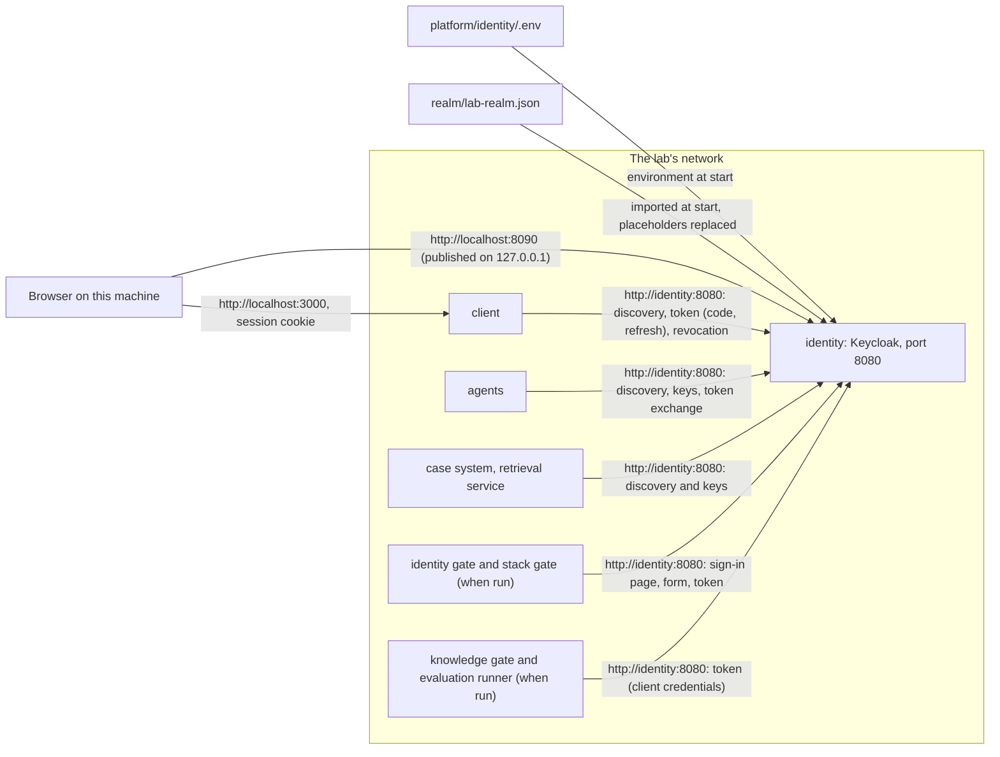
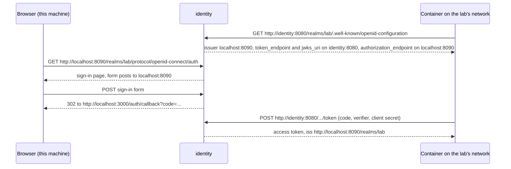
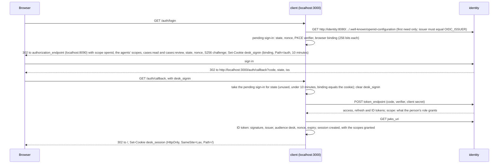
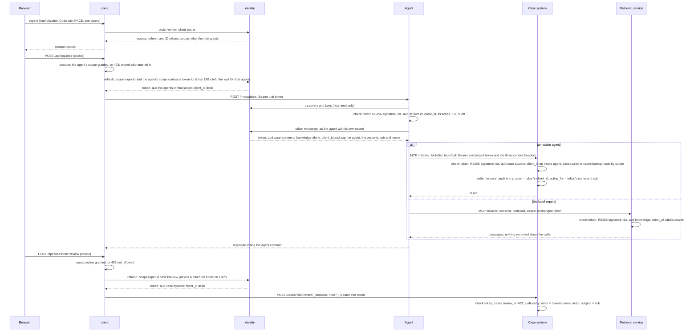
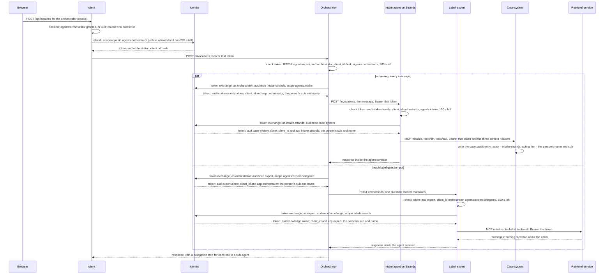

# Identity provider

The lab's OpenID Connect provider: Keycloak in development mode, one realm, imported from a file at every start. It stands in for the identity provider that AgentCore's JWT authorizer trusts. To use it, see [platform/identity/README.md](../../platform/identity/README.md).

Every token is for a target: the audiences of the scopes it holds. The client's server signs staff in, and before each call gets a token for that call's scope, by refresh when it holds none with enough life left: an agent's scope for an agent, `cases:read` or `cases:review` for the case system. The token from sign-in is sent to nobody. Each agent accepts a token for itself with its scope, then exchanges it, as itself with its own secret, for a token for what it calls: the intake agents for the case system, the label expert for the retrieval service, the orchestrator for the intake agent on Strands and for the label expert, each of which exchanges the token it is sent again for its own tool server. The case system and the retrieval service accept tokens only from their own callers, and each tool and route needs its own scope. The case system records the agent from the token's client and the person from the token's user.

Three programs sign a person in without a browser: the identity gate, the stack gate and the attack runner (`evaluation/attacks.sh`). Two get a token as a machine, by client credentials: the knowledge gate and the evaluation runner ([Signing in without a browser](#signing-in-without-a-browser)).

## Terms

| Term | Meaning |
|---|---|
| Provider | The `identity` service: Keycloak 26.8.2, pinned by digest, started with `start-dev --import-realm` |
| Realm | `lab`, defined by `platform/identity/realm/lab-realm.json` |
| Identity secrets | `platform/identity/.env`: the administrator's username and password, the secret of each client that has one (`desk`, the four agents, the two machines), each person's password. Ignored by git |
| Front channel | Requests a browser makes: the sign-in page and sign-out |
| Back channel | Requests a server makes: discovery, the token endpoint (code, refresh, exchange, client credentials), keys, userinfo |
| Scope | A capability, such as `cases:review`. Roles grant it, a client may ask for it, and it names the audiences a token for it carries |
| Audience | The service a token is for, in `aud`: an agent's id, `case-system` or `knowledge` |
| Token exchange | OAuth 2.0 Token Exchange (RFC 8693): an agent sends the token it was called with, as itself, and gets a token for one audience and the scopes it asks for |
| Gate | `platform/identity/gate.sh` and `platform/identity/gate/gate.ts`: the check that decides whether a running provider issues and refuses the tokens described here. Its statements are named G1 to G16 in `gate.ts` |
| Stack gate | `platform/identity/stack-gate.sh` and `platform/identity/gate/stack-gate.ts`: the check of sign-in and token use through the whole running stack |
| Client | The desk's server, `client/src/`, the relying party registered as `desk` |
| Session | The client's record of one signed-in user: who they are and their tokens, in the client's memory, found by a random identifier |

## What runs

| Property | Value |
|---|---|
| Image | `quay.io/keycloak/keycloak:26.8.2`, by the digest of its index for `linux/amd64` and `linux/arm64` |
| Mode | Development (`start-dev`) |
| Database | `dev-file` (H2) under `/opt/keycloak/data`, on a tmpfs |
| Realm file | `platform/identity/realm/` mounted read-only at `/opt/keycloak/data/import`; imported when the container starts, and at no other time |
| Published | `127.0.0.1:8090` to container port `8080`; nothing else |
| Ready | When `GET /realms/lab/.well-known/openid-configuration` answers 200 inside the container |
| State between starts | None. Each start imports the realm from the file and makes new signing keys |
| Container | `cap_drop: ALL`, `no-new-privileges`, `init`, tmpfs on `/tmp` and `/opt/keycloak/data`. Root filesystem writable: `start-dev` rebuilds the server into `/opt/keycloak/lib/quarkus` at every start |

### Changing the realm file

The realm file is read only at start. A running provider keeps the realm it imported until its container stops; the tmpfs that holds its database is emptied then, so the next start imports the file as it is.

| Operator does | Effect |
|---|---|
| Edits `realm/lab-realm.json` | Nothing, until the provider restarts. `docker compose up -d` does not restart it: the compose configuration has not changed |
| Restarts the provider: `docker compose restart identity` at the repository root, or `docker compose -f platform/identity/compose.yaml restart identity` when it was started on its own | The edited realm is imported; new signing keys |
| Then | Every access token issued before the restart is refused (`bad_signature`: its key is no longer published). Every client session ends at its next refresh, which the provider refuses (401 `not_signed_in`); its users sign in again |

A realm file that names a variable the identity secrets lack needs more than a restart. Every compose file that passes a secret requires it (`${NAME:?run platform/identity/setup.sh}`), so `docker compose up` stops before starting anything and names it.

| Step | What it takes |
|---|---|
| New values | `platform/identity/setup.sh`, run again, writes a random value for each variable the existing `platform/identity/.env` lacks and names them; every value already there, every client secret and password among them, is kept |
| The stack started again | `docker compose down`, then `docker compose up -d --build --wait`, at the repository root. The provider starts with the new values and imports the realm file; `down` without `-v` keeps the volumes, the cases among them |
| Every image built again | `--build` builds the agents, the case system, the client and the retrieval service from the checkout, so each runs the code that matches the realm, with the values its compose file passes |
| Everyone signs in again | Tokens issued before are refused (`bad_signature`). People's passwords are the same as before |

## The realm

Roles. Every account also holds `default-roles-lab`, Keycloak's default role for the realm; it includes `offline_access` and `uma_authorization`. So no account's `roles` claim is empty, and Keycloak omits an empty one.

| Role | For | Held by |
|---|---|---|
| `desk` | People: enters inquiries and runs the intake agents and the orchestrator | `dana.desk` |
| `medical-information` | People: does what the desk does, and runs the label expert | `morgan.medinfo` |
| `safety-reviewer` | People: reads adverse event cases and decides them | `riley.reviewer` |
| `auditor` | People: reads every case and its audit trail; changes nothing | `avery.auditor` |
| `evaluation` | A machine: the evaluation harness's service account | `service-account-evaluation` |
| `knowledge-gate` | A machine: the knowledge gate's service account | `service-account-knowledge-gate` |

Scopes. A role grants a scope through the realm's scope mappings; the scope's audience mappers put its audiences in the access token.

| Scope | Granted by | Audiences it names | Reaches |
|---|---|---|---|
| `agents:intake` | `desk`, `medical-information` | `intake-handwritten`, `intake-strands` | `POST /invocations` on both intake agents |
| `agents:expert` | `medical-information`, `evaluation` | `expert` | `POST /invocations` on the label expert |
| `agents:expert:delegated` | `desk`, `medical-information` | `expert` | `POST /invocations` on the label expert, with a token the orchestrator got by exchange. Only the `orchestrator` client may ask for it |
| `agents:orchestrator` | `desk`, `medical-information` | `orchestrator` | `POST /invocations` on the orchestrator |
| `cases:write` | `desk`, `medical-information` | `case-system` | `create_case`, `add_follow_up` |
| `cases:lookup` | No role | `case-system` | `find_case`. No client may ask for it, so no token carries it and an intake agent is offered no lookup |
| `cases:read` | `safety-reviewer`, `auditor` | `case-system` | `GET /cases`, `GET /cases/<id>` |
| `cases:review` | `safety-reviewer` | `case-system` | `POST /cases/<id>/review` |
| `labels:search` | `desk`, `medical-information`, `evaluation`, `knowledge-gate` | `knowledge` | `find_labels`, `search_label` |

Clients. Every client is confidential, with no password grant, implicit flow, device grant or CIBA, and default scopes `basic`, `profile`, `email`. Each client that issues tokens has two mappers: a hard-coded `client_id` claim naming itself (access token), and the realm roles as a top-level `roles` claim (access token and ID token).

| Client | What it is | How it gets a token | May ask for | May exchange | Secret |
|---|---|---|---|---|---|
| `desk` | The client's server | Authorization Code with PKCE, and refresh | `agents:intake`, `agents:expert`, `agents:orchestrator`, `cases:read`, `cases:review` | No | `IDENTITY_DESK_CLIENT_SECRET` |
| `intake-handwritten` | The hand-written intake agent | Token exchange only | `cases:write` | Yes | `IDENTITY_INTAKE_HANDWRITTEN_CLIENT_SECRET` |
| `intake-strands` | The intake agent on Strands | Token exchange only | `cases:write` | Yes | `IDENTITY_INTAKE_STRANDS_CLIENT_SECRET` |
| `expert` | The label expert | Token exchange only | `labels:search` | Yes | `IDENTITY_EXPERT_CLIENT_SECRET` |
| `orchestrator` | The orchestrator | Token exchange only | `agents:intake`, `agents:expert:delegated` | Yes | `IDENTITY_ORCHESTRATOR_CLIENT_SECRET` |
| `evaluation` | The evaluation runner | Client credentials, as its service account | `agents:expert` | No | `IDENTITY_EVALUATION_CLIENT_SECRET` |
| `knowledge-gate` | The knowledge gate | Client credentials, as its service account | `labels:search` | No | `IDENTITY_KNOWLEDGE_GATE_CLIENT_SECRET` |
| `case-system` | The case system, named as an audience only | None | Nothing | No | None |
| `knowledge` | The retrieval service, named as an audience only | None | Nothing | No | None |

| Client `desk` | Value |
|---|---|
| Type | Confidential, client secret from the identity secrets |
| Grants | Authorization Code only. No password grant, implicit flow, service account, device grant, CIBA or token exchange |
| PKCE | Required, `S256` |
| Redirect URI | `http://localhost:3000/auth/callback` |
| Post-logout redirect URI | `http://localhost:3000/` |
| Default scopes | `basic`, `profile`, `email` |
| Optional scopes | `agents:intake`, `agents:expert`, `agents:orchestrator`, `cases:read`, `cases:review` |
| Mappers | Hard-coded claim `client_id` = `desk` (access token); realm roles as top-level `roles` (access token and ID token) |

| Account | Name | Email | Realm roles | Password |
|---|---|---|---|---|
| `riley.reviewer` | Riley Reviewer | `riley.reviewer@example.org` | `safety-reviewer`, `default-roles-lab` | Identity secrets, permanent |
| `dana.desk` | Dana Desk | `dana.desk@example.org` | `desk`, `default-roles-lab` | Identity secrets, permanent |
| `morgan.medinfo` | Morgan Medinfo | `morgan.medinfo@example.org` | `medical-information`, `default-roles-lab` | Identity secrets, permanent |
| `avery.auditor` | Avery Auditor | `avery.auditor@example.org` | `auditor`, `default-roles-lab` | Identity secrets, permanent |
| `service-account-evaluation` | Evaluation Harness | — | `evaluation`, `default-roles-lab` | None: the `evaluation` client's secret |
| `service-account-knowledge-gate` | Knowledge Gate | — | `knowledge-gate`, `default-roles-lab` | None: the `knowledge-gate` client's secret |

Every account has a fixed id in the realm file, so its `sub` is the same after every start.

Access tokens live 600 seconds.

## The access token

A JWT signed with RS256 by a key at the realm's `jwks_uri`.

| Claim | Value | Read by AgentCore's JWT authorizer as |
|---|---|---|
| `iss` | `http://localhost:8090/realms/lab` | The issuer of the discovery URL |
| `aud` | The audiences of the scopes granted, and no other. A person's token for `agents:intake` names both intake agents; a token for any case-system scope names `case-system`. A token got by exchange names the one audience asked for | Allowed audiences |
| `client_id` | The client the token was issued to: `desk` for a person's token, the agent for a token it got by exchange, `evaluation` or `knowledge-gate` for a machine's | Allowed client IDs |
| `scope` | The scopes granted, separated by spaces. Keycloak adds others, such as `profile` and `email`, which no service reads | Allowed scopes (the token must hold at least one) |
| `roles` | Array of the account's realm role names, composites expanded: its one lab role, `default-roles-lab` and what that includes | A custom-claim rule (a string array contains a value) |
| `sub`, `preferred_username`, `name` | The account's id (fixed in the realm file), username and full name. A machine's username is `service-account-<client>` | — |
| `exp` − `iat` | 600. An exchanged token keeps the `exp` of the token it was exchanged for | — |

A person's token from sign-in carries no `realm_access` or `resource_access` claim (G2).

How a token is got decides what it holds. Each row is a statement of the gate:

| Request | Scopes granted | Audiences | Gate |
|---|---|---|---|
| Sign-in through `desk`, asking for `openid` and every scope `desk` may ask for | Exactly those the person's role grants | Those scopes' audiences | G1, G2 |
| Refresh with `scope=openid <one granted scope>` | That scope alone of the lab's scopes | That scope's audiences alone | G3 |
| The same, with the refresh token that refresh returned | The whole grant again, or any other granted scope | As asked | G4 |
| Refresh for a scope `desk` may ask for that the role does not grant | Not that scope; answered 200 | None of that scope's | G5 |
| `desk` asking for a scope it may not ask for (`labels:search`, `agents:expert:delegated`) | Refused 400 `invalid_scope`, at a refresh and at the authorization endpoint | — | G6 |
| An agent's exchange | Every scope asked for, and no other of the lab's scopes | The one audience asked for | G7, G8 |
| The orchestrator's exchange of a person's token for it, for a sub-agent | The sub-agent's scope alone of the lab's scopes | That sub-agent alone | G15 |
| A sub-agent's exchange of the token the orchestrator got for it | Every scope asked for, and no other of the lab's scopes | Its tool server alone | G16 |
| A machine's client credentials | The scope asked for; a scope its client may not ask for is refused 400 `invalid_scope` | That scope's audiences | G11, G12 |

Keycloak leaves out of a token a scope the person's role does not grant, and still answers 200 (G5). So a token request that succeeds says nothing about what the person may do: the service's check is the control. A token without the service's audience is refused there as `wrong_audience` (401); a token with the audience but none of the service's scopes, as `insufficient_scope` (403). A client asking for a scope it may not ask for at all is a different case: the provider refuses it with `invalid_scope`.

## The ID token

Signed the same way, issuer `http://localhost:8090/realms/lab`, audience `desk`, with the same top-level `roles`. The client reads `sub`, `name`, `preferred_username` and `roles` from it. What a person may do in the client is not read from it: it comes from the scopes the token response grants.

## Two addresses

| Party | Address | Uses |
|---|---|---|
| Browser | `http://localhost:8090` | Authorization endpoint, sign-in form, sign-out |
| Container on the lab's network: the client, the agents, the case system, the retrieval service, the knowledge gate, the evaluation runner | `http://identity:8080` | Discovery, token endpoint, `jwks_uri`, revocation (the client) |
| Container on the lab's network standing in for a browser: the gate and the stack gate | `http://identity:8080` | As above, and the sign-in page and form: each sends a URL it is given on `http://localhost:8090` to `http://identity:8080` with the same path and query |

| Discovery field, fetched at `http://identity:8080` | Address given |
|---|---|
| `issuer`, `authorization_endpoint`, `end_session_endpoint` | `http://localhost:8090`, the browser's |
| `token_endpoint`, `jwks_uri`, `userinfo_endpoint`, `introspection_endpoint` | `http://identity:8080` |
| `revocation_endpoint` | `http://localhost:8090`, the browser's, which a container cannot reach. The client does not read it: it is configured with `OIDC_REVOCATION_ENDPOINT` = `http://identity:8080/realms/lab/protocol/openid-connect/revoke` |

| Setting | Effect |
|---|---|
| `KC_HOSTNAME=http://localhost:8090` | Issuer and every front-channel URL, whatever address the request came in on |
| `KC_HOSTNAME_BACKCHANNEL_DYNAMIC=true` | Back-channel URLs use the address the request came in on |

## Signing in through the client

The client asks for `openid`, the scope of each agent it is configured with, `cases:read` and `cases:review`. It keeps the scopes the token response grants on the session. A scope left out because the person's role does not grant it is normal, not a failure.

| Step | Refused when | Answer |
|---|---|---|
| Callback | State unknown, used, or 10 minutes old; no `desk_signin` cookie, or another sign-in's; the provider sent `error` | 400 page, no session; the pending sign-in is used up |
| Code exchange, ID token | The provider refuses the code; the ID token fails a check (signature, issuer, audience, nonce, or `exp`, `iat`, `nbf` with 30 s of leeway); it lacks `sub`, `name` or `preferred_username`; its `roles` is not a list of names | 502 page, no session |
| Code exchange | The provider cannot be reached | 502 page `identity_unreachable`, no session |
| Discovery | Unreachable within 10 s; not JSON; `issuer` is not `OIDC_ISSUER`; no `authorization_endpoint`, `token_endpoint` or `jwks_uri` | 502 page `identity_unreachable`; no sign-in is left pending |

Each request the client makes to the provider waits at most 10 s. The discovery document is kept for the life of the process once fetched.

### Sessions and where tokens live

| Held | Where | For how long |
|---|---|---|
| The newest refresh token; an access token for each target scope the session has called with; the scopes granted at sign-in; the user's subject, name, username and roles. Neither the access token nor the ID token from sign-in is kept | The client's memory, in the session | Until sign-out, a failed refresh, or the client stops |
| Pending sign-ins (state, nonce, verifier, binding) | The client's memory | Until their callback, 10 minutes, or 1000 newer ones |
| A pending sign-in's binding | The browser that started it, in the `desk_signin` cookie | Until the callback clears it, or 10 minutes |
| Session identifier | The browser, in the `desk_session` cookie | Until sign-out clears it |
| Who entered an inquiry and started a run: subject and name | The client's SQLite file | With the inquiry |

No token is written to disk or to the store, and no response carries a token, in its body or in any header.

### Signing out

| Step | What happens |
|---|---|
| `POST /auth/logout` | With no session, 401 `not_signed_in`. Otherwise the session is removed and `desk_session` cleared |
| Revocation | The refresh token is revoked (RFC 7009) at the configured `OIDC_REVOCATION_ENDPOINT`, authenticating as `desk`; with `none`, no call. A refusal or no answer is logged (`revoking the refresh token at the identity provider failed`); sign-out goes on |
| Answer | 200 with `sign_out_url`: the provider's `end_session_endpoint` with `client_id` and `post_logout_redirect_uri`, and no token. 502 `identity_unreachable` if the discovery document cannot be had |

### What a session may do

| Granted scope | The session may |
|---|---|
| An agent's scope (`agents:intake`, `agents:expert`, `agents:orchestrator`) | Run that agent: enter an inquiry for it, or start a run of one |
| `cases:read` | Read cases |
| `cases:review` | Decide a case |

What may be done is read from the scopes granted at sign-in, which the client keeps on the session. A token response without `scope` is taken as granting nothing.

| Route | Answers |
|---|---|
| `GET /api/session` | `{ user: { name, username, roles }, may: { agents, read_cases, decide_cases } }`: the ids of the agents whose scope was granted, and whether `cases:read` and `cases:review` were. No token |
| `GET /api/agents` | `{ agents: [{ id, name, description }] }`, only the agents whose scope was granted |
| A call for anything the session may not do | 403 `not_allowed`, before the provider or the target is asked. An agent id that is not configured is 400 `unknown_agent` |
| `GET /api/inquiries` | Only the inquiries the reader entered, matched by the subject who entered them |
| Another person's inquiry: reading it, or starting a run on it | 404 `inquiry_not_found`, the answer an inquiry that does not exist gets |

### What the client sends downstream

A target is a scope. Before a call, the client takes the session's token for the call's scope if it has the time below left; otherwise it refreshes with `scope=openid <that scope>` and keeps the new token under that scope. The token from sign-in is sent to nobody.

| Call | `Authorization` | Token must have left |
|---|---|---|
| Agent `POST /invocations` (a new inquiry, or a new run of one) | `Bearer <token for that agent's scope>`: `agents:intake` for an intake agent, `agents:expert` for the label expert, `agents:orchestrator` for the orchestrator | The time the client waits for that agent (its `wait_seconds` in `client/compose.yaml`): 180 s, and 295 s for the orchestrator |
| Case system: list, get | `Bearer <token for cases:read>` | 30 s |
| Case system: review | `Bearer <token for cases:review>` | 30 s |
| Health checks (`/ping`) | None | — |

| Refresh | What happens |
|---|---|
| Order | Refreshes of one session run one at a time, in the order asked. Each uses the newest refresh token the provider has returned, which replaces the session's |
| Two calls for the same scope at once | Share one refresh |
| Calls for different scopes | Each gets its own token, never another scope's |
| The provider refuses, or cannot be reached; the session has no refresh token; or the new token lives less than the call needs | The session is removed, the request answers 401 `not_signed_in`, and nothing is sent |
| The provider answers without the scope asked for, or with no `scope` at all | 403 `not_allowed`; the session stays, and keeps the refresh token that answer returned |

A review is forwarded as `{ decision, note? }`, with no reviewer field; the case system takes the reviewer from the token.

## The agents

Every agent checks the token it is called with using `shared/access-token.ts`, then exchanges it for a token for what it calls: its tool server, or, for the orchestrator, each sub-agent. Where the check is made ([agent-runtime.md](agent-runtime.md)):

| Agent | Checked by | Before the body is read | A refusal |
|---|---|---|---|
| Intake agent, hand-written | `agents/src/contract/server.ts` | Yes | 401, 403 or 503, below |
| Intake agent on Strands, label expert, orchestrator | The local edge, `agents/src/contract/edge.ts` | Yes | 401, 403 or 503, below |
| The same three, again, for the caller | `agents/src/contract/sdk-app.ts`, after AWS's SDK has read the body | No | 200 with `outcome: failed` and a reason saying the token was not valid or could not be checked. Reached only with the edge off |

| Agent | `AUTH_ALLOWED_AUDIENCE` | `AUTH_ALLOWED_CLIENTS` | `AUTH_REQUIRED_SCOPES` |
|---|---|---|---|
| Intake agent, hand-written | `intake-handwritten` | `desk` | `agents:intake` |
| Intake agent on Strands | `intake-strands` | `desk`, `orchestrator` | `agents:intake` |
| Label expert | `expert` | `desk`, `evaluation`, `orchestrator` | `agents:expert`, `agents:expert:delegated` |
| Orchestrator | `orchestrator` | `desk` | `agents:orchestrator` |

A token must hold at least one of the agent's scopes, from any of its clients. Which client can hold which scope is set in the realm: only the `orchestrator` client may ask for `agents:expert:delegated` (G6 for `desk`, G9 for the other agents' clients), and `agents:expert` is not among the `orchestrator` client's optional scopes (`realm/lab-realm.json`). The `desk` client may not ask for `agents:expert:delegated`, and the `desk` role does not grant `agents:expert`, so desk staff reach the label expert only through the orchestrator.

| Order | Check | Refused as |
|---|---|---|
| 1 | `Authorization: Bearer` present | `missing` |
| 2 | A JWT, header algorithm RS256 | `malformed`; any other algorithm, `none` included, `bad_signature` |
| 3 | Signature against the keys at `jwks_uri` | `bad_signature` |
| 4 | Not past `exp`, on the agent's clock, no tolerance | `expired` |
| 5 | `iss` = `http://localhost:8090/realms/lab` | `wrong_issuer` |
| 6 | `aud` contains the agent's own id | `wrong_audience` |
| 7 | `client_id` in the agent's allowed clients | `wrong_client` |
| 8 | `scope` holds one of the agent's scopes | `insufficient_scope` |
| 9 | At least the run's time limit before `exp`: 150 s, and 280 s for the orchestrator | `expires_too_soon` |
| 10 | `sub`, `preferred_username`, `name` present; `roles` a list if present | `malformed` |

| Answer | When |
|---|---|
| 401, `WWW-Authenticate: Bearer error="invalid_token"`, `{"error":"unauthorized","reason","detail"}` | A refusal above other than `insufficient_scope`. The handler is not called |
| 403, `WWW-Authenticate: Bearer error="insufficient_scope", scope="<the agent's scopes, separated by spaces>"`, `{"error":"forbidden","reason":"insufficient_scope","detail"}` | A token with none of the agent's scopes. The handler is not called |
| 503 `identity_unavailable` | Discovery or keys cannot be fetched, discovery names another issuer, or the key set holds an RSA key that is not a valid RS256 public key. The handler is not called |
| As before, the handler given the caller | An accepted token |

The discovery document and keys are fetched on first need and kept; a failure is not kept. Each request to the provider waits at most 5 s. A token naming a key not yet seen makes the agent fetch the keys again, at most every 30 s, so new keys after a provider restart are picked up without restarting the agent. `GET /ping` needs no token.

### The exchange

Before it connects to its tool server, each agent exchanges the token it was called with (`agents/src/tools/tool-token.ts`, through `shared/token-exchange.ts`): once per run, as itself (client id `AGENT_ID`, secret `EXCHANGE_CLIENT_SECRET`), at `EXCHANGE_TOKEN_ENDPOINT`, within the tool limit (10 s) or what the run has left. Only the exchanged token goes to the tool server. The caller's token goes to the token endpoint and nowhere else. On AWS, AgentCore Identity makes this exchange and the agent holds no client secret.

The orchestrator makes the same exchange, through the same file, once for each call to a sub-agent instead of once per run: as itself (client id `orchestrator`), within that call's limit (155 s for the exchange and the call together) or what the run has left. Only the exchanged token goes to the sub-agent. The sub-agent checks it as it checks any token it is called with, and exchanges it again for its own tool server ([orchestrator.md](orchestrator.md)).

| Agent | Asks for | Sends the exchanged token to | How |
|---|---|---|---|
| Both intake agents | Audience `case-system`, scope `cases:write` alone | The case system's MCP endpoint | `Authorization: Bearer` on every request (connect, tool list, every tool call), beside the three context headers |
| The label expert | Audience `knowledge`, scope `labels:search` | The retrieval service's MCP endpoint | `Authorization: Bearer` on every request (connect, tool list, every tool call), and no other header of the caller's |
| The orchestrator | Audience `intake-strands`, scope `agents:intake`, to screen the message; audience `expert`, scope `agents:expert:delegated`, for each label question | The intake agent on Strands, or the label expert: `POST /invocations` | `Authorization: Bearer`, with the agent contract's request |

What the provider issues, as the gate states it (G7, G8; G15 for the orchestrator's exchange, G16 for a sub-agent's exchange of the token the orchestrator got): `aud` is the one audience asked for; `client_id` and `azp` are the agent; `sub`, `preferred_username`, `name` and `roles` are those of the token exchanged; `scope` holds every scope asked for and no other of the lab's scopes; `exp` is that of the token exchanged. No refresh token comes with it. Only the four agents' clients have token exchange on. The provider refuses to exchange a token the agent, the orchestrator among them, is not an audience of (403 `Client is not within the token audience`, G9), and refuses an agent a scope its client may not ask for (400 `invalid_scope`, G9): an intake agent or the label expert asking for the other kind of agent's scopes or for `agents:expert:delegated`, an intake agent asking for `cases:lookup`, and the orchestrator asking for `labels:search`. `desk`, the two audience-only clients and both machines cannot exchange (G10).

| Result | The run | Reason given |
|---|---|---|
| The exchange is refused: a 4xx from the provider, a scope asked for left out, or an answer that is not a bearer token | Ends `failed`; nothing is connected | "The agent could not get a token for the case system: " (or "for the retrieval service: ") and the exchange's detail, which holds no token or secret |
| The exchange cannot be made: no answer in time, the provider not reached, a 5xx, a body that is not JSON | Ends `failed`; nothing is connected | "The agent could not get a token for the case system: the identity provider could not be reached or did not answer in time." (or the retrieval service) |
| The tool server refuses the exchanged token at connection (401, or 403 for a missing scope) | Ends `failed` | "The case system refused the agent's token." or "The retrieval service refused the agent's token." |
| The tool server cannot check it (503) | Ends `failed` | "The case system could not check the agent's token." or "The retrieval service could not check the agent's token." |
| The tool server answers anything else, or not at all | Ends `failed` | "The case system could not be reached." or "The retrieval service could not be reached." |

An exchange is not retried.

For the orchestrator, an exchange that is refused or cannot be made is the failure of that one call, not of the run: the call's `delegation` step holds the reason, "The agent could not get a token for the intake agent: " (or "for the label expert: ") and the exchange's detail, or the same fixed sentence when the provider could not be reached. How the run then ends is in [orchestrator.md](orchestrator.md), "How it ends".

| AgentCore Runtime JWT authorizer setting | The agent's setting | Value in the lab |
|---|---|---|
| Discovery URL (ends `/.well-known/openid-configuration`) | `AUTH_DISCOVERY_URL` | `http://identity:8080/realms/lab/.well-known/openid-configuration` |
| Issuer (from the discovery document) | `AUTH_ISSUER`, compared exactly | `http://localhost:8090/realms/lab` |
| Allowed audiences | `AUTH_ALLOWED_AUDIENCE` | The agent's own id: `intake-handwritten`, `intake-strands`, `expert`, `orchestrator` |
| Allowed clients (the `client_id` claim) | `AUTH_ALLOWED_CLIENTS`, separated by commas | `desk`; for the intake agent on Strands, `desk,orchestrator`; for the label expert, `desk,evaluation,orchestrator` |
| Allowed scopes | `AUTH_REQUIRED_SCOPES`, separated by commas | `agents:intake`; for the label expert, `agents:expert,agents:expert:delegated`; for the orchestrator, `agents:orchestrator` |
| Custom-claim rule (optional) | `AUTH_ROLES_CLAIM` names the claim; no rule is applied | `roles` |
| — | Minimum remaining life | 150 s; 280 s for the orchestrator |

## The case system

The case system runs two servers, each with its own token check from `shared/access-token.ts`, made before anything else: the agents' checks in the same order, audience `case-system`, no minimum remaining life, the same provider timeout and key refetch, and each server's own clients and scopes. A refusal is answered as the agents answer it: 401 with `WWW-Authenticate: Bearer error="invalid_token"`, or 403 with `insufficient_scope` naming the scopes; a provider that cannot be asked is 503 `identity_unavailable`. Every route but `GET /ping` needs the token, an unknown one included. Nothing reaches the MCP server or the store before the token is accepted.

| Server | Allowed clients | The token must hold one of | Then |
|---|---|---|---|
| Agents' server, port 8000, `POST /mcp` | `intake-handwritten`, `intake-strands` | `cases:write`, `cases:lookup` | Each tool is offered only to a token holding its scope: `create_case` and `add_follow_up` need `cases:write`, `find_case` needs `cases:lookup`, which no role grants and no client may ask for, so no token is offered `find_case`. A call to a tool not offered gets the MCP library's unknown-tool error and changes nothing |
| Review server, port 8001 | `desk` | `cases:read`, `cases:review` | `GET /cases` and `GET /cases/<id>` need `cases:read`; `POST /cases/<id>/review` needs `cases:review`, checked before the case is looked up or the body read (403 `insufficient_scope` naming it) |

| Server | Route | Takes from the token |
|---|---|---|
| Agents' server | `POST /mcp` | The agent: the token's `client_id`, recorded as the actor of every audit entry of its change. The user it acted for: `name` and `sub`, recorded beside it as `acting_for` |
| Review server | `GET /cases`, `GET /cases/<id>` | — |
| Review server | `POST /cases/<id>/review` | The reviewer: `name` as the audit actor, `sub` as `actor_subject`. A body naming a `reviewer` is 400 |
| Both | `GET /ping` | Nothing |

See [tools/case-system/README.md](../../tools/case-system/README.md).

## The retrieval service

The retrieval service (`knowledge/src/search/`) checks the token with `shared/access-token.ts` before the request target or the body is read, in the same order as the case system, with audience `knowledge`, allowed clients `expert` and `knowledge-gate`, scope `labels:search`, no minimum remaining life, and the same provider timeout and key refetch. Its one scope covers both tools, `find_labels` and `search_label`. A refusal is answered as the agents answer it, 401 or 403; a provider that cannot be asked is 503 `identity_unavailable`. Every route but `GET /ping` needs the token, an unknown one included. The token goes no further: the embedding and reranking model servers are called with the model server's key. See [knowledge.md](knowledge.md).

| Route | Needs | Takes from the token |
|---|---|---|
| `POST /mcp` | A valid token | Nothing: the tools search a public corpus and record nothing about the caller |
| `GET /ping` | Nothing | — |

## Signing in without a browser

Each of these runs in a container on the stack's default network (`<compose-project>_default`), reaches the provider at `http://identity:8080`, and is given only the values it names from the identity secrets, by Compose. None prints a password, secret, code or token. Only the two identity gates and the attack runner are given a person's password, because acting as each person is what they are for. The two machines hold their own client's secret and nothing else.

| Party | Started by | As | How | Secrets given | What it does with it |
|---|---|---|---|---|---|
| Gate | `platform/identity/gate.sh` | The four people; each agent and each machine as its client | Authorization Code with PKCE through `desk`, standing in for the browser: requests the sign-in page, posts Keycloak's form, reads the redirect to the callback without requesting it, and exchanges the code itself. Then refreshes, each agent's exchanges, the orchestrator's exchanges with each sub-agent's exchange of what it got, and each machine's client credentials | Every client secret and the four passwords | Checks the tokens' signatures and claims; tries the requests that must be refused |
| Stack gate | `platform/identity/stack-gate.sh` | The four people; for tokens it presents itself, also `intake-handwritten`, `expert`, `orchestrator` and both machines | Through the client: `/auth/login`, Keycloak's form, the client's callback; the client exchanges the code and the gate holds cookies. For its own tokens: through `desk` directly, four exchanges (one as `intake-handwritten`, one as `expert`, two as `orchestrator`), and client credentials | The four passwords; the `desk`, `intake-handwritten`, `expert`, `orchestrator`, `evaluation` and `knowledge-gate` secrets | Uses the desk as a browser would, knocks on every agent and tool server with no token, and presents its own tokens to each service and to the agents |
| Knowledge gate | `knowledge/gate.sh` | Client `knowledge-gate` | Client credentials with its own secret, scope `labels:search` (`shared/machine-token.ts`) | `IDENTITY_KNOWLEDGE_GATE_CLIENT_SECRET` | Calls the retrieval service's MCP endpoint with the token. A token that cannot be got is exit 2 |
| Evaluation runner | `evaluation/run.sh` | Client `evaluation` | Client credentials with its own secret, scope `agents:expert` (`shared/machine-token.ts`). Gets a new token before the current one has under 200 s left | `IDENTITY_EVALUATION_CLIENT_SECRET` | Sends it to the label expert on `POST /invocations`; the expert exchanges it for its own token for the retrieval service. A question for which no token could be got is recorded with the reason `no access token could be got` |
| Attack runner | `evaluation/attacks.sh` | The four people | Through the client, as the stack gate does (`platform/identity/src/desk.ts`): `/auth/login`, Keycloak's form, the client's callback; the client exchanges the code and the runner holds only cookies. A person whose session ends (401) signs in again once | The four passwords, and no client secret | Sends each attack, control and fault case's inquiry as its person, and reads cases as `riley.reviewer` |

## From sign-in to an audit entry

A token reaches a tool server by one of two paths. On the first, the client calls an intake agent or the label expert, which exchanges the token for its tool server. On the second, the client calls the orchestrator, which exchanges the token for each sub-agent it calls, and each sub-agent exchanges what it is sent for its tool server.

### Client to agent to tool server

| Step | Who | What it holds or checks |
|---|---|---|
| 1. Sign-in | The client, with the provider | Access, refresh and ID tokens; the scopes the person's role grants. The ID token is checked; the client keeps the refresh token and the scopes, and neither keeps nor sends the access token |
| 2. Refresh for a target | The client, with the provider | Only for a scope granted at sign-in; any other call is 403 `not_allowed` before the provider is asked. A token for one scope: that scope's audiences, `client_id` `desk`. A response without that scope is 403 `not_allowed` too |
| 3. The agent's check | The agent | Its own id in `aud`, an allowed client, its scope, 150 s left |
| 4. The exchange | The agent, with the provider | As the agent: a token for the tool server's audience alone, the agent as `client_id`, the person's identity |
| 5. The tool server's check | The case system or the retrieval service | Its audience, one of its own callers as `client_id`, one of its scopes; then the tool's or route's own scope |
| 6. The audit entry | The case system | The agent from the token's `client_id`; the person from its `name` and `sub`. A reviewer's decision: the reviewer from a token the client got for `cases:review` |

### Client to orchestrator to sub-agent to tool server

Screening by the intake agent on Strands and the label questions put to the label expert run at the same time ([orchestrator.md](orchestrator.md)). Each call to a sub-agent is recorded in the orchestrator's response as a `delegation` step, a step kind of `shared/agent-contract.ts`, with the sub-agent's whole response or the reason there is none.

| Step | Who | What it holds or checks |
|---|---|---|
| 1. Sign-in | The client, with the provider | As on the first path |
| 2. Refresh for the orchestrator | The client, with the provider | Only if `agents:orchestrator` was granted at sign-in. A token for that scope: audience `orchestrator`, `client_id` `desk`, with 295 s left, the time the client waits for the orchestrator |
| 3. The orchestrator's check | The orchestrator | Its own id in `aud`, client `desk`, `agents:orchestrator`, 280 s left |
| 4. The first exchange | The orchestrator, with the provider, once for each call to a sub-agent | As `orchestrator`: a token for the sub-agent's audience alone with the sub-agent's scope, `orchestrator` as `client_id` and `azp`, the person's identity, the caller's `exp` (G15) |
| 5. The sub-agent's check | The intake agent on Strands, or the label expert | Its own id in `aud`, client `orchestrator` among its allowed clients, `agents:intake` or `agents:expert:delegated`, 150 s left |
| 6. The second exchange | The sub-agent, with the provider | As on the first path: a token for its tool server's audience alone, the sub-agent as `client_id`, the person's identity (G16) |
| 7. The tool server's check and the audit entry | The case system or the retrieval service | As on the first path. The case system records `intake-strands` as the actor and the person as `acting_for`. The orchestrator is in no claim the case system reads, and in no audit entry |

### Who checks what

| Checker | What it receives | Audience required | Allowed clients | Scope required | Other checks | What it takes from the token |
|---|---|---|---|---|---|---|
| Client | The ID token, from the token endpoint at sign-in | `desk` (the ID token's `aud`) | — | — | Signature, issuer, nonce, expiry (30 s leeway); the browser that started the sign-in | Who the user is. What they may do comes from the scopes in the token response |
| Intake agent or label expert | A token for its scope: from the client; for the label expert, also from the evaluation runner (`evaluation`'s own); for the intake agent on Strands and the label expert, also from the orchestrator, which got it by exchange | Its own id | `desk`; for the intake agent on Strands, also `orchestrator`; for the label expert, also `evaluation` and `orchestrator` | `agents:intake`; for the label expert, `agents:expert` or `agents:expert:delegated` | Signature (RS256), issuer, 150 s left | The caller, given to the handler; the token itself, exchanged |
| Orchestrator | A token for `agents:orchestrator`, from the client | `orchestrator` | `desk` | `agents:orchestrator` | Signature (RS256), issuer, 280 s left | The caller, given to the handler; the token itself, exchanged once for each call to a sub-agent |
| Case system, agents' server | The token an intake agent got by exchange | `case-system` | `intake-handwritten`, `intake-strands` | `cases:write` or `cases:lookup`; then each tool's own | Signature (RS256), issuer, not expired | The agent and the user it acted for |
| Case system, review server | A person's token, from the client | `case-system` | `desk` | `cases:read` or `cases:review`; then each route's own | Signature (RS256), issuer, not expired | The reviewer |
| Retrieval service | The label expert's exchanged token; the knowledge gate's own | `knowledge` | `expert`, `knowledge-gate` | `labels:search` | Signature (RS256), issuer, not expired | Nothing |

## Where secrets live

| Secret | Written by | Held in | Read by |
|---|---|---|---|
| Administrator username and password | `setup.sh`, random | Identity secrets | The provider, at start |
| `desk` client secret | `setup.sh`, random | Identity secrets | The provider, through the realm import; the gate; the stack gate; the client, as `OIDC_CLIENT_SECRET`, the only value its container takes from the identity secrets |
| The four agents' client secrets | `setup.sh`, random | Identity secrets | The provider, through the realm import; each agent its own, as `EXCHANGE_CLIENT_SECRET`; the gate (all four); the stack gate (`intake-handwritten`'s, `expert`'s and `orchestrator`'s) |
| The two machines' client secrets | `setup.sh`, random | Identity secrets | The provider, through the realm import; the evaluation runner (`evaluation`'s only) and the knowledge gate (`knowledge-gate`'s only); the gate and the stack gate (both) |
| The four people's passwords | `setup.sh`, random | Identity secrets | The provider, through the realm import; the gate and the stack gate (all four). No other program |
| Token signing keys | The provider, at start | The provider's database, on a tmpfs | Nobody outside; the public keys are at `jwks_uri` |

The realm file holds a `${NAME}` placeholder where each secret goes, and no secret.

## How it fails

| Failure | Result |
|---|---|
| `platform/identity/.env` missing | `docker compose up` stops before starting anything and names the missing variable |
| `setup.sh` without Docker | Exits 2 and says so |
| `platform/identity/.env` lacks a variable `setup.sh` knows | `setup.sh` adds it with a new value and keeps every other value |
| `.env.example` names a variable `setup.sh` cannot make a value for | `setup.sh` exits 1, names it, and changes nothing |
| The realm does not import | The service never becomes healthy; `docker compose up --wait` fails |
| The realm file was edited and the provider not restarted | The provider keeps serving the realm it imported at start |
| The provider restarted | Tokens issued before are refused as `bad_signature`; client sessions end at their next refresh |
| A token without the service's audience, or from a client the service does not accept | 401 `wrong_audience` or `wrong_client` |
| A token with the service's audience but none of its scopes, or without a route's own scope | 403 `insufficient_scope`, naming the scopes |
| A person asks the client for something their role does not grant | 403 `not_allowed`, before the provider is asked. A refresh answered without the scope asked for is also 403 `not_allowed`; the session stays |
| The client's refresh refused, the provider not reached, or a new token too short for the call | The session ends; 401 `not_signed_in` |
| An agent's exchange refused, or the provider not reached | The run ends `failed` with the reason; nothing is connected; not retried. For the orchestrator, that one call fails, with the reason in its `delegation` step; not retried |
| A machine cannot get a token | The knowledge gate exits 2; the evaluation runner records the question with the reason `no access token could be got` |
| The provider does not answer on a running project's network, or a statement on this page about its realm or tokens does not hold | The gate exits 1 and names the first statement that does not hold |
| The gate cannot run: no `platform/identity/.env`, no network for the project, or no report | The gate exits 2 and says why on standard error |

## Measured by the planner, 2026-11-22

On a trial stack built from this repository, run under Docker on an Apple-silicon laptop (arm64), with the chat model served on the GPU machine and the label index built:

| Gate | Command | Result |
|---|---|---|
| Identity gate | `platform/identity/gate.sh` | 222 statements held, none failed |
| Stack gate | `platform/identity/stack-gate.sh` | 119 statements held, none failed, none in `not_checked`. Its run through the orchestrator ended `completed` in 29 s: a case opened by the intake agent, one label question put to the label expert |
| Knowledge gate, with its token as its own client `knowledge-gate` | `knowledge/gate.sh` | 20 statements held |
| The same three gates, on a stack started from the earlier realm with an inquiry store and a label index, then moved to the new realm with its volumes kept, by removing `platform/identity/.env`, running set-up, and stopping and starting the stack with `--build` | as above | 151, 102 and 20 statements held, none failed. Measured before the gates had their statements about the orchestrator |

## Not present

| What | Note |
|---|---|
| Proof of who sent a message | The sender is text that the signed-in user vouches for. Lookups and follow-ups are limited by that text |
| Every agent in a chain named | A token names one client, the one it was issued to. An exchanged token's `client_id` and `azp` are the agent's, and no claim a service reads names the client before it. Through the orchestrator, the token the case system receives names `intake-strands`, and the audit trail names the intake agent on Strands as the actor, not the orchestrator that called it |
| A token limited to one run or message | The exchanged token is limited to the agent, one audience and the scopes asked for, and lasts until the caller's token expires: until then it is good for any run of that agent for that person |
| Special handling of a token refused mid-run | A tool call the case system refuses after it accepted the connection falls under the agents' rules for a call that got no answer |
| Use of the caller's roles by the agents | The roles are read and given to the handler; nothing is decided on them |
| Rules on data | No rule limits reading to a person's own cases: a token with `cases:read` lists and reads every case on the review server. No four-eyes rule: one person with `cases:review` decides a case alone |
| Refresh-token rotation | The realm file sets none; Keycloak's defaults for a new realm apply |
| Session expiry of the client's own | A session ends only at sign-out, a failed refresh or a restart |
| `Secure` on the session cookie | The client is served over HTTP on this machine |
| HTTPS | HTTP on loopback and the lab's network only |
| Persistence | Nothing survives a restart; tokens issued before one stop verifying after it |
| Production database or clustering | — |
| Password policy, brute-force protection, multi-factor sign-in | — |
| Self-registration, password reset, email | — |
| Federation with another identity provider | — |
