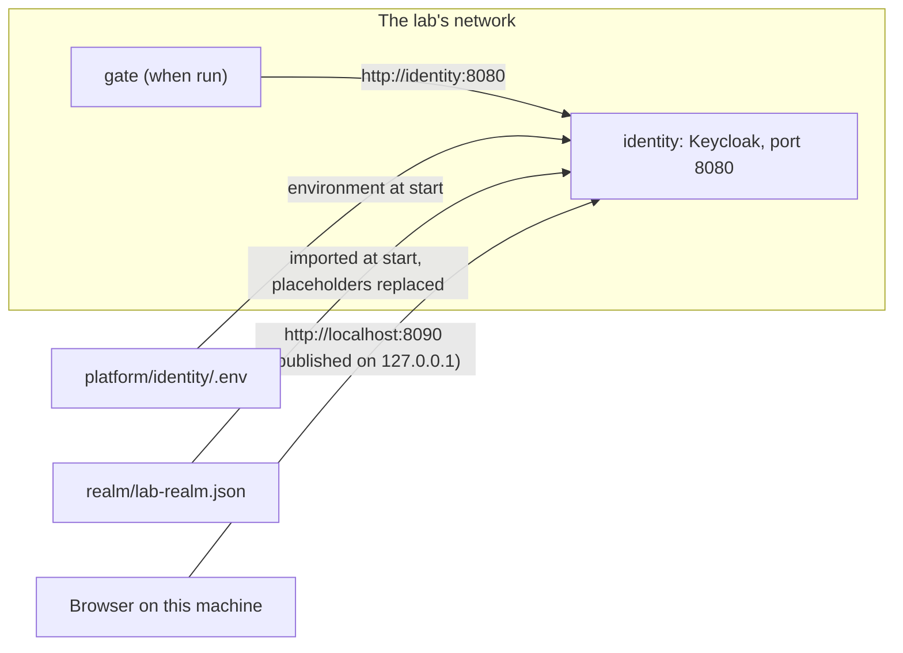
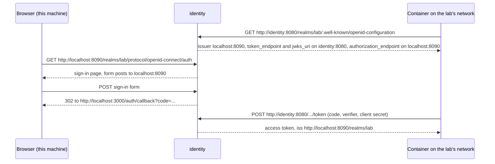

# Identity provider

The lab's OpenID Connect provider: Keycloak in development mode, one realm, imported from a file at every start. It stands in for the identity provider that AgentCore's JWT authorizer trusts. To use it, see [platform/identity/README.md](../../platform/identity/README.md).

Nothing in the lab consumes its tokens. The client, the agents and the case system neither ask for a token nor check one.

## Terms

| Term | Meaning |
|---|---|
| Provider | The `identity` service: Keycloak 26.8.2, pinned by digest, started with `start-dev --import-realm` |
| Realm | `lab`, defined by `platform/identity/realm/lab-realm.json` |
| Identity secrets | `platform/identity/.env`: the administrator's username and password, the `desk` client's secret, each user's password. Ignored by git |
| Front channel | Requests a browser makes: the sign-in page and sign-out |
| Back channel | Requests a server makes: discovery, token exchange, keys, userinfo |
| Gate | `platform/identity/gate.sh` and `platform/identity/gate/`: the check that decides whether a running provider issues the tokens described here |

## What runs

| Property | Value |
|---|---|
| Image | `quay.io/keycloak/keycloak:26.8.2`, by the digest of its index for `linux/amd64` and `linux/arm64` |
| Mode | Development (`start-dev`) |
| Database | `dev-file` (H2) under `/opt/keycloak/data`, on a tmpfs |
| Published | `127.0.0.1:8090` to container port `8080`; nothing else |
| Ready | When `GET /realms/lab/.well-known/openid-configuration` answers 200 inside the container |
| State between starts | None. Each start imports the realm from the file and makes new signing keys |
| Container | `cap_drop: ALL`, `no-new-privileges`, `init`, tmpfs on `/tmp` and `/opt/keycloak/data`. Root filesystem writable: `start-dev` rebuilds the server into `/opt/keycloak/lib/quarkus` at every start |

## The realm

| Client `desk` | Value |
|---|---|
| Type | Confidential, client secret from the identity secrets |
| Grants | Authorization Code only |
| PKCE | Required, `S256` |
| Redirect URI | `http://localhost:3000/auth/callback` |
| Post-logout redirect URI | `http://localhost:3000/` |
| Default scopes | `basic`, `profile`, `email` |
| Mappers | Audience `lab-agents`; audience `lab-case-system`; hard-coded claim `client_id` = `desk`; realm roles as top-level `roles` |

| User | Name | Email | Realm roles | Password |
|---|---|---|---|---|
| `riley.reviewer` | Riley Reviewer | `riley.reviewer@example.org` | `reviewer`, `default-roles-lab` | Identity secrets, permanent |
| `dana.desk` | Dana Desk | `dana.desk@example.org` | `default-roles-lab` | Identity secrets, permanent |

`default-roles-lab` is Keycloak's default role for the realm; it includes `offline_access` and `uma_authorization`. Every user holds it, so no user's `roles` claim is empty, and Keycloak omits an empty one.

Access tokens live 600 seconds.

## The access token

A JWT signed with RS256 by a key at the realm's `jwks_uri`.

| Claim | Value | Read by AgentCore's JWT authorizer as |
|---|---|---|
| `iss` | `http://localhost:8090/realms/lab` | The issuer of the discovery URL |
| `aud` | Contains `lab-agents` and `lab-case-system` | Allowed audiences |
| `client_id` | `desk` | Allowed client IDs |
| `roles` | Array of the user's realm role names, composites expanded; contains `reviewer` only for reviewers | A custom-claim rule (a string array contains a value) |
| `sub`, `preferred_username`, `name` | The user's id (fixed in the realm file), username and full name | — |
| `exp` − `iat` | 600 | — |

## Two addresses

| Party | Address | Uses |
|---|---|---|
| Browser | `http://localhost:8090` | Authorization endpoint, sign-in form, sign-out |
| Container on the lab's network | `http://identity:8080` | Discovery, token endpoint, `jwks_uri`, userinfo |

| Setting | Effect |
|---|---|
| `KC_HOSTNAME=http://localhost:8090` | Issuer and every front-channel URL, whatever address the request came in on |
| `KC_HOSTNAME_BACKCHANNEL_DYNAMIC=true` | Back-channel URLs use the address the request came in on |

## Where secrets live

| Secret | Written by | Held in | Read by |
|---|---|---|---|
| Administrator username and password | `setup.sh`, random | Identity secrets | The provider, at start |
| `desk` client secret | `setup.sh`, random | Identity secrets | The provider, through the realm import; the gate |
| User passwords | `setup.sh`, random | Identity secrets | The provider, through the realm import; the gate |
| Token signing keys | The provider, at start | The provider's database, on a tmpfs | Nobody outside; the public keys are at `jwks_uri` |

The realm file holds a `${NAME}` placeholder where each secret goes, and no secret.

## How it fails

| Failure | Result |
|---|---|
| `platform/identity/.env` missing | `docker compose up` stops before starting anything and names the missing variable |
| `setup.sh` without Docker | Exits 2 and says so |
| `platform/identity/.env` lacks a variable | `setup.sh` exits 1 and names it |
| The realm does not import | The service never becomes healthy; `docker compose up --wait` fails |
| The provider is not running, or its realm or tokens differ from this page | The gate exits 1 and names the first statement that does not hold |

## Not present

| What | Note |
|---|---|
| A consumer of the tokens | No piece of the lab asks for or checks a token |
| HTTPS | HTTP on loopback and the lab's network only |
| Persistence | Nothing survives a restart; tokens issued before one stop verifying after it |
| Production database or clustering | — |
| Password policy, brute-force protection, multi-factor sign-in | — |
| Self-registration, password reset, email | — |
| Federation with another identity provider | — |
