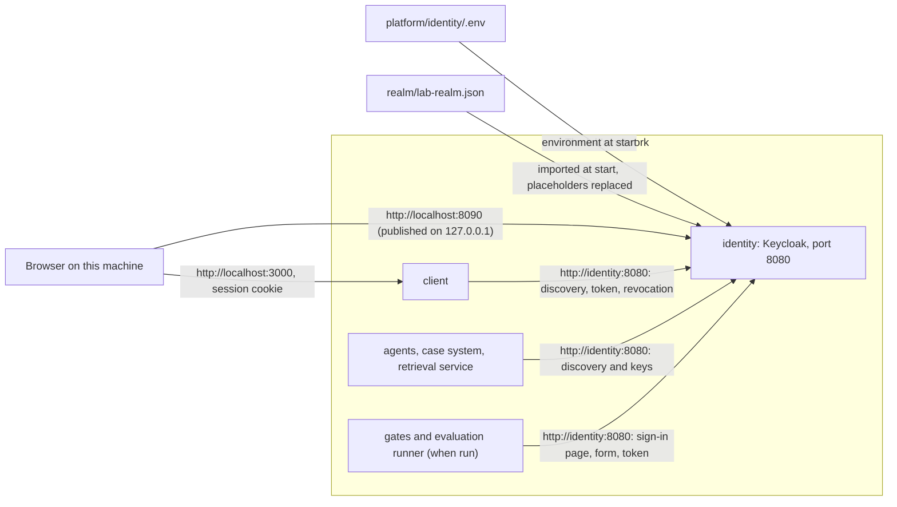
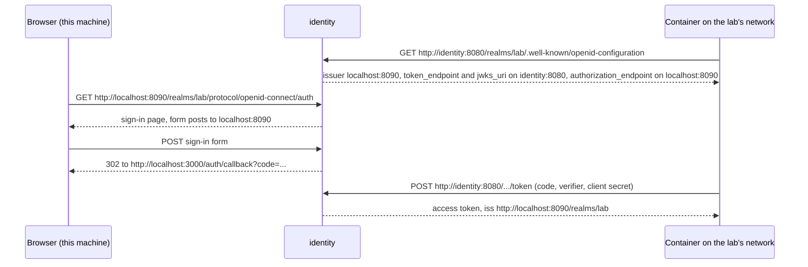
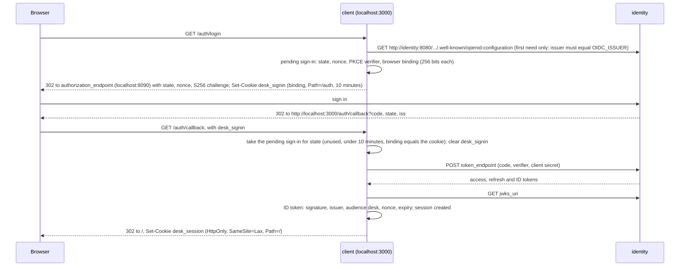
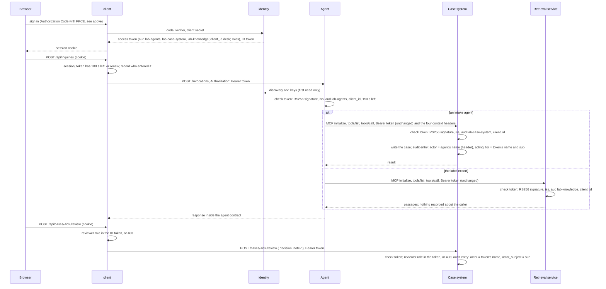

# Identity provider

The lab's OpenID Connect provider: Keycloak in development mode, one realm, imported from a file at every start. It stands in for the identity provider that AgentCore's JWT authorizer trusts. To use it, see [platform/identity/README.md](../../platform/identity/README.md).

Four pieces consume its tokens. The client's server signs desk staff in, keeps their tokens, and sends the access token on every call to an agent and to the case system. The agents require a valid access token on `POST /invocations` and pass it on: the intake agents to the case system, the label expert to the retrieval service. The case system requires a valid access token on every request but `/ping`, records the user an agent acted for, and takes the reviewer and the reviewer role from the token. The retrieval service (`knowledge/`) requires a valid access token with audience `lab-knowledge` on every request but `/ping`, and takes nothing else from it.

Four programs get a token, or a signed-in session, without a browser: the identity gate, the stack gate, the knowledge gate and the evaluation runner ([Signing in without a browser](#signing-in-without-a-browser)).

## Terms

| Term | Meaning |
|---|---|
| Provider | The `identity` service: Keycloak 26.8.2, pinned by digest, started with `start-dev --import-realm` |
| Realm | `lab`, defined by `platform/identity/realm/lab-realm.json` |
| Identity secrets | `platform/identity/.env`: the administrator's username and password, the `desk` client's secret, each user's password. Ignored by git |
| Front channel | Requests a browser makes: the sign-in page and sign-out |
| Back channel | Requests a server makes: discovery, token exchange, keys, userinfo |
| Gate | `platform/identity/gate.sh` and `platform/identity/gate/gate.ts`: the check that decides whether a running provider issues the tokens described here |
| Stack gate | `platform/identity/stack-gate.sh` and `platform/identity/gate/stack-gate.ts`: the check of sign-in and token use through the whole running stack |
| Client | The desk's server, `client/src/`, the relying party registered as `desk` |
| Session | The client's record of one signed-in user: who they are and their tokens, in the client's memory, found by a random identifier |

## What runs

| Property | Value |
|---|---|
| Image | `quay.io/keycloak/keycloak:26.8.2`, by the digest of its index for `linux/amd64` and `linux/arm64` |
| Mode | Development (`start-dev`) |
| Database | `dev-file` (H2) under `/opt/keycloak/data`, on a tmpfs |
| Realm file | `platform/identity/realm/` mounted read-only at `/opt/keycloak/data/import`; imported when the container starts, and at no other time |
| Published | `127.0.0.1:8090` to container port `8080`; nothing else |
| Ready | When `GET /realms/lab/.well-known/openid-configuration` answers 200 inside the container |
| State between starts | None. Each start imports the realm from the file and makes new signing keys |
| Container | `cap_drop: ALL`, `no-new-privileges`, `init`, tmpfs on `/tmp` and `/opt/keycloak/data`. Root filesystem writable: `start-dev` rebuilds the server into `/opt/keycloak/lib/quarkus` at every start |

### Changing the realm file

The realm file is read only at start. A running provider keeps the realm it imported until its container stops; the tmpfs that holds its database is emptied then, so the next start imports the file as it is.

| Operator does | Effect |
|---|---|
| Edits `realm/lab-realm.json` | Nothing, until the provider restarts. `docker compose up -d` does not restart it: the compose configuration has not changed |
| Restarts the provider: `docker compose restart identity` at the repository root, or `docker compose -f platform/identity/compose.yaml restart identity` when it was started on its own | The edited realm is imported; new signing keys |
| Then | Every access token issued before the restart is refused (`bad_signature`: its key is no longer published). Every client session ends at its next renewal, which the provider refuses (401 `not_signed_in`); its users sign in again |

## The realm

| Client `desk` | Value |
|---|---|
| Type | Confidential, client secret from the identity secrets |
| Grants | Authorization Code only. No password grant, implicit flow, service account, device grant, CIBA or token exchange |
| PKCE | Required, `S256` |
| Redirect URI | `http://localhost:3000/auth/callback` |
| Post-logout redirect URI | `http://localhost:3000/` |
| Default scopes | `basic`, `profile`, `email` |
| Mappers | Audience `lab-agents`; audience `lab-case-system`; audience `lab-knowledge`; hard-coded claim `client_id` = `desk` (access token); realm roles as top-level `roles` (access token and ID token) |

| User | Name | Email | Realm roles | Password |
|---|---|---|---|---|
| `riley.reviewer` | Riley Reviewer | `riley.reviewer@example.org` | `reviewer`, `default-roles-lab` | Identity secrets, permanent |
| `dana.desk` | Dana Desk | `dana.desk@example.org` | `default-roles-lab` | Identity secrets, permanent |

`default-roles-lab` is Keycloak's default role for the realm; it includes `offline_access` and `uma_authorization`. Every user holds it, so no user's `roles` claim is empty, and Keycloak omits an empty one.

Access tokens live 600 seconds.

## The access token

A JWT signed with RS256 by a key at the realm's `jwks_uri`.

| Claim | Value | Read by AgentCore's JWT authorizer as |
|---|---|---|
| `iss` | `http://localhost:8090/realms/lab` | The issuer of the discovery URL |
| `aud` | Contains `lab-agents`, `lab-case-system` and `lab-knowledge` | Allowed audiences |
| `client_id` | `desk` | Allowed client IDs |
| `roles` | Array of the user's realm role names, composites expanded; contains `reviewer` only for reviewers | A custom-claim rule (a string array contains a value) |
| `sub`, `preferred_username`, `name` | The user's id (fixed in the realm file), username and full name | — |
| `exp` − `iat` | 600 | — |

Every access token carries all three audiences, so one token is accepted by every agent, the case system and the retrieval service.

## The ID token

Signed the same way, issuer `http://localhost:8090/realms/lab`, audience `desk`. The client reads `sub`, `name`, `preferred_username` and `roles` from it; `reviewer` in `roles` makes the user a reviewer.

## Two addresses

| Party | Address | Uses |
|---|---|---|
| Browser | `http://localhost:8090` | Authorization endpoint, sign-in form, sign-out |
| Container on the lab's network: the client, the agents, the case system, the retrieval service | `http://identity:8080` | Discovery, token endpoint, `jwks_uri`, revocation (the client) |
| Container on the lab's network standing in for a browser: the gate, the stack gate, the knowledge gate, the evaluation runner | `http://identity:8080` | As above, and the sign-in page and form: each sends a URL it is given on `http://localhost:8090` to `http://identity:8080` with the same path and query |

| Discovery field, fetched at `http://identity:8080` | Address given |
|---|---|
| `issuer`, `authorization_endpoint`, `end_session_endpoint` | `http://localhost:8090`, the browser's |
| `token_endpoint`, `jwks_uri`, `userinfo_endpoint`, `introspection_endpoint` | `http://identity:8080` |
| `revocation_endpoint` | `http://localhost:8090`, the browser's, which a container cannot reach. The client does not read it: it is configured with `OIDC_REVOCATION_ENDPOINT` = `http://identity:8080/realms/lab/protocol/openid-connect/revoke` |

| Setting | Effect |
|---|---|
| `KC_HOSTNAME=http://localhost:8090` | Issuer and every front-channel URL, whatever address the request came in on |
| `KC_HOSTNAME_BACKCHANNEL_DYNAMIC=true` | Back-channel URLs use the address the request came in on |

## Signing in through the client

| Step | Refused when | Answer |
|---|---|---|
| Callback | State unknown, used, or 10 minutes old; no `desk_signin` cookie, or another sign-in's; the provider sent `error` | 400 page, no session; the pending sign-in is used up |
| Code exchange, ID token | The provider refuses the code; the ID token fails a check (signature, issuer, audience, nonce, or `exp`, `iat`, `nbf` with 30 s of leeway); it lacks `sub`, `name` or `preferred_username`; its `roles` is not a list of names | 502 page, no session |
| Code exchange | The provider cannot be reached | 502 page `identity_unreachable`, no session |
| Discovery | Unreachable within 10 s; not JSON; `issuer` is not `OIDC_ISSUER`; no `authorization_endpoint`, `token_endpoint` or `jwks_uri` | 502 page `identity_unreachable`; no sign-in is left pending |

Each request the client makes to the provider waits at most 10 s. The discovery document is kept for the life of the process once fetched.

### Sessions and where tokens live

| Held | Where | For how long |
|---|---|---|
| Access, refresh and ID tokens; the user's subject, name, username and roles | The client's memory, in the session | Until sign-out, a failed renewal, or the client stops |
| Pending sign-ins (state, nonce, verifier, binding) | The client's memory | Until their callback, 10 minutes, or 1000 newer ones |
| A pending sign-in's binding | The browser that started it, in the `desk_signin` cookie | Until the callback clears it, or 10 minutes |
| Session identifier | The browser, in the `desk_session` cookie | Until sign-out clears it |
| Who entered an inquiry and started a run: subject and name | The client's SQLite file | With the inquiry |

No token is written to disk or to the store, and no response carries a token, in its body or in any header.

### Signing out

| Step | What happens |
|---|---|
| `POST /auth/logout` | With no session, 401 `not_signed_in`. Otherwise the session is removed and `desk_session` cleared |
| Revocation | The refresh token is revoked (RFC 7009) at the configured `OIDC_REVOCATION_ENDPOINT`, authenticating as `desk`; with `none`, no call. A refusal or no answer is logged (`revoking the refresh token at the identity provider failed`); sign-out goes on |
| Answer | 200 with `sign_out_url`: the provider's `end_session_endpoint` with `client_id` and `post_logout_redirect_uri`, and no token. 502 `identity_unreachable` if the discovery document cannot be had |

### What the client sends downstream

| Call | `Authorization` | Access token must have left |
|---|---|---|
| Agent `POST /invocations` (a new inquiry, or a new run of one) | `Bearer <access token>` | 180 s, the time the client waits for an agent |
| Case system: list, get, review | `Bearer <access token>` | 30 s |
| Health checks (`/ping`) | None | — |

With less time left the client renews the access token with the refresh token first; requests that arrive during a renewal wait for it. If the provider refuses or cannot be reached, or the renewed token still has less time left than the call needs, the request answers 401 `not_signed_in`, the session is removed, and nothing is sent. A review is forwarded as `{ decision, note? }`, with no reviewer field, and only for a user holding `reviewer`; the case system takes the reviewer from the access token.

## The agents

Every agent checks the access token with `shared/access-token.ts` and passes the accepted token on. Where the check is made ([agent-runtime.md](agent-runtime.md)):

| Agent | Checked by | Before the body is read | A refusal |
|---|---|---|---|
| Intake agent, hand-written | `agents/src/contract/server.ts` | Yes | 401 or 503, below |
| Intake agent on Strands, label expert | The local edge, `agents/src/contract/edge.ts` | Yes | 401 or 503, below |
| The same two, again, for the caller | `agents/src/contract/sdk-app.ts`, after AWS's SDK has read the body | No | 200 with `outcome: failed` and a reason saying the token was not valid or could not be checked. Reached only with the edge off |

| Order | Check | Refused as |
|---|---|---|
| 1 | `Authorization: Bearer` present | `missing` |
| 2 | A JWT, header algorithm RS256 | `malformed`; any other algorithm, `none` included, `bad_signature` |
| 3 | Signature against the keys at `jwks_uri` | `bad_signature` |
| 4 | Not past `exp`, on the agent's clock, no tolerance | `expired` |
| 5 | `iss` = `http://localhost:8090/realms/lab` | `wrong_issuer` |
| 6 | `aud` contains `lab-agents` | `wrong_audience` |
| 7 | `client_id` in `desk` | `wrong_client` |
| 8 | At least 150 s (the run's time limit) before `exp` | `expires_too_soon` |
| 9 | `sub`, `preferred_username`, `name` present; `roles` a list if present | `malformed` |

| Answer | When |
|---|---|
| 401, `WWW-Authenticate: Bearer error="invalid_token"`, `{"error":"unauthorized","reason","detail"}` | A refusal above. The handler is not called |
| 503 `identity_unavailable` | Discovery or keys cannot be fetched, discovery names another issuer, or the key set holds an RSA key that is not a valid RS256 public key. The handler is not called |
| As before, the handler given the caller | An accepted token |

The discovery document and keys are fetched on first need and kept; a failure is not kept. Each request to the provider waits at most 5 s. A token naming a key not yet seen makes the agent fetch the keys again, at most every 30 s, so new keys after a provider restart are picked up without restarting the agent. `GET /ping` needs no token.

| Passed on | By | To | How | Refused there |
|---|---|---|---|---|
| The caller's access token, as presented | Both intake agents | The case system's MCP endpoint | `Authorization: Bearer` on every request (connect, tool list, every tool call), beside the four context headers | At connection, the run ends: "The case system refused the caller's token." (401) or "The case system could not check the caller's token." (503) |
| The caller's access token, as presented | The label expert | The retrieval service's MCP endpoint | `Authorization: Bearer` on every request (connect, tool list, every tool call), and no other header of the caller's | At connection, the run ends: "The retrieval service refused the caller's token." (401) or "The retrieval service could not check the caller's token." (503) |

| AgentCore Runtime JWT authorizer setting | The agent's setting | Value in the lab |
|---|---|---|
| Discovery URL (ends `/.well-known/openid-configuration`) | `AUTH_DISCOVERY_URL` | `http://identity:8080/realms/lab/.well-known/openid-configuration` |
| Issuer (from the discovery document) | `AUTH_ISSUER`, compared exactly | `http://localhost:8090/realms/lab` |
| Allowed audiences | `AUTH_ALLOWED_AUDIENCE` | `lab-agents` |
| Allowed clients (the `client_id` claim) | `AUTH_ALLOWED_CLIENTS`, separated by commas | `desk` |
| Custom-claim rule (optional) | `AUTH_ROLES_CLAIM` names the claim; no rule is applied | `roles` |
| — | Minimum remaining life | 150 s |

## The case system

Both case-system servers check the access token with `shared/access-token.ts` before anything else, with the agents' checks in the same order, audience `lab-case-system` and no minimum remaining life, and the same provider timeout and key refetch. A refusal is 401 with `WWW-Authenticate: Bearer error="invalid_token"` and `{error, reason, detail}`; a provider that cannot be asked is 503 `identity_unavailable`. Every route but `GET /ping` needs the token, an unknown one included. Nothing reaches the MCP server or the store before the token is accepted.

| Server | Route | Needs | Takes from the token |
|---|---|---|---|
| Agent server | `POST /mcp` | A valid token | The user the agent acts for: `name` and `sub`, recorded on every audit entry of the agent's change beside the agent's name |
| Review server | `GET /cases`, `GET /cases/<id>` | A valid token | — |
| Review server | `POST /cases/<id>/review` | A valid token whose `roles` hold `AUTH_REVIEWER_ROLE` (`reviewer`); checked before the case is looked up or the body read (403 `not_a_reviewer`) | The reviewer: `name` as the audit actor, `sub` as `actor_subject`. A body naming a `reviewer` is 400 |
| Both | `GET /ping` | Nothing | — |

## The retrieval service

The retrieval service (`knowledge/src/search/`) checks the access token with `shared/access-token.ts` before the request target or the body is read, in the same order as the case system, with audience `lab-knowledge`, allowed client `desk`, no minimum remaining life, and the same provider timeout and key refetch. A refusal is 401 with `WWW-Authenticate: Bearer error="invalid_token"` and `{error, reason, detail}`; a provider that cannot be asked is 503 `identity_unavailable`. Every route but `GET /ping` needs the token, an unknown one included. The token goes no further: the embedding and reranking model servers are called with the model server's key. See [knowledge.md](knowledge.md).

| Route | Needs | Takes from the token |
|---|---|---|
| `POST /mcp` | A valid token | Nothing: the tools search a public corpus and record nothing about the caller |
| `GET /ping` | Nothing | — |

## Signing in without a browser

Each of these runs in a container on the stack's default network (`<compose-project>_default`), reaches the provider at `http://identity:8080`, and is given only the values it names from the identity secrets, by Compose. None prints a password, secret, code or token.

| Party | Started by | User | How | Secrets given | What it does with it |
|---|---|---|---|---|---|
| Gate | `platform/identity/gate.sh` | `riley.reviewer` and `dana.desk` | Authorization Code with PKCE through `desk`, standing in for the browser: requests the sign-in page, posts Keycloak's form, reads the redirect to the callback without requesting it, and exchanges the code itself | `IDENTITY_DESK_CLIENT_SECRET`, `IDENTITY_RILEY_PASSWORD`, `IDENTITY_DANA_PASSWORD` | Checks the tokens' signatures and claims; tries the grants that must be refused |
| Stack gate | `platform/identity/stack-gate.sh` | `riley.reviewer` and `dana.desk` | Through the client: `/auth/login`, Keycloak's form, the client's callback. The client exchanges the code; the gate holds cookies, never a token | `IDENTITY_RILEY_PASSWORD`, `IDENTITY_DANA_PASSWORD` | Uses the desk as a browser would, and knocks on the intake agents and the case system with no token |
| Knowledge gate | `knowledge/gate.sh` | `dana.desk` | As the gate, through `desk` | `IDENTITY_DESK_CLIENT_SECRET`, `IDENTITY_DANA_PASSWORD` | Calls the retrieval service's MCP endpoint with the access token. A failed sign-in is exit 2 |
| Evaluation runner | `evaluation/run.sh` | `dana.desk` | As the gate, through `desk`. Signs in again, rather than renewing, when the token has under 200 s left | `IDENTITY_DESK_CLIENT_SECRET`, `IDENTITY_DANA_PASSWORD` | Sends it to the label expert on `POST /invocations`, which passes it to the retrieval service. A question for which no token could be got is recorded with the reason `no access token could be got` |

## From sign-in to an audit entry

### Who checks what

| Checker | What it receives | Audience required | Other checks | What it takes from the token |
|---|---|---|---|---|
| Client | The ID token, from the token endpoint at sign-in | `desk` (the ID token's `aud`) | Signature, issuer, nonce, expiry (30 s leeway); the browser that started the sign-in | Who the user is, and whether they hold `reviewer` |
| Agent | The access token: from the client; for the label expert, also from the evaluation runner (`dana.desk`'s) | `lab-agents` | Signature (RS256), issuer, `client_id` `desk`, 150 s left | The caller, given to the handler; the token itself, passed on |
| Case system | The access token, from an intake agent or from the client | `lab-case-system` | Signature (RS256), issuer, `client_id` `desk`, not expired | The user an agent acted for; the reviewer and the reviewer role |
| Retrieval service | The access token: the label expert sends its caller's; the knowledge gate sends `dana.desk`'s | `lab-knowledge` | Signature (RS256), issuer, `client_id` `desk`, not expired | Nothing |

## Where secrets live

| Secret | Written by | Held in | Read by |
|---|---|---|---|
| Administrator username and password | `setup.sh`, random | Identity secrets | The provider, at start |
| `desk` client secret | `setup.sh`, random | Identity secrets | The provider, through the realm import; the gate; the knowledge gate; the evaluation runner; the client, as `OIDC_CLIENT_SECRET`, the only value its container takes from the identity secrets |
| User passwords | `setup.sh`, random | Identity secrets | The provider, through the realm import; the gate and the stack gate (both users'); the knowledge gate and the evaluation runner (`dana.desk`'s only) |
| Token signing keys | The provider, at start | The provider's database, on a tmpfs | Nobody outside; the public keys are at `jwks_uri` |

The realm file holds a `${NAME}` placeholder where each secret goes, and no secret.

## How it fails

| Failure | Result |
|---|---|
| `platform/identity/.env` missing | `docker compose up` stops before starting anything and names the missing variable |
| `setup.sh` without Docker | Exits 2 and says so |
| `platform/identity/.env` lacks a variable | `setup.sh` exits 1 and names it |
| The realm does not import | The service never becomes healthy; `docker compose up --wait` fails |
| The realm file was edited and the provider not restarted | The provider keeps serving the realm it imported at start |
| The provider restarted | Tokens issued before are refused as `bad_signature`; client sessions end at their next renewal |
| The provider does not answer on a running project's network, or a statement on this page about its realm or tokens does not hold | The gate exits 1 and names the first statement that does not hold |
| The gate cannot run: no `platform/identity/.env`, no network for the project, or no report | The gate exits 2 and says why on standard error |

## Not present

| What | Note |
|---|---|
| Proof of which agent is calling | The agent's own identity is a header it claims (`x-agent-id`). The case system checks the user's token, not the agent: anything holding a valid token can claim to be any agent |
| Proof of who sent a message | The sender is text that the signed-in user vouches for. Lookups and follow-ups are limited by that text |
| A narrower token downstream | The agents pass the user's access token on unchanged. It is not exchanged for one limited to the agent, the message or the run, and it carries all three audiences, so the case system and the retrieval service accept it from any agent for anything that user may do there |
| Special handling of a token refused mid-run | A tool call the case system refuses after it accepted the connection falls under the agents' rules for a call that got no answer |
| Use of the caller's roles by the agents | The roles are read and given to the handler; nothing is decided on them |
| Role-based access to reading cases | Any valid token lists and reads every case on the review server |
| Session expiry of the client's own | A session ends only at sign-out, a failed renewal or a restart |
| `Secure` on the session cookie | The client is served over HTTP on this machine |
| HTTPS | HTTP on loopback and the lab's network only |
| Persistence | Nothing survives a restart; tokens issued before one stop verifying after it |
| Production database or clustering | — |
| Password policy, brute-force protection, multi-factor sign-in | — |
| Self-registration, password reset, email | — |
| Federation with another identity provider | — |
