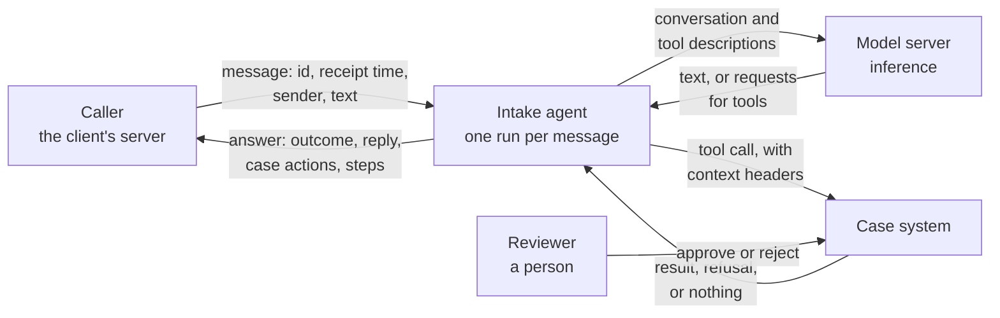
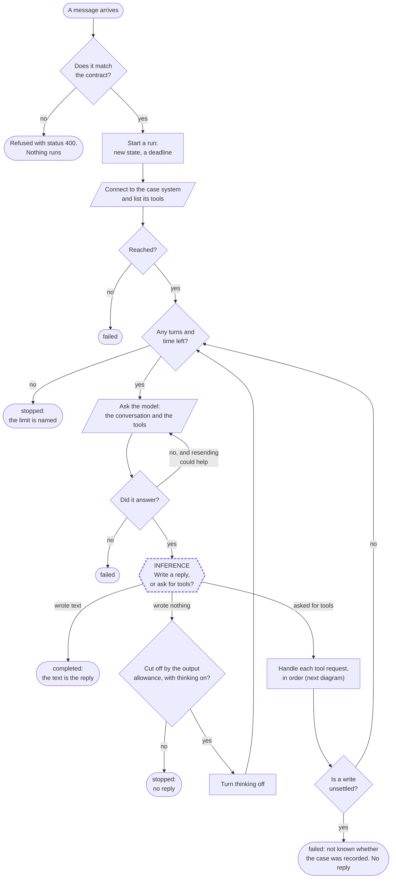
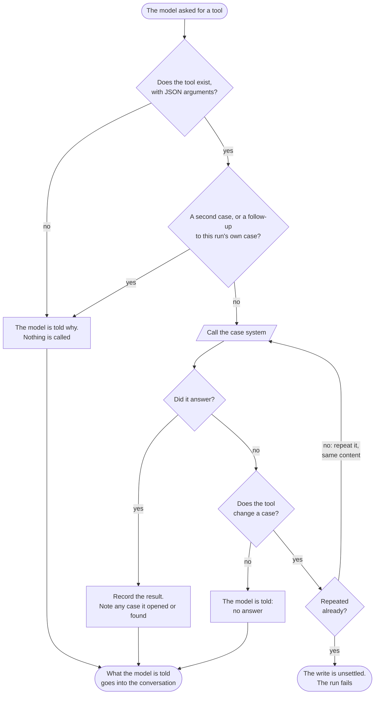

# The intake agent as an actor

An agent is an actor in which one step of the behaviour is decided by inference. This document reads the intake agent that way. It holds for both implementations, the [hand-written loop](intake-agent-handwritten.md) and the one [on Strands](intake-agent-strands.md); where they differ, a table says so. Terms and module boundaries are in those two documents.

## The parts of an actor, and where each one is

| An actor has | In the intake agent | Where |
|---|---|---|
| A mailbox | `POST /invocations`. One message per request | `contract/server.ts` |
| State that nothing else can touch | The run: its steps, its case actions, the case it opened, whether a write is unsettled, its deadline. And the conversation with the model | `IntakeRun` in `intake/run.ts`, built on `RunState` in `run/state.ts`; the conversation held by the loop |
| A behaviour: what it does when a message arrives | Ask the model, apply the rules, call the case system, answer | `intake/handwritten.ts`, or Strands' `Agent` with four hooks in `intake/strands.ts` |
| Messages it sends to other actors | Requests to the model server and to the case system, and one answer to the caller | `model/chat.ts` or Strands' `OpenAIModel`; `tools/case-system.ts` or Strands' `McpClient` |
| A lifetime | One message. Each message gets a new run with new state, and nothing is kept once it is answered | `startRun` in `intake/run.ts` |

One step of the behaviour is not written in code: what to do next, given the conversation so far. That step is asked of a model. Every other step is ordinary code.

## The actors and their messages

Every message is a request that waits for its answer, with a time limit. None is sent and forgotten.

| Actor | State it owns | What it decides |
|---|---|---|
| Caller | The message's identifier and receipt time; the answers it was given | Which agent is sent the message, and whether to send it again |
| Intake agent | One run, discarded when answered | The order of work, whether a call may be made, and how the run ends |
| Model server | Nothing between requests | What to write, or which tool to ask for, given the conversation it is sent |
| Case system | Cases, their versions and the audit trail | Whether a case exists, is complete or is a repeat, and which sender may see it |
| Reviewer | Nothing | Whether a case is approved |

## The behaviour for one message

A six-sided box is decided by inference. A diamond is decided by code. A slanted box is a message sent to another actor. A rounded box is an ending.

A turn is one pass from "Any turns and time left?" through the model and back. A run has at most 6 turns and 150 seconds.

## The behaviour for one tool request

Inference asked for the tool. Every box here is code.

### Where an implementation differs from the diagrams

| Step | Hand-written loop | Strands |
|---|---|---|
| "Did it answer?" for the model | The loop sends a failed request again: up to 3 requests for a turn, never one that ran out of time | The OpenAI client inside Strands sends it again, timed-out ones included; Strands adds its own retry when the model throttles |
| "Does the tool exist, with JSON arguments?" | The loop's own check | Strands' check. Arguments that are not JSON end the run as `failed` instead of being told to the model |
| "wrote text", when the text was cut off by the output allowance | `completed`, with the cut-off text as the reply | `stopped`, with no reply |
| "Turn thinking off" | Uses one of the 6 turns | Does not use a turn |
| Where the diamonds are evaluated | Inline, in the order drawn | In hooks Strands calls before and after each model call and tool call |

## Who decides what

| Decision | Decided by | Held in check by |
|---|---|---|
| Whether the message reports an adverse event | Inference | The prompt. No code checks it |
| Which tool to ask for, and its arguments | Inference | Code: the tool must exist and the arguments must be JSON. The case system: each part of a report must be present |
| Whether a call is made | Code | `refusalBeforeCall` in `intake/run.ts` |
| Whether a write that got no answer is repeated | Code | `afterCall` in `intake/run.ts`: once, with identical content |
| Whether a case exists, is a repeat or is complete | The case system | Its own rules, keyed on the message identifier and the sender |
| What the reply says | Inference | Nothing. The reply is returned as written |
| How the run ends | Code | The named endings in `run/endings.ts` |
| Whether a case is approved | A person | The case system records who and when |

## Always true, in this view

1. Inference sends no message to another actor. It returns a proposal to the agent's code, which makes the call or refuses it.
2. State changes in two places only: the run's own state, which is private and discarded, and the case system, which owns its own.
3. Runs share no state. Two runs of one message meet only at the case system, which opens one case.
4. Every message has a time limit and a defined result when no answer comes.
5. The agent does not fail towards its caller. Once a message is accepted, every failure is an outcome with the steps taken.

## What happens to each message when no answer comes

| Message | When no answer comes | Sent at most | Sending it twice is safe because |
|---|---|---|---|
| Caller to agent | The caller stops waiting at 180 s and records the run as failed | Once for a run. A person may start another run of the same message | The case system recognises the message identifier |
| Agent to model | A failed connection or a status of 408, 429 or 5xx is sent again. A request that ran out of time is not (hand-written loop) | 3 times for a turn (hand-written loop) | Asking the model changes nothing |
| Agent to case system, a lookup | The model is told there was no answer | Once | Not applicable |
| Agent to case system, a write | Repeated once by code. If that also gets no answer, the run fails as not known | Twice | The case system recognises identical content for the same message |

## Design choices in this actor

The actor model leaves each of these open. This is what the intake agent chose, and why.

| Choice | What this agent does | Why | What follows |
|---|---|---|---|
| How a message is delivered | A request that is held open until the answer. No queue in front of the agent | The desk wants the outcome of this message: the reply and any case it opened. `/invocations` on AgentCore Runtime is a request and its answer | The caller waits up to 180 s. The client does that waiting in the background, so the person at the desk is not held |
| How long the actor lives | One run for one message. Its state is discarded when it answers | Each message is handled the same whatever came before, and one sender's conversation cannot reach another's. What must last is in the case system | The agent knows nothing of earlier messages, except what the case system returns from a lookup |
| What happens when a run fails | The failure is reported to the caller as an outcome. Nothing restarts the run | Whether to try again is a decision for a person at the desk. Trying again is safe, because the case system opens one case for a message | Another run is started by a person |
| Whether it hands work to other actors | It hands none on | Recording an adverse event is one job with three tools | One agent does the whole job |
