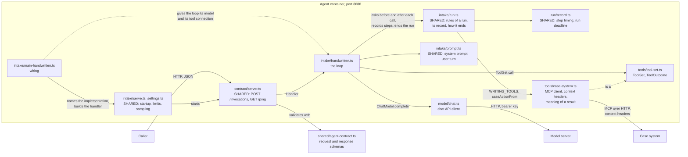
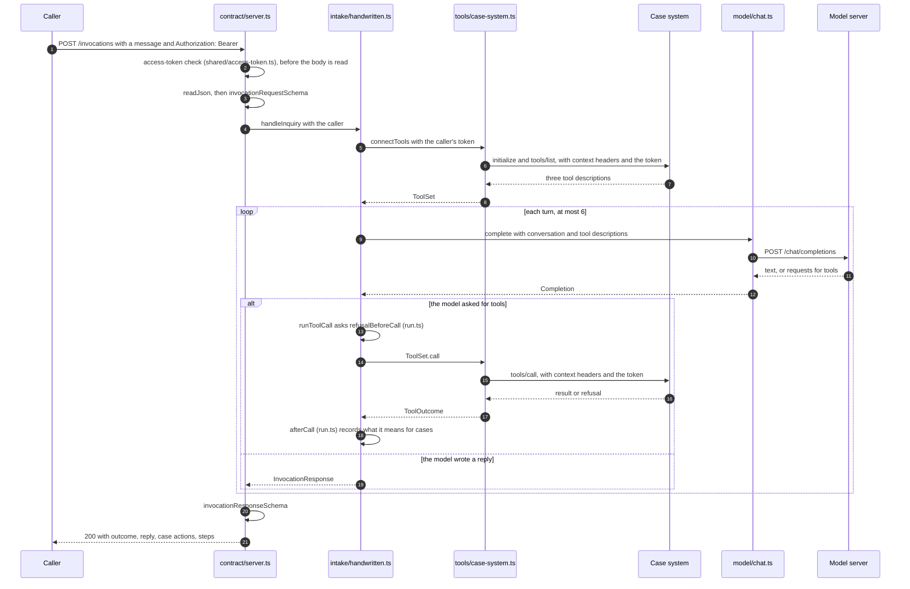
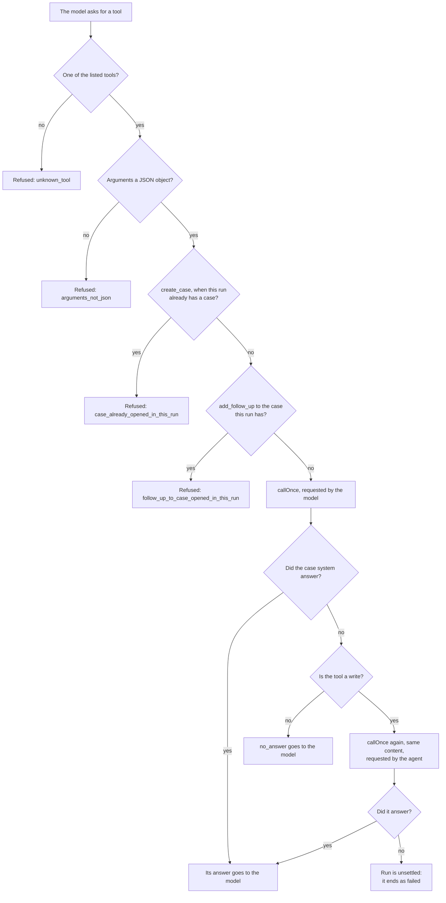
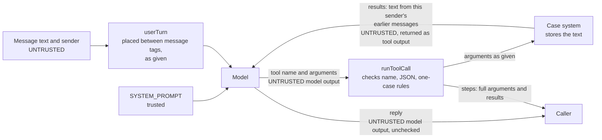

# Intake agent, hand-written loop

One agent in one container. It receives a clinician's message, decides with a model whether the message reports an adverse event, and records it in the case system. Its loop is written by hand. To run it, see [agents/README.md](../../agents/README.md).

The same agent also exists on Strands: [intake-agent-strands.md](intake-agent-strands.md). The two share the prompt, the rules of a run, the run's record, the settings and the startup. This document marks which modules are shared.

## Terms

| Term | Meaning |
|---|---|
| Caller | Whatever posts to `/invocations` with an access token the agent accepts. In the lab, the client's server, on behalf of the signed-in member of staff |
| Access token | The caller's `Authorization: Bearer` token, issued by the identity provider. Checked by `shared/access-token.ts` |
| Message | One inbound message: an identifier, a receipt time, a sender, and text. The caller sets all four |
| Run | The handling of one message by one call to `/invocations` |
| Turn | One answer asked of the model inside a run. Usually one request; up to three when a request fails and is sent again |
| Tool set | A list of tool descriptions and a function that calls them. The case system's is the only one |
| Write | A tool call that changes a case: `create_case` or `add_follow_up` |
| Step | One entry in the run's record: a model turn, a tool call, or an error |
| Context headers | `x-message-id`, `x-received-at`, `x-agent-id`, `x-sender`, sent on every request to the case system beside the caller's access token |

## Modules and their boundaries

| Module | Owns | Knows nothing about |
|---|---|---|
| `contract/server.ts` | The HTTP surface. That a valid request always gets an answer inside the contract | The model, tools, cases, what the handler does |
| `intake/handwritten.ts` | The order of work in a run: when the model is asked, when a tool is called, when each rule is applied. Three rules of its own: an unknown tool, arguments that are not JSON, and when a failed request to the model is sent again | HTTP, MCP, the model server's address, how a tool is reached |
| `intake/run.ts` (shared) | The rules both implementations apply (one case per run, the repeat of a lost write, an unsettled write, the turn lost to thinking), the run's record, and the wording of every ending | Who is looping, the model, how a tool is reached |
| `intake/prompt.ts` | What the model is told, and how the message is laid out for it | Everything else |
| `run/record.ts` | Measuring a step and counting down the run's time | What is being timed |
| `tools/tool-set.ts` | The shape of any tool set and of what a call can come back as | Any particular tool |
| `tools/case-system.ts` | The MCP connection, the context headers, which tools write, and what an answer means for the run's record | The model, the loop |
| `model/chat.ts` | One request to the model server, the reading of its answer, and whether a failure could go differently if the request were sent again. It never sends twice | Tools' meaning, cases, the loop |
| `intake/serve.ts`, `intake/settings.ts` (shared) | Reading the environment, the limits and sampling settings, asking which model is served, starting the server | The rules of a run, which implementation runs |
| `model/served.ts` (shared) | The model settings, the question "which model do you serve", and the wording of a model failure | Chat requests |
| `intake/main-handwritten.ts` | Connecting this implementation's modules | The rules of a run |

The loop receives the model, the tool connection, its clock, its way of waiting and its source of randomness as arguments (`IntakeDeps`). It knows nothing about the case system. The shared rules in `run.ts` do: they import `WRITING_TOOLS` and `caseActionFrom` from `tools/case-system.ts`, and they name `create_case` and `add_follow_up`.

## One request, end to end

The same flow by function:

| # | Where | What happens |
|---|---|---|
| 1 | `createContractServer` in `contract/server.ts` | Routes `POST /invocations` to `invoke`. `GET /ping` answers `Healthy`, needs no token, and does not check the model or the case system |
| 1a | `invoke` → the access-token check | Checks the `Authorization` header before the body is read (see "The caller's token"). A refused token gets 401 and a check that cannot be made gets 503; nothing else runs |
| 2 | `invoke` → `readJson` | Reads the body, at most 1 MB, as JSON |
| 3 | `invoke` | Checks the body against `invocationRequestSchema`. A body that fails gets 400, and nothing else runs |
| 4 | Handler in `serve.ts` → `ready`, given the caller | On the first request, asks the model server which model it serves (`servedModelId`) unless `MODEL_ID` names it, then has `main-handwritten.ts` build the client (`createChatModel`) and the handler |
| 5 | `handleInquiry` in `intake/handwritten.ts` → `startRun` in `run.ts` | Starts the run: its `Deadline`, and empty lists of steps and case actions |
| 6 | `connectCaseTools` in `tools/case-system.ts` | Opens the MCP connection with the four context headers, taken from the message and the agent's name, and `Authorization: Bearer` with the caller's token as it was presented, on every request. Lists the tools. Each becomes a tool description for the model |
| 7 | `loop` | Starts the conversation: `SYSTEM_PROMPT`, then `userTurn(message)` |
| 8 | `loop` → `askModel` → `ChatModel.complete` in `model/chat.ts` | Sends the conversation and the tool descriptions. The time allowed is the smaller of the model limit and what the run has left. A request that fails may be sent again (see "A failed request to the model") |
| 9 | `loop` | Records a model step. If the model asked for no tools, the run ends here (see "How a run ends") |
| 10 | `loop` → `runToolCall`, once per tool the model asked for, in order | Decides whether the call is made: its own two checks, then `refusalBeforeCall` in `run.ts` (see "One tool call") |
| 11 | `runToolCall` → `callOnce` → `ToolSet.call` | Makes the MCP call and records a tool step (`recordToolCall`) |
| 12 | `runToolCall` → `afterCall` in `run.ts` → `caseActionFrom` | Turns the case system's answer into a case action, remembers the case this run opened or found open, and says whether the call is done, to be repeated, or unsettled |
| 13 | `loop` | Appends one tool message per call to the conversation, and goes to step 8 |
| 14 | `completed`, `stoppedAt...`, `failed` in `run.ts` | Builds the response: outcome, stop reason, reply, case actions, steps |
| 15 | `handleInquiry` | Closes the MCP connection |
| 16 | `invoke` | Checks the response against `invocationResponseSchema` and sends it with 200 |

## One tool call

Everything between the model asking for a tool and the model being told what happened is `runToolCall`. The first two checks are this loop's own. The rest are the shared rules: the two one-case checks are `refusalBeforeCall`, and what follows a call is `afterCall`.

- A refusal makes no call. It is recorded as a tool step with `is_error`, and the model is told why.
- "This run has a case" means the case system answered `create_case` with a case: newly created, recognised as a repeat, or refused because a case is already open for this message.
- An answer from the case system that is itself a refusal still counts as an answer. Only silence triggers the repeat.

## A failed request to the model

A request to the model changes nothing in the case system, so sending it twice is safe. `askModel` in `intake/handwritten.ts` does it. A write is different, and has its own rule above.

| Question | Answer | Why |
|---|---|---|
| Which failures are sent again | The connection failed, or the status is 408, 429 or 5xx | These can go differently a moment later. `model/chat.ts` marks them `retryable` |
| Which are not | Any other status, such as 400 or 401, and an answer that is not in the expected form | The same request would get the same answer |
| A request that ran out of time | Not sent again. The run fails after that one request: 90 s at most | A request is allowed 90 s of a run's 150 s. A second one would get at most 60 s, less than the one that just ran out, and the caller would wait the whole 150 s to hear the same thing |
| How many requests | Three at most for one turn | What this is for is brief: a dropped connection, a restart, a moment of overload. A fault that outlasts two more tries is not brief, and the caller is better told |
| How long between them | 250 to 500 ms before the second, 500 to 1,000 ms before the third | Short against a run of several seconds. The length within each range is random, so runs that failed together do not all come back together |
| What bounds it | The run's time. A wait that the run has no time left for is not started, and the run fails with the last failure | The caller waits 180 s and must hear how the run ended |
| What is recorded | Every failed request, as an error step | The record shows what the run went through, not only how it ended |
| Does it use a turn | No. The requests of one turn count as one of the 6 | A failed request is not an answer from the model |

The wait and the randomness are given to the loop (`sleep` and `random` in `IntakeDeps`), so tests read the waits exactly and none waits in real time.

## How a run ends

| Ends as | When | Decided in | Reply |
|---|---|---|---|
| `completed` | The model asks for no tools and writes text | `loop` | The model's text |
| `stopped` | The run's time is used up when a turn is about to start | `loop` | Empty |
| `stopped` | The turn limit is reached | `loop` | Empty |
| `stopped` | The model asks for no tools and writes nothing | `loop` | Empty |
| `failed` | The case system cannot be reached at the start | `handleInquiry` | Empty |
| `failed` | A request to the model still fails after being sent three times, or fails in a way that sending again would not change | `askModel`, then `loop` | Empty |
| `failed` | A write got no answer twice | `runToolCall`, then `loop` | Empty |
| `failed` | The model server would not say which model it serves | Handler in `serve.ts` | Empty |
| `failed` | The handler threw | `invoke` in `contract/server.ts` | Empty |

One exception to "writes nothing": if that turn ended because the output allowance ran out (`finish_reason` `length`) and thinking was on, the model is asked again with thinking off, once in a run (`askAgainWithoutThinking`). The lost turn is recorded and counts towards the turn limit.

A turn that ends at the output allowance with some text written ends the run as `completed`, with that cut-off text as the reply. The Strands implementation returns no reply in that case.

Four answers are not outcomes of a run: 401 for a refused token, 503 when the token cannot be checked, 400 for a request outside the contract, and 500 if the agent's own response is outside it.

## The caller's token

Settings, read by `settingsFrom` in `intake/serve.ts`: `AUTH_DISCOVERY_URL`, `AUTH_ISSUER`, `AUTH_ALLOWED_AUDIENCE` (`lab-agents`), `AUTH_ALLOWED_CLIENTS` (`desk`), `AUTH_ROLES_CLAIM` (`roles`). The minimum remaining life is the run's time limit, 150 s.

| Order | Check | Refused as |
|---|---|---|
| 1 | An `Authorization: Bearer` header | `missing` |
| 2 | A JWT whose header names RS256 | `malformed`, or `bad_signature` for any other algorithm, `none` included |
| 3 | Signature against the provider's published keys (fetched once and cached; fetched again, at most every 30 s, for a key not yet seen) | `bad_signature` |
| 4 | Not past `exp` | `expired` |
| 5 | `iss` equals `AUTH_ISSUER` | `wrong_issuer` |
| 6 | `aud` contains `AUTH_ALLOWED_AUDIENCE` | `wrong_audience` |
| 7 | `client_id` is in `AUTH_ALLOWED_CLIENTS` | `wrong_client` |
| 8 | At least 150 s left before `exp` | `expires_too_soon` |
| 9 | `sub`, `preferred_username`, `name` present; the roles claim a list if present | `malformed` |

A refusal is 401 with `WWW-Authenticate: Bearer error="invalid_token"` and `{"error":"unauthorized","reason","detail"}`. The provider's discovery document or keys unreachable, or a discovery document naming another issuer, is 503 `identity_unavailable`. Neither calls the handler, and neither answer contains the token.

## Always true

1. A request that matches the contract gets 200 with an outcome and every step taken, whatever went wrong after it was accepted.
2. The model makes no call. Every call to the case system goes through `runToolCall`, or is the one repeat that `runToolCall` makes itself.
3. The message identifier, the receipt time, the sender and the agent's name reach the case system as headers set by code when the connection is opened, with the caller's access token beside them. None is in the tool descriptions, so the model cannot supply them.
3a. No handler runs, and no body is read, for a request without an accepted access token. A token is accepted only if it has at least the run's 150 s left, so it cannot expire during the run it starts.
3b. The case system checks the token the agent passes on, before it reads the request. A refusal when the agent connects fails the run with "The case system refused the caller's token."; a case system that cannot check tokens, with "The case system could not check the caller's token." The model is not asked in either case.
4. A run opens or finds at most one case for its message and adds no version to that case.
5. A lookup returns only cases the message's sender has reported on, and a follow-up is accepted only on such a case. The case system enforces both from the sender header. A case from another sender is answered exactly as a case that does not exist.
6. A write that got no answer is repeated at most once, by code, with identical content. The model is not asked to repeat it.
7. If it is not known whether a write happened, the run fails and carries no reply.
8. Every tool the model asks for gets exactly one tool message back, in the order asked.
9. Every model turn, every tool call, every refusal and every failed request to the model is a step in the response.
10. Case actions are built from the case system's answers, never from what the model wrote.
11. A run has at most 6 turns with the model, makes at most 3 requests for each, and starts no turn after 150 seconds.
12. The response contains no address and no key.
13. The agent stores nothing. What it knows about a run is in the response; what it changed is in the case system.

## Where untrusted text goes

The agent does not act on its own reading of the text. It acts only through the three tools, and the rules in `runToolCall` and in the case system hold whatever the model was persuaded of: no tool approves, rejects or deletes; a message opens one case; a person reviews every case.

## Not present

Each row is a control this agent does not have, where it would sit in the flow, and what follows from its absence.

### Who is calling

| Missing | Where it would sit | What follows |
|---|---|---|
| Proof of who sent the message | The request | `sender` is free text from the caller. The reporter recorded in a case is whatever was typed. The limit on lookups and follow-ups rests on this text: a caller that supplies another sender's exact text can find and add to that sender's cases |
| A check of the identifier and receipt time | `invoke` | Both are forwarded as given. A second identifier for the same message opens a second case. A receipt time in the past is accepted, so the start of the reporting clock can be set by the caller |
| Proof of which agent is calling | The case system's MCP endpoint | The case system checks the caller's token, but the agent's name (`x-agent-id`) is still a header it claims: anything holding a valid token can claim to be any agent |
| A narrower token for the case system | `connectCaseTools` | The caller's token is passed on unchanged, not exchanged for one limited to this agent and this run, so the case system accepts it for anything that user may do there |
| Special handling of a token refused mid-run | `ToolSet.call` | A tool call the case system refuses (401) or cannot check (503) after the connection was accepted falls under the rules for a call that got no answer (see "One tool call") |
| A check of the caller's roles | `invoke` | Any accepted token may submit a message; the roles are given to the handler and not used |
| Encryption between the pieces | All three hops | Plain HTTP. The model server's key crosses the local network unencrypted |
| Rotation of the model server's key | `serve.ts` | One long-lived key, read from a file into an environment variable |

### What goes into the model

| Missing | Where it would sit | What follows |
|---|---|---|
| Scrubbing of the message | `userTurn`, or before `handleInquiry` | The text reaches the model, the case system, the steps and the caller's store exactly as sent, patient details included |
| A limit on message length | `invoke` | Only the 1 MB body limit applies. The client limits text to 10,000 characters; a direct caller is not limited |
| Escaping of the message block | `userTurn` | A message that contains the closing tag ends the block early, and what follows it sits outside the block |
| Detection of instructions in the message | Before the first turn | There is none. The only defence at this level is rule 1 of the prompt |
| Marking of tool results as untrusted | `loop`, where tool messages are appended | `find_case` returns text from the same sender's earlier messages. It enters the conversation as ordinary tool output |

### What the model may cause

| Missing | Where it would sit | What follows |
|---|---|---|
| A check of arguments against the message | `runToolCall` | The model can record a detail the message does not contain. The case system checks that each part is present, not that it is true |
| Recognition of one event reported by two senders | The case system | A second clinician reporting the same patient and event cannot find the first sender's case, so a second case is opened. Nothing links the two |

### What comes out

| Missing | Where it would sit | What follows |
|---|---|---|
| A check of the reply | `loop`, before `completed` | The reply is the model's text as written. It can say something the tools did not say, answer a clinical question, or repeat details of the sender's own earlier cases returned by `find_case` |
| Redaction of the steps | The record in `run.ts` | Steps carry full tool arguments and results to the caller, which stores them |

### Running it

| Missing | Where it would sit | What follows |
|---|---|---|
| Rate and concurrency limits | `createContractServer` | Each request holds a model call for up to 150 seconds, and nothing bounds how many run at once. Two runs of one message at the same time race; the case system still opens one case |
| Reading of `Retry-After` | `askModel` | A server that says how long to wait is not listened to: the loop waits its own half second and second. The local model server does not send the header |
| A shared view of the model's health | Around `askModel` | Each run decides on its own. While the model server is down, every run in flight sends its three requests |
| A record kept by the agent | The endings in `run.ts` | If the caller goes away mid-run, the steps are lost. What remains is the case system's audit trail and the agent's error output |
| Tracing and metrics | Around `complete` and `ToolSet.call` | No trace identifiers and no exported measurements. A step carries its own timing and token counts |
| The model's reasoning text | `createChatModel` | It is received and discarded. Only its cost appears, inside `output_tokens` |
| The prompt's version in the response | The endings in `run.ts` | The response names the model. It does not say which prompt, temperature or seed produced it |
| A health check of what it depends on | `GET /ping` | `/ping` says `Healthy` when the model server or the case system is down |

## Limits and settings

| Setting | Value | Set in |
|---|---|---|
| Turns in a run | 6 | `intake/settings.ts` |
| Time for a run | 150 s | `intake/settings.ts` |
| Time for one model request | 90 s, or what the run has left | `intake/settings.ts`, `Deadline.within` |
| Requests for one turn | 3 at most | `MODEL_RETRY` in `intake/handwritten.ts` |
| Wait before a further request | 250 to 500 ms, then 500 to 1,000 ms | `waitBeforeRequest` in `intake/handwritten.ts` |
| Time for one tool call | 10 s, or what the run has left | `intake/settings.ts`, `Deadline.within` |
| Request body | 1 MB | `contract/server.ts` |
| Model temperature, seed | 0, fixed | `intake/settings.ts` |
| Output allowance for a turn | 2,048 tokens, thinking included | `intake/settings.ts` |
| Thinking | On, until a turn is lost to it | `loop` |
| Model server address and key | `MODEL_BASE_URL`, `MODEL_API_KEY` | `model/.env`, through `agents/compose.yaml` |
| Model name | Asked of the model server, unless `MODEL_ID` is set | `intake/serve.ts` |
| Case system address | `CASE_MCP_URL` | `agents/compose.yaml` |
| Agent's name | `AGENT_ID` | `agents/compose.yaml` |
| Access-token check | `AUTH_DISCOVERY_URL`, `AUTH_ISSUER`, `AUTH_ALLOWED_AUDIENCE`, `AUTH_ALLOWED_CLIENTS`, `AUTH_ROLES_CLAIM` | `agents/compose.yaml` |
| Minimum life left on a token | 150 s, the run's time limit | `settingsFrom` in `intake/serve.ts` |
| Wait before fetching the keys again | 30 s | `intake/serve.ts` |

## Who owns what

| Owner | Owns |
|---|---|
| `shared/agent-contract.ts` | The shape of a request and a response |
| The caller | The message's identifier, receipt time and sender, its access token, and keeping the response |
| The identity provider | Who the caller is: the access token's claims and the keys that sign it |
| The agent | The order of work, the rules of a tool call, and the run's record |
| The case system | Whether a case exists, whether it is complete, its versions and its audit trail, the one-case-per-message rule, and which sender may see or add to a case |
| The model server | Which model answers |
| A reviewer | Whether a case is approved |
