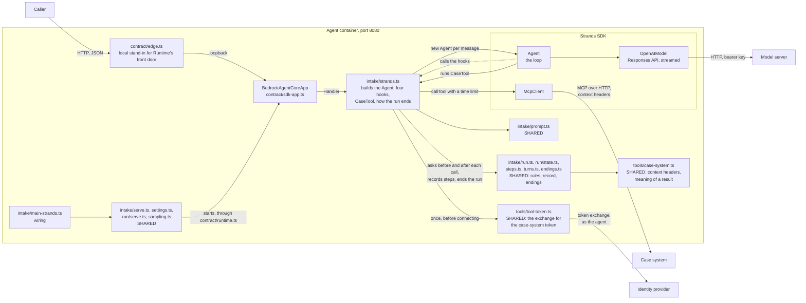
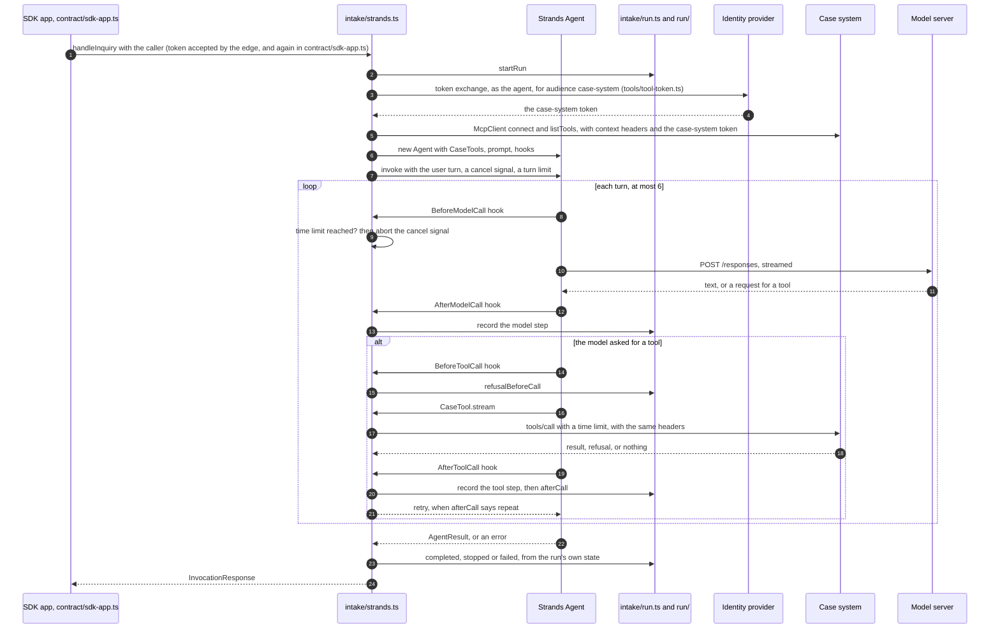

# Intake agent, on Strands

The same agent as the [hand-written one](intake-agent-handwritten.md), with Strands running the loop and AWS's SDK server serving the contract. It has the same prompt, the same rules, the same limits, the same contract and the same case system. This document covers only what differs. Terms, the untrusted-text flow, the "Always true" list and the "Not present" list are in the hand-written agent's document and apply here unless a section below says otherwise.

Strands is `@strands-agents/sdk` 1.25.0, the TypeScript SDK. To run the agent, see [agents/README.md](../../agents/README.md).

The contract is served by `BedrockAgentCoreApp` from `bedrock-agentcore` 0.4.6, behind a local stand-in for AgentCore Runtime's front door; how, and where it answers differently from the hand-written server, is in [agent-runtime.md](agent-runtime.md).

Strands is used the way it comes. Its default model is Amazon Bedrock; here the local model server takes that place, through Strands' OpenAI model on that model's default API, the Responses API.

## What is shared and what is not

| Part | Hand-written agent | Strands agent |
|---|---|---|
| Prompt and layout of the message | `intake/prompt.ts` | The same file |
| Rules of a run, its record, its endings | `intake/run.ts` (rules); `run/state.ts`, `run/steps.ts`, `run/turns.ts`, `run/endings.ts` (state, record, endings) | The same files |
| Limits and sampling settings | `intake/settings.ts` (limits), `run/sampling.ts` (sampling) | The same files |
| Startup and environment | `intake/serve.ts`, `run/serve.ts` | The same files, plus `LOCAL_RUNTIME_EDGE` |
| HTTP surface | `contract/server.ts`, written by hand | `BedrockAgentCoreApp` (`contract/sdk-app.ts`), behind the local edge (`contract/edge.ts`), started by `contract/runtime.ts` |
| The access-token check | `shared/access-token.ts`, in `contract/server.ts` | The same file, in the edge and again in `contract/sdk-app.ts` |
| Exchanging the caller's token for the case-system token | `tools/tool-token.ts` (`connectWithToolToken`, wired in `intake/main-handwritten.ts`) | `tools/tool-token.ts` (`toolToken`), called in `handleInquiry`, with the exchange given in `StrandsDeps` |
| Context headers and the case-system token on requests to the case system, the two tools a run needs and is shown, reading a case system answer | `tools/case-system.ts` (`caseSystemHeaders`, `missingCaseTools`, `isCaseTool`), which reads answers through `tools/mcp-answers.ts` | The same functions |
| The loop | `intake/handwritten.ts` | Strands' `Agent` |
| Request to the model | `model/chat.ts`: chat completions, one JSON response | Strands' `OpenAIModel` on its default: the Responses API, streamed |
| Connection to the case system | `@modelcontextprotocol/sdk` 1.32.2 client | Strands' `McpClient`, on `@modelcontextprotocol/client` 2.4.0 |
| Where the rules are applied | Inline in the loop | In four hooks Strands calls |

## Modules and their boundaries

`intake/strands.ts` is the only file of the intake agent that imports Strands. The label expert's `expert/strands.ts` is the only other.

Before anything is connected, `handleInquiry` exchanges the caller's token for the case-system token, within the tool limit, 10 s, or what the run has left. A refused exchange, or one that cannot be made, ends the run `failed` with the same reasons as the hand-written agent: no MCP client is made and the model is not asked. Connecting to the case system and listing its tools then share one time limit of their own, asked of the run's deadline again after the exchange: the tool limit, or what the run has left by then. The hand-written agent differs here: its exchange and its connection share one tool limit. A connection that fails or runs out of time ends the run `failed`, with the same three reasons as the hand-written agent: not reached, the token refused, or the token not checkable. A case system that does not offer both `create_case` and `add_follow_up` ends it `failed`, naming what is missing. Only those two become `CaseTool`s: any other tool it offers is not given to the `Agent`, so the model is not shown it.

## One request, end to end

## Where each rule is applied

The rule is one function in `intake/run.ts` or `run/turns.ts` in both agents. This table shows what each agent does with its answer.

| Rule | Hand-written loop | Strands |
|---|---|---|
| A second `create_case`, or a follow-up to the run's own case, is refused (`refusalBeforeCall`) | `runToolCall` returns the refusal as the tool message | `BeforeToolCallEvent`: `event.cancel` is set to the refusal text |
| A lost write is repeated once by code (`afterCall` says `repeat`) | `runToolCall` calls again | `AfterToolCallEvent`: `event.retry = true` |
| A write still unanswered fails the run (`afterCall` says `unsettled`) | `loop` returns `failed` | `AfterToolCallEvent` aborts a cancel signal this file owns |
| A turn lost to thinking is asked again with thinking off (`askAgainWithoutThinking`) | `loop` continues with `thinking = false` | `AfterModelCallEvent`: `model.updateConfig`, then `event.retry = true` |
| A failed request to the model is sent again | `askModel`: at most three requests for a turn | Not in this file. The OpenAI client inside Strands' model, then Strands' retry strategy, both as they come (see "A failed request to the model") |
| Turn limit | The `for` loop | `limits.turns` on `invoke` |
| Time limit | Checked at the top of each turn | Checked in `BeforeModelCallEvent`, plus a timer on the cancel signal for a request in flight |
| Time limit on one tool call | `ToolSet.call` takes a timeout | `CaseTool` passes `timeoutMs` to `McpClient.callTool` |
| How the run ends | Returned where it is decided | Decided after `invoke` returns, from the run's own state. Strands' stop reason is read last |

## What Strands does differently

The rules are tested once, on the hand-written agent, in [`agents/test/intake.test.ts`](../../agents/test/intake.test.ts). [`agents/test/intake-strands.test.ts`](../../agents/test/intake-strands.test.ts) has five tests that this agent's hooks are wired to them: a case action from the tool's answer (with the exchanged token, and only that one, on every request to the case system, and only `create_case` and `add_follow_up` shown to the model when the case system offers a lookup as well), a refused call that does not reach the case system, a write repeated once by code, the turn limit, and a model server that fails. The differences below are read from the code and from the source of Strands; no test asserts them.

| Situation | Hand-written loop | Strands | What this file does about it |
|---|---|---|---|
| A tool call's reply never arrives | Gives up after 10 s | Its own MCP tool sets no time limit, so the call waits until the run is cancelled | `CaseTool` makes the call with the 10 s limit |
| Tool arguments are not JSON | Tells the model and carries on | Throws, which ends the run | Reports the run as `failed` with that reason. Nothing is called in either |
| The output allowance runs out with nothing written | Asks again with thinking off | Throws `MaxTokensError` | Retries from the hook with thinking off |
| The output allowance runs out part way through a reply | Returns the cut-off reply as `completed` | Throws `MaxTokensError`, which carries what was written | Ends as `stopped` with no reply. The text is kept in the step |
| The model names a tool that does not exist | Tells the model which tools exist | Tells the model `Tool '<name>' not found in registry` | Records the step |
| A tool result is an error | The model is sent the result as it is | The model is sent it with `[ERROR] ` in front | Nothing |
| A turn lost to thinking is asked again | Counts as one of the 6 turns | Not counted, so a run can have 7 turns | Nothing |
| The run's time runs out while a request is in flight | The request was given only the time left, so it times out | The cancel signal's timer stops the request | Reports a model request as a model that did not answer, and a write as not known, as the hand-written loop does |
| How a turn ended, as recorded | The server's words: `stop`, `tool_calls`, `length` | Strands' words: `endTurn`, `toolUse`, `maxTokens` | Records what it is given |
| How thinking is turned off | `chat_template_kwargs`, which the model server passes to the model's chat template | `reasoning.effort: 'none'`, the Responses API's own setting | Sets it through `model.updateConfig` |
| The request, as sent | Chat completions: a list of messages | The Responses API: instructions, then a list of input items | Nothing |
| A failed request to the model is sent again | Each failure is an error step | The OpenAI client sends it again inside itself. No hook is called | Nothing. The record shows only a failure that reached Strands |
| The model never answers | One request. The run fails when its time allowed runs out | The OpenAI client sends the request again, until the run's time limit | Nothing. The run's own time limit is what ends it |
| The model answers 429 three times in a row | The run fails: it has made its three requests | The client's three requests are one failed call to Strands, which waits and asks again | Records the failed call as an error step, and does not count it as how the run ended if a later attempt answers |
| Strands stops the run with an error no other row names | Not applicable | `invoke` throws | Ends the run `failed`: "Strands stopped the run with" the error's type, recorded as an error step |
| A write gets no answer and the run's time is already out | Repeats it with the time left, none, so the repeat gets no answer either; the run fails as a write not answered twice | Is already stopping the run, so no repeat is made | Ends the run `failed`: the write is not known, and the time ran out before it could be repeated. Both outcomes are `failed` as not known |

Several tool calls in one turn are run by both, in order, and the model is sent every result.

### A failed request to the model

Nothing is set. Two layers send a failed request again, and the run's time limit stops both.

| Layer | Sends again when | How many | Wait |
|---|---|---|---|
| The OpenAI client inside `OpenAIModel` | The connection failed, the request timed out, or the status is 408, 409, 429 or 5xx | 3 requests at most | About 0.5 s, then 1 s |
| Strands' `DefaultModelRetryStrategy` | The call failed as throttling or as a network error. On `OpenAIModel` only throttling is ever reported: status 429, or a rate-limit message | 6 attempts at most, each a call to the client above | Random, from nothing up to 4 s, then up to 8 s, doubling |

What follows:

- **A model that answers 500** gets three requests and the run fails, as in the hand-written agent.
- **A model that keeps answering 429** can get up to 18 requests.
- **A model that never answers holds the run for all of its 150 s.** The first request times out at 90 s, the client sends it again, and the run's time limit cuts the second one short. The hand-written agent does not send a timed-out request again, so its run fails at 90 s.
- **Only a failure that reaches Strands** is seen by this file's hooks and recorded.

The numbers are read from the source of Strands 1.25.0 and OpenAI client 6.49.0. No test sends a failed request again in either layer: the tests' failing model server answers 400, which neither sends again.

### A known defect on the path not taken

Strands' OpenAI model can also speak chat completions (`api: 'chat'`). An earlier version of this agent set that, to send the same request as the hand-written agent, and met a defect: of several tool calls in one turn Strands kept only the last, and text written before a tool call was lost. It is reported as `strands-agents/harness-sdk` issue 4975, with a fix in pull request 4980 that was open on 2026-11-20. The newest release on that day, 1.26.0, still had it. The default API used here does not: against the real model server, a turn with a sentence and two tool calls came through whole.

## Settings that are not Strands' defaults

Each is set in `converse` in `intake/strands.ts`.

| Setting | Strands' default | Set to | Why |
|---|---|---|---|
| `toolExecutor` | Runs the tool calls of one turn at the same time | `sequential` | Two `create_case` calls at once would both pass the one-case rule. A test sends two in one turn and the second is refused |
| `printer` | Prints the conversation to the log | `false` | The conversation holds patient details |
| One `Agent` for all requests | An `Agent` keeps its conversation between calls | A new `Agent` and `McpClient` per message | One sender's message would otherwise be in the next sender's conversation, and the context headers belong to one message |
| `conversationManager` | Keeps the last 40 messages | `NullConversationManager` | A run is one message and at most 6 turns. Nothing should be trimmed |

## Not present, in addition

Everything in the hand-written agent's "Not present" list is also absent here, including special handling of a token the case system refuses mid-run: such a tool call falls under the rules for a call that got no answer. The refusal at connection is named in the same two reasons as the hand-written agent's, read from the error Strands' MCP client raises. Three more follow from Strands:

| Missing | What follows |
|---|---|
| The model's reasoning text in the record | Strands reads it into the message, but this agent records only the reply text, so as in the hand-written agent only its cost appears in `output_tokens`. Strands does not send reasoning back to the model on later turns over the Responses API, and logs a warning each time it leaves it out |
| Control of what Strands writes to the log | Strands logs its own warnings and errors to the container's output, including a stack trace when tool arguments cannot be parsed |
| A smaller image | Strands requires the AWS SDK's Bedrock client and the OpenAI client, and the AgentCore SDK brings Fastify and more AWS SDK clients. All four agents run from one image, `ai-on-aws-agents:local`, so the hand-written agent's container carries them too |

## What was checked

- Five tests (strands 1 to 5 in `agents/test/intake-strands.test.ts`) show this agent's hooks are wired to the shared rules, which are tested on the hand-written agent.
- Against the 9B model, before the retries were turned on, the Strands agent was sent the seven prepared inquiries on an empty store. It gave the expected result for all seven and left three cases: one awaiting review at version 2, one incomplete, one awaiting review. The prompt was tuned on these seven with the hand-written agent, so this is not a held-out set.
- With the retries on, each agent answered one inquiry against the 9B model, and each was run once with a model address where nothing listens. Both failed the run with "The model could not be reached." after about 1.4 s. The hand-written agent recorded three error steps, the Strands agent one.
- With a bare Strands `Agent` against the 9B model, before this agent was written this way: a turn with a sentence and two tool calls came through whole; a turn cut off by its output allowance raised `MaxTokensError` carrying what had been written; asking again with `reasoning.effort: 'none'` gave an answer with no thinking; a tool result marked as an error was understood by the model.
- The output is not repeatable on this model server, with the same seed and a temperature of 0, even between two runs of one agent.

Not established: how either retry layer behaves against a model server that fails some of the time (the closed address above only); whether the thinking retry fires in this agent against the real model (the bare `Agent` above only); how this agent behaves when the real model makes two tool calls in one turn (strands 2 against the scripted model, and the bare `Agent` above); what either agent does with a response that starts and then breaks off (from the code, the hand-written loop sends the request again and Strands does not); whether the context headers and the case-system token pass through AgentCore Runtime or Gateway.
