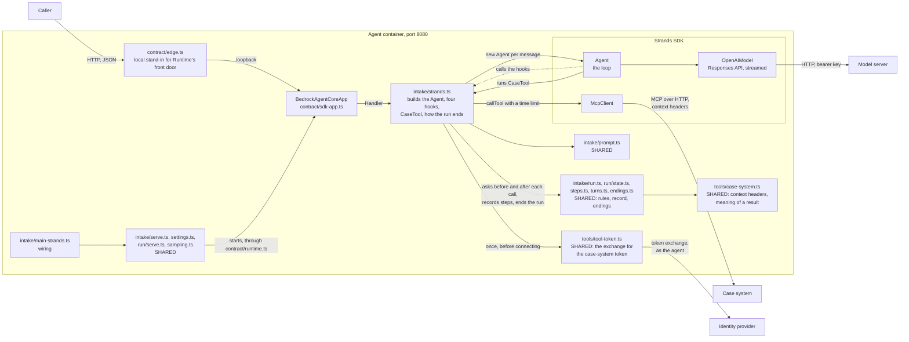
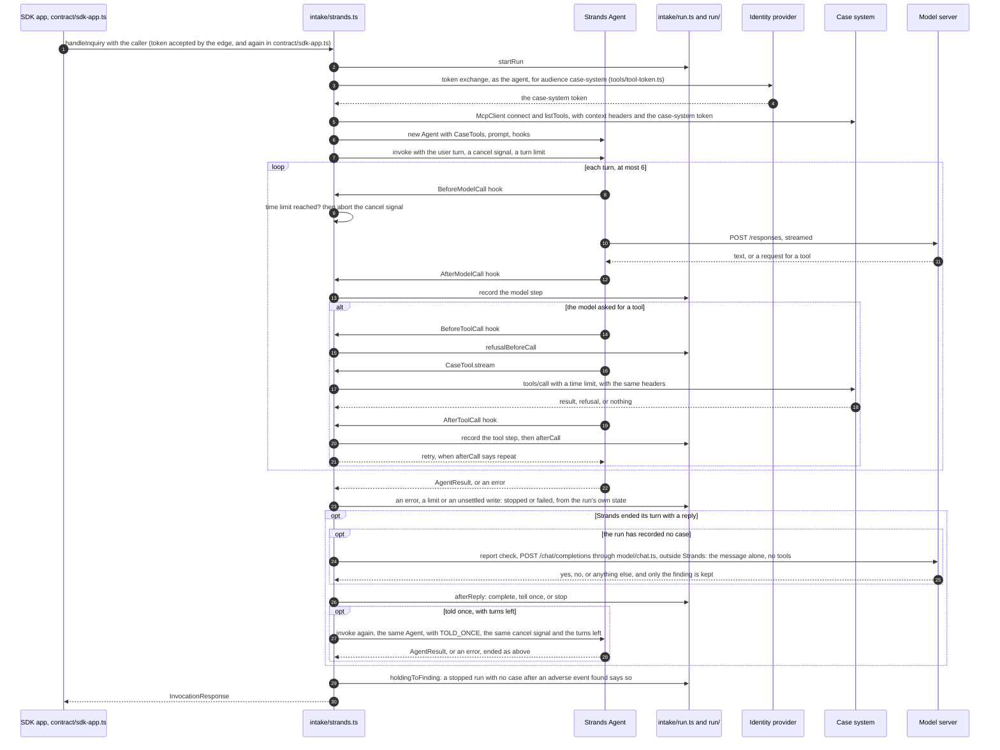

# Intake agent, on Strands

This implementation uses Strands to run the intake agent's model loop and the AgentCore SDK server to serve its contract. It shares the [hand-written agent's](intake-agent-handwritten.md) prompt, run rules, configured limits and case system. Strands hooks apply those rules around model and tool calls.

This document covers the implementation differences. The hand-written agent's terms, untrusted-text flow, invariants and known limits also apply, except where a difference is identified below.

Strands is `@strands-agents/sdk` 1.25.0, the TypeScript SDK. To run the agent, see [agents/README.md](../../agents/README.md).

`BedrockAgentCoreApp` from `bedrock-agentcore` 0.4.6 serves the contract behind a local stand-in for AgentCore Runtime's front door. [Agent runtime](agent-runtime.md) describes that boundary and its response differences from the hand-written server.

Strands uses the local model server through `OpenAIModel` and its default Responses API, in place of the SDK's default Bedrock model.

## Shared responsibilities and implementation differences

| Part | Hand-written agent | Strands agent |
|---|---|---|
| Prompt and layout of the message | `intake/prompt.ts` | The same file |
| Rules of a run, its record, its endings | `intake/run.ts` (rules); `run/state.ts`, `run/steps.ts`, `run/turns.ts`, `run/endings.ts` (state, record, endings) | The same files |
| Limits and sampling settings | `intake/settings.ts` (limits), `run/sampling.ts` (sampling) | The same files |
| Startup and environment | `intake/serve.ts`, `run/serve.ts` | The same files, plus `LOCAL_RUNTIME_EDGE` |
| Audience (`AUTH_ALLOWED_AUDIENCE`) | `intake-handwritten` | `intake-strands` |
| Clients (`AUTH_ALLOWED_CLIENTS`) | `desk,lab-explorer` | `desk,orchestrator,lab-explorer`; the orchestrator screens every message through this agent |
| Published port | 8080 | 8081 |
| HTTP surface | `contract/server.ts`, written by hand | `BedrockAgentCoreApp` (`contract/sdk-app.ts`), behind the local edge (`contract/edge.ts`), started by `contract/runtime.ts` |
| The access-token check | `shared/access-token.ts`, in `contract/server.ts` | The same file, in the edge and again in `contract/sdk-app.ts` |
| Exchanging the caller's token for the case-system token | `tools/tool-token.ts` (`connectWithToolToken`, wired in `intake/main-handwritten.ts`) | `tools/tool-token.ts` (`toolToken`), called in `handleInquiry`, with the exchange given in `StrandsDeps` |
| Case-system headers, required tools and result parsing | `tools/case-system.ts` (`caseSystemHeaders`, `missingCaseTools`, `isCaseTool`), which reads answers through `tools/mcp-answers.ts` | The same functions |
| The loop | `intake/handwritten.ts` | Strands' `Agent` |
| Request to the model | `model/chat.ts`: chat completions, one JSON response | Strands' `OpenAIModel` on its default: the Responses API, streamed. The report check alone goes through `model/chat.ts`, as in the hand-written agent, outside Strands |
| Connection to the case system | `@modelcontextprotocol/sdk` 1.32.2 client | Strands' `McpClient`, on `@modelcontextprotocol/client` 2.4.0 |
| Where the rules are applied | Inline in the loop | In four hooks Strands calls |

## Modules and their boundaries

`intake/strands.ts` is the only file of the intake agent that imports Strands. The label expert's `expert/strands.ts` and the orchestrator's `orchestrator/strands.ts` are the only others in `agents/`.

`handleInquiry` first exchanges the caller's token for a case-system token. The exchange has at most 10 s, bounded by the run's remaining time. If it fails, the run ends `failed` with the same reasons as the hand-written agent; no MCP client is created and the model is not called.

Connecting and listing tools then share a separate limit of at most 10 s, recalculated from the run's remaining time. The hand-written implementation instead shares one tool limit between exchange and connection. Connection failures distinguish an unreachable case system, a refused token and a token the case system cannot check. Missing `create_case` or `add_follow_up` also fails the run, naming the missing tool. Only those two tools become `CaseTool`s visible to the model.

## One request, end to end

## Where each rule is applied

Both implementations call the same rule functions in `intake/run.ts` and `run/turns.ts`. The difference is where the loop applies each result.

| Rule | Hand-written loop | Strands |
|---|---|---|
| A second `create_case`, or a follow-up to the run's own case, is refused (`refusalBeforeCall`) | `runToolCall` returns the refusal as the tool message | `BeforeToolCallEvent`: `event.cancel` is set to the refusal text |
| A lost write is repeated once by code (`afterCall` says `repeat`) | `runToolCall` calls again | `AfterToolCallEvent`: `event.retry = true` |
| A write still unanswered fails the run (`afterCall` says `unsettled`) | `loop` returns `failed` | `AfterToolCallEvent` aborts a cancel signal this file owns |
| A turn lost to thinking is asked again with thinking off (`askAgainWithoutThinking`) | `loop` continues with `thinking = false` | `AfterModelCallEvent`: `model.updateConfig`, then `event.retry = true` |
| Model request retries | `askModel`: at most three requests per turn | The OpenAI client and Strands retry strategy retain their defaults; see "A failed request to the model" |
| Turn limit | The `for` loop | `limits.turns` on `invoke` |
| Time limit | Checked at the top of each turn | Checked in `BeforeModelCallEvent`, plus a timer on the cancel signal for a request in flight |
| Time limit on one tool call | `ToolSet.call` takes a timeout | `CaseTool` passes `timeoutMs` to `McpClient.callTool` |
| How the run ends | Returned where it is decided | Decided after `invoke` returns, from the run's own state. Strands' stop reason is read last |
| Reply with no case: report check and `afterReply`, through `atReply` | Runs inside `loop`; the reminder starts another turn | Runs after `invoke`, through the chat client. The reminder starts a second `invoke` on the same `Agent`, with the existing hooks, cancel signal, deadline and remaining turn allowance |

## What Strands does differently

The shared rules do not remove differences in parsing, retries, cancellation and turn accounting. The adapter handles those differences as follows.

| Situation | Hand-written loop | Strands | What this file does about it |
|---|---|---|---|
| A tool call's reply never arrives | Gives up after 10 s | Its own MCP tool sets no time limit, so the call waits until the run is cancelled | `CaseTool` makes the call with the 10 s limit |
| Tool arguments are not JSON | Tells the model and carries on | Throws, which ends the run | Reports the run as `failed` with that reason. Nothing is called in either |
| The output allowance runs out with nothing written | Asks again with thinking off | Throws `MaxTokensError` | Retries from the hook with thinking off |
| The output allowance runs out part way through a reply | Treats the cut-off text as a reply like any other | Throws `MaxTokensError`, which carries what was written | Ends as `stopped` with no reply. The text is kept in the step |
| The model names a tool that does not exist | Tells the model which tools exist | Tells the model `Tool '<name>' not found in registry` | Records the step |
| A tool result is an error | The model is sent the result as it is | The model is sent it with `[ERROR] ` in front | Nothing |
| A turn lost to thinking is asked again | Counts as one of the 6 turns | Not counted, so a run can have 7 turns | Nothing |
| Run deadline during a request | The request times out at the remaining run limit | The cancellation timer stops the request | Reports an unanswered model request or an uncertain write, as the hand-written loop does |
| How a turn ended, as recorded | The server's words: `stop`, `tool_calls`, `length` | Strands' words: `endTurn`, `toolUse`, `maxTokens` | Records what it is given |
| How thinking is turned off | `chat_template_kwargs`, which the model server passes to the model's chat template | `reasoning.effort: 'none'`, the Responses API's own setting | Sets it through `model.updateConfig` |
| The request, as sent | Chat completions: a list of messages | The Responses API: instructions, then a list of input items | Nothing |
| A failed request to the model is sent again | Each failure is an error step | The OpenAI client sends it again inside itself. No hook is called | Nothing. The record shows only a failure that reached Strands |
| The model never answers | One request. The run fails when its time allowed runs out | The OpenAI client sends the request again, until the run's time limit | Nothing. The run's own time limit is what ends it |
| Three consecutive 429 responses | The three-request limit fails the run | The client reports one failed call to Strands, which waits and retries | Records the failed call as an error step; a later success can still complete the run |
| Strands stops the run with an error no other row names | Not applicable | `invoke` throws | Ends the run `failed`: "Strands stopped the run with" the error's type, recorded as an error step |
| Unanswered write at the run deadline | Attempts the repeat with no time left; fails as an unanswered write | Cancellation prevents the repeat | Returns `failed`, explaining that the write is uncertain and time expired before retry |

Both implementations execute a turn's tool calls sequentially and return their results to the model.

### A failed request to the model

The adapter leaves model retries at their SDK defaults. Two layers can retry a request; the run's deadline bounds both.

| Layer | Sends again when | How many | Wait |
|---|---|---|---|
| The OpenAI client inside `OpenAIModel` | The connection failed, the request timed out, or the status is 408, 409, 429 or 5xx | 3 requests at most | About 0.5 s, then 1 s |
| Strands' `DefaultModelRetryStrategy` | Throttling or network errors. `OpenAIModel` reports only throttling to this layer: status 429 or a rate-limit message | 6 attempts at most, each a call to the client above | Random, from nothing up to 4 s, then up to 8 s, doubling |

These layers produce the following behaviour:

- **A model that answers 500** gets three requests and the run fails, as in the hand-written agent.
- **A model that keeps answering 429** can get up to 18 requests.
- **A model that never answers holds the run for all of its 150 s.** The first request times out at 90 s, the client sends it again, and the run's time limit cuts the second one short. The hand-written agent does not send a timed-out request again, so its run fails at 90 s.
- **Only a failure that reaches Strands** is seen by this file's hooks and recorded.

The numbers are those of Strands 1.25.0 and OpenAI client 6.49.0.

## Settings that are not Strands' defaults

Each is set in `intake/strands.ts`: the `McpClient` for each message in `handleInquiry`, the rest where `converse` makes the `Agent`.

| Setting | Strands' default | Set to | Why |
|---|---|---|---|
| `toolExecutor` | Runs the tool calls of one turn at the same time | `sequential` | Two `create_case` calls at once would both pass the one-case rule. |
| `printer` | Prints the conversation to the log | `false` | The conversation holds patient details |
| One `Agent` for all requests | An `Agent` keeps its conversation between calls | A new `Agent` and `McpClient` per message | One sender's message would otherwise be in the next sender's conversation, and the context headers belong to one message |
| `conversationManager` | Keeps the last 40 messages | `NullConversationManager` | A run is one message and at most 6 turns. Nothing should be trimmed |

## Not present, in addition

The hand-written agent's "Not present" list also applies. In particular, a token refused during a run follows the unanswered-write rules. A refusal during connection uses the same reasons as the hand-written agent, extracted from the MCP client's error. The Strands implementation has these additional limits:

| Missing | What follows |
|---|---|
| Reasoning text in the record | The agent records reply text and `output_tokens`, excluding reasoning text. Strands also omits reasoning from later Responses API requests and logs a warning for each omission |
| Control of what Strands writes to the log | Strands logs its own warnings and errors to the container's output, including a stack trace when tool arguments cannot be parsed |
| Separate minimal images | All four agents share `ai-on-aws-agents:local`. It includes Strands' Bedrock and OpenAI clients, plus Fastify and the AgentCore SDK's AWS clients, even in the hand-written agent's container |

