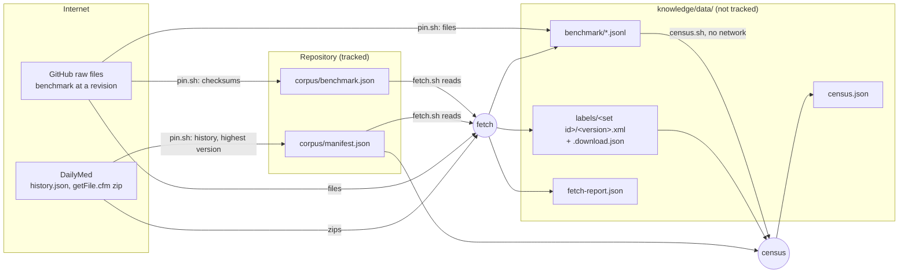
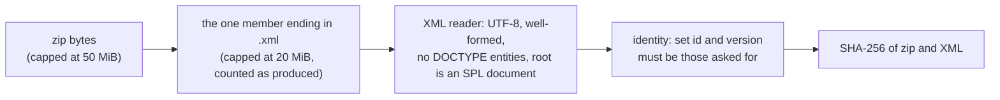

# Knowledge

The corpus of the lab's Bedrock Knowledge Bases stand-in: US drug labels from DailyMed, pinned by set id and version, fetched onto disk and counted. To use it, see [knowledge/README.md](../../knowledge/README.md).

## The corpus as pinned

| | Labels |
|---|---|
| Records in the benchmark's labels file | 704 |
| Records with a set id | 699 |
| Pinned | 640 |
| Not served by DailyMed | 59 |
| Prescription labels (34391-3), of the pinned | 417 |
| Over-the-counter labels (34390-5), of the pinned | 223 |
| New format, of the pinned | 236 |
| Old format, of the pinned | 404 |

The corpus holds both prescription and over-the-counter labels. Nothing downstream may assume a label is a prescription label: the document type code in the manifest says which it is.

## Terms

| Term | Meaning |
|---|---|
| Set id | A label's identifier at DailyMed, a GUID that never changes |
| Version | A label's version number at DailyMed; it only rises |
| Benchmark | FDARxBench at one revision: a labels file (set id, drug name, drug id, chunks of text) and a questions file (question, task, source, set id, context passages) |
| Pin | `knowledge/corpus/benchmark.json`: the benchmark's repository, revision, licence, and each file's path, SHA-256 and size |
| Manifest | `knowledge/corpus/manifest.json`: per label, set id, version, document id, effective time, published date, document type code, the SHA-256 of the zip and of the XML, the XML's size; and the labels not pinned, each with a reason code |
| Data folder | `knowledge/data/`: the benchmark files, the label XML files and the reports. Never tracked, never in an image |
| Download record | `labels/<set id>/<version>.download.json` beside each XML: the SHA-256 of the zip it came from and of the XML |
| Stand-in | The loopback server the tests use in place of DailyMed and the benchmark's host. It serves synthetic data and marks each response as a stand-in's |

## What moves where

Inside one download, in pinning and in fetching:

## What is pinned

| Thing | Pinned by | Where |
|---|---|---|
| The benchmark | Repository, 40-character revision, and each file's SHA-256 | `knowledge/corpus/benchmark.json` |
| Each label | Set id, version, document id, and the SHA-256 of its XML | `knowledge/corpus/manifest.json` |
| The image the commands run in | The `run` stage of `toolchain/Dockerfile`, from the Node image pinned there by digest, with the locked run-time dependencies | `toolchain/Dockerfile`, `package-lock.json` |
| The zip and XML readers | yauzl 3.4.0, @xmldom/xmldom 0.9.12, exact versions | Root `package.json` |
| Request settings | Concurrency, attempts, waits, time limit, caps, User-Agent, passed by name | `knowledge/lib.sh` |

## Always true

1. No label text is in a tracked file. The repository holds the manifest and the commands; labels live only in the data folder, which `.gitignore` and `.dockerignore` both exclude.
2. The manifest and the pin are sorted and written in one key order, with no time in them. The same inputs give byte-identical files.
3. The manifest and the pin are read only through their schema. A missing field, a checksum that is not 64 lowercase hex characters, a set id that is not a lowercase GUID, or a duplicated set id is refused, with where it is.
4. A file name on disk is built only from a manifest's set id, which must be a lowercase GUID, and its version, which must be a positive integer. No name from inside an archive is ever used as a path.
5. Of each zip, only the one member whose name ends in `.xml` is read. None, or more than one, and the zip is refused.
6. The XML's size is capped on the bytes the decompressor produces. The size the archive declares is used only to refuse earlier.
7. The XML reader performs no input or output of its own. A DOCTYPE that declares an entity is refused before the parser's other errors are judged, so the reason names the declaration.
8. A label is written to the data folder only if its XML's SHA-256 equals the manifest's. A file there that does not match is removed.
9. The fetch report and the census describe what is in the data folder, not what one run did. A run on complete data sends no request and changes no file.
10. Reasons written to any file are codes from one closed list (`knowledge/src/reasons.ts`), never a parser's message.
11. At most 4 requests to DailyMed are in flight at once. Only no response, 408, 429 and 5xx are retried, 3 attempts in all, with growing waits. A 404 is final.
12. Every request carries the User-Agent `label-corpus-fetch/1.0` and nothing else that identifies who sent it.
13. A request that fails after every attempt during pinning stops the run, and nothing is written to `knowledge/corpus/`.
14. The census runs with no network and writes counts and codes only.
15. Every setting is a named flag of the tool, given by the script. The tool has no defaults and reads no environment variable.

## Where each step runs

| Step | Runs in | Network | Mounts from the host |
|---|---|---|---|
| Build the image | `docker build`, stage `run` of `toolchain/Dockerfile`, `PIECE=knowledge` | npm registry, for the locked dependencies | None |
| `pin` | The image, as the host user, read-only root filesystem, no capabilities | DailyMed and GitHub | `corpus/` read-write, `data/` read-write |
| `fetch` | The same | DailyMed and GitHub | `corpus/` read-only, `data/` read-write |
| `census` | The same | None | `corpus/` read-only, `data/` read-write |
| Tests F1 to F13 | `toolchain/check.sh` | None; the stand-in listens on loopback | None |

## How it fails

| Failure | Pinning | Fetching |
|---|---|---|
| A set id in the benchmark is not a GUID, or is a duplicate | Listed as not pinned | Not reached: the manifest holds only GUIDs |
| No history at DailyMed | Listed as not pinned (`no-history`) | Not reached |
| The version's file answers 404 | Listed as not pinned (`version-not-served`) | Refused, run carries on, exit 1 |
| Zip too large, unreadable, with no or several XML members; XML too large, not UTF-8, not well-formed, with DOCTYPE entities, not SPL, or of another set id or version | Listed as not pinned, with the code | Refused, run carries on, exit 1 |
| XML checksum differs from the manifest | Not applicable | Refused (`xml-checksum-mismatch`), exit 1 |
| Zip checksum differs, XML matches | Not applicable | Accepted, reported as repackaged |
| No response, or 408, 429, 5xx, three times | The run stops, nothing written to `corpus/`, exit 1 | Refused (`download-failed`), run carries on, exit 1 |
| A tracked file fails its schema | Not applicable | Nothing fetched, exit 2 |
| A pinned label is missing from the data folder or does not match | Not applicable | The census lists it as not counted and exits 1 |

## Who owns what

| Owner | Owns |
|---|---|
| `knowledge/pin.sh` | The benchmark's repository, revision, licence and file paths |
| `knowledge/lib.sh` | The image name, the container's isolation, and every request setting |
| `knowledge/src/` | The tool: the schema, the request client, the archive and XML readers, pinning, fetching, the census |
| `knowledge/corpus/` | What the corpus is: written by `pin.sh`, read by everything else |
| `knowledge/data/` | Local copies; regenerated by `fetch.sh` and `census.sh` |
| `toolchain/Dockerfile` | The `run` stage the image is built from, and the Node pin |

## What is not present

- No parsing of a label into sections, no chunks, no search index, no retrieval API, no Bedrock data source.
- No label version beyond the one pinned per set id, and no rule for choosing among several labels of one drug.
- No label for a set id DailyMed does not serve: the manifest lists it as not pinned.
- No check that a pinned label is still the newest version at DailyMed.
- No mirror of DailyMed's files. A version DailyMed stops serving can no longer be fetched.
