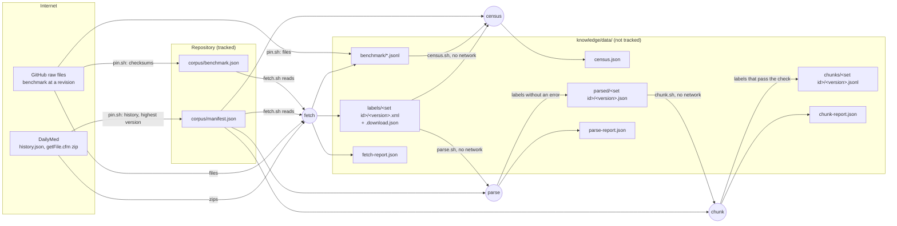
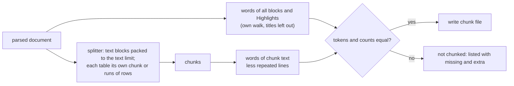
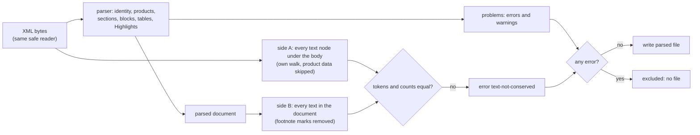
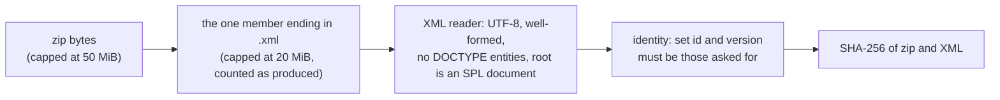
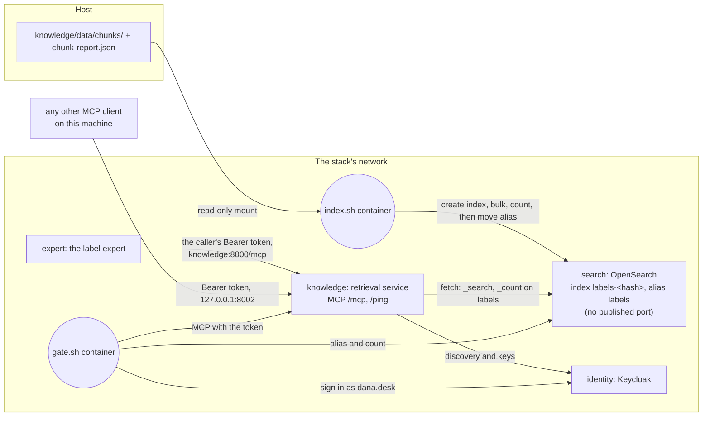

# Knowledge

The corpus of the lab's Bedrock Knowledge Bases stand-in: US drug labels from DailyMed, pinned by set id and version, fetched onto disk, counted, parsed into structured documents, and split into chunks. The chunks are indexed in a search engine, and a retrieval service serves keyword search over them to agents as MCP tools. To use it, see [knowledge/README.md](../../knowledge/README.md).

## The corpus as pinned

| | Labels |
|---|---|
| Records in the benchmark's labels file | 704 |
| Records with a set id | 699 |
| Pinned | 640 |
| Not served by DailyMed | 59 |
| Prescription labels (34391-3), of the pinned | 417 |
| Over-the-counter labels (34390-5), of the pinned | 223 |
| New format, of the pinned | 236 |
| Old format, of the pinned | 404 |

The corpus holds both prescription and over-the-counter labels. Nothing downstream may assume a label is a prescription label: the document type code in the manifest says which it is.

## Terms

| Term | Meaning |
|---|---|
| Set id | A label's identifier at DailyMed, a GUID that never changes |
| Version | A label's version number at DailyMed; it only rises |
| Benchmark | FDARxBench at one revision: a labels file (set id, drug name, drug id, chunks of text) and a questions file (question, task, source, set id, context passages) |
| Pin | `knowledge/corpus/benchmark.json`: the benchmark's repository, revision, licence, and each file's path, SHA-256 and size |
| Manifest | `knowledge/corpus/manifest.json`: per label, set id, version, document id, effective time, published date, document type code, the SHA-256 of the zip and of the XML, the XML's size; and the labels not pinned, each with a reason code |
| Data folder | `knowledge/data/`: the benchmark files, the label XML files and the reports. Never tracked, never in an image |
| Download record | `labels/<set id>/<version>.download.json` beside each XML: the SHA-256 of the zip it came from and of the XML |
| Stand-in | The loopback server the tests use in place of DailyMed and the benchmark's host. It serves synthetic data and marks each response as a stand-in's |
| Parsed document | `parsed/<set id>/<version>.json`: a label as identity, products and a tree of sections holding blocks (paragraphs, lists, tables, images) and Highlights blocks, with its warnings |
| Problem | What the parser found wrong: a code, a severity (error or warning), the section id or table position, counts. Never label text |
| Excluded | A label with an error: it has no parsed file |
| Chunk | One line of `chunks/<set id>/<version>.jsonl`: a piece of one section's text or of one table, with where it came from and the lines it repeats |
| Splittable table | A table with a `thead` header, no nested table, no short row, and no wholly bold row below the header except group labels (one filled cell) |
| Group label | A wholly bold row below the header with exactly one filled cell: it labels the rows under it |
| Search engine | The `search` service: OpenSearch 3.9.0, one node, security plugin off, no published port |
| Index | `labels-<hash>`: the chunks, one document each, under an explicit mapping. The hash is of the chunk report and the mapping |
| Alias | `labels`: the name the retrieval service searches. The index command moves it, and only to a complete index |
| Retrieval service | The `knowledge` service: MCP tools `find_labels` and `search_label` behind the token check |

## What moves where

Inside one label, in chunking:

Inside one label, in parsing:

Inside one download, in pinning and in fetching:

## Search and retrieval

| Tool | Returns | Its counterpart in a Bedrock Knowledge Base retrieval result |
|---|---|---|
| `search_label` | `text` | The passage's text (content) |
| `search_label` | `score` | Its relevance score |
| `search_label` | `label.source`, the label's page at DailyMed for this version | Its source location |
| `search_label` | `chunk_id`, `part`, `type`, `section` (number, title, path), `position`, `label` (set id, version, effective date, kind) | Its metadata, and the document id. Bedrock returns these only as metadata attached at ingestion; here they are fields |
| `find_labels` | The labels for a drug name, with set id, version, date, kind, format, names, page | No counterpart: a retrieval request there is one search; resolving the drug first is this design's own step |

The agent that calls these two tools is the label expert: [expert-agent.md](expert-agent.md).

## What is pinned

| Thing | Pinned by | Where |
|---|---|---|
| The search engine | OpenSearch 3.9.0, by the digest of its multi-architecture index | `knowledge/compose.yaml` |
| The index's definition | The mapping and settings, part of the index's name | `knowledge/src/search/mapping.ts` |
| The benchmark | Repository, 40-character revision, and each file's SHA-256 | `knowledge/corpus/benchmark.json` |
| Each label | Set id, version, document id, and the SHA-256 of its XML | `knowledge/corpus/manifest.json` |
| The image the commands run in | The `run` stage of `toolchain/Dockerfile`, from the Node image pinned there by digest, with the locked run-time dependencies | `toolchain/Dockerfile`, `package-lock.json` |
| The zip and XML readers | yauzl 3.4.0, @xmldom/xmldom 0.9.12, exact versions | Root `package.json` |
| Request settings | Concurrency, attempts, waits, time limit, caps, User-Agent, passed by name | `knowledge/lib.sh` |

## Always true

1. No label text is in a tracked file. The repository holds the manifest and the commands; labels live only in the data folder, which `.gitignore` and `.dockerignore` both exclude.
2. The manifest and the pin are sorted and written in one key order, with no time in them. The same inputs give byte-identical files.
3. The manifest and the pin are read only through their schema. A missing field, a checksum that is not 64 lowercase hex characters, a set id that is not a lowercase GUID, or a duplicated set id is refused, with where it is.
4. A file name on disk is built only from a manifest's set id, which must be a lowercase GUID, and its version, which must be a positive integer. No name from inside an archive is ever used as a path.
5. Of each zip, only the one member whose name ends in `.xml` is read. None, or more than one, and the zip is refused.
6. The XML's size is capped on the bytes the decompressor produces. The size the archive declares is used only to refuse earlier.
7. The XML reader performs no input or output of its own. A DOCTYPE that declares an entity is refused before the parser's other errors are judged, so the reason names the declaration.
8. A label is written to the data folder only if its XML's SHA-256 equals the manifest's. A file there that does not match is removed.
9. The fetch report and the census describe what is in the data folder, not what one run did. A run on complete data sends no request and changes no file.
10. Reasons written to any file are codes from one closed list (`knowledge/src/reasons.ts`), never a parser's message.
11. At most 4 requests to DailyMed are in flight at once. Only no response, 408, 429 and 5xx are retried, 3 attempts in all, with growing waits. A 404 is final.
12. Every request carries the User-Agent `label-corpus-fetch/1.0` and nothing else that identifies who sent it.
13. A request that fails after every attempt during pinning stops the run, and nothing is written to `knowledge/corpus/`.
14. The census runs with no network and writes counts and codes only.
15. Every setting is a named flag of the tool, given by the script. The tool has no defaults and reads no environment variable.
16. The parser is one pure function from XML bytes to a document and problems: no clock, no randomness, no input or output. The same input gives a byte-identical parsed file and report.
17. No text of a parsed label is lost or doubled without an error: every label passes the check that no text was lost, or gets `text-not-conserved` and no parsed file. The check takes its own walk of the XML and shares nothing of the parser's traversal.
18. A label with any error has no parsed file in the data folder; one left by an earlier run is removed.
19. Highlights text is only ever in a section's Highlights blocks, never in its own blocks.
20. In a table's grid every position is covered by at most one cell, and empty positions are only ever at the end of a short row, where the label's own cells stop. Anything else excludes the label with `table-not-rectangular`. No cell is moved to fill a gap.
21. The parse report holds identifiers, codes from the fixed lists, element names and numbers only.
22. Text the parser does not understand is kept where it sits; its element is reported by name and count.
23. For every table row the parsed document records whether it is wholly bold and how many of its cells have text. Which rows are column headings beyond the one inference rule is not decided here.
24. The splitter is one pure function of a parsed document and two named settings, the text limit and the table limit. The same input gives byte-identical chunk files and report.
25. Every word of a label's blocks and Highlights is in exactly one chunk's text outside its `repeated` lines, or the label gets no chunk file. The check takes its own walk of the parsed document.
26. A chunk id is unique within its label and depends only on the set id, version, section and the chunk's position in the section.
27. A table that is not splittable is one chunk, whatever its size. A split table's chunks each hold the caption, every header row and the group label in force: the first holds the caption and header rows in their place, and each later one repeats them and lists them in `repeated`. No chunk ends on a group label or inside a row span.
28. A chunk holds text or a table, never both.
29. The alias `labels` points only at an index into which the engine accepted every item, and whose count of documents equals the number of chunks read. A refused item, or a count that differs, leaves the alias where it was and removes the new index.30. An index's name is a hash of the chunk report and the mapping. Indexing unchanged chunks changes nothing.
31. The search engine publishes no port. Only containers on the stack's network reach it.
32. Every route of the retrieval service but `GET /ping` needs a valid access token with audience `lab-knowledge`, judged before the body is read.
33. `search_label` searches one label only. The set id filter is set by code and is exact, and the query goes only into a full-text match, never a query language. Input outside the limits is refused before anything is sent.
34. No failure of the engine reads as an empty answer: each is an error result naming its kind. A set id with no documents is the error `label_not_found`.
35. The retrieval service reaches the engine only with `fetch` and its REST API, and each request has a time limit.
36. Every gate image and gate compose project is named for the checkout it was built from, so a gate run from one checkout never runs an image another checkout built.

## Where each step runs

| Step | Runs in | Network | Mounts from the host |
|---|---|---|---|
| Build the image | `docker build`, stage `run` of `toolchain/Dockerfile`, `PIECE=knowledge` | npm registry, for the locked dependencies | None |
| `pin` | The image, as the host user, read-only root filesystem, no capabilities | DailyMed and GitHub | `corpus/` read-write, `data/` read-write |
| `fetch` | The same | DailyMed and GitHub | `corpus/` read-only, `data/` read-write |
| `census` | The same | None | `corpus/` read-only, `data/` read-write |
| `parse` | The same | None | `corpus/` read-only, `data/` read-write |
| `chunk` | The same | None | `corpus/` read-only, `data/` read-write |
| `index` | The same image, on the stack's network | The search engine only | `corpus/` read-only, `data/` read-write (read only) |
| `search` service | OpenSearch, no capabilities, no new privileges, not read-only (it writes its keystore at start) | The stack's network, no published port | None; a named volume for its data |
| `knowledge` service | The `run` stage image, read-only, no capabilities | The stack's network; `127.0.0.1:8002` | None |
| Gate | The same image, on the stack's network, through `knowledge/gate/compose.yaml` | The stack's network | `data/`, `corpus/` and `platform/identity/src/`, read-only |
| Tests F1 to F13, P1 to P21, U1 to U18, S1 to S14 | `toolchain/check.sh` | None; the stand-in listens on loopback | None |

## Parsing: problems and what follows

| Code | Severity | Raised when | Result |
|---|---|---|---|
| `text-not-conserved` | error | The token collections of side A and side B differ; gives missing and extra | Excluded |
| `table-not-rectangular` | error | After spans, two cells claim one position, a span passes the last row, or a row has an empty position before a covered one | Excluded |
| `no-sections` | error | No section of the body has text | Excluded |
| `unreadable` | error | A step 1 refusal, or the XML is missing or does not match the manifest | Excluded |
| `section-untitled`, `section-unclassified` | warning | A section with no title; a section coded 42229-5 | Written |
| `table-header-inferred`, `table-header-none`, `table-caption-inferred`, `table-nested` | warning | How a table's header and caption were found; a table inside a cell | Written |
| `section-images-only`, `footnote-reference-unmatched`, `element-unknown` | warning | A section of images only; a reference to no footnote; an element not known, by name and count | Written |
| `table-row-short`, `footnote-mark-unmatched` | warning | A table with rows shorter than its widest row (with how many); a `tfoot` mark no cell of the table carries | Written |

## How it fails

| Failure | Pinning | Fetching |
|---|---|---|
| A set id in the benchmark is not a GUID, or is a duplicate | Listed as not pinned | Not reached: the manifest holds only GUIDs |
| No history at DailyMed | Listed as not pinned (`no-history`) | Not reached |
| The version's file answers 404 | Listed as not pinned (`version-not-served`) | Refused, run carries on, exit 1 |
| Zip too large, unreadable, with no or several XML members; XML too large, not UTF-8, not well-formed, with DOCTYPE entities, not SPL, or of another set id or version | Listed as not pinned, with the code | Refused, run carries on, exit 1 |
| XML checksum differs from the manifest | Not applicable | Refused (`xml-checksum-mismatch`), exit 1 |
| Zip checksum differs, XML matches | Not applicable | Accepted, reported as repackaged |
| No response, or 408, 429, 5xx, three times | The run stops, nothing written to `corpus/`, exit 1 | Refused (`download-failed`), run carries on, exit 1 |
| A tracked file fails its schema | Not applicable | Nothing fetched, exit 2 |
| A pinned label is missing from the data folder or does not match | Not applicable | The census lists it as not counted and exits 1 |

## Who owns what

| Owner | Owns |
|---|---|
| `knowledge/pin.sh` | The benchmark's repository, revision, licence and file paths |
| `knowledge/lib.sh` | The image name, the container's isolation, and every request setting |
| `knowledge/src/` | The tool: the schema, the request client, the archive and XML readers, pinning, fetching, the census |
| `knowledge/src/parse/` | The parsed document's shape and problem codes (`model.ts`), the parser (`parser.ts`), the check that no text was lost (`conserve.ts`), and the command (`run.ts`) |
| `knowledge/corpus/` | What the corpus is: written by `pin.sh`, read by everything else |
| `knowledge/src/chunk/` | What a chunk is (`model.ts`), the splitter (`split.ts`), the check that nothing was lost or doubled (`check.ts`), and the command (`run.ts`) |
| `knowledge/chunk.sh` | The text limit and the table limit |
| `knowledge/src/search/` | The mapping and index name, indexing, the engine client, the two tools, the MCP and HTTP servers, the settings |
| `knowledge/compose.yaml` | The search engine's and the retrieval service's containers: images, settings, hardening, ports |
| `knowledge/index.sh` | The alias, batch size and time limit of indexing |
| `knowledge/gate.sh`, `knowledge/gate/`, `knowledge/src/gate/` | The gate of the retrieval path |
| `knowledge/data/` | Local copies; regenerated by `fetch.sh`, `census.sh`, `parse.sh` and `chunk.sh` |
| `toolchain/Dockerfile` | The `run` stage the image is built from, and the Node pin |

## What is not present

- No security on the search engine: its security plugin is off, so it has no TLS, no sign-in and no access control. Any container on the stack's network can read, change or delete its indexes; only the absence of a published port keeps everything else out.
- No embeddings, vector search, hybrid search or reranking. No Bedrock data source.
- No removal of old indexes, and no backup of an index: it is rebuilt from the chunks.
- No size limit on a table that is not splittable; no chunk holding text and a table together.
- No decision on which table rows are column headings beyond the one inference rule; no text read from images; no section numbers in old-format labels.
- No label version beyond the one pinned per set id, and no rule for choosing among several labels of one drug.
- No label for a set id DailyMed does not serve: the manifest lists it as not pinned.
- No check that a pinned label is still the newest version at DailyMed.
- No mirror of DailyMed's files. A version DailyMed stops serving can no longer be fetched.
