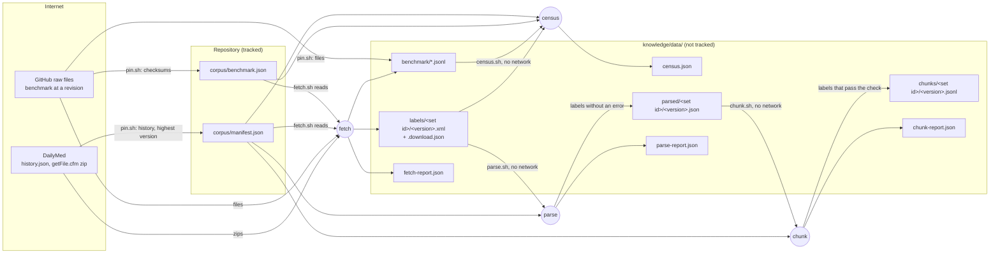
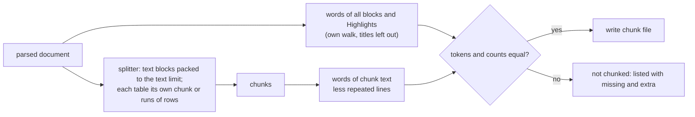
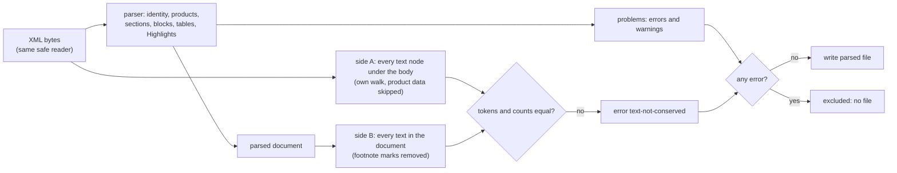
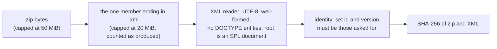
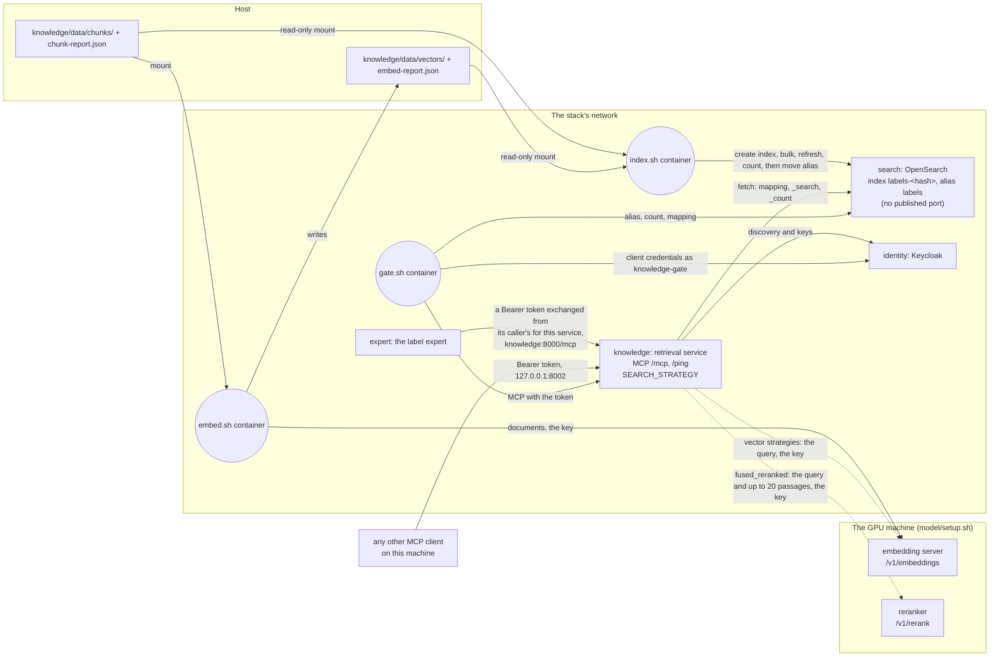

# Knowledge

The corpus of the lab's Bedrock Knowledge Bases stand-in: US drug labels from DailyMed, pinned by set id and version, fetched onto disk, counted, parsed into structured documents, and split into chunks. Each chunk can be given a vector by the embedding server. The chunks, with their vectors, are indexed in a search engine, and a retrieval service serves search over them to agents as MCP tools: by keyword, by vector, by both fused by rank, or fused and then reranked, as one setting of the service chooses. To use it, see [knowledge/README.md](../../knowledge/README.md).

## The corpus as pinned

| | Labels |
|---|---|
| Records in the benchmark's labels file | 704 |
| Records with a set id | 699 |
| Pinned | 640 |
| Not served by DailyMed | 59 |
| Prescription labels (34391-3), of the pinned | 417 |
| Over-the-counter labels (34390-5), of the pinned | 223 |
| New format, of the pinned | 236 |
| Old format, of the pinned | 404 |

The corpus holds both prescription and over-the-counter labels. Nothing downstream may assume a label is a prescription label: the document type code in the manifest says which it is.

## Terms

| Term | Meaning |
|---|---|
| Set id | A label's identifier at DailyMed, a GUID that never changes |
| Version | A label's version number at DailyMed; it only rises |
| Benchmark | FDARxBench at one revision: a labels file (set id, drug name, drug id, chunks of text) and a questions file (question, task, source, set id, context passages) |
| Pin | `knowledge/corpus/benchmark.json`: the benchmark's repository, revision, licence, and each file's path, SHA-256 and size |
| Manifest | `knowledge/corpus/manifest.json`: per label, set id, version, document id, effective time, published date, document type code, the SHA-256 of the zip and of the XML, the XML's size; and the labels not pinned, each with a reason code |
| Data folder | `knowledge/data/`: the benchmark files, the label XML files, the parsed documents, the chunks, the vectors and the reports. Never tracked, never in an image |
| Download record | `labels/<set id>/<version>.download.json` beside each XML: the SHA-256 of the zip it came from and of the XML |
| Stand-in | What the tests use in place of DailyMed, the benchmark's host, the search engine and the model servers: a function or object in memory, given to the code as a value, answering with synthetic data |
| Parsed document | `parsed/<set id>/<version>.json`: a label as identity, products and a tree of sections holding blocks (paragraphs, lists, tables, images) and Highlights blocks, with its warnings |
| Problem | What the parser found wrong: a code, a severity (error or warning), the section id or table position, counts. Never label text |
| Excluded | A label with an error: it has no parsed file |
| Chunk | One line of `chunks/<set id>/<version>.jsonl`: a piece of one section's text or of one table, with where it came from and the lines it repeats |
| Splittable table | A table with a `thead` header, no nested table, no short row, and no wholly bold row below the header except group labels (one filled cell) |
| Group label | A wholly bold row below the header with exactly one filled cell: it labels the rows under it |
| Embed report | `embed-report.json`: the embedding identity (model repository, revision, served name, dimensions, document recipe, query instruction), the SHA-256 of the chunk report the vectors were made from, counts, the chunks without a vector, tokens, and the vector files with one SHA-256 over their bytes |
| Vector file | `vectors/<set id>/<version>.jsonl`: one line per chunk that has a vector, its id and the vector as base64 of little-endian float32 |
| Embedding identity | Repository, revision, dimensions, recipe, instruction and the vector files' SHA-256, recorded in the index's `_meta`; `null` for an index built without vectors |
| Search engine | The `search` service: OpenSearch 3.9.0, one node, security plugin off, no published port |
| Index | `labels-<hash>`: the chunks, one document each, under an explicit mapping. The hash is of the chunk report, the embed report when vectors are loaded, and the index definition |
| Strategy | `SEARCH_STRATEGY`, the service's setting: `keyword`, `vector`, `fused` or `fused_reranked`. It says how `search_label` ranks |
| Alias | `labels`: the name the retrieval service searches. The index command moves it, and only to a complete index |
| Retrieval service | The `knowledge` service: MCP tools `find_labels` and `search_label` behind the token check |

## What moves where

Inside one label, in chunking:

Inside one label, in parsing:

Inside one download, in pinning and in fetching:

## Search and retrieval

### Vectors, fusion and reranking

The embedding stage (`knowledge/embed.sh`) asks the embedding server for a vector of every chunk's document text (`<context>\n<text>`, recipe `context-newline-text/1`), in chunk-id order, in batches of 32, and writes one vector file per label and `embed-report.json`. A batch refused as over-length is sent one passage at a time; a passage refused alone gets no vector and is listed. The index build loads each vector with its chunk when the embed report names the chunk report being loaded, and records the embedding identity (repository, revision, dimensions, recipe, query instruction, vector files' SHA-256) in the index's `_meta`. The details, exit codes and numbers are in [knowledge/README.md](../../knowledge/README.md#the-embedding-stage).

`SEARCH_STRATEGY` chooses how `search_label` ranks. The model never chooses it.

| Strategy | Ranking | Calls |
|---|---|---|
| `keyword` | BM25, on the alias | The engine |
| `vector` | Exact cosine (`script_score`, `knn_score`, `cosinesimil`) over documents with `hasVector: true` | The engine's mapping, the embedding server, the engine |
| `fused` | Reciprocal rank fusion of the best 50 by each: score = Σ 1 / (60 + rank); ties by chunk id | As `vector`, plus the keyword search, at once |
| `fused_reranked` | The best 20 fused, each sent as the text the embedding stage embeds (context line, newline, text), ordered by the reranker's score (`max_tokens_per_doc` 7000); ties by fused rank | As `fused`, plus the reranker |

Before a vector is used the service reads which index the alias points at and the identity it records, and compares it with its configuration (`model/retrieval.env`) and constants: `null` is `vectors_not_built`, any difference `vectors_do_not_match`, and the embedding server is not called. Both legs then search that one index. Fusion is done in the service's code, by rank.

| Failure | Error result |
|---|---|
| The index has no vectors | `vectors_not_built` |
| The index's vectors were made another way | `vectors_do_not_match` |
| Embedding server not reached; no answer in 3 s; error status, the query refused as too long, a wrong-length vector or an unreadable answer | `embedding_unreachable`, `embedding_timed_out`, `embedding_error` |
| Reranker not reached; no answer in 5 s; error status, an unreadable answer or one not scoring each passage once | `rerank_unreachable`, `rerank_timed_out`, `rerank_error` |
| The alias does not exist | `index_not_built` |
| The alias points at no index or at more than one, under a strategy that uses vectors (a keyword search goes to the alias as it is) | `search_unexpected_answer` |

No failure is retried or falls back to a quieter kind of search. The key goes to the two model servers only. The verdict on an index's embedding identity is kept by index name for the life of the service.

The model servers are reached at `MODEL_EMBED_BASE_URL` and `MODEL_RERANK_BASE_URL` from inside the stack's network. An address of `127.0.0.1` there is the container itself, so servers published on a loopback address of the host are not reached: the embed command exits 2 and a search answers `embedding_unreachable`.

A whole search (`search_label` or `find_labels`) has 8 s from the moment it starts (`SEARCH_LIMIT_MS`, `knowledge/src/search/limits.ts`). Every request it makes gets the smaller of its own limit (engine 5 s, embedding 3 s, reranker 5 s) and what is left; when nothing is left the answer is `search_timed_out`, with a detail naming the step. When a request runs out of time, which limit ran out is decided by what it was given, before it was sent, never by which timer fired first: if it was given what was left of the search (less than its own limit), the search as a whole ran out; otherwise the request's own limit did, and the failure is that request's own (`search_timed_out`, `embedding_timed_out` or `rerank_timed_out`). A search therefore answers inside an agent's 10 s tool limit.

| Tool | Returns | Its counterpart in a Bedrock Knowledge Base retrieval result |
|---|---|---|
| `search_label` | `text` | The passage's text (content) |
| `search_label` | `score` | Its relevance score |
| `search_label` | `label.source`, the label's page at DailyMed for this version | Its source location |
| `search_label` | `chunk_id`, `part`, `type`, `section` (number, title, path), `position`, `label` (set id, version, effective date, kind) | Its metadata, and the document id. Bedrock returns these only as metadata attached at ingestion; here they are fields |
| `search_label` | `strategy` for the result; per passage `ranks` and `scores` (keyword, vector, fused, reranked: null where not computed) | No counterpart: Bedrock returns one score |
| `find_labels` | At most 10 labels for a drug name, newest first, with set id, version, date, kind, format, names, page; `more_matched`; `matched_by` (`exact_name`, `every_word` or `none`) | No counterpart: a retrieval request there is one search; resolving the drug first is this design's own step |

Every tool result is one MCP text item holding JSON: the result, or `{error, detail}` with `isError` set.

The retrieval service accepts a token for the audience `knowledge`, issued to `expert` (the label expert's token, exchanged from its caller's) or `knowledge-gate` (the gate, by client credentials). Its HTTP answers:

| Request | Answer |
|---|---|
| `GET /ping` | 200 `{status: "Healthy"}`, with no token |
| No token, or one that is not valid | 401 `{error: "unauthorized", reason, detail}` with `WWW-Authenticate: Bearer` |
| A valid token without the scope `labels:search` | 403 `{error: "forbidden", reason: "insufficient_scope", detail}` with `WWW-Authenticate: Bearer error="insufficient_scope", scope="labels:search"` |
| The identity provider cannot be asked | 503 `{error: "identity_unavailable", detail}` |
| A target that is not a path; a body over 100,000 bytes or not JSON | 400 `{error: "bad_request", detail}` |
| A path other than `/mcp` | 404 `{error: "not_found"}` |
| `/mcp` with a method other than `POST` | 405 `{error: "method_not_allowed"}`, `Allow: POST`. The MCP endpoint is stateless and answers in JSON |
| A failure of the service's own | 500 `{error: "internal_error"}` |

A setting missing or malformed stops the service at start with exit 2, naming the setting.

The agent that calls these two tools is the label expert: [expert-agent.md](expert-agent.md).

## What is pinned

| Thing | Pinned by | Where |
|---|---|---|
| The search engine | OpenSearch 3.9.0, by the digest of its multi-architecture index | `knowledge/compose.yaml` |
| The index's definition | The mapping and settings, part of the index's name | `knowledge/src/search/mapping.ts` |
| The vectors' identity | The embedding model's repository and revision, the dimensions, the document recipe and the query instruction, recorded in the embed report and the index's `_meta`, and checked by the service before it uses a vector | `model/retrieval.env`, `knowledge/src/vectors/recipe.ts` |
| The benchmark | Repository, 40-character revision, and each file's SHA-256 | `knowledge/corpus/benchmark.json` |
| Each label | Set id, version, document id, and the SHA-256 of its XML | `knowledge/corpus/manifest.json` |
| The image the commands run in | The `run` stage of `toolchain/Dockerfile`, from the Node image pinned there by digest, with the locked run-time dependencies | `toolchain/Dockerfile`, `package-lock.json` |
| The zip and XML readers | yauzl 3.4.0, @xmldom/xmldom 0.9.12, exact versions | Root `package.json` |
| Request settings | The two hosts, concurrency, workers, attempts, waits, time limit, caps (zip, XML, benchmark file), User-Agent, passed by name | `knowledge/lib.sh` |
| The retrieval service's numbers | Time limits (`limits.ts`), passages fused and reranked and the reranker's tokens per passage (`tools.ts`), the fusion constant (`fusion.ts`), input limits (`tools.ts`), body limit (`http.ts`) | `knowledge/src/search/` |

## Always true

1. No label text is in a tracked file. The repository holds the manifest and the commands; labels live only in the data folder, which `.gitignore` and `.dockerignore` both exclude.
2. The manifest and the pin are sorted and written in one key order, with no time in them. The same inputs give byte-identical files.
3. The manifest and the pin are read only through their schema. A missing field, a checksum that is not 64 lowercase hex characters, a set id that is not a lowercase GUID, or a duplicated set id is refused, with where it is.
4. A file name on disk is built only from a manifest's set id, which must be a lowercase GUID, and its version, which must be a positive integer. No name from inside an archive is ever used as a path.
5. Of each zip, only the one member whose name ends in `.xml` is read. None, or more than one, and the zip is refused.
6. The XML's size is capped on the bytes the decompressor produces. The size the archive declares is used only to refuse earlier.
7. The XML reader performs no input or output of its own and expands no entity: a DOCTYPE whose internal subset declares an entity, internal or external, is refused as `xml-doctype-declares-entities`, even when the document uses the entity; a document that is not well-formed is `xml-not-well-formed`.
8. A label is written to the data folder only if its XML's SHA-256 equals the manifest's. A file there that does not match, or whose download record is missing, unreadable or names another XML SHA-256, is removed and fetched again.
9. The fetch report and the census describe what is in the data folder, not what one run did. A run on complete data sends no request and changes no file.
10. Reasons written to any file are fixed codes, never a parser's message: those of one closed list (`knowledge/src/reasons.ts`) for refusals, and `missing`, `checksum-mismatch`, `no-parsed-file`, `check-failed` and `other` in the census, parse and chunk reports.
11. At most 2 requests to DailyMed are in flight at once (`knowledge/lib.sh`); the tool refuses a setting above 4. Only no response, a body cut short or not read in time, 408, 429 and 5xx are retried, 3 attempts in all, with growing waits. A 404, and any other status, is final.
12. Every request the corpus commands make, to DailyMed and to the benchmark's host, carries the User-Agent `label-corpus-fetch/1.0` and nothing else that identifies who sent it.
13. A request that fails during pinning fails the run: every set id is still tried, each failure is named, and nothing is written to `knowledge/corpus/` or `knowledge/data/benchmark/`.
14. The census runs with no network and writes counts and codes only.
15. Every setting is a named flag of the tool, given by the script. The tool has no defaults and reads no environment variable, with one exception: the embed command reads the embedding server's address, the key and the model's identity from the environment it is given (`model/.env` and `model/retrieval.env`, passed by `--env-file`), so the key is never on a command line. Every other command is run with no variable.
16. The parsed document and its problems depend only on the XML bytes: no clock, no randomness, no input or output. The same input gives a byte-identical parsed file and report.
17. No text of a parsed label is lost or doubled without an error: every label passes the check that no text was lost, or gets `text-not-conserved` and no parsed file. The check compares the parsed document with every text node of the XML's body, not with what the parser read.
18. A label with any error has no parsed file in the data folder; one left by an earlier run is removed.
19. Highlights text is only ever in a section's Highlights blocks, never in its own blocks.
20. In a table's grid every position is covered by at most one cell, and empty positions are only ever at the end of a short row, where the label's own cells stop. Anything else excludes the label with `table-not-rectangular`. No cell is moved to fill a gap.
21. The parse report holds identifiers, codes from the fixed lists, element names and numbers only.
22. Text the parser does not understand is kept where it sits; its element is reported by name and count.
23. For every table row the parsed document records whether it is wholly bold and how many of its cells have text. Which rows are column headings beyond the one inference rule is not decided here.
24. The chunks depend only on a parsed document and two named settings, the text limit and the table limit. The same input gives byte-identical chunk files and report.
25. Every word of a label's blocks and Highlights is in exactly one chunk's text outside its `repeated` lines, or the label gets no chunk file. The check compares the chunks with every block and Highlights block of the parsed document, not with what the splitter wrote.
26. A chunk id depends only on the set id, version, section, part and the chunk's position in the section and part.
27. A table that is not splittable is one chunk, whatever its size, and so is a splittable table with fewer than two body rows. A split table's chunks each hold the caption, every header row and the group label in force: the first holds the caption and header rows in their place, and each later one repeats them and lists them in `repeated`. No chunk ends on a group label, unless it is the table's last row, or inside a row span. A chunk of one row may pass the table limit.
28. A chunk of type `table` or `table-rows` holds one table and no other text. A table inside a list item is written, in plain form, into the list's `text` chunk.
29. The alias `labels` points only at an index into which the engine accepted every item, and whose count of documents equals the number of chunks read. Any failure once the run may have made a new index (a refused item, a count that differs, a create, bulk request, refresh, count or alias move that fails or gets no answer) leaves the alias where it was and removes the new index; if the removal fails, the run names the index left behind. An index the alias points at is never removed: one with the wrong count stops the run (exit 2). An index with this name, the wrong count and no alias on it is removed and built again.
30. An index's name is a hash of the chunk report, the embed report when vectors are loaded, and the mapping. The chunk report records the SHA-256 of every chunk file and the embed report that of the vector files, and the index command refuses a file that does not match, so a change to any chunk's or vector's bytes is a new index. Indexing unchanged chunks and vectors changes nothing. An embed report made from other chunks builds nothing.
31. The search engine publishes no port. Only containers on the stack's network reach it.
32. Every request to the retrieval service but `GET /ping` needs a valid access token with audience `knowledge` and the scope `labels:search`, judged before anything else of the request is read: the target, then the body.
33. `search_label` searches one label only. The set id filter is set by code and is exact, and the query goes only into a full-text match, never a query language. Input outside the limits (a query over 1,000 characters, a drug name over 200, `max_results` outside 1 to 10, an unknown part, a set id that is not a lowercase GUID) is refused with `invalid_input` before anything is sent. A request body over 100 kB is refused with 400.
34. The strategy is the service's setting, never the caller's or the model's: no tool argument names it. Every strategy searches under the same filters set in code. A failure of the embedding server, the reranker or the engine is an error result naming it, never a search by another strategy. A vector is used only from an index whose recorded embedding identity matches the service's, and both legs of a search run against that one index.
35. The model servers' key is sent to the two model servers only, and appears in no result, error or output line.
36. An engine answer is read as a result only when it is whole: one that says it timed out or that a shard failed, or holds a version that is not a whole number of 1 or more, is an error result.
37. No parser's message about label data reaches the index command's or the gate's output: a line that is not JSON is named by its file and line number.
38. No failure of the engine reads as an empty answer: each is an error result naming its kind. A set id with no documents is the error `label_not_found`.
39. The retrieval service reaches the engine only with `fetch` and its REST API, and each request has a time limit: one that gets no answer ends as a timeout.
40. A call from the gate to the retrieval service that gets no answer stops the gate (exit 2). A refusal counts only when it is the service's own `invalid_input` result.
41. Every gate image and gate compose project is named for the checkout it was built from, so a gate run from one checkout never runs an image another checkout built.

## Where each step runs

| Step | Runs in | Network | Mounts from the host |
|---|---|---|---|
| Build the image | `docker build`, stage `run` of `toolchain/Dockerfile`, `PIECE=knowledge` | npm registry, for the locked dependencies | None |
| `pin` | The image, as the host user, read-only root filesystem, no capabilities | DailyMed and GitHub | `corpus/` read-write, `data/` read-write |
| `fetch` | The same | DailyMed and GitHub | `corpus/` read-only, `data/` read-write |
| `census` | The same | None | `corpus/` read-only, `data/` read-write |
| `parse` | The same | None | `corpus/` read-only, `data/` read-write |
| `chunk` | The same | None | `corpus/` read-only, `data/` read-write |
| `embed` | The same image, on the stack's network, with `model/.env` and `model/retrieval.env` by `--env-file` | The embedding server | `corpus/` read-only, `data/` read-write |
| `index` | The same image, on the stack's network | The search engine only | `corpus/` and `data/` read-only |
| `search` service | OpenSearch, no capabilities, no new privileges, not read-only (it writes its keystore at start) | The stack's network, no published port | None; a named volume for its data |
| `knowledge` service | The `run` stage image, read-only, no capabilities | The stack's network; `127.0.0.1:8002` | None |
| Gate | The same image, on the stack's network, through `knowledge/gate/compose.yaml` | The stack's network | `data/` and `corpus/`, read-only |
| Tests `knowledge 2.` to `knowledge 39.`, one per invariant above (none for 1, 31, 40 and 41), and one probe of the index command | `toolchain/check.sh` | None: the stand-ins are in memory, and the retrieval service listens on loopback | None |

## Parsing: problems and what follows

| Code | Severity | Raised when | Result |
|---|---|---|---|
| `text-not-conserved` | error | The token collections of side A and side B differ; gives missing and extra | Excluded |
| `table-not-rectangular` | error | After spans, two cells claim one position, a span passes the last row, or a row has an empty position before a covered one | Excluded |
| `no-sections` | error | No section of the body has a title or a block | Excluded |
| `unreadable` | error | The XML reader refused the file (its reason is a `reasons.ts` code), or the XML is missing (`missing`) or does not match the manifest (`checksum-mismatch`) | Excluded |
| `section-untitled`, `section-unclassified` | warning | A section with no title; a section coded 42229-5 | Written |
| `table-header-inferred`, `table-header-none`, `table-caption-inferred`, `table-nested` | warning | How a table's header and caption were found; a table inside a cell | Written |
| `section-images-only`, `footnote-reference-unmatched`, `element-unknown` | warning | A section of images only; a reference to no footnote; an element not known, by name and count | Written |
| `table-row-short`, `footnote-mark-unmatched` | warning | A table with rows shorter than its widest row (with how many); a `tfoot` mark no cell of the table carries | Written |

## How it fails

| Failure | Pinning | Fetching |
|---|---|---|
| A set id in the benchmark is not a GUID, or is a duplicate | Listed as not pinned | Not reached: the manifest holds only GUIDs |
| No history at DailyMed | Listed as not pinned (`no-history`) | Not reached |
| The version's file answers 404 | Listed as not pinned (`version-not-served`) | Refused, run carries on, exit 1 |
| Zip too large, unreadable, with no or several XML members; XML too large, not UTF-8, not well-formed, with DOCTYPE entities, not SPL, or of another set id or version | Listed as not pinned, with the code | Refused, run carries on, exit 1 |
| XML checksum differs from the manifest | Not applicable | Refused (`xml-checksum-mismatch`), exit 1 |
| Zip checksum differs, XML matches | Not applicable | Accepted, reported as repackaged |
| No response, or 408, 429, 5xx, three times; or any other status but 404 once | The run fails after trying every set id, nothing written to `corpus/`, exit 1 | Refused (`download-failed`), run carries on, exit 1 |
| A benchmark file answers 404, is over 256 MiB, or holds a line that is not a record; a history that cannot be read; a manifest that would fail its schema | The run fails, nothing written to `corpus/`, exit 1 | A benchmark file refused (`download-failed`, `benchmark-checksum-mismatch`), run carries on, exit 1 |
| A tracked file fails its schema | Not applicable | Nothing fetched, exit 2 |

In the census, a pinned label that is missing from the data folder or does not match is listed as not counted and the census exits 1; a benchmark file missing or not matching the pin stops it with exit 2.

## Who owns what

| Owner | Owns |
|---|---|
| `knowledge/pin.sh` | The benchmark's repository, revision, licence and file paths |
| `knowledge/lib.sh` | The image name, the container's isolation, and every request setting |
| `knowledge/src/` | The tool: the command line (`cli.ts`), the schema, the request client, the archive and XML readers, pinning, fetching, the census |
| `knowledge/src/references.ts` | The rule that matches a benchmark reference to a section, used by the gate and the evaluation harness |
| `knowledge/src/parse/` | The parsed document's shape and problem codes (`model.ts`), the parser (`parser.ts`), the check that no text was lost (`conserve.ts`), and the command (`run.ts`) |
| `knowledge/corpus/` | What the corpus is: written by `pin.sh`, read by everything else |
| `knowledge/src/chunk/` | What a chunk is (`model.ts`), the splitter (`split.ts`), the check that nothing was lost or doubled (`check.ts`), and the command (`run.ts`) |
| `knowledge/chunk.sh` | The text limit and the table limit |
| `knowledge/src/search/` | The mapping and index name, indexing, the engine client, the two tools and their strategies, fusion (`fusion.ts`), the retriever built from the settings (`retriever.ts`), the time limits (`limits.ts`), the MCP and HTTP servers, the settings |
| `knowledge/src/vectors/` | The document recipe, the query instruction and the vector encoding (`recipe.ts`), the model servers' client (`model-client.ts`), and the embedding stage (`embed.ts`) |
| `knowledge/embed.sh` | The batch size, tries, waits and time limit of the embedding stage |
| `model/retrieval.env` (the model piece's) | The embedding and reranker models' repository, revision, served name and dimensions |
| `knowledge/compose.yaml` | The search engine's and the retrieval service's containers: images, settings, hardening, ports |
| `knowledge/index.sh` | The alias, the largest bulk body and the time limit of indexing |
| `knowledge/gate.sh`, `knowledge/gate/`, `knowledge/src/gate/` | The gate of the retrieval path |
| `knowledge/data/` | Local copies; regenerated by `fetch.sh`, `census.sh`, `parse.sh`, `chunk.sh` and `embed.sh` |
| `toolchain/Dockerfile` | The `run` stage the image is built from, and the Node pin |

## What is not present

- No security on the search engine: its security plugin is off, so it has no TLS, no sign-in and no access control. Any container on the stack's network can read, change or delete its indexes; only the absence of a published port keeps everything else out.
- No Bedrock data source.
- No record of which passages the reranker read only in part (over 7,000 tokens).
- One passage of the corpus is over the embedding model's limit: it has no vector and is found by keyword only.
- Vectors are not bit-for-bit repeatable across runs of the embedding stage, which is why the index is named from the vectors it holds.
- No approximate (HNSW) vector search: each vector search is exact, over the documents of one label.
- No check of the reranker's repository or revision: the service names the reranker only by its served name.
- No removal of old indexes, and no backup of an index: it is rebuilt from the chunks.
- No size limit on a table that is not splittable, or on a split chunk of one row.
- No decision on which table rows are column headings beyond the one inference rule; no text read from images; no section numbers in old-format labels.
- No label version beyond the one pinned per set id, and no rule for choosing among several labels of one drug.
- No label for a set id DailyMed does not serve: the manifest lists it as not pinned.
- No check that a pinned label is still the newest version at DailyMed.
- No mirror of DailyMed's files. A version DailyMed stops serving can no longer be fetched.
