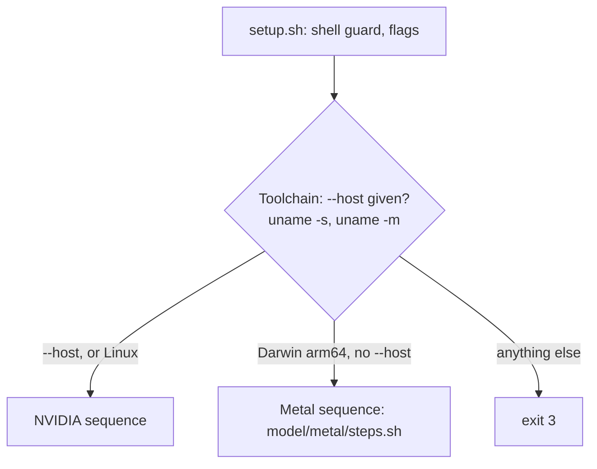
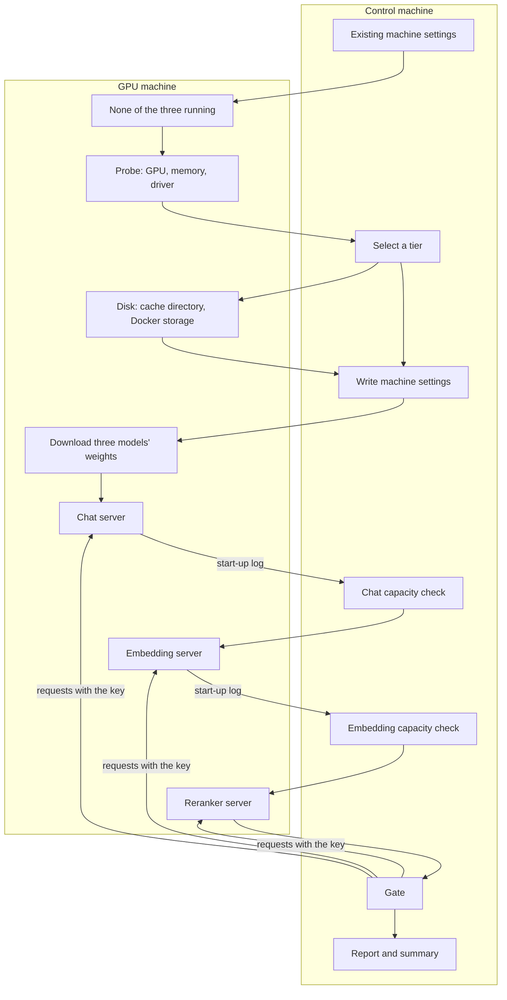
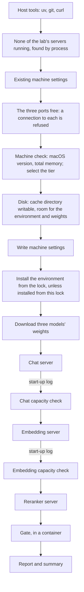

# Model server

Three vLLM processes share one GPU and stand in for hosted models through
OpenAI-compatible APIs: chat with tool calling, embeddings, and reranking.
Each process serves one model. Agents and the knowledge service reach them
through configured URLs and authenticate with one shared key.

The servers are brought up by one of two **toolchains**, chosen by setup
from the machine it runs on:

| | NVIDIA | Metal |
|---|---|---|
| GPU | one NVIDIA card | an Apple silicon Mac's |
| Where the servers run | in Docker containers on the **GPU machine**, which may be the **control machine** setup runs on or another machine reached through its Docker daemon (`--host`) | as processes on the Mac setup runs on |
| What pins them | the vLLM server image, by digest (`model/compose.yaml`) | a Python environment installed from the lock file `model/metal/requirements.txt`: vLLM and vLLM-Metal release wheels and every other package at one version, each from an index or a URL checked against its checksum, two built from pinned git commits |
| Models | a chat profile from `model/tiers.json`; `model/retrieval.env` | the chat profile of `model/metal/tiers.json`; `model/metal/retrieval.env` |
| Bind address | `--bind`, default `127.0.0.1` | `127.0.0.1` only |
| How the lab's containers reach them | the bind address | `host.docker.internal`, Docker Desktop's name for the Mac |
| Started and stopped by | Docker Compose, project `ai-on-aws-model` | `model/metal/servers.sh` |
| Logs | the containers' | `<cache>/vllm-metal/run/<server>.log` |

Setup selects a chat profile that fits alongside the two retrieval models,
downloads pinned weights, starts the servers, and checks that they meet the
lab's requirements. With `--host`, the GPU machine needs no copy of the
repository.

## Configuration boundary

Three files configure the servers, passed explicitly by name:

| Configuration | Location | Controls |
|---|---|---|
| Machine settings | `model/.env`, ignored by git | Toolchain and the retrieval settings file, bind address, ports and URLs, cache directory, user and API key |
| Chat profile | `model/profiles/` | Chat model and revision, context length, concurrency, cache bytes and startup memory share |
| Retrieval settings | `model/retrieval.env` (NVIDIA), `model/metal/retrieval.env` (Metal) | Embedding and reranker models and revisions, served names, input limits, cache bytes, startup memory shares and embedding dimensions; on Metal also the reranker's model overrides and its prompt template |

The machine settings name the toolchain (`MODEL_TOOLCHAIN`) and the
retrieval settings file the servers were started from (`MODEL_RETRIEVAL_ENV`,
a path under `model/`). A file that names neither is read as `nvidia` and
`retrieval.env`.

Retrieval settings are the same for every chat profile of a toolchain. A
**tier** combines a chat profile with the memory needed for all three
servers: free GPU memory on NVIDIA (`model/tiers.json`), total memory on
Metal (`model/metal/tiers.json`). The **gate**, in `model/gate/`, checks the
running servers against the same requirements for every tier and both
toolchains.

Metal's other files: `model/metal/requirements.in` (what the environment is
made of), `model/metal/requirements.txt` (the lock), `model/metal/lock.sh`
(regenerates the lock in a container), `model/metal/qwen3_reranker.jinja`
(the reranker's prompt template), `model/metal/steps.sh` (setup's Metal
sequence) and `model/metal/servers.sh` (start, stop, status).

## Servers

| Server | NVIDIA service | Serves | Listens on | Model and settings from |
|---|---|---|---|---|
| Chat | `chat` | `/v1/chat/completions`, tool calling | `MODEL_BIND_ADDRESS:MODEL_PORT` | the profile |
| Embedding | `embed` | `/v1/embeddings` | `MODEL_BIND_ADDRESS:MODEL_EMBED_PORT` | retrieval settings, `EMBED_*` |
| Reranker | `rerank` | `/v1/rerank` | `MODEL_BIND_ADDRESS:MODEL_RERANK_PORT` | retrieval settings, `RERANK_*` |

Each also serves `/v1/models`, which lists its served name, and `/health`,
which setup reads. On NVIDIA each listens on port 8000 in its container and
is published on the address and port above; on Metal each listens on the
address and port above.

The knowledge pipeline and retrieval service use the following settings:

| Setting | From | Purpose |
|---|---|---|
| `MODEL_EMBED_BASE_URL`, `MODEL_RERANK_BASE_URL`, `MODEL_API_KEY` | machine settings | Embedding and reranking destinations, and the request key |
| `EMBED_MODEL_ID`, `RERANK_MODEL_ID` | retrieval settings | Model names sent in API requests |
| `EMBED_MODEL_REPO`, `EMBED_MODEL_REVISION`, `EMBED_DIMENSIONS` | retrieval settings | Vector identity recorded in the embed report and index, then checked by the retrieval service |

These requests originate in containers on the lab's network. A model server
on a loopback address is reached from those containers only through
`host.docker.internal`, which the Metal machine settings use; an NVIDIA
server published only on its host's loopback address is not reachable from
them. The retrieval service reads the retrieval settings file that
`MODEL_RETRIEVAL_ENV` names, so it sends the reranker's served name of the
toolchain the servers run on.

## Setup

The NVIDIA sequence:

The Metal sequence, all on the Mac:

With `--check`, setup stops after the disk check and prints the tier it would
select. With `--keep-env`, the existing machine settings are used as they are
and none are written.

## Invariants

1. Each server process serves one model, and all three run on one GPU: an
   NVIDIA card or an Apple silicon Mac's. Every request to any of them must
   carry the one key; a request without it is rejected. The one exception is
   `/health`, which tells whether a server is up and is read without the key.
2. The servers are configured by exactly three files, passed by name: the
   machine settings, one profile and the retrieval settings of the
   toolchain. Nothing else reaches them: no default of the machine, the
   shell or the user. Setup refuses to run when the shell holds a variable
   that would override any of the three files or change which compose file,
   project or profile is used.
3. Each server's context cache is fixed in bytes, by the profile for the chat
   server and by the retrieval settings for the other two. The cache is that
   size on any machine. A size that does not fit stops the server at
   start-up; it is never reduced to fit.
4. Weights are fetched by separate download steps, one per model, at the
   pinned revisions. The servers themselves never fetch from the network.
5. On NVIDIA one server image serves all three, pinned by digest. On Metal
   the three run from one Python environment, installed from the committed
   lock file. On both, the Node image that setup's tool and the gate run in
   is pinned by digest.
6. On NVIDIA the servers run as the owner of the cache directory, the only
   folder of the GPU machine mounted into them, and what else a server
   writes stays in its own container. On Metal the servers are processes of
   the user who ran setup, each the leader of its own process group, with
   exactly this environment and nothing of the caller's: `VLLM_API_KEY`;
   `PATH` (the environment's `bin` and the system's directories); `HOME`
   under the cache directory; `HF_HOME` (the cache directory's `hf`);
   `HF_HUB_OFFLINE=1`, so access to the Hugging Face hub is off;
   `HF_HUB_DISABLE_TELEMETRY=1`; `HF_HUB_DISABLE_IMPLICIT_TOKEN=1`;
   `VLLM_NO_USAGE_STATS=1`; `DO_NOT_TRACK=1`; and, for the embedding and
   reranker servers only, `VLLM_ENABLE_V1_MULTIPROCESSING=0`.
7. The gate is one bar for every tier and both toolchains: the same checks
   and thresholds whatever the chat model.
8. On NVIDIA a tier's need is its chat model's peak GPU memory, plus the
   peaks of the embedding and reranker servers, plus a margin; the disk check
   counts the server image when the GPU machine does not hold it, and the
   weights of each of the three models not already in the cache directory.
   On Metal a tier's need is the peak memory of the three servers together,
   plus a margin; the disk check counts the environment when it is not
   installed from the current lock, and the weights of each of the three
   models not already in the cache directory, against the cache directory's
   volume.
9. On NVIDIA setup selects the largest tier whose need fits in the GPU's free
   memory. On Metal it selects the tier named, else its one tier, once the
   machine check passes: Apple silicon, at least the macOS version the tiers
   file names, and total memory at least the tier's need. Setup never selects
   a tier that does not fit and never replaces a tier that was asked for by
   name.
10. Setup writes nothing and starts nothing until the machine's checks (on
    Metal: the host tools, the running servers, the three ports and the
    machine check), the
    selection and the disk check have all passed.
11. Setup never overwrites existing machine settings, and it creates the key
    itself. The key is never printed or passed on a command line.
12. The three ports differ.
13. Each server gives vLLM an explicit start-up share of the GPU's memory:
    the chat server through its profile, the other two through the retrieval
    settings. On NVIDIA the share is small enough to be free while the other
    two run, and sizes nothing, because each cache is fixed in bytes; it is
    only vLLM's check of free memory at start-up. On Metal each cache is the
    size its bytes give, and the share is given so that vLLM's default
    (0.92) is never the one in force. The embedding and reranker servers
    start only once the chat server is healthy, so that they start with the
    chat server's memory already in use.
14. The servers count as set up only when the chat server's start-up log
    confirms room for the profile's number of requests, the embedding
    server's confirms room for one input of its longest length, and the gate
    has passed. On any failure after the first server starts, every server
    is stopped.
15. Setup refuses to run while any of the three servers is running, because
    its memory would be counted against the servers setup starts. On Metal
    it finds them by process, under any cache directory, whether or not
    `model/.env` is theirs.
16. With `--host`, no file of the repository is needed on the GPU machine.
17. Setup takes the toolchain from the machine and `--host` by the table
    below and from nothing else; no flag overrides it, and with `--keep-env`
    it must equal the one the machine settings record.

    | `--host` | This machine (`uname -s`, `uname -m`) | Toolchain |
    |---|---|---|
    | given | any | NVIDIA |
    | not given | Darwin, arm64 | Metal |
    | not given | Linux | NVIDIA |
    | not given | anything else | none: exit 3 |

18. The embedding model's repository, revision, served name, dimensions and
    longest input are the same in both retrieval files, so an index built
    with one toolchain is searched with the other.
19. On Metal the servers listen on the loopback address only, and the machine
    settings give their addresses as `host.docker.internal`.
20. On Metal the servers' Python environment is installed from the committed
    lock file, and is rebuilt when the lock changes. The lock holds every
    package at one version; a package from an index or a URL is checked
    against its checksum; two packages are built from pinned git commits,
    and the tools that build them are not in the lock.

## Restarting

| Action | NVIDIA | Metal |
|---|---|---|
| Restart any one server | it starts beside the other two, with the same context cache, because its start-up share is free while they run | the same, with `model/metal/servers.sh stop <server>` and `start <profile> <server>` |
| Start all three | `docker compose ... up -d chat embed rerank`: chat starts first; the embedding and reranker servers wait until it reports healthy | `model/metal/servers.sh start <profile>`: chat starts first; the other two start once its `/health` answers |
| Set up again | refused until all three are stopped | the same |

On Metal the servers are not started again when the Mac restarts.

## Execution and side effects

`model/setup.sh` sequences the work; on Metal it sources
`model/metal/steps.sh` for the rest of the sequence. `model/setup/tool.ts`
makes the decisions: the toolchain, flag validation, tier selection, the
machine check, disk capacity, machine settings, health, model capacity and
exit codes. The tool runs in the pinned Node image on the control machine
with no network.

NVIDIA:

| Step | Runs on | Side effect |
|---|---|---|
| Parse flags, select a tier, check disk capacity | Control machine | None |
| Check Docker, running servers, GPU, cache and storage | GPU machine | Pulls the pinned Node image if absent |
| Write machine settings | Control machine | Creates `model/.env` |
| Download three models' weights | GPU machine | Populates the cache directory |
| Start servers sequentially, allowing up to 900 seconds each to become healthy | GPU machine | Creates three containers |
| Check chat and embedding capacity from startup logs | Control machine | None |
| Run the gate | Control machine | Writes `model/gate-report.json` |

The GPU checks include Docker's version when `--host` is supplied, a trial
run of the Node image, GPU and disk probes, and checks for the server image,
cached weights and Docker storage. The gate uses the host network when the
servers are published on loopback. Setup removes any previous gate report
before downloading weights.

Metal, all on the Mac:

| Step | Side effect |
|---|---|
| Parse flags, check host tools, running servers, ports, the machine, the cache directory and its volume | None |
| Write machine settings | Creates `model/.env` |
| Install the environment, when its stamp does not equal the lock's sha256 | Replaces `<cache>/vllm-metal/venv`; `uv`'s cache and the Python it installs are kept under `<cache>/vllm-metal` |
| Download three models' weights | Populates `<cache>/hf` |
| Start servers sequentially, allowing up to 900 seconds each to become healthy | Three processes; their logs and pid files in `<cache>/vllm-metal/run` |
| Check chat and embedding capacity from startup logs | None |
| Run the gate, on its default network | Writes `model/gate-report.json` |

If the Mac is on battery power, setup says so and continues. Setup removes
any previous gate report before downloading weights.

Before the tool can run, `setup.sh` rejects the following with exit 2:
`DOCKER_HOST` or an overriding configuration variable in the shell, Docker
missing or not responding, and failure to start the tool.

## What the gate checks

| Server | Check | Passes when |
|---|---|---|
| Chat | Key | no key and a wrong key are rejected with 401; the right key is accepted |
| Chat | Model listed | the profile's model name is listed |
| Chat | Tool calling under load | conversations run several at once; the share that ends correctly is at or above the threshold, and none shows a server fault |
| Chat | Long prompts at once | several long prompts sent together are each answered from their own content, and none with another's |
| Embedding | Key, model listed | as for chat; the model's name is listed |
| Embedding | Vectors | every vector has the configured number of dimensions and unit length within a tolerance |
| Embedding | Ranking | for a fixed synthetic set, the passage that answers each query is the most similar in at least the threshold share |
| Embedding | Input over the limit | refused with 400 |
| Embedding | Batches at once | several batches sent together are all answered |
| Reranker | Key, model listed | as for chat; the model's name is listed |
| Reranker | Ranking | for the same set, the answering passage is ranked first in at least the threshold share |
| Reranker | Document over the limit | refused with 400 without `max_tokens_per_doc`; accepted with it |
| Reranker | Requests at once | several requests sent together are all answered |

## Outcomes of setup

| Exit | Meaning | Left behind |
|---|---|---|
| 0 | the three servers running and shown fit; with `--check`, the machine would get the printed tier | machine settings, the gate's report, the servers; with `--check`, nothing written and nothing started |
| 1 | the environment could not be installed (Metal), a download failed, or a server started and was not shown fit | machine settings; the servers stopped, their containers (NVIDIA) or log files (Metal) kept for their logs; the gate's report if the gate ran |
| 2 | could not run; on Metal also a host tool missing, a port already listened on, the cache directory not writable, or `--keep-env` with machine settings of the other toolchain | no server that setup started left running; a server found running already is left as it was; machine settings only if the failure came after they were written |
| 3 | machine not supported or too small: not Linux and not an Apple silicon Mac without `--host`; on Metal a macOS version below the requirement or too little total memory | nothing written, nothing started |

## Ownership

| Owner | Responsibility | Consumers |
|---|---|---|
| `model/compose.yaml` | NVIDIA server and download definitions | Setup and manual server commands |
| `model/profiles/` | Chat model settings | Chat server, gate and setup |
| `model/retrieval.env` | NVIDIA embedding and reranker settings | Retrieval servers, setup, model gate, knowledge embedding stage, retrieval service and knowledge gate |
| `model/metal/retrieval.env` | Metal embedding and reranker settings | Retrieval servers, setup, model gate and retrieval service |
| `model/tiers.json` | NVIDIA memory and disk requirements; hardware minimums | Setup |
| `model/metal/tiers.json` | Metal memory and disk requirements; the least macOS version | Setup |
| `model/metal/requirements.in`, `requirements.txt`, `lock.sh` | The Metal servers' Python environment and its lock | Setup |
| `model/metal/qwen3_reranker.jinja` | The Metal reranker's prompt template | Metal reranker server |
| `model/.env` | Machine settings | Servers, gate, agents, knowledge embedding stage and retrieval service |
| `model/setup.sh`, `model/metal/steps.sh` | Setup sequence | Operator |
| `model/metal/servers.sh` | Starting, stopping and the status of the Metal servers | Setup and operator |
| `model/setup/` | Setup decisions as pure functions | `setup.sh` |
| `model/gate/` | Checks, thresholds and fixed synthetic dataset | Setup and direct gate commands |

NVIDIA tier requirements include chat, embedding and reranker memory peaks,
a margin, download sizes and server-image disk size; its hardware minimums
cover the driver and GPU compute capability. Metal tier requirements include
the peak memory of the three servers together, a margin, download sizes and
the environment's disk size; its minimum is the macOS major version.
