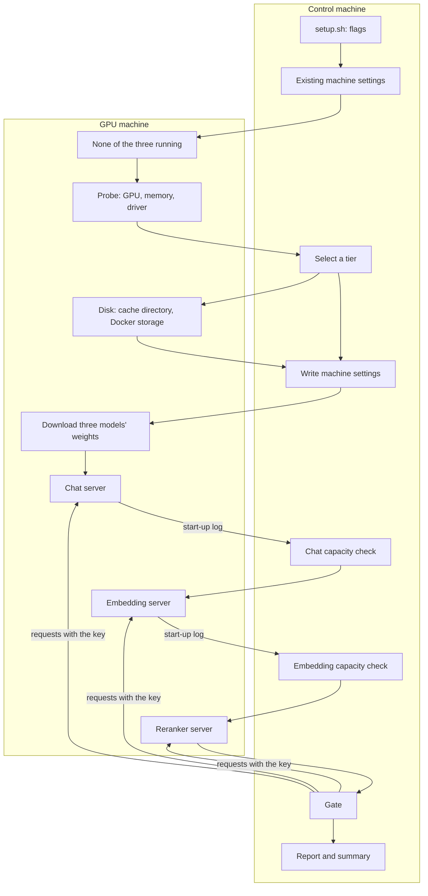

# Model server

Three vLLM processes share one NVIDIA GPU and stand in for hosted models
through OpenAI-compatible APIs: chat with tool calling, embeddings, and
reranking. Each process serves one model. Agents and the knowledge service
reach them through configured URLs and authenticate with one shared key.

Setup runs from the **control machine**, which may also be the **GPU
machine**. It selects a chat profile that fits alongside the two retrieval
models, downloads pinned weights, starts the servers, and checks that they
meet the lab's requirements. When the machines are separate, the GPU machine
needs no copy of the repository.

## Configuration boundary

Three files configure the servers, passed explicitly by name:

| Configuration | Location | Controls |
|---|---|---|
| Machine settings | `model/.env`, ignored by git | Bind address, ports and URLs, cache directory, user and API key |
| Chat profile | `model/profiles/` | Chat model and revision, context length, concurrency, cache bytes and startup memory share |
| Retrieval settings | `model/retrieval.env` | Embedding and reranker models and revisions, served names, input limits, cache bytes, startup memory shares and embedding dimensions |

Retrieval settings are the same for every chat profile. A **tier** combines
a chat profile with the free GPU memory needed for all three servers, as
recorded in `model/tiers.json`. The **gate**, in `model/gate/`, checks the
running servers against the same requirements for every tier.

## Servers

| Server | Compose service | Serves | Published on | Model and settings from |
|---|---|---|---|---|
| Chat | `chat` | `/v1/chat/completions`, tool calling | `MODEL_BIND_ADDRESS:MODEL_PORT` | the profile |
| Embedding | `embed` | `/v1/embeddings` | `MODEL_BIND_ADDRESS:MODEL_EMBED_PORT` | retrieval settings, `EMBED_*` |
| Reranker | `rerank` | `/v1/rerank` | `MODEL_BIND_ADDRESS:MODEL_RERANK_PORT` | retrieval settings, `RERANK_*` |

Each also serves `/v1/models`, which lists its served name, and `/health`, which its health check reads. Each listens on port 8000 in its container.

The knowledge pipeline and retrieval service use the following settings:

| Setting | From | Purpose |
|---|---|---|
| `MODEL_EMBED_BASE_URL`, `MODEL_RERANK_BASE_URL`, `MODEL_API_KEY` | machine settings | Embedding and reranking destinations, and the request key |
| `EMBED_MODEL_ID`, `RERANK_MODEL_ID` | retrieval settings | Model names sent in API requests |
| `EMBED_MODEL_REPO`, `EMBED_MODEL_REVISION`, `EMBED_DIMENSIONS` | retrieval settings | Vector identity recorded in the embed report and index, then checked by the retrieval service |

These requests originate in containers on the lab's network. A model server
published only on its host's loopback address is not reachable from those
containers.

## Setup

With `--check`, setup stops after the disk check and prints the tier it would select. With `--keep-env`, the existing machine settings are used as they are and none are written.

## Invariants

1. Each server process serves one model, and all three run on one GPU. Every
   request to any of them must carry the one key; a request without it is
   rejected. The one exception is `/health`, which each server's own health
   check reads without the key.
2. The servers are configured by exactly three files, passed by name: the
   machine settings, one profile and the retrieval settings. Nothing else
   reaches them: no default of the machine, the shell or the user. Setup
   refuses to run when the shell holds a variable that would override any of
   the three files or change which compose file, project or profile is used.
3. Each server's context cache is fixed in bytes, by the profile for the chat
   server and by the retrieval settings for the other two. The cache is that
   size on any card. A size that does not fit stops the server at start-up;
   it is never reduced to fit.
4. Weights are fetched by separate download steps, one per model, at the
   pinned revisions. The servers themselves never fetch from the network.
5. One server image serves all three. It, and the Node image that setup's
   tool and the gate run in, are pinned by digest.
6. The servers run as the owner of the cache directory, the only folder of
   the GPU machine mounted into them. What else a server writes stays in its
   own container.
7. The gate is one bar for every tier: the same checks and thresholds
   whatever the chat model.
8. A tier's need is its chat model's peak GPU memory, plus the peaks of the
   embedding and reranker servers, plus a margin. The disk check counts the
   server image when the GPU machine does not hold it, and the weights of
   each of the three models not already in the cache directory.
9. Setup selects the largest tier whose need fits in the GPU's free memory.
   It never selects a tier that does not fit and never replaces a tier that
   was asked for by name.
10. Setup writes nothing and starts nothing until the probe, the selection
    and the disk check have all passed.
11. Setup never overwrites existing machine settings, and it creates the key
    itself. The key is never printed or passed on a command line.
12. The three ports differ.
13. Each server gives vLLM an explicit start-up share of the card, small
    enough to be free while the other two run: the chat server through its
    profile, the other two through the retrieval settings. The share sizes
    nothing, because each cache is fixed in bytes; it is only vLLM's check of
    free memory at start-up. The embedding and reranker servers start only
    once the chat server is healthy, so that check runs with the chat
    server's memory already in use.
14. The servers count as set up only when the chat server's start-up log
    confirms room for the profile's number of requests, the embedding
    server's confirms room for one input of its longest length, and the gate
    has passed. On any failure after the first server starts, every server
    is stopped.
15. Setup refuses to run while any of the three servers is running, because
    its memory would make the card look smaller than it is.
16. When the control machine is not the GPU machine, no file of the
    repository is needed on the GPU machine.

## Restarting

| Action | What happens |
|---|---|
| Restart any one server | it starts beside the other two, with the same context cache, because its start-up share is free while they run |
| `docker compose ... up -d chat embed rerank` | chat starts first; the embedding and reranker servers wait until it reports healthy |
| Set up again | refused until all three are stopped |

## Execution and side effects

`model/setup.sh` sequences the work. `model/setup/tool.ts` makes the decisions:
flag validation, tier selection, disk capacity, machine settings, health,
model capacity and exit codes. The tool runs in the pinned Node image on
the control machine with no network.

| Step | Runs on | Side effect |
|---|---|---|
| Parse flags, select a tier, check disk capacity | Control machine | None |
| Check Docker, running servers, GPU, cache and storage | GPU machine | Pulls the pinned Node image if absent |
| Write machine settings | Control machine | Creates `model/.env` |
| Download three models' weights | GPU machine | Populates the cache directory |
| Start servers sequentially, allowing up to 900 seconds each to become healthy | GPU machine | Creates three containers |
| Check chat and embedding capacity from startup logs | Control machine | None |
| Run the gate | Control machine | Writes `model/gate-report.json` |

The GPU checks include Docker's version when `--host` is supplied, a trial
run of the Node image, GPU and disk probes, and checks for the server image,
cached weights and Docker storage. The gate uses the host network when the
servers are published on loopback. Setup removes any previous gate report
before downloading weights.

Before the tool can run, `setup.sh` rejects the following with exit 2:
`DOCKER_HOST` or an overriding configuration variable in the shell, Docker
missing or not responding, and failure to start the tool.

## What the gate checks

| Server | Check | Passes when |
|---|---|---|
| Chat | Key | no key and a wrong key are rejected with 401; the right key is accepted |
| Chat | Model listed | the profile's model name is listed |
| Chat | Tool calling under load | conversations run several at once; the share that ends correctly is at or above the threshold, and none shows a server fault |
| Chat | Long prompts at once | several long prompts sent together are each answered from their own content, and none with another's |
| Embedding | Key, model listed | as for chat; the model's name is listed |
| Embedding | Vectors | every vector has the configured number of dimensions and unit length within a tolerance |
| Embedding | Ranking | for a fixed synthetic set, the passage that answers each query is the most similar in at least the threshold share |
| Embedding | Input over the limit | refused with 400 |
| Embedding | Batches at once | several batches sent together are all answered |
| Reranker | Key, model listed | as for chat; the model's name is listed |
| Reranker | Ranking | for the same set, the answering passage is ranked first in at least the threshold share |
| Reranker | Document over the limit | refused with 400 without `max_tokens_per_doc`; accepted with it |
| Reranker | Requests at once | several requests sent together are all answered |

## Outcomes of setup

| Exit | Meaning | Left behind |
|---|---|---|
| 0 | the three servers running and shown fit; with `--check`, the machine would get the printed tier | machine settings, the gate's report, the servers; with `--check`, nothing written and nothing started |
| 1 | a download failed, or a server started and was not shown fit | machine settings; the servers stopped, their containers kept for their logs; the gate's report if the gate ran |
| 2 | could not run | no server that setup started left running; a server found running already is left as it was; machine settings only if the failure came after they were written |
| 3 | machine not supported or too small | nothing written, nothing started |

## Ownership

| Owner | Responsibility | Consumers |
|---|---|---|
| `model/compose.yaml` | Server and download definitions | Setup and manual server commands |
| `model/profiles/` | Chat model settings | Chat server, gate and setup |
| `model/retrieval.env` | Embedding and reranker settings | Retrieval servers, setup, model gate, knowledge embedding stage, retrieval service and knowledge gate |
| `model/tiers.json` | Memory and disk requirements; hardware minimums | Setup |
| `model/.env` | Machine settings | Servers, gate, agents, knowledge embedding stage and retrieval service |
| `model/setup.sh` | Setup sequence | Operator |
| `model/setup/` | Setup decisions as pure functions | `setup.sh` |
| `model/gate/` | Checks, thresholds and fixed synthetic dataset | Setup and direct gate commands |

Tier requirements include chat, embedding and reranker memory peaks, a
margin, download sizes and server-image disk size. Hardware minimums cover
the driver and GPU compute capability.
