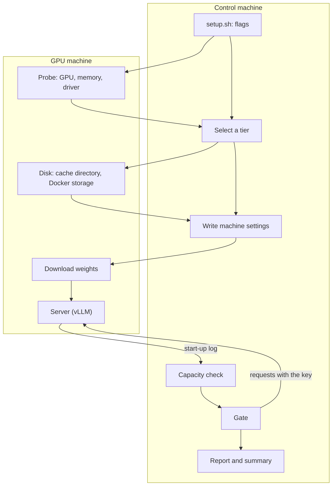

# Model server

The lab's stand-in for a hosted model: one vLLM process serving one chat
model on one NVIDIA GPU, behind an OpenAI-compatible API with tool calling and
a required key. Everything else in the lab reaches it by a URL and that key.

## Terms

| Term | Meaning |
|---|---|
| GPU machine | the machine with the NVIDIA GPU; it runs the server |
| Control machine | the machine `setup.sh` is run from; it may be the GPU machine |
| Machine settings | `model/.env`: address, port, cache directory, user, key. Ignored by git |
| Profile | a file in `model/profiles/`: a model at a pinned revision, its context length, how many requests it serves at once, and the size of its context cache in bytes |
| Gate | `model/gate/`: the check that decides whether a running server is fit for the lab |
| Tier | a profile that has passed the gate, with the free GPU memory it needs. Listed in `model/tiers.json` |

## Setup

## Invariants

1. One server process serves one chat model on one GPU. Every request must
   carry the key; a request without it is rejected.
2. The server is configured by exactly two files, passed by name: the machine
   settings and one profile. Nothing else reaches it: no default of the
   machine, the shell or the user. Setup refuses to run when the shell holds
   a variable that would override either file or change which compose file,
   project or profile is used.
3. A profile fixes the size of the context cache in bytes. The cache is that
   size on any card. A size that does not fit stops the server at start-up;
   it is never reduced to fit.
4. Weights are fetched by a separate download step at the profile's pinned
   revision. The server itself never fetches from the network.
5. The server image and the tool image are pinned by digest.
6. The server runs as the owner of the cache directory.
7. The gate is one bar for every tier: the same checks and thresholds
   whatever the model.
8. A tier's need is its measured peak GPU memory, plus a margin, plus a
   reserve for the other models the lab runs on the same card.
9. Setup selects the largest tier whose need fits in the GPU's free memory.
   It never selects a tier that does not fit and never replaces a tier that
   was asked for by name.
10. Setup writes nothing and starts nothing until the probe, the selection
    and the disk check have all passed.
11. Setup never overwrites existing machine settings, and it creates the key
    itself. The key is never printed or passed on a command line.
12. A server counts as set up only when its own start-up log confirms room
    for the profile's number of requests and the gate has passed. A server
    that fails either is stopped.
13. Setup refuses to run while the lab's server is running, because the
    server's own memory would make the card look smaller than it is.
14. When the control machine is not the GPU machine, no file of the
    repository is needed on the GPU machine.

## Where each step runs

| Step | Runs on | Changes anything |
|---|---|---|
| Parse flags, select a tier, decide the disk verdict | control machine | no |
| Probe the GPU; inspect the cache directory and Docker's storage | GPU machine | no |
| Write machine settings | control machine | `model/.env` |
| Download weights | GPU machine | the cache directory |
| Run the server | GPU machine | a container |
| Check capacity from the start-up log | control machine | no |
| Gate | control machine | `model/gate-report.json`, replacing any earlier one |

## What the gate checks

| Check | Passes when |
|---|---|
| Key | no key and a wrong key are rejected; the right key is accepted |
| Tool calling under load | conversations run several at once; the share that ends correctly is at or above the threshold, and none shows a server fault |
| Long prompts at once | several long prompts sent together are each answered from their own content |

## Outcomes of setup

| Exit | Meaning | Left behind |
|---|---|---|
| 0 | server running and shown fit | machine settings, the gate's report, the server |
| 1 | download failed, or the server started and was not shown fit | machine settings; the server stopped, its container kept for its log; the gate's report if the gate ran |
| 2 | could not run | no server left running; machine settings only if the failure came after they were written |
| 3 | machine not supported or too small | nothing written, nothing started |

## Ownership

| Thing | Where | Read by |
|---|---|---|
| Server and download definitions | `model/compose.yaml` | setup, a person starting the server by hand |
| Profiles | `model/profiles/` | the server, the gate, setup |
| Tiers: needs, margin, reserve, minimum driver and GPU generation | `model/tiers.json` | setup |
| Machine settings | `model/.env` | the server, the gate, the rest of the lab |
| Setup: sequencing | `model/setup.sh` | a person |
| Setup: decisions, as pure functions with tests | `model/setup/` | `setup.sh` |
| Gate and its thresholds | `model/gate/` | setup, a person |
