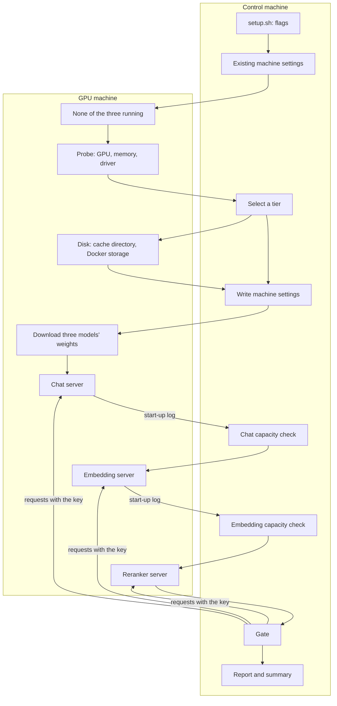

# Model server

The lab's stand-in for hosted models: three vLLM processes on one NVIDIA GPU,
each serving one model behind an OpenAI-compatible API and one shared key.
The chat server serves the chat model with tool calling, the embedding server
an embedding model, the reranker server a reranker. Everything else in the lab
reaches them by their URLs and that key.

## Terms

| Term | Meaning |
|---|---|
| GPU machine | the machine with the NVIDIA GPU; it runs the servers |
| Control machine | the machine `setup.sh` is run from; it may be the GPU machine |
| Machine settings | `model/.env`: address, the three ports and URLs, cache directory, user, key. Ignored by git |
| Profile | a file in `model/profiles/`: a chat model at a pinned revision, its context length, how many requests it serves at once, the size of its context cache in bytes, and the chat server's start-up share of the card |
| Retrieval settings | `model/retrieval.env`: the embedding model and the reranker, each at a pinned revision, with its name, longest input, cache size in bytes and start-up share of the card; the embedding model's number of dimensions. The same for every profile |
| Gate | `model/gate/`: the check that decides whether the running servers are fit for the lab |
| Tier | a profile that has passed the gate, with the free GPU memory it and the two retrieval servers need. Listed in `model/tiers.json` |

## Servers

| Server | Compose service | Serves | Published on | Model and settings from |
|---|---|---|---|---|
| Chat | `chat` | `/v1/chat/completions`, tool calling | `MODEL_BIND_ADDRESS:MODEL_PORT` | the profile |
| Embedding | `embed` | `/v1/embeddings` | `MODEL_BIND_ADDRESS:MODEL_EMBED_PORT` | retrieval settings, `EMBED_*` |
| Reranker | `rerank` | `/v1/rerank` | `MODEL_BIND_ADDRESS:MODEL_RERANK_PORT` | retrieval settings, `RERANK_*` |

Each also serves `/v1/models`, which lists its served name, and `/health`, which its health check reads. Each listens on port 8000 in its container.

Where the knowledge piece meets these servers:

| Setting | From | Read by the knowledge piece as |
|---|---|---|
| `MODEL_EMBED_BASE_URL`, `MODEL_RERANK_BASE_URL`, `MODEL_API_KEY` | machine settings | where the embedding stage and the retrieval service send requests, and the key they carry |
| `EMBED_MODEL_ID`, `RERANK_MODEL_ID` | retrieval settings | the served names each request names |
| `EMBED_MODEL_REPO`, `EMBED_MODEL_REVISION`, `EMBED_DIMENSIONS` | retrieval settings | the vectors' identity, recorded in the embed report and the index and compared by the service before it uses a vector |

The knowledge piece runs in containers on the lab's network and reaches these URLs from there. A server published on a loopback address of the host is not reachable from those containers.

## Setup

## Invariants

1. Each server process serves one model, and all three run on one GPU. Every
   request to any of them must carry the one key; a request without it is
   rejected.
2. The servers are configured by exactly three files, passed by name: the
   machine settings, one profile and the retrieval settings. Nothing else
   reaches them: no default of the machine, the shell or the user. Setup
   refuses to run when the shell holds a variable that would override any of
   the three files or change which compose file, project or profile is used.
3. Each server's context cache is fixed in bytes, by the profile for the chat
   server and by the retrieval settings for the other two. The cache is that
   size on any card. A size that does not fit stops the server at start-up;
   it is never reduced to fit.
4. Weights are fetched by separate download steps, one per model, at the
   pinned revisions. The servers themselves never fetch from the network.
5. One server image serves all three, and it and the tool image are pinned
   by digest.
6. The servers run as the owner of the cache directory, and write on the GPU
   machine only inside it.
7. The gate is one bar for every tier: the same checks and thresholds
   whatever the chat model.
8. A tier's need is its chat model's peak GPU memory, plus the peaks of the
   embedding and reranker servers, plus a margin. The disk check counts the
   image and the weights of each of the three models not already in the
   cache.
9. Setup selects the largest tier whose need fits in the GPU's free memory.
   It never selects a tier that does not fit and never replaces a tier that
   was asked for by name.
10. Setup writes nothing and starts nothing until the probe, the selection
    and the disk check have all passed.
11. Setup never overwrites existing machine settings, and it creates the key
    itself. The key is never printed or passed on a command line.
12. The three ports differ.
13. Each server gives vLLM an explicit start-up share of the card, small
    enough to be free while the other two run: the chat server through its
    profile, the other two through the retrieval settings. The share sizes
    nothing, because each cache is fixed in bytes; it is only vLLM's check of
    free memory at start-up. The embedding and reranker servers start only
    once the chat server is healthy, so that check runs with the chat
    server's memory already in use.
14. The servers count as set up only when the chat server's start-up log
    confirms room for the profile's number of requests, the embedding
    server's confirms room for one input of its longest length, and the gate
    has passed. On any failure after the first server starts, every server
    is stopped.
15. Setup refuses to run while any of the three servers is running, because
    its memory would make the card look smaller than it is.
16. When the control machine is not the GPU machine, no file of the
    repository is needed on the GPU machine.

## Restarting

| Action | What happens |
|---|---|
| Restart any one server | it starts beside the other two, with the same cache, because its start-up share is free while they run |
| `docker compose ... up -d chat embed rerank` | chat starts first; the embedding and reranker servers wait until it reports healthy |
| Set up again | refused until all three are stopped |

## Where each step runs

| Step | Runs on | Changes anything |
|---|---|---|
| Parse flags, select a tier, decide the disk verdict | control machine | no |
| List the lab's running servers; run the pinned Node image once; probe the GPU; inspect the cache directory and Docker's storage | GPU machine | no |
| Write machine settings | control machine | `model/.env` |
| Download weights of the three models | GPU machine | the cache directory |
| Run the three servers, one at a time, each waited on until healthy for at most 900 seconds | GPU machine | three containers |
| Check capacity from the chat and embedding servers' start-up logs | control machine | no |
| Gate, on the host's network when the servers are published on a loopback address | control machine | `model/gate-report.json`; an earlier one is removed before the downloads |

Every decision (flags, selection, disk verdict, the text of machine settings, health, capacity, exit codes) is made by `model/setup/tool.ts`, run in the pinned Node image on the control machine with no network.

## What the gate checks

| Server | Check | Passes when |
|---|---|---|
| Chat | Key | no key and a wrong key are rejected with 401; the right key is accepted |
| Chat | Model listed | the profile's model name is listed |
| Chat | Tool calling under load | conversations run several at once; the share that ends correctly is at or above the threshold, and none shows a server fault |
| Chat | Long prompts at once | several long prompts sent together are each answered from their own content, and none with another's |
| Embedding | Key, model listed | as for chat; the model's name is listed |
| Embedding | Vectors | every vector has the configured number of dimensions and unit length within a tolerance |
| Embedding | Ranking | for a fixed synthetic set, the passage that answers each query is the most similar in at least the threshold share |
| Embedding | Input over the limit | refused with 400 |
| Embedding | Batches at once | several batches sent together are all answered |
| Reranker | Key, model listed | as for chat; the model's name is listed |
| Reranker | Ranking | for the same set, the answering passage is ranked first in at least the threshold share |
| Reranker | Document over the limit | refused with 400 without `max_tokens_per_doc`; accepted with it |
| Reranker | Requests at once | several requests sent together are all answered |

## Outcomes of setup

| Exit | Meaning | Left behind |
|---|---|---|
| 0 | the three servers running and shown fit; with `--check`, the machine would get the printed tier | machine settings, the gate's report, the servers; with `--check`, nothing written and nothing started |
| 1 | a download failed, or a server started and was not shown fit | machine settings; the servers stopped, their containers kept for their logs; the gate's report if the gate ran |
| 2 | could not run | no server left running; machine settings only if the failure came after they were written |
| 3 | machine not supported or too small | nothing written, nothing started |

## Ownership

| Thing | Where | Read by |
|---|---|---|
| Server and download definitions | `model/compose.yaml` | setup, a person starting the servers by hand |
| Profiles | `model/profiles/` | the chat server, the gate, setup |
| Retrieval settings | `model/retrieval.env` | the embedding and reranker servers, the gate, setup; in the knowledge piece, the embedding stage, the retrieval service and the knowledge gate |
| Tiers: chat peaks, retrieval peaks, margin, download sizes, minimum driver and GPU generation | `model/tiers.json` | setup |
| Machine settings | `model/.env` | the servers, the gate, the rest of the lab (the agents; the knowledge piece's embedding stage and retrieval service) |
| Setup: sequencing | `model/setup.sh` | a person |
| Setup: decisions, as pure functions with tests | `model/setup/` | `setup.sh` |
| Gate, its thresholds and its fixed synthetic set | `model/gate/` | setup, a person |
