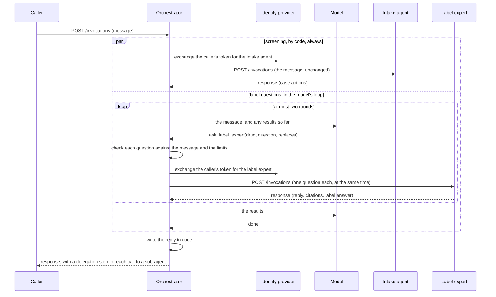

# Orchestrator, on Strands

One agent in one container. It receives any inquiry and gets both halves of it done by the two agents that each do one: the [intake agent](intake-agent-strands.md) records an adverse event as a case, and the [label expert](expert-agent.md) answers a question from an approved label. It calls each over the agent contract, as a client does, with a token it gets for that agent.

It serves the same contract as the other agents, through the same startup (`run/serve.ts`), on AWS's SDK server behind the local edge ([agent-runtime.md](agent-runtime.md)).

## Terms

| Term | Meaning |
|---|---|
| Sub-agent | The intake agent on Strands, or the label expert |
| Screening | Sending the message to the intake agent, which decides whether it reports an adverse event and records it |
| Label question | One question about one medicine, written by the orchestrator's model, put to the label expert as a message of its own |
| Round | The label questions the model asks in one turn. They are put at the same time |
| Replaces | A question may name an earlier question it replaces. The reply then shows the later one |
| Delegation | One call to a sub-agent, recorded as a `delegation` step with what was sent and what came back |

## The problem

One inquiry can hold an adverse event report, a question a label answers, both, or neither. Each sub-agent handles one half:

| Agent | Does | Does not |
|---|---|---|
| Intake | Records an adverse event as a case, once per message, even when the message is mainly a question | Answer any question |
| Label expert | Answers from one approved label, every statement checked in code against cited passages | Record anything; it declines a bare adverse event report |

## Constraints

| Constraint | What it forces |
|---|---|
| An adverse event that is not recorded must never look like success | Screening runs on every message, by code. A model's choice cannot skip it, and a run cannot end `completed` without it |
| The case system opens one case per message id | The intake agent receives the original message under its own id. No model-written text reaches it |
| The expert answers from one label, and its checks live in its handler | The expert is called through its contract. A question about two medicines is two calls |
| Text from the message is untrusted | The model cannot stop screening, change what the intake agent receives, or put text in the reply |
| The client and the agents' front doors wait at most 300 s for an answer (Node's `fetch`) | The whole run is limited to 280 s |

## One message

Code screens every message through the intake agent. A model, in Strands' own loop, puts label questions to the expert, reads what comes back, and may ask again. Code writes the reply, placing the expert's checked text word for word.

## Who decides what

| Part | Decided by | How |
|---|---|---|
| Whether the message is screened | Code | Always, at the start of the run |
| Whether the message reports an adverse event | The intake agent's own model and rules | Unchanged |
| Which label questions to ask, and whether to ask again | The orchestrator's model | One tool, `ask_label_expert({ drug, question, replaces })`, in Strands' default loop. Tool calls of one turn run together, which is Strands' default |
| Whether a question is put | Code | Its arguments must be a medicine and a question in words, and any question it names as replaced must have been put; every number in the question must be in the message (the expert's number rule); at most two questions a round and two rounds; the run must have a sub-agent call's time left and a 5 s margin, 160 s in all, so no round starts later than 120 s in and every call ends, and is recorded, before the run's timer |
| What the model reads back | Code | For each question: the expert's label answer, or that it did not complete, its stop reason and its reply |
| The answer to a label question | The label expert | Unchanged |
| The reply | Code | A sentence for each case action, each question named by its number only ("Label question 1") with the expert's reply word for word, and a plain sentence for anything unfinished. No text the orchestrator's model wrote is in it, the questions included: what that model wrote, and each question as it was put, are in the run's steps. The expert's reply is the expert's: statements its model wrote and its code checked |
| How the run ends | Code | The table under "How it ends" |

## Modules and what each owns

| Module | Owns | Knows nothing about |
|---|---|---|
| `orchestrator/main.ts` | Starting the agent through `run/serve.ts` on the AgentCore SDK server, with the implementation `Strands`; the handler used while the model's name cannot be learnt, so that screening still runs | The rules of a run |
| `orchestrator/serve.ts` | Reading `INTAKE_AGENT_URL` and `EXPERT_AGENT_URL`, beside what `run/serve.ts` reads | Everything else |
| `orchestrator/settings.ts` | Every number of this agent: its limits, questions in a round, rounds | Where they are used |
| `orchestrator/prompt.ts` | What the model is told, and the message laid out for it (its text only, inside `<message>`) | Everything else |
| `orchestrator/strands.ts` | The run: screening, the tool, the hooks, the ids and when each question is decided, the steps, the response | HTTP, the token check |
| `orchestrator/decisions.ts` | Whether a question is put, what the model is told about it, which questions the reply shows, how the run ends, the reply and its citations. Pure functions | Strands, the sub-agents, the clock |
| `orchestrator/sub-agents.ts` | The two sub-agents, one call to either with the token for it and its time limit, the HTTP call, and the sentence for each way a call fails | The model, the loop |
| `expert/checks.ts` (the label expert's) | The number rule, and moving the citation numbers of a reply as `replyFor` writes it | The orchestrator |
| `tools/tool-token.ts` (shared) | Exchanging the caller's token for one meant for a tool server or an agent, each target's audience and scopes, and the sentence a failed exchange gives | The model, the loop |
| `run/*`, `contract/*`, `model/served.ts` (shared) | The state every run keeps, the record, startup, the HTTP contract on the SDK server, the wording of a model failure | This agent |

A question's id is given, and the question decided, when the model's turn ends (the `AfterModelCall` hook), in the order of the turn's calls, before Strands runs any of them. A round is a turn with at least one call to `ask_label_expert`, and a call counts towards its round's two whether or not it is put. The shared endings in `run/endings.ts` are not used: this agent's reply and reason come from `decisions.ts`.

## Who the orchestrator is to the sub-agents

| Step | Token |
|---|---|
| The client calls the orchestrator | For the orchestrator alone: audience `orchestrator`, scope `agents:orchestrator`, granted by the roles `desk` and `medical-information` |
| The orchestrator calls the intake agent | Exchanged, as client `orchestrator`: audience `intake-strands`, scope `agents:intake` |
| The orchestrator calls the label expert | Exchanged: audience `expert`, scope `agents:expert:delegated`. Only the orchestrator's client may ask for this scope |
| The sub-agent calls its tool server | Exchanged again by the sub-agent, as it does for any caller |

The expert accepts `agents:expert` or `agents:expert:delegated`. So desk staff reach the expert through the orchestrator and cannot call it directly.

## Always true

1. Every accepted message is sent to the intake agent once, unchanged and under its own id, by code, whatever the model does or fails to do.
2. A label question is put to the expert only if it names a medicine and a question in words, any question it says it replaces was put, every number in it is in the message, it is within two questions a round and two rounds, and the run has a sub-agent call's time left. A question not put is told to the model and named in the reply. Each question put is one call to the expert; the orchestrator sends none again.
3. The model is shown, for each question, the expert's label answer or that it did not complete, its stop reason and its reply, and nothing else of the run: not the intake agent's result.
4. The reply is written by code. No text from the orchestrator's model is in it, and each expert reply shown is word for word, except that its citation numbers are moved to their place in the combined list. A question that was replaced is not shown.
5. Citations are those of the expert replies shown, in that order, so that each number in the reply names its own citation. Case actions are the intake agent's. `label_answer` is absent.
6. A run ends `completed` only when screening completed and every question asked was answered, or replaced by one that was. Each other ending is the row of "How it ends" that describes it.
7. Each sub-agent is sent a token the orchestrator exchanged for that agent, with its audience and scope, and never the token the orchestrator was called with. An exchange that fails is that call's failure.
8. Every call to a sub-agent is a `delegation` step holding what was sent, and the sub-agent's whole response or the reason there is none.
9. Whatever goes wrong, a run ends with an outcome inside the contract, within 280 s and after at most three model turns.
10. Runs share no state.

## How it ends

| Screening | Label questions | Outcome | `stop_reason` | Reply begins |
|---|---|---|---|---|
| Completed | None asked, or every question (or its replacement) answered | `completed` | none | The results |
| Completed | One not put, one neither answered nor replaced, or the model's loop failed | `stopped` | `label_question_unanswered` | "A question in this message was not answered", then what was obtained |
| Did not complete | A label answer obtained | `stopped` | `adverse_event_screening_incomplete` | "The screening of this message for an adverse event did not complete", why, and, unless the intake agent's run ended `stopped`, "Send it again."; then the label answer |
| Did not complete | Nothing obtained | `failed` | the reason | The reason |

Screening completed means the intake agent's response has outcome `completed`. A stopped intake run includes one whose report check found an adverse event while the run recorded no case ([intake-agent-handwritten.md](intake-agent-handwritten.md), invariant 14). A question is answered when the expert's response to it has outcome `completed`, whatever its label answer: "no label was found" is an answer. The orchestrator sends no failed call again. Sending the same message again is safe: the case system opens one case per message.

## How it fails

| Failure | Result |
|---|---|
| A sub-agent cannot be reached, answers with a status that is not 200, answers outside the contract, or does not answer in 155 s | A `delegation` step with the reason. For a label question the model is told and may ask another |
| An exchange is refused, or the identity provider does not answer | The same |
| The model's loop fails, or ends with a question unanswered | Screening still runs. `stopped`, `label_question_unanswered` |
| The model asks a question holding a number the message does not | The question is not put; the model is told; the reply says so |
| The message contains instructions | They can change which questions are put. They cannot stop screening, change the message the intake agent receives, or add text to the reply, because no text the model wrote is placed in it: a question is named there by its number only |
| An expert's reply contains instructions | The model reads it, so it can change later questions, inside the same limits and the same question check |

## The numbers, and where each is set

| Number | Value | Set in |
|---|---|---|
| Model turns in a run | 3. The first turn of a run that uses up its output allowance having written nothing is asked again once, with thinking off for the rest of the run, as in the intake agent on Strands; Strands does not count that request as a turn, and the run's 280 s bounds it. Any later cut-off turn ends the model's loop | `ORCHESTRATOR_LIMITS`, `orchestrator/settings.ts`; the rule in `run/turns.ts` |
| Questions in a round | 2 | `ORCHESTRATOR_SETTINGS`, `orchestrator/settings.ts` |
| Rounds | 2 | `ORCHESTRATOR_SETTINGS` |
| Each model turn | 30 s, for each request Strands' OpenAI client makes | `ORCHESTRATOR_LIMITS` |
| Each call to a sub-agent | 155 s, its token exchange included: the sub-agent's own 150 s, and the round trip | `ORCHESTRATOR_LIMITS` |
| The whole run | 280 s | `ORCHESTRATOR_LIMITS` |
| Margin beyond a call's limit for a question to be put | 5 s | `ORCHESTRATOR_SETTINGS`, `orchestrator/settings.ts` |
| A round starts no later than | 120 s into the run. Derived: a question is put only while the run has a call's 155 s and the 5 s margin left, so a call that was started always ends, and its delegation step is recorded, before the run's own timer fires | The check in `orchestrator/decisions.ts` |
| Token life the orchestrator requires | 280 s, the whole run. A sub-agent requires 150 s, and a call starts with at least 155 s left | `run/serve.ts`, from `ORCHESTRATOR_LIMITS` |
| What the client waits for the orchestrator, and the token life it requires first | 295 s for both. The other agents keep 180 s | The client |
| Temperature, seed and output allowance | shared | `run/sampling.ts` |

## How it is tested

`agents/test/orchestrator.test.ts`: one test for each line of "Always true" (orchestrator 1 to 10). Whether a question is put (2), how the run ends (6) and the reply with its citations (4, 5) are called as pure functions with plain values. The rest call the handler with the caller, a scripted token exchange and a scripted call to a sub-agent passed in, through the real Strands loop, against one scripted model server on loopback shared by the file; every response is checked against the contract schema. A time limit is shown with small limits passed in, or with the clock passed in and moved on by the scripted call. No token is signed, and no sub-agent runs. Whether the orchestrator and the real sub-agents agree, with a real model and real exchanges, is shown by the stack gate.

## Not present

| Missing | What follows |
|---|---|
| The orchestrator's name in the case system's audit trail | A case opened through the orchestrator names the intake agent as the acting agent. The exchanged token names only the last agent in the chain |
| Asking the sender a question and waiting for the answer | The agent contract is one message in and one response out |
| A third round | A question the first two rounds leave unanswered is named in the reply |
| A measure of how well it splits and asks again | Not measured yet |
| A limit on a whole model turn | The 30 s is each request's. Strands' OpenAI client sends a request that timed out or failed with 408, 409, 429 or 5xx again, up to three in all, and Strands asks again after 429; the run's 280 s stops either |
| A test of the run when the model's name cannot be learnt | Screening still runs and the model's loop counts as failed (`orchestrator/main.ts`, `run/serve.ts`); no test calls that path |
