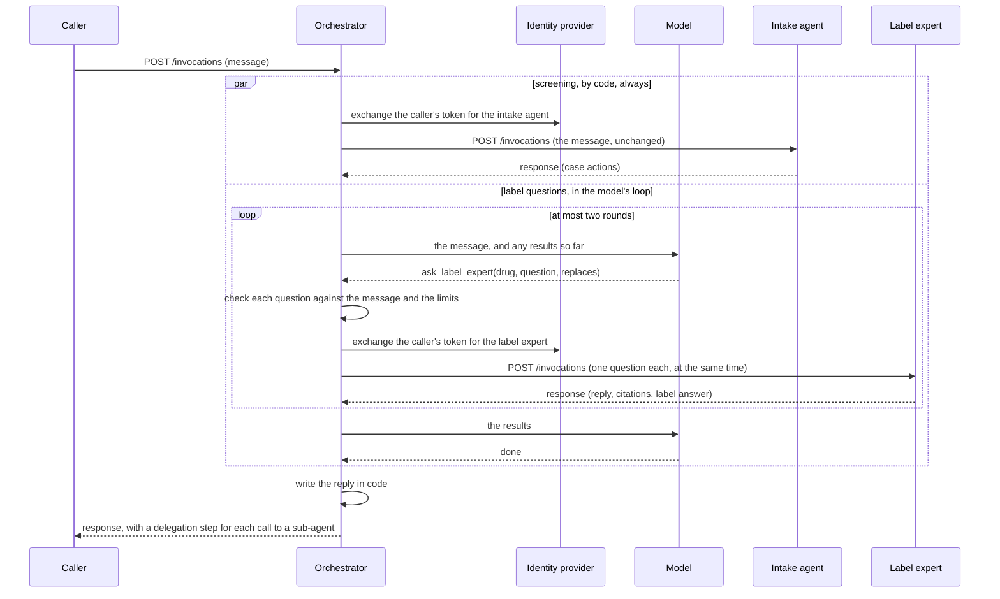

# Orchestrator, on Strands

An inquiry can contain an adverse event report, a question about a medicine, both or neither. The orchestrator sends every message to the [intake agent](intake-agent-strands.md) for screening while its model identifies questions for the [label expert](expert-agent.md). It calls both through the agent contract, using a token exchanged for each agent.

Code controls screening and assembles the final reply. The model can choose label questions, but cannot skip screening or supply the final reply text.

The orchestrator shares the other agents' contract and startup (`run/serve.ts`). The [AgentCore SDK server and local edge](agent-runtime.md) serve its requests.

## Terms

| Term | Meaning |
|---|---|
| Sub-agent | The intake agent on Strands, or the label expert |
| Screening | Sending the message to the intake agent, which decides whether it reports an adverse event and records it |
| Label question | One question about one medicine, written by the orchestrator's model, put to the label expert as a message of its own |
| Round | The label questions the model asks in one turn. They are put at the same time |
| Replaces | A question may name an earlier question it replaces. The reply then shows the later one |
| Delegation | One call to a sub-agent, recorded as a `delegation` step with what was sent and what came back |

## Delegated responsibilities

Each sub-agent owns a distinct result:

| Agent | Does | Does not |
|---|---|---|
| Intake | Records an adverse event as a case, once per message, even when the message is mainly a question | Answer any question |
| Label expert | Answers from one approved label, every statement checked in code against cited passages | Record anything; it declines a bare adverse event report |

## Constraints

| Constraint | What it forces |
|---|---|
| An adverse event that is not recorded must never look like success | Screening runs on every message, by code. A model's choice cannot skip it, and a run cannot end `completed` without it |
| The case system opens one case per message id | The intake agent receives the original message under its own id. No model-written text reaches it |
| The expert answers from one label, and its checks live in its handler | The expert is called through its contract. A question about two medicines is two calls |
| Text from the message is untrusted | The model cannot stop screening, change what the intake agent receives, or put text in the reply |
| The client waits at most 295 s for the orchestrator, because Node's `fetch` stops waiting at 300 s | The whole run is limited to 280 s |

## One message

Screening and label questions run in parallel. Strands runs the model's question loop; the model reads the expert's results and may ask a second round. Code combines the case actions and expert replies, preserving the checked answer text and renumbering its citations.

## Who decides what

| Part | Decided by | How |
|---|---|---|
| Whether the message is screened | Code | Always, at the start of the run |
| Whether the message reports an adverse event | The intake agent's own model and rules | Unchanged |
| Which label questions to ask, and whether to ask again | The orchestrator's model | One tool, `ask_label_expert({ drug, question, replaces })`, in Strands' default loop. Tool calls of one turn run together, which is Strands' default |
| Whether a question is sent | Code | Validates the arguments, replacement id, numbers, question count and remaining time; see the admission rules below |
| What the model reads back | Code | For each question: the expert's label answer, or that it did not complete, its stop reason and its reply |
| The answer to a label question | The label expert | Unchanged |
| The reply | Code | Fixed sentences and the expert's checked replies. The orchestrator model's text, including its questions, appears only in the steps |
| How the run ends | Code | The table under "How it ends" |

A question is sent only when all admission rules pass:

- `drug` and `question` contain nonempty text, and any `replaces` id names a question already sent.
- Every number in the drug and question appears in the original message, using the expert's number rule.
- The call is within two questions per round and two rounds.
- At least 160 s remain: the 155 s call limit plus a 5 s margin. This makes 120 s into the run the latest start time for a round, leaving time to record its calls before the 280 s deadline.

## Modules and what each owns

| Module | Owns | Knows nothing about |
|---|---|---|
| `orchestrator/main.ts` | Starts the SDK server through `run/serve.ts` with implementation `Strands`; supplies a handler that preserves screening when model discovery fails | Run rules |
| `orchestrator/serve.ts` | Reading `INTAKE_AGENT_URL` and `EXPERT_AGENT_URL`, beside what `run/serve.ts` reads | Everything else |
| `orchestrator/settings.ts` | Run limits, questions per round and round count | Enforcement |
| `orchestrator/prompt.ts` | What the model is told, and the message laid out for it (its text only, inside `<message>`) | Everything else |
| `orchestrator/strands.ts` | Screening, tool and hooks, question ids, admission timing, steps and response | HTTP, token validation |
| `orchestrator/decisions.ts` | Pure functions for question admission, model feedback, visible questions, outcomes, reply and citations | Strands, sub-agents, clock |
| `orchestrator/sub-agents.ts` | Sub-agent HTTP calls, target tokens, timeouts and failure messages | Model, loop |
| `expert/checks.ts` (the label expert's) | The number rule, and moving the citation numbers of a reply as `replyFor` writes it | The orchestrator |
| `tools/tool-token.ts` (shared) | Token exchange for each target audience and scope, and exchange failure messages | Model, loop |
| `run/*`, `contract/*`, `model/served.ts` (shared) | The state every run keeps, the record, startup, the HTTP contract on the SDK server, the wording of a model failure | This agent |

`AfterModelCall` assigns question ids and checks admission in call order, before Strands executes any tool. A turn containing at least one `ask_label_expert` call is a round. Every proposed call counts against that round's limit, including rejected calls.

`decisions.ts` supplies this agent's reply and stop reason; the shared endings in `run/endings.ts` are not used.

## Identity at each boundary

| Step | Token |
|---|---|
| The client calls the orchestrator | For the orchestrator alone: audience `orchestrator`, scope `agents:orchestrator`, granted by the roles `desk` and `medical-information` |
| The orchestrator calls the intake agent | Exchanged, as client `orchestrator`: audience `intake-strands`, scope `agents:intake` |
| The orchestrator calls the label expert | Exchanged: audience `expert`, scope `agents:expert:delegated`. Only the orchestrator's client may ask for this scope |
| The sub-agent calls its tool server | Exchanged again by the sub-agent, as it does for any caller |

The expert accepts `agents:expert` or `agents:expert:delegated`. Desk staff use the delegated scope through the orchestrator; they cannot call the expert directly.

## Always true

1. Code sends every accepted message to intake once, unchanged and under its original id, regardless of model behaviour or failure. A failed intake token exchange prevents the call and counts as a screening failure (invariant 7).
2. A label question reaches the expert only with valid medicine and question text, a valid replacement id if supplied, numbers drawn from the message, room within two questions per round and two rounds, and enough time for the call. Rejections are reported to the model and named in the reply. Each accepted question makes one call, without retry.
3. For each question, the model receives the expert's label answer or incomplete status, stop reason and reply. It receives no other run data, including the intake result.
4. The reply is written by code. No text from the orchestrator's model is in it, and each expert reply shown is word for word, except that its citation numbers are moved to their place in the combined list. A question that was replaced is not shown.
5. Citations are those of the expert replies shown, in that order, so that each number in the reply names its own citation. Case actions are the intake agent's. `label_answer` is absent.
6. A run ends `completed` only when screening completed and every question asked was answered, or replaced by one that was. Each other ending is the row of "How it ends" that describes it.
7. Each sub-agent receives a token exchanged for its audience and scope, never the orchestrator's inbound token. A failed exchange fails that call.
8. Every sub-agent call produces a `delegation` step containing the request and the whole response, or the reason no response was obtained.
9. Whatever goes wrong, a run ends with an outcome inside the contract, within 280 s and after at most three model turns.
10. Runs share no state.

## How it ends

| Screening | Label questions | Outcome | `stop_reason` | Reply begins |
|---|---|---|---|---|
| Completed | None asked, or every question (or its replacement) answered | `completed` | none | "Thank you for your message.", then the results |
| Completed | One not put, one neither answered nor replaced, or the model's loop failed | `stopped` | `label_question_unanswered` | "Thank you for your message.", then "A question in this message was not answered", then what was obtained |
| Did not complete | A label answer obtained | `stopped` | `adverse_event_screening_incomplete` | "The screening of this message for an adverse event did not complete", why, and, unless the intake agent's run ended `stopped`, "Send it again."; then the label answer |
| Did not complete | Nothing obtained | `failed` | the reason | The reason |

Screening is complete only when intake returns `completed`. A stopped intake run can mean that the report check found an adverse event but no case was recorded ([intake invariant 14](intake-agent-handwritten.md#always-true)).

A label question counts as answered when the expert returns `completed`, including a checked refusal such as "no label was found". The orchestrator does not retry failed calls. A caller may resubmit the same message id; the case system still opens at most one case for it.

## The reply

When screening completes, code addresses the reply to the sender and joins these parts with blank lines:

| Part | Text |
|---|---|
| Opening | "Thank you for your message." For `label_question_unanswered`, the sentence of its row in "How it ends" follows as its own paragraph |
| Each case action | Opened, status `incomplete`: "We have recorded the side effect you describe as an adverse event report, reference `<case id>`. Some details the report needs are missing, so our safety team will contact you for them." |
| | Opened, any other status: "We have recorded the side effect you describe as an adverse event report, reference `<case id>`. Our safety team will review it and may contact you for more detail." |
| | Already open: "Your report is already recorded under reference `<case id>`." |
| | Follow-up recorded: "We have added what you told us to report `<case id>`." |
| | No case action: no sentence |
| Each question shown | A heading followed by the expert's reply, or a fixed explanation of why it was not answered. Formatting is defined below |
| Sign-off | "Medical Information", for `completed` only |

A single visible question has the heading "On your question:". Multiple questions use "On your question `<n>`:", retaining the question's original number (1 for `q1`). The expert's reply follows word for word, with citation numbers adjusted to the combined list. A rejected question stays in one paragraph: heading, "it was not put to the label expert.", and the reason. An incomplete expert response uses the heading, then "The label expert did not answer this question." and the reason.

Case status values never appear in the reply. If screening did not complete, the opening follows "How it ends", followed by the same case-action sentences and questions headed "Label question `<n>`".

## How it fails

| Failure | Result |
|---|---|
| A sub-agent cannot be reached, answers with a status that is not 200, answers outside the contract, or does not answer in 155 s | A `delegation` step with the reason. For a label question the model is told and may ask another |
| An exchange is refused, or the identity provider does not answer | The same |
| The model's loop fails, or leaves a question unanswered | Screening still runs. If it completes, the outcome is `stopped` with `label_question_unanswered`; otherwise "How it ends" determines the outcome |
| The model asks a question holding a number the message does not | The question is not put; the model is told; the reply says so |
| The message contains instructions | They can influence label questions within the admission rules. They cannot skip screening, alter intake's message or insert orchestrator model text in the reply. Question headings use only fixed wording and question numbers |
| An expert's reply contains instructions | The model reads it, so it can change later questions, inside the same limits and the same question check |

## Limits and settings

| Number | Value | Set in |
|---|---|---|
| Model turns in a run | 3, excluding the one thinking retry described below | `ORCHESTRATOR_LIMITS`, `orchestrator/settings.ts`; the retry rule in `run/turns.ts` |
| Questions in a round | 2 | `ORCHESTRATOR_SETTINGS`, `orchestrator/settings.ts` |
| Rounds | 2 | `ORCHESTRATOR_SETTINGS` |
| Each model turn | 30 s, for each request Strands' OpenAI client makes | `ORCHESTRATOR_LIMITS` |
| Each call to a sub-agent | 155 s, its token exchange included: the sub-agent's own 150 s, and the round trip | `ORCHESTRATOR_LIMITS` |
| The whole run | 280 s | `ORCHESTRATOR_LIMITS` |
| Margin beyond a call's limit for a question to be put | 5 s | `ORCHESTRATOR_SETTINGS`, `orchestrator/settings.ts` |
| Latest round start | 120 s into the run, derived as 280 − 155 − 5 s. The remaining time covers the call and recording its delegation step | The check in `orchestrator/decisions.ts` |
| Token life the orchestrator requires | 280 s, the whole run. A sub-agent requires 150 s, and a call starts with at least 155 s left | `run/serve.ts`, from `ORCHESTRATOR_LIMITS` |
| What the client waits for the orchestrator, and the token life it requires first | 295 s for both. The other agents keep 180 s | The client |
| Temperature, seed and output allowance | shared | `run/sampling.ts` |

If a turn exhausts its output allowance without writing text while thinking is on, the agent retries once with thinking off for the rest of the run. Strands does not count that retry as a turn; the 280 s deadline still applies. A later cut-off turn ends the model loop.

## How it is tested

`agents/test/orchestrator.test.ts` maps `orchestrator 1` through `orchestrator 10` to the invariants. Admission (2), outcomes (6), and reply and citation assembly (4, 5) are tested as pure functions over plain values.

The remaining tests exercise the real Strands loop against a shared scripted model server on loopback. Caller identity, token exchange and sub-agent calls are supplied as values or scripted dependencies. Every response is checked against the contract schema. Timeout cases use small injected limits or a clock advanced by the scripted call. No tokens are signed and no sub-agents run. The stack gate checks agreement with real sub-agents, model and token exchanges.

## Not present

| Missing | What follows |
|---|---|
| The orchestrator's name in the case system's audit trail | A case opened through the orchestrator names the intake agent as the acting agent. The exchanged token names only the last agent in the chain |
| Asking the sender a question and waiting for the answer | The agent contract is one message in and one response out |
| A third round | A question the first two rounds leave unanswered is named in the reply |
| A limit on a whole model turn | The 30 s is each request's. Strands' OpenAI client sends a request that timed out or failed with 408, 409, 429 or 5xx again, up to three in all, and Strands asks again after 429; the run's 280 s stops either |
