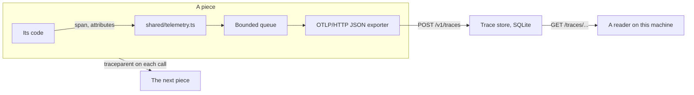

# Telemetry

Execution evidence is a record of the work a piece did, exported by that piece as each operation ends. It does not wait for an agent's final response. Spans from different pieces are joined into one trace by the trace context that each call carries. The evidence holds metadata only. The `steps` of the agent contract carry content, and they are a separate record.

Two parts make it up: [`shared/telemetry.ts`](../../shared/telemetry.ts), the module a piece uses to record and export spans, and the [trace store](../../platform/telemetry/README.md), the lab's own destination for them. The pieces below send spans through the module.

## Pieces that send spans

| Piece | Service name | Spans | Described in |
|---|---|---|---|
| Client | `client` | `desk.run` (`internal`, the root of a new trace for every run, ended with `completed`, `stopped` or `failed`); `desk.run.accepted` (`internal`, child of `desk.run`, ended as the run is recorded); `agent.invoke` (`client`, child of `desk.run`, `lab.operation.id` the run's id, `lab.attempt` 1, ended with `executed`, `response_lost` or `failed`) Starts the trace. Injects `traceparent` from `agent.invoke` on the request to the agent | [its README](../../client/README.md#execution-evidence) |
| The hand-written intake agent | `intake-handwritten` | `agent.run` (server), `model.call` and `tool.call` (client), with `traceparent` on each request to the case system | [Intake agent, hand-written loop](intake-agent-handwritten.md#what-the-agent-exports) |
| Case system | `case-system` | `case.tool` (server) for each tool call, a child of the request's `traceparent`; `case.commit` (internal) around each create or follow-up, saying `created`, `replayed` or `conflict`, ended before the answer is sent; `case.review` (server) for each review decision | [its README](../../tools/case-system/README.md#telemetry) |

A run whose trace holds `desk.run.accepted` and no `desk.run` has not finished, or did not finish while the client ran. Nothing exports an ending for it.

## Who reads the evidence

| Reader | Asks the store | Shows |
|---|---|---|
| The client's lab explorer, `GET /lab/api/runs/<run_id>/spans` | `GET /traces?run_id=<run_id>`, then `GET /traces/<trace_id>` for each trace found | Every span of those traces, of every piece, on the run page's "Exported evidence", beside the steps from the agent's answer |

## Terms

| Term | Meaning |
|---|---|
| Span | One operation of one piece: a name, a kind (`server`, `client` or `internal`), a start and an end, a status, and the declared attributes |
| Trace | The spans of one piece of work across pieces, sharing a trace id. Each span but the first names its parent |
| Trace context | The current trace id and span id, carried between pieces as the W3C `traceparent` header |
| Evidence schema version | `lab.telemetry.schema_version` on every span's resource, beside `service.name`. It changes when the meaning of a declared attribute changes |

## What moves where

| Step | Owner | What happens |
|---|---|---|
| Record | The piece's code, through the module | A span is started as a child of the current span, of a parent taken from a request, or as a new trace. It always ends, whether the work returns or throws |
| Carry | The module | `inject` writes the current context as `traceparent` on an outgoing request. `extract` reads it from an incoming one |
| Queue | The module | An ended span joins a queue of at most `maxSpans`. It is exported in batches of at most `maxBatch`, at least every `delayMs` |
| Export | The OpenTelemetry OTLP/HTTP exporter | One batch is one `POST` of JSON to the endpoint setting, given `exportTimeoutMs` to answer |
| Keep | The trace store | Each span is stored once, by trace id and span id, and the newest `TELEMETRY_RETAIN_SPANS` are kept |

The module uses the OpenTelemetry JavaScript SDK by hand, at the boundaries the lab owns, with no auto-instrumentation, so one piece of code owns each span. It registers no global tracer provider, context manager or propagator. A library that records through the global OpenTelemetry API, such as Strands, records nothing.

## Three identifiers

| Attribute | Identifies | Changes when |
|---|---|---|
| `lab.operation.id` | One intended operation of the piece that makes the span, such as the client's call to the agent, one model turn or one tool call | Never between repeats of the same operation: a retry carries the same value. It is the caller's own name for the operation and does not cross a boundary |
| `lab.run.id` | One execution: one run of an agent for one inquiry | Every new run, even of the same message |
| `lab.attempt` | One delivery attempt of an operation, counted from 1 | Every repeat of the operation |

`lab.inquiry.id` names the inquiry a run serves. The trace and span ids are the telemetry's own, and none of these identifiers is used as one. Only `traceparent` crosses a boundary, so a service's span for an attempt is joined to the caller's by being its child, not by carrying its `lab.operation.id` or `lab.attempt`. The case system names the business operation by `lab.inquiry.id` and the tool, which are the same for a repeat. The caller's outcome (`executed`, `response_lost`, `refused`, `failed`) and the service's (`created`, `replayed`, `conflict`) are recorded separately, so a write that was committed but whose answer was lost shows as both.

## Declared attributes

The module accepts these names and no others, with values of the type shown. Anything else is refused when it is set, and nothing is recorded.

| Name | Value |
|---|---|
| `lab.inquiry.id`, `lab.run.id`, `lab.operation.id` | Text, 1 to 256 characters |
| `lab.attempt` | Whole number, 1 or more |
| `gen_ai.agent.id`, `gen_ai.tool.name`, `gen_ai.request.model`, `lab.finish_reason` | Text, 1 to 256 characters |
| `lab.requested_by` | `model` or `agent`, as `requested_by` in the agent contract |
| `lab.outcome` | `refused`, `executed`, `response_lost`, `failed`; for a run `completed` or `stopped`; for a service `created`, `replayed` or `conflict` |
| `gen_ai.usage.input_tokens`, `gen_ai.usage.output_tokens` | Whole number, 0 or more. An unknown count is left out, never written as 0 |

A span whose work throws ends with status `error`. It takes the outcome `failed` unless its code already set an outcome. The error's message is not recorded, and neither is any event.

## Content rule

No span attribute or event holds message text, a tool's arguments or result, a retrieved passage, a token, a secret, a key or a network address. The declared names and types enforce the shape. Text values are limited in length, but what an identifier holds is the caller's responsibility. A span's resource holds `service.name` and the evidence schema version and nothing else, so no host or process detail.

## When the destination is down

| Condition | Effect |
|---|---|
| The endpoint setting is not set | Telemetry is off, and the piece says so once at start. Every call still works and records nothing |
| The store does not answer, or answers with an error | That batch is counted as failed and logged once with its size. The piece's own work is not affected |
| Spans end faster than they are exported | Past `maxSpans` waiting, a span is dropped and counted. Drops are logged once per run of drops, with the count |
| The piece shuts down | Waiting spans are flushed for at most the time given to `shutdown`. The report then names how many were not sent, and any export still unanswered is given up and counted as failed |

The counts are ended, exported, failed and dropped, read from the handle. No log line holds span content.

## Always true

The module's items are 8 to 11 in [`shared/README.md`](../../shared/README.md); the store's are 1 to 4 in [its README](../../platform/telemetry/README.md).

## Not present

- No spans from the intake agent on Strands, the label expert or the orchestrator.
- No sampling: every span is kept, within the store's limits.
- No span links, events, `tracestate` or baggage. Only `traceparent` crosses a boundary.
- No content lane: no prompt, completion, argument or result is exported anywhere.
- No authenticated access to the store. It is reachable on this machine only.
- No second destination: no collector, vendor or AWS route.
- No metrics or logs signal.
