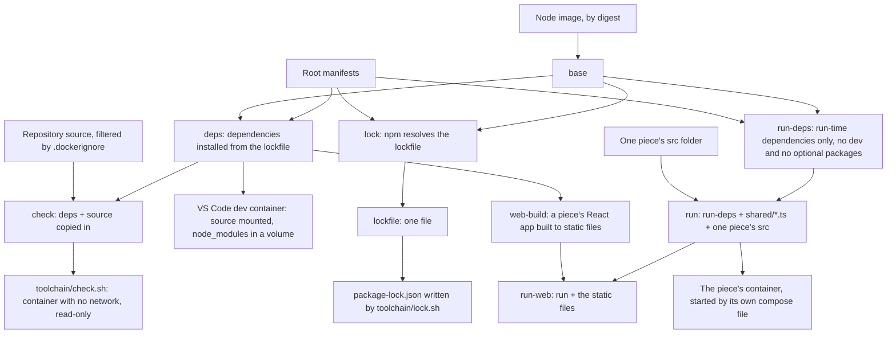

# Toolchain

The toolchain defines the repository's TypeScript checks and packages
application components from one dependency tree. Each component receives
the files it needs to run. Docker supplies Node and npm, so the host needs
no language toolchain.
For commands, see [toolchain/README.md](../../toolchain/README.md).

The root `package.json` defines the dependencies and the **check**:
typechecking, linting, tests and the React app build. The root
`package-lock.json` fixes the resolved dependency tree. A **piece** is a
top-level lab component, such as `model/`.

The **Node pin** is one image digest shared by `toolchain/Dockerfile`, the
Node commands under `model/`, and identity setup and gate commands under
`platform/identity/`.

## Build and runtime boundaries

The `deps` stage includes development tools for checks and browser builds.
The `run-deps` stage omits development and optional packages. Each running
piece receives its own source and the shared top-level TypeScript files;
a piece with a browser app also receives its shared types and built static
files. Node runs server TypeScript directly.

The check image contains a source snapshot from image build time. Its
container has no network or host mounts and a read-only root filesystem.
The development container instead mounts the working source and keeps
`node_modules` in a volume.

## Always true

1. One definition of the check. The `check` script in the root `package.json` is what `toolchain/check.sh` runs in its container and what `npm run check` runs in the dev container.
2. The check covers every `*.ts` file outside `node_modules`, and every `test/*.test.ts` file at any depth. A piece that runs on Node registers nothing. The React app is the one exception: because it runs in a browser, `client/web` is named in `tsconfig.json`, `eslint.config.js` and the `check` script, with its own compiler settings.
3. The check container has no network, a read-only root filesystem, and no mount from the host. Its source is the copy made when the image was built.
4. Dependencies are installed only by `npm ci` from the committed lockfile, with install scripts off. A lockfile that disagrees with `package.json` fails the install.
5. Every dependency version in the root `package.json` is exact. A test in `toolchain/test/` fails otherwise.
6. The Node pin is one digest. One test in `toolchain/test/` compares the Dockerfile's with every other file that pins Node: `model/gate/compose.yaml`, `model/setup.sh`, `model/setup/run-tests.sh`, `platform/identity/gate/compose.yaml` and `platform/identity/setup.sh`.
7. The only base image is the Node pin; the `lockfile` stage starts from `scratch` and holds one file. Nothing is installed from the operating system's package manager.
8. No `.git`, git worktree, `node_modules`, `dist` folder, `.env` file (other than `.env.example`), `secrets` folder, gate report, or anything under `knowledge/data` or `evaluation/data` enters an image.
9. The only place `toolchain/` names a piece is the Node pin test, which reads the files listed in 6. `model/` does not depend on the toolchain: its setup, its gate and its own test command run in the bare Node image with only `model/` mounted and no installed dependency.
10. TypeScript is run by Node directly, in the check and in a running piece. The compiler emits nothing.
11. A piece's image holds the run-time dependencies, the source files at the top of `shared/`, and that piece's `src/` folder: no tests, no other piece, and none of the check's tools. A piece with a React app also holds its own `shared/` folder (the types its server and its app share) and that app's built static files, and none of the libraries it was built from.
12. The check image is named for the checkout it is built from, so two checkouts can be checked at the same time.
13. A piece's run-time install leaves out dev and optional packages, and no package in the lockfile is optional without also being dev.

The tests in `toolchain/test/` are named T1 to T5: T1 shows 6, T2 shows 5, T3 shows 12, T4 shows the `shared/` part of 11, and T5 shows 13.

## Execution and network access

| Thing | Where | Network |
|---|---|---|
| `npm ci` for the `deps` and `run-deps` stages | Image build | Yes, to the npm registry |
| Lockfile resolution | Image build | Yes, to the npm registry |
| Typecheck, lint, tests, and the build of the React app | The check container | None |
| The same four steps, on demand | The dev container, as user `node` | Whatever the host gives it |

## How it fails

| Failure | Result |
|---|---|
| A type error, a lint error or warning, a failing test, or a failing build of the React app | `toolchain/check.sh` exits non-zero; the tool's own message is shown |
| The lockfile and `package.json` disagree | The image build fails at `npm ci` |
| Docker is not reachable, or the image cannot be built | `toolchain/check.sh` exits non-zero |
| `toolchain/lock.sh` cannot resolve, or npm has not finished in 300 seconds | It exits non-zero; the existing `package-lock.json` is unchanged |

## Ownership

| Owner | Owns |
|---|---|
| Root `package.json` | Exact dependency versions, overrides and the check command |
| `package-lock.json` | The resolved dependency tree. Written only by `toolchain/lock.sh` |
| `tsconfig.json` | What the compiler accepts |
| `eslint.config.js` | The lint rules |
| `.dockerignore` | What may enter an image |
| `toolchain/Dockerfile` | Build and runtime stages, and the toolchain's Node pin |
| `toolchain/compose.yaml` | The check container's isolation: no network, read-only |
| `.devcontainer/devcontainer.json` | How VS Code attaches: the stage, the mount, the volume, the user |
| Each packaged piece | Its `src/`, `test/` and compose file; runtime command, ports, volumes and settings |

The root manifest overrides five `@aws-sdk` packages brought in by
`bedrock-agentcore`. They use the versions associated with
`@aws-sdk/client-bedrock-runtime` 3.1174.0, which Strands resolves in the
lockfile.
