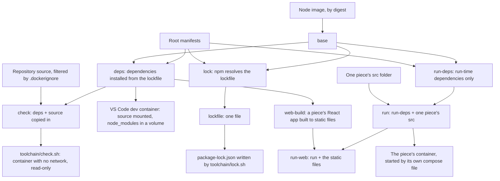

# Toolchain

How the repository's TypeScript is checked, and how a piece is packaged to run. To use it, see [toolchain/README.md](../../toolchain/README.md).

## Terms

| Term | Meaning |
|---|---|
| Root manifests | `package.json` and `package-lock.json` at the root of the repository |
| The check | Typecheck, lint, tests and the build of the React app, as defined by the `check` script in the root `package.json` |
| Piece | A top-level folder of the lab, such as `model/` |
| Node pin | The digest of the Node image, written in `toolchain/Dockerfile`, in the files under `model/` that run Node, and in `platform/identity/setup.sh` and `platform/identity/gate/compose.yaml` |

## What is built from what

## Always true

1. One definition of the check. The `check` script in the root `package.json` is what `toolchain/check.sh` runs in its container and what `npm run check` runs in the dev container.
2. The check covers every `*.ts` file outside `node_modules`, and every `test/*.test.ts` file at any depth. A piece that runs on Node registers nothing. The React app is the one exception: because it runs in a browser, `client/web` is named in `tsconfig.json`, `eslint.config.js` and the `check` script, with its own compiler settings.
3. The check container has no network, a read-only root filesystem, and no mount from the host. Its source is the copy made when the image was built.
4. Dependencies are installed only by `npm ci` from the committed lockfile, with install scripts off. A lockfile that disagrees with `package.json` fails the install.
5. Every dependency version in the root `package.json` is exact. A test in `toolchain/test/` fails otherwise.
6. The Node pin is one digest. A test in `toolchain/test/` compares the Dockerfile's with `model/gate/compose.yaml`, a test in `model/setup/test/` compares the copies under `model/`, and tests in `platform/identity/test/` compare the Dockerfile's with `platform/identity/gate/compose.yaml` and `platform/identity/setup.sh`.
7. The only base image is the Node pin. Nothing is installed from the operating system's package manager.
8. No `.git`, `node_modules`, `.env` file (other than `.env.example`), `secrets` folder or gate report enters an image.
9. The only place `toolchain/` names a piece is the Node pin test, which reads `model/gate/compose.yaml`. `model/` does not depend on the toolchain: its setup, its gate and its own test command run in the bare Node image with only `model/` mounted and no installed dependency.
10. TypeScript is run by Node directly, in the check and in a running piece. The compiler emits nothing.
11. A piece's image holds the run-time dependencies, the source files at the top of `shared/`, and that piece's `src/` folder: no tests, no other piece, and none of the check's tools. A piece with a React app also holds that app's built static files, and none of the libraries it was built from.

## Where each thing runs

| Thing | Where | Network |
|---|---|---|
| `npm ci` for the `deps` stage | Image build | Yes, to the npm registry |
| Lockfile resolution | Image build | Yes, to the npm registry |
| Typecheck, lint, tests, and the build of the React app | The check container | None |
| The same four steps, on demand | The dev container, as user `node` | Whatever the host gives it |

## How it fails

| Failure | Result |
|---|---|
| A type error, a lint error or warning, or a failing test | `toolchain/check.sh` exits non-zero; the tool's own message is shown |
| The lockfile and `package.json` disagree | The image build fails at `npm ci` |
| Docker is not reachable, or the image cannot be built | `toolchain/check.sh` exits non-zero |
| `toolchain/lock.sh` cannot resolve, or npm has not finished in 300 seconds | It exits non-zero; the existing `package-lock.json` is unchanged |

## Who owns what

| Owner | Owns |
|---|---|
| Root `package.json` | Dependency versions, and the definition of the check |
| `package-lock.json` | The resolved dependency tree. Written only by `toolchain/lock.sh` |
| `tsconfig.json` | What the compiler accepts |
| `eslint.config.js` | The lint rules |
| `.dockerignore` | What may enter an image |
| `toolchain/Dockerfile` | The stages, including the `run` stage every piece is packaged with, and the toolchain's copy of the Node pin |
| `toolchain/compose.yaml` | The check container's isolation: no network, read-only |
| `.devcontainer/devcontainer.json` | How VS Code attaches: the stage, the mount, the volume, the user |
| Each piece | Its own TypeScript in `src/`, its own tests in `test/`, and its own compose file: command, ports, volumes, settings |
