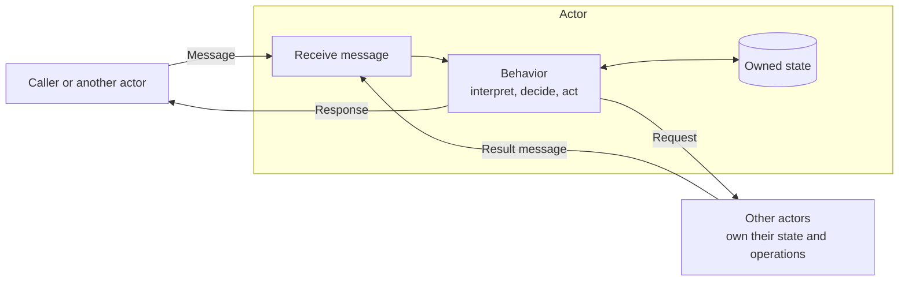
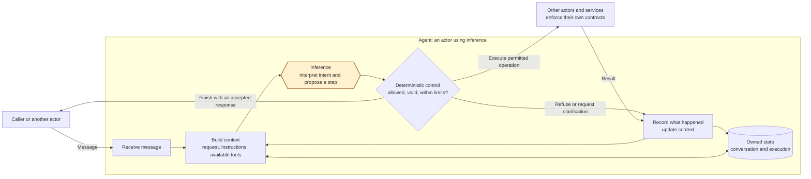
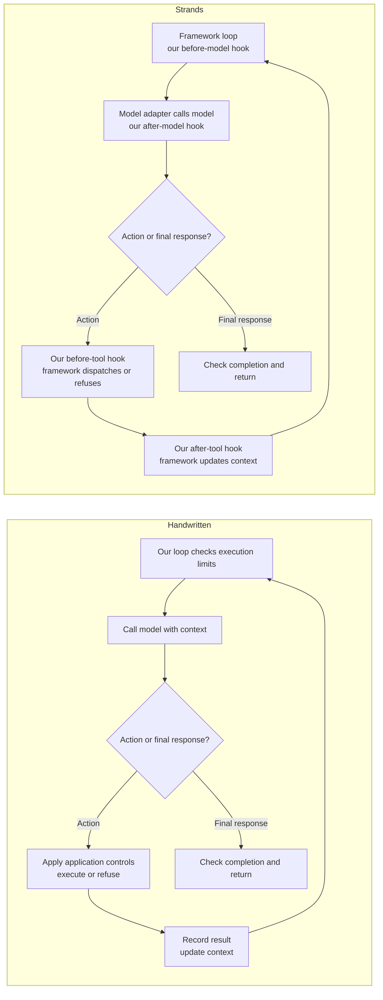
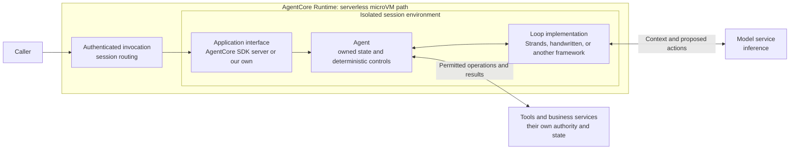

# Actors, Agents and Strands

*A look into AWS AgentCore Runtime*

Earlier this year, I wrote about [agents as actors with inference where the decision used to be](https://andrewphunter.com/writing/agents-are-actors-with-intent/). That framing gives us a useful place to start when looking at the growing collection of frameworks and services for building them. We already know quite a lot about systems that receive messages, make decisions, change state, and coordinate with other systems. Putting a model inside that process gives us a new way to make some of those decisions. It also makes the surrounding architecture more important.

I have been building an AWS playground to work through how those ideas fit together in practice. One of the things I built was the same agent twice, with a handwritten loop and with Strands, behind the interface used by AgentCore Runtime. That lets me examine how the actor's responsibilities are expressed through different loop implementations and a managed hosting boundary.

To understand what Strands and Runtime give us, we need to keep that architecture in view as we move through the stack.

## Start with the actor

An actor owns its state and responds to messages. It can change that state, send messages to other actors, and decide how to handle the next message. Other actors interact with it through those messages instead of reaching into its internals.

That gives us a boundary around responsibility. A reservation component owns reservations. A payment component owns payment operations. Each can ask the other to do work, but neither gets to declare that the other's work succeeded simply because it sent a request.



Once work crosses that boundary, we have familiar questions to answer. Can messages arrive twice? Does their order matter? What happens if the receiver performs an operation but the sender never sees the result? How much work can be in flight, and what happens when the recipient cannot keep up?

Those questions lead to message identifiers, idempotent operations, ordering, timeouts, backpressure, and recovery. They also determine what needs to be recorded so we can reconstruct what happened. The actor model gives us a way to reason about the system; the implementation has to supply the behavior its callers depend on.

Nothing about that requires a model. A coded decision can select an operation from known conditions. A rule-based expert system can infer a conclusion from explicit facts and rules. The boundary around the work remains the same in either case.

## Why put inference there?

Because people rarely hand us a perfectly specified operation.

A clinician might ask whether a drug is suitable for a patient and mention, in the same message, that the patient developed a rash after taking it. The question and the report are both present. The clinician has not selected an “adverse event” operation, filled in its arguments, and submitted it separately. Understanding what needs to happen requires interpreting the message.

This is a problem language models are particularly good at: working through natural language, using context to interpret intent, and relating what someone said to the operations available. A customer asking to move a delivery, an engineer describing a broken deployment, and a clinician reporting a reaction all bring the same kind of ambiguity. The wording varies, information is missing, and the request may contain several intentions at once.

We can ask a model to interpret that input and propose what to do next. We give it the relevant context and descriptions of the available operations. It can recognize that a request needs more information, select a lookup, interpret the result, and use it to propose a subsequent action.

That is where inference changes the actor's behavior. We can handle requests whose route through the system was not spelled out by the caller or enumerated as a branch for every possible wording. The model's flexibility is useful precisely because the input is ambiguous.

The decision is also now variable. A model may interpret the same request differently on another attempt. Its proposed arguments may be plausible and wrong. We need to preserve that ability to interpret language while keeping the operations it requests under the system's control.

## The agent is still an actor

The outer shape has not changed. A message arrives, the actor works with its state, and it communicates with other components. Inside the behavior, we now have a model participating in the decision about what happens next.



*Inference is part of the actor's behavior. The model itself can run in a separate service; this diagram shows the logical responsibility.*

The model produces a request for a tool. Code executes that tool. Between the two, the application can check the arguments, the caller's authority, the current state, and whether the operation is still permitted. The receiving service makes its own checks before changing anything it owns.

A prompt can tell the model that an order must be paid before dispatch. The order service still needs to enforce that condition. A model can identify that someone wants a refund; the payment system determines whether the transaction can be refunded and for how much. Interpreting intent and authorizing an effect are different responsibilities, and they belong in different parts of the system.

The same applies to the agent's own execution. Code determines how many steps it can take, how long it can wait, whether operations can run concurrently, and what happens after a failed call. These controls apply regardless of how convincingly the model argues for another attempt. Deterministic control means the rules for executing an action remain explicit and enforced even when the proposed action came from inference.

Consider a write whose response is lost. Asking the model again can produce a different request. That is another decision, with another possible effect. Retrying the original operation requires retaining its identity and arguments, and a receiving system that can recognize the repeat. If we cannot establish whether the operation completed, that uncertainty has to remain visible to the caller.

This is the same problem we had between actors before putting inference in one of them. The additional work is preventing a fresh interpretation from quietly becoming our retry mechanism.

A record of the actual calls and their results matters for the same reason. Asking the model to explain itself later is another inference, not a replay of the execution. We need to know which action was requested, which checks were applied, and what the receiving system returned. Those results also become information the agent can use to decide what to do next.

## Where the loop comes from

Take the customer's request to move a delivery. Before deciding which changes are possible, the agent needs to find the order and examine its status. It cannot finish the job from the original message alone.

The application sends context to the model, receives a proposed action, executes it through the controls, adds the result to the context, and asks again. It stops when there is an acceptable response, when work must be handed back to a person, or when an execution limit or failure ends the run. That repeated exchange is the agent loop.

The conversation exists in the software managing those exchanges. A model endpoint is given the context for an inference request; the application decides which earlier messages and results become part of that context. Keeping the history, trimming it, restoring it, or sharing selected information with another agent are architectural choices about state.

We can write the loop ourselves, or use a framework. [Strands](https://strandsagents.com/latest/documentation/docs/user-guide/concepts/agents/agent-loop/) supplies that machinery: model invocation, conversation handling, tool dispatch, and continuation. Its lifecycle hooks let application code participate before and after model calls and tool calls.



*The same responsibilities are present in both loops. A failure or an execution limit can end either path; the diagram follows the ordinary action-and-result cycle.*

## Assemble the actor with Strands

The right-hand side of that diagram becomes a Strands agent assembled from a model adapter, instructions, and tools. The adapter handles communication with the model provider. The instructions describe the job. Each tool supplies both a description of an available operation and a way for the application to execute it.

Those two sides of a tool belong to different audiences. The model receives its name, description, and input schema so it can propose a call. The executable behavior stays in the application, where it can call a local function or reach another service through something like MCP. Giving the model a tool description does not give it a connection to the database behind that tool.

Here is a condensed TypeScript sketch of that assembly, with the model, tools, and run state already prepared by the application. The rule function is our own; Strands supplies the point at which it is called.

```typescript
const agent = new Agent({
  model,
  systemPrompt: instructions,
  tools,
  toolExecutor: 'sequential',
});

agent.addHook(BeforeToolCallEvent, (event) => {
  const { name, input } = event.toolUse;
  const refusal = refusalBeforeCall(run, name, input);
  if (refusal !== undefined) {
    event.cancel = JSON.stringify(refusal);
  }
});

const result = await agent.invoke(request, {
  limits: { turns: maxTurns },
  cancelSignal: deadlineSignal,
});
```

For the delivery request, the model might first ask to look up the order. Strands dispatches that tool through the before-call hook, places its result in the conversation, and invokes the model again. Suppose the order has already been dispatched. The model can use that information to explain the available options. If it nevertheless proposes a change that is no longer allowed, `refusalBeforeCall` can reject it based on the run's known state. The framework returns the refusal to the conversation so the model can respond to what actually happened. Any call that does proceed still faces the order service's check against its current record.

The sequential setting in the example is part of that decision. Independent lookups can run concurrently, but changing an order and then dispatching it requires the second operation to see the first one's result. The framework's executor determines how calls are scheduled; the application determines which ordering its work requires.

Hooks after calls serve the other half of the boundary. They let application code record the actual outcome, update execution state, and decide whether to retry or stop. In my playground, both loop implementations use the same business rules. The handwritten version calls them directly; the Strands version connects them to those lifecycle events. Strands carries the conversation forward while the application retains the meaning of success and failure.

State lifetime follows the same principle. A Strands agent retains conversation history across invocations. Reusing it is useful for continuing one person's work; creating a fresh instance gives an independent request its own conversation. We choose that lifetime to match the actor's responsibility. The turn limit and cancellation signal bound how long it may keep working, and the application examines the result before reporting completion.

Strands supplies the recurring exchanges and the points where our code participates. Whether that saves the team useful work depends on how well those mechanisms fit the application and the people maintaining it.

## Choose the implementation for the people and the work

Handwritten, Strands, or another framework is largely an implementation choice. Team familiarity, the time available, the integrations required, and how the business expects the system to evolve should drive it.

A team that already understands a framework's model adapters, tools, and lifecycle may get a useful capability into production much sooner by using it. That familiarity carries into operating the system: engineers know where to put a control, how to inspect a failure, and which behavior belongs to the library. Replacing that with a custom loop creates work the team now owns, including maintaining integrations and responding to changes in provider APIs.

A narrow application may justify the opposite choice. If its execution path is small and its requirements fit poorly into a framework, writing the loop can make the behavior easier to understand and change. We should count the whole cost, including error handling, context management, instrumentation, and maintenance, rather than comparing the length of two successful-path examples.

Portability is another business requirement that needs a concrete meaning. Moving between model providers, changing agent frameworks, and changing hosting platforms are three different things. A model adapter may make it easier to call another provider, but differences in tool calling or context behavior still affect the application. Keeping business rules outside framework-specific callbacks makes a framework change more manageable. A clear service contract separates those choices from where the program runs.

## What AgentCore Runtime adds

That service boundary is where the hosting decision begins. Whichever loop implementation we choose, its program needs an environment that accepts authenticated invocations, isolates working state, stays available across related calls, and supplies capacity as demand changes.

[Amazon Bedrock AgentCore Runtime](https://docs.aws.amazon.com/bedrock-agentcore/latest/devguide/agents-tools-runtime.html) provides that managed hosting environment. It can run agents built with Strands, other frameworks, or custom code. The framework determines how the program carries out its work; Runtime manages the environment in which that work executes.

Its serverless microVM path makes the session an infrastructure boundary. Each session has isolated compute, memory, and filesystem resources. Multiple requests can return to the same active environment, which is useful when work continues across several interactions. AWS handles provisioning and retiring that compute as sessions come and go, while the application determines what the session means and which caller it belongs to.

This fits the shape of agent work. A request can involve several rounds of inference and tool use, with much of its elapsed time spent waiting for another service. A conversation may continue after the first response. Supporting that requires decisions about execution lifetime and isolation beyond starting a web server and putting an endpoint in front of it. Runtime supplies a managed place to make use of those capabilities.



*The actor's logical boundary remains inside a managed execution environment. Hosting, loop implementation, inference, and business operations have separate responsibilities.*

The hosting boundary is expressed through a service contract. For the HTTP path used in my playground, that is an invocation endpoint at `/invocations` and a health endpoint at `/ping`. The [AgentCore HTTP contract](https://docs.aws.amazon.com/bedrock-agentcore/latest/devguide/runtime-http-protocol-contract.html) supports ordinary responses and streaming. The AgentCore SDK can provide the server that implements that interface, or we can implement it ourselves.

This is where the names can obscure the arrangement. Strands runs the agent loop. The AgentCore SDK server receives the invocation inside the application. AgentCore Runtime is the AWS service hosting the application. They fit together, but choosing one does not require handing every other responsibility to the same library or service.

The model can remain behind a separate inference endpoint, and the tools can remain services with their own identities and authorization. Runtime gives the agent an execution environment; it does not need to become the owner of the business state that those tools change.

That distinction matters for recovery. A session may hold conversation history and intermediate work. An order, a payment, or an approved case belongs to the system responsible for that record. Runtime's [session lifecycle and persistence options](https://docs.aws.amazon.com/bedrock-agentcore/latest/devguide/runtime-sessions.html) help manage the execution environment, but restoring a conversation still cannot tell us whether an external write completed. The actor patterns remain necessary at that boundary.

## The architecture carries through

We can now change the loop implementation or the hosting environment while asking the same architectural questions. Who owns the state? Which actions are permitted? What survives an interruption, and how do we establish the outcome of work sent elsewhere? Strands and Runtime give us mechanisms for implementing parts of those answers. Their value is in how much work they take off the team while preserving the behavior the business needs.

The clinician's mixed question and report can now become useful work without requiring the clinician to speak our API. That is what inference brings. The system around it still has to preserve identity, coordinate changes, recognize repeated operations, and explain the result. Those are the responsibilities we started with when we drew the actor, and they remain the basis for deciding whether the finished agent works.
