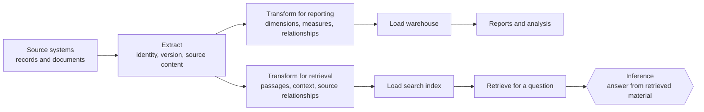
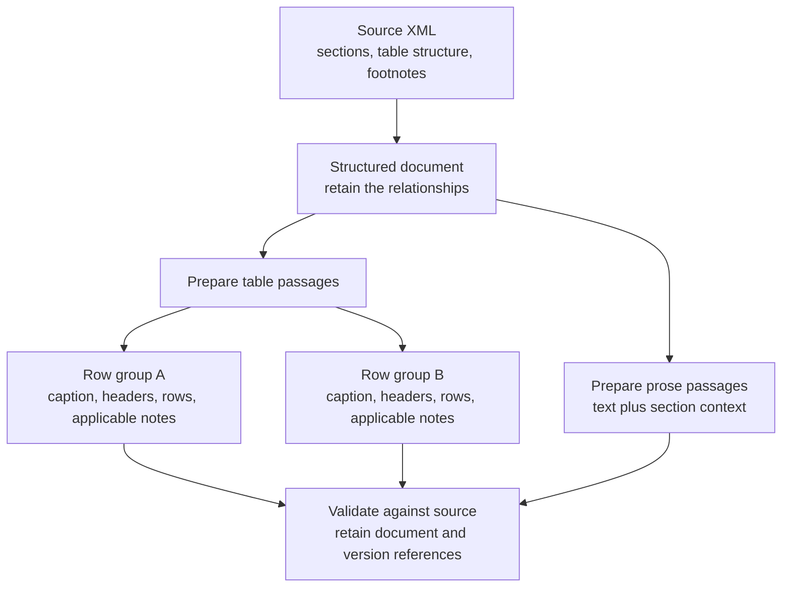

# Before the Model Can Answer

*RAG starts with an ETL pipeline*

Before a business could trust a report, somebody had to work out where its data came from. They had to reconcile identifiers, decide which system owned a value, preserve the meaning of the fields, and arrange for changes to reach the reporting system. A dashboard could make that information easier to understand. It could also make a bad transformation look convincing. The presentation did not settle whether the numbers meant what the business thought they meant.

Preparing information for retrieval-augmented generation has the same shape. We extract it from source systems, transform it into a representation the consumer can use, and load it into a serving system. That is ETL. This time the consumer is an agent retrieving evidence for inference, and the target is often a search index instead of a warehouse. The responsibility for turning source material into something dependable has carried over with it.

RAG adds retrieval and generation to that prepared information: a question arrives, relevant material is selected, and the model uses it to produce an answer. Those later stages introduce their own decisions, but they begin with what the preparation pipeline made available. An embedding does not settle which policy is authoritative. A model that can read a table does not recover a heading discarded during conversion. We can put inference inside the transformation process too, but we still need to establish what that transformation preserved and whether its output is fit for use.

This is the connection I want to develop here. In [Actors, Agents and Strands](actors-agents-and-strands.md), the actor model gave us a foundation for reasoning about agents. In [The Tool Call Is a Distributed Transaction](tool-calling-and-reliability.md), distributed-systems practices explained what happens when they request work elsewhere. For retrieval, the foundation is the data pipeline. Its familiar concerns give us a way to reason about the choices before getting absorbed in embedding models, chunk sizes, or vector stores.

The label expert in my AWS playground provides a concrete source to follow. It answers questions from drug labels, which arrive as structured XML with sections, tables, footnotes, and version information. That source has to become material a retrieval service can find and a model can interpret. Following it through the pipeline makes the decisions visible without requiring that every application use the same parser, search engine, or agent framework.

The output representation changes with the consumer. The need to define, validate, publish, and maintain that representation remains.

## Extracting a source includes deciding what it means

In a reporting pipeline, two columns called `customer_id` do not necessarily identify the same entity. We establish their meaning before joining the records. A collection of documents requires the same discipline. A current policy, an archived policy, and a draft may all discuss the same subject in similar language. If we load them without preserving their standing, the retrieval system has no reliable way to distinguish an applicable rule from a proposal that was never adopted.

That decision belongs in the source contract. We need to know which collection is authoritative for the questions the application will support, what identifies a document, how revisions are represented, and what a deletion or withdrawal means. The contract also needs to distinguish a document we could not obtain from one the source says does not exist. Otherwise a temporary failure during extraction becomes a permanent gap in what the agent can know.

Drug labels make identity and revision explicit. [DailyMed provides label identities and version history](https://dailymed.nlm.nih.gov/dailymed/app-support-web-services.cfm), including access to specified versions. The playground pins the source version and retains a checksum so a later run can distinguish a changed input from a changed transformation. Some intended labels were unavailable and are recorded as exclusions. Those are ordinary extraction controls: retain what was read, account for what was missed, and make the input to downstream processing reproducible.

For a live system, the business must also decide how that snapshot advances. A newly published version may replace the previous one for current questions while the older version remains necessary to explain an earlier answer. A failed update should not silently turn into a claim that the corpus is current. These are the same freshness and history questions we would ask of a reporting feed, and they need answers before a scheduled sync can mean anything operationally.

The format of the source introduces another part of the contract. DailyMed's XML contains useful structure, but it is not a document format we can hand directly to the Bedrock Knowledge Base ingestion paths discussed below. Conversion is required. That is where extraction leads into transformation: choosing a supported output format is easy; preserving what the source means inside that format is the work.

## Transform for the questions the consumer must answer

ETL transformations are shaped by their downstream use. A reporting system might need one record per order line, with a product identity, quantity, currency, and effective date. Keeping only the amount would make aggregation possible while removing the information needed to interpret the result. A retrieval passage has an equivalent requirement. It must carry enough of the source's relationships to support the questions we intend to ask of it.

Consider this invented miniature of a label table:

**Reported events in adult trial participants (%)**

| Event | Treatment | Comparator |
|---|---:|---:|
| Headache | 12 | 4 |
| Rash | 3 | 1 |

*Events recorded during the first four weeks.*

The row `Rash | 3 | 1` is not a useful standalone record. Its meaning depends on the column headings, percentage units, adult population, and observation period. Stripping the XML tags and retaining the text can preserve every number while losing those associations. This resembles loading an amount without its currency or joining it to the wrong dimension. The transformation succeeded syntactically and failed semantically.

A structured intermediate representation gives us somewhere to preserve those relationships before choosing a format for the destination. Sections can retain their titles and parent sections. Tables can retain their captions, headers, cell spans, and footnote references. From that representation, we can emit HTML, Markdown, or deliberately prepared text while checking what survived. We can also change the destination later without returning to an undocumented collection of string substitutions over the original XML.

This is why parsing and chunking are separate decisions. Parsing recovers the structure we have. Chunking chooses the units we will publish for retrieval. Combining them into “extract some text and split every few hundred tokens” lets the size setting decide which relationships survive, often before we have examined what those relationships are.

The size of a passage still matters. A very large passage brings more reading into the model's context, may obscure the part that matched the question, and can exceed a downstream model's input limit. Very small passages can be easy to match while leaving out the qualification needed to use them. The design question is what constitutes a useful unit of evidence under those constraints. For prose, that may be a paragraph with its section heading. For the table, it may be a group of rows carrying the caption, column headings, group label, and applicable footnotes.

Repeating the headings in each row group is deliberate denormalization. It puts information needed to interpret the record beside the record, rather than requiring every consumer to reconstruct it. The repeated text has a cost, but it serves a defined purpose. That is a stronger basis for deciding what to repeat than picking an overlap percentage and hoping it captures the dependency.

The table rules in the playground apply that reasoning. Tables with explicit, usable structure can be split into consecutive row groups with their context carried forward. Tables the splitter cannot safely divide remain whole. An oversized table or a passage refused by the embedding model is recorded as a limitation, so we can distinguish material available to text search from material also represented in vector search. Silently truncating it would make the load appear more complete while removing evidence.

A passage also needs identity and lineage. The source document, version, section, and position let us find it again, replace it when the source changes, and inspect the evidence behind an answer. The product name and section path can be included as context for retrieval while the original text remains identifiable. If we ask a model to generate a summary or explanatory prefix instead, that is a derived field with its own chance of error. It may help search, but we should not let it acquire the standing of the source merely because it travels beside it.

That leaves room for several implementations. We can publish self-contained passages, or preserve parent identifiers so a small search hit can lead to a larger section at retrieval time. We can use fixed-size boundaries where the material tolerates them, or more structural preparation where it does not. The consumer's information requirements establish the transformation contract; chunking techniques are ways of implementing it. Their search behavior and context costs belong in the next stage of the investigation.

## Validate and publish the data product

A loader reporting success tells us that the destination accepted its input. It does not tell us that the transformation produced the right input. We would not use a successful warehouse load as proof that revenue had been calculated correctly. The same distinction applies when a vector store accepts every embedding or a Knowledge Base reports a completed ingestion job.

Preparation therefore needs checks that can run independently of generation. Did the words and numbers survive extraction? Are table cells still associated with the correct headings? Did every expected document produce usable output, or is there an exclusion we must account for? Do the output records carry the source identities and versions we intended to publish? These are questions about the data product, before we ask whether a model can answer well from it.

In the label pipeline, an independent traversal compares source text with the parsed representation and later with the prepared chunks. Deliberately repeated context is accounted for separately. That catches dropped or duplicated content without asking a model to judge whether the output looks reasonable. Structural checks and inspection of representative documents address a different class of failure: every word can survive while a table's relationships are wrong. Each check needs a defined claim, just as it would in a conventional ETL pipeline.

Loading then needs a publication boundary. If documents are replaced piece by piece in a live index, queries can encounter part of an update or a mixture of representations. One option is to build a complete new index, validate it, and switch the serving reference once it is ready. That is the local playground's approach. An incremental pipeline makes different tradeoffs, but it still needs to establish which changes are visible, how failures are recovered, and whether a partially updated corpus is acceptable to the application.

Derived representations make lineage more important. An embedding depends on the input text, the model that produced it, and how that text was assembled. Changing the parser, the context prefix, or the embedding model can require rebuilding downstream data. The source and the preparation recipe must remain available so a reindex is a controlled transformation rather than an attempt to reconstruct how the current vectors came to exist.

Deletion belongs in this process too. Removing a source document while leaving its chunks searchable has not removed it from the application. A new version needs to displace the old one wherever current answers draw their evidence, while historical records may need separate retention for investigation. Synchronization is the mechanism that propagates these decisions. The decisions about freshness, retention, and acceptable failure behavior still belong to the application and the business operating it.

## Decide where the pipeline meets Bedrock

The ETL framing gives us a useful way to approach Bedrock: choose how much of the pipeline to hand to the service and which transformations the application must retain. That boundary determines what the team builds, what it configures, and what it needs to validate from a managed stage. The input format is the first concrete boundary for these labels.

Bedrock Knowledge Bases' [supported document formats](https://docs.aws.amazon.com/bedrock/latest/userguide/knowledge-base-ds.html) include HTML, Markdown, and text, but not native XML. A bucket of SPL files therefore needs a conversion stage before ingestion. We could convert each label into a complete HTML document with its sections and tables intact, or publish smaller prepared passages. Renaming the files would satisfy neither choice: the output needs to express the source relationships in a form the next parser can use.

The first option is to convert the documents and let a [Managed Knowledge Base](https://docs.aws.amazon.com/bedrock/latest/userguide/kb-build-managed.html) handle the remaining ingestion and retrieval infrastructure. Its [Smart Parsing and chunking configuration](https://docs.aws.amazon.com/bedrock/latest/userguide/kb-managed-customize-ingestion.html) determine how the supported documents become searchable material. AWS operates the storage and index, which reduces the infrastructure the team needs to provision and maintain. This is a useful starting point when the converted documents survive that path correctly and the team has no business requirement to control the underlying store. We would inspect representative output, particularly tables and footnotes, before accepting that boundary.

The second option is a customer-managed Knowledge Base when the application needs more explicit control over the ingestion pipeline or vector store. Its [parser options](https://docs.aws.amazon.com/bedrock/latest/userguide/kb-advanced-parsing.html) include a default text parser, Bedrock Data Automation, and foundation-model parsing. A text parser may be sufficient for prepared prose. Scanned pages, charts, and complex layouts give us a reason to evaluate the richer extraction paths, with their additional processing cost and behavior to validate. For already structured SPL XML, I would first preserve the known structure during conversion rather than render it into a page and pay a model to infer that structure again.

The [chunking choices](https://docs.aws.amazon.com/bedrock/latest/userguide/kb-chunking.html) then decide what the index receives and what retrieval can return. Fixed-size chunking controls size and overlap. Hierarchical chunking searches smaller children and returns their larger parents, which is useful when a focused match needs its surrounding section. Semantic chunking uses changes between sentence groups to choose boundaries, giving us another option for prose whose topics do not follow useful headings. Those options answer different preparation requirements; they are not a progression from basic to universally better. Managed Knowledge Bases exposes a smaller set, including default, fixed-size, and no chunking, rather than this entire configurable set.

The third option is to own the preparation through to the retrieval unit. For these labels, that could mean converting each table row group or prose passage into a supported file carrying the context we have decided it needs, then selecting no chunking so ingestion does not split that unit again. Both Knowledge Base paths provide a no-chunking option. We still need to check the parsing behavior; disabling chunking does not mean bypassing every transformation. [Metadata accompanying the documents](https://docs.aws.amazon.com/bedrock/latest/userguide/kb-metadata.html) can retain the original label identity, version, section, and source URL. Otherwise the system may cite a generated fragment without giving the reader a useful path back to the original label.

That boundary lets the application own domain-specific preparation while AWS handles downstream indexing and retrieval. The customer-managed path also provides a [custom transformation hook](https://docs.aws.amazon.com/bedrock/latest/userguide/kb-custom-transformation.html), using Lambda to implement custom chunking or add metadata within ingestion. The hook operates after parsing, so it does not remove the need to convert unsupported XML before submitting it. It moves transformation code into the service workflow while leaving the team responsible for its behavior, intermediate storage, permissions, and failures. This hook belongs to the customer-managed option described here.

| Boundary we choose | What remains ours | Why choose it |
|---|---|---|
| Convert whole documents, then use Managed ingestion | Source contract, format conversion, output validation, update policy | The service's preparation preserves what we need, and operating the storage and index would add little value. |
| Use customer-managed ingestion controls | Source conversion, parser and chunking configuration, vector-store choices and operation, validation | The application requires specific extraction behavior, retrieval units, or storage control. |
| Publish prepared passages with no further chunking | Passage construction, context, provenance, conversion and rebuild process | Domain relationships need explicit preparation that we want to preserve across the service boundary. |

Whichever boundary we choose, updates still have to travel through it. Bedrock [synchronization processes source additions, modifications, and deletions](https://docs.aws.amazon.com/bedrock/latest/userguide/kb-data-source-sync-ingest.html). When our source is converted XML, the conversion pipeline must first publish the corresponding changes in the supported documents supplied to Bedrock. If a new label leaves obsolete fragment files behind, a successful sync can faithfully ingest the wrong collection. The service can operate its part of ETL correctly while the end-to-end data product remains wrong.

## What adopting RAG commits the business to

A convincing demonstration usually starts with a small collection that someone has already made usable. They chose the documents, knew which versions mattered, and found questions those documents could answer. That preparation may never appear in the demo, but it is part of what made the result possible. Moving to the estate means turning those implicit choices into an operating process, including the sources that are inconsistent, inaccessible, out of date, or difficult to interpret.

The first business decision is who can establish the source of truth. A data team can detect two conflicting policies and keep their versions separate. It cannot decide which policy the business intends to enforce. A model may summarize the disagreement or help identify it, but selecting the governing rule requires authority outside the inference. If the source has no owner who can resolve that question, the RAG project includes establishing one, or narrowing the scope to information whose standing is known.

The next decision is what service the business is prepared to operate. How quickly must a source change become available? Can the application continue using the last known version when an update fails? What happens when a document cannot be converted without losing information? The answers determine schedules, monitoring, exception handling, and staffing. A requirement for current policy answers carries a different obligation from a searchable historical archive, even if both use the same model and Knowledge Base.

Those obligations belong in the delivery estimate and the ongoing budget. Converting a sample document once is different from maintaining a converter as source formats change. Buying managed ingestion reduces infrastructure and integration work, but the business still owns the quality of the source, the meaning of its metadata, the scope of access, and the decision to publish or withdraw material. Where existing data and content teams already own these responsibilities, the RAG project should use that capability. Where it is missing, someone must fund and staff it rather than leave it as an assumed property of the AI platform.

This is also how to decide whether to proceed. Inspect representative sources before committing to estate-wide coverage. Establish which failures the managed path can handle, which need custom transformation, and which require a decision from a content owner. Use that evidence to set scope, choose the service boundary, and price the operating work. Every expansion of the corpus adds sources whose meaning, quality, and lifecycle the application must account for.

AI won't fix your data. It can help extract, classify, and explain it, but those are transformations whose results still need validation. It cannot supply missing authority, make an obsolete source current, or turn an unidentified number back into evidence. Adopting RAG means taking responsibility for the pipeline that makes information usable by inference. Once that responsibility is accounted for, we can examine how well retrieval finds the material and how well the model uses it. Until then, the convincing answer is ahead of the system required to stand behind it.
