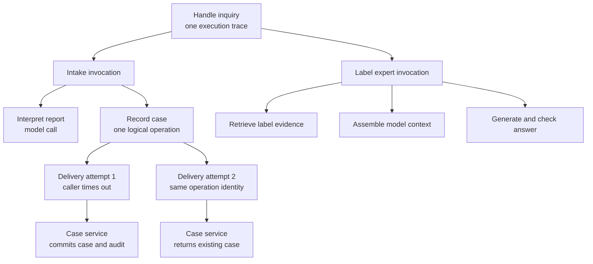
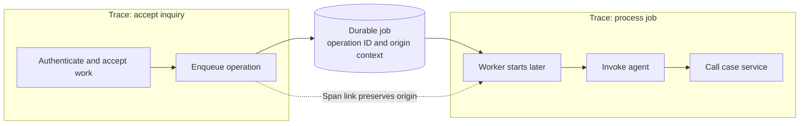
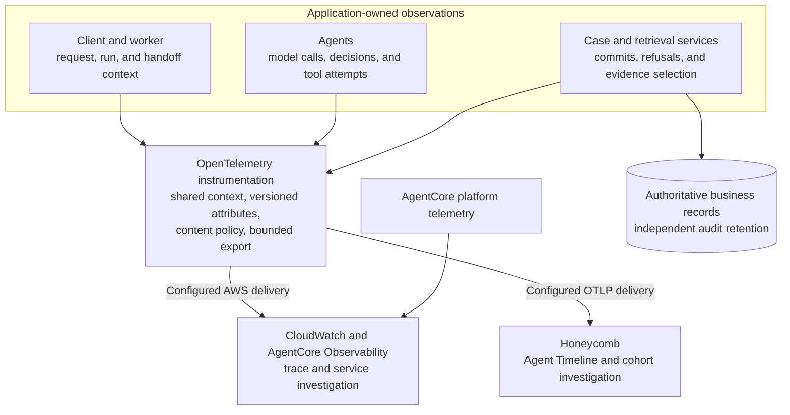

# Following the Work

*Telemetry for agents and the systems they call*

Return to the report from the earlier essays. A clinician describes a reaction to a medicine and asks a question about its label. Intake records the report while the label expert looks for an answer. This time, the case service commits the write but its response never reaches the agent. The agent repeats the same operation, the service recognizes it, and the workflow eventually returns an acknowledgment.

The user sees a completed request. Inside that request, a call failed, a recovery rule ran, and an idempotency check prevented a duplicate case. If we record only the final outcome, all of that disappears. If recovery fails too, the user may see an error even though the case already exists. Counting successful HTTP responses will not tell us which of those things happened.

This is familiar territory for distributed systems. A caller's knowledge and a service's state can disagree, and the evidence we need lives on both sides of the boundary. Inference adds more work along the way: interpreting the report, choosing a tool, searching again when evidence is missing, and deciding whether to finish. We need to observe those operations with the same care as the database write they eventually produce.

The [security essay](whose-authority-is-the-agent-using.md) followed whose authority the work uses. Here we follow the work itself: how to establish what happened, retain enough context to investigate it, and compare it with other requests. That gives evaluation something concrete to judge beyond the final answer.

## The final response arrives too late to be our only record

An agent can assemble a useful account of its execution and return it with the answer. My playground already does this: model calls, tools, retrieval results, and delegated calls appear as structured steps. That makes a completed run inspectable. But those steps are held in memory until the response is returned. If the process stops or the caller cannot accept the response, the path that delivers the evidence fails with the work we are trying to investigate.

We need observations to leave the process independently of the final answer. When a model call finishes, when a tool refuses an operation, or when a service accepts a write, the component that observed it should emit a record. The request can continue while those records are collected. A later failure may leave an incomplete account, but it should not erase every completed step that preceded it.

That still leaves an important distinction between diagnostic evidence and business truth. The case service's transaction establishes whether the case was recorded. Its audit entry belongs with that transaction. An exported event saying “case committed” helps us find and investigate it, but a telemetry exporter can fail after the commit. Missing telemetry is not proof that the write never occurred. We correlate the service's durable record with the execution evidence instead of asking one to substitute for the other.

The same reasoning applies to long-running operations. Tracing SDKs normally export the completed-operation record after the operation ends. A process that dies during a model call may never emit that record. If we need to identify work that started and never finished, we also need a durable work state or an explicit start event, together with deadlines that let us recognize it as incomplete. Instrumentation gives us observations from particular points in execution. It does not make the system omniscient.

## Put the observations back into one request

Suppose we have a model-call record, a case-service write record, and an error from the caller. Without a relationship between them, we are searching by timestamps and guessing which events belong together. That gets difficult as soon as several requests run at once, and harder when the machines disagree slightly about the time.

Distributed tracing supplies that relationship. OpenTelemetry gives us common instrumentation APIs and formats for recording and exporting it across services; an observability backend stores those observations and lets us investigate them. A [span](https://opentelemetry.io/docs/concepts/signals/traces/) describes one operation over an interval: its start, end, outcome, and attributes. It has its own identifier and belongs to a trace. When an operation starts another operation, the child span records the parent's identifier. The trace can then show a request crossing the client, an agent, a tool service, and a database, with each component contributing what it observed.

The relationship has to travel with the request. At an HTTP boundary, the caller injects trace context into headers and the receiver extracts it before starting its own span. An intermediary has to preserve that context, whether it forwards an HTTP request, carries a tool call over MCP, or delegates work to another agent. Starting a new unrelated trace at every service gives us several detailed accounts that still cannot explain one piece of work.

The span boundaries should follow work we need to distinguish. We want to see the intake invocation, each model call, the logical case write, its individual delivery attempts, and the service handling those attempts. For the expert, we want retrieval and context assembly separately from generation. A span around every helper function would bury that structure in implementation detail. A single span around the whole agent would conceal the decisions and dependencies that explain its behavior.

*The branches show parent-child relationships, not a serial schedule. Intake and label work can overlap; the individual spans supply their timing.*

That distinction matters when investigating latency. Adding every span duration double-counts nested work and counts parallel work as if it happened in sequence. We need to see which branch the caller waited for and where that branch spent its time. A slow response might be waiting on retrieval, an identity provider, a retry delay, or inference. “The agent was slow” is the symptom we started with.

Each observation also needs to preserve whose outcome it describes. In the example, the caller's first attempt timed out and the service's first write committed. Both are true. A later acknowledgment resolves the caller's uncertainty, but it should not overwrite the failed delivery attempt. Similarly, a refused tool call can be the correct enforcement of a rule, and a completed expert run can report that it found insufficient evidence to answer the question. Transport status, workflow outcome, and the quality of the answer are different facts.

## Keep the work connected when execution moves on

A trace describes an execution path. A business operation may survive several such paths.

If the report waits in a queue until another worker can process it, we still need to connect the later execution with its origin. We retain the message and operation identifiers, carry the relevant trace context with the handoff, and record when the work was accepted and when processing began. That lets us distinguish time waiting for a worker from time spent executing the agent.

For a short asynchronous handoff, continuing the trace may be appropriate. For a delayed job or another activation, a new trace linked to the originating span can express the relationship without keeping one span open for hours. OpenTelemetry's [span links](https://opentelemetry.io/docs/specs/otel/overview/#links-between-spans) also let a batch refer to several originating operations. The choice follows the work's lifetime and relationships. An entire conversation does not need to become one indefinitely growing trace merely because it has one conversation identifier.

The identifiers have different jobs. The operation identifier tells the case system whether a write is a repeat. A run identifier distinguishes another execution of the workflow. Span identifiers distinguish individual attempts and calls. Reusing one identifier for all three would make it difficult to tell recovery from new work. Changing the operation identifier on a retry would be worse: telemetry might look tidy while the case system records a duplicate.

This is also where the identity story remains attached. The originating user, the executing workload, and the result of authorization can be recorded as permitted metadata. An access token must not become a trace attribute or travel in tracing baggage. Trace context helps join observations; it supplies no permission to execute the request. We retain the relationships across a handoff while continuing to authorize the work at the receiving service.

## Record what changed the path

Once the trace connects the operations, we need enough information on those operations to explain their differences. An HTTP client can tell us that a request to the model took a certain amount of time. It cannot tell us whether the application made that request to interpret a report, correct a rejected answer, or check whether screening missed an adverse event. The application knows that purpose and has to record it.

For inference, we need the model that was actually called, the prompt and tool-definition versions, relevant generation settings, token usage when supplied, and how the call ended. A requested model alias is useful, but a resolved model version is better when the provider exposes one. These details let us ask whether behavior changed with a deployment, a prompt edit, or a provider-side change instead of treating every run of “the same agent” as equivalent.

For tool use, the proposal and the execution are separate observations. The model can request a call that code refuses, or code can repeat a write without invoking the model again. Recording who requested the action, whether it ran, and which attempt it was preserves that distinction. Framework hooks are useful places to collect this information, but a hook around a logical call may not expose retries inside the HTTP SDK. We instrument the boundary that owns the retry if we need to account for each attempt.

Retrieval needs the same care. A list of returned passages does not establish what the model read. The search may retrieve a relevant passage and context assembly may exclude it. We need the source and index versions, the retrieval configuration, the selected passage identifiers, and which passages were actually included in context. That gives us a way to distinguish a search problem from a context-budget problem before we start changing the model.

We also need to account for the full cost of the path. A final answer's token count omits earlier turns, correction attempts, and separate checking calls. Token usage belongs on each model invocation and can be aggregated over the operation. Missing usage remains unknown; recording it as zero makes failures look artificially cheap. A monetary estimate adds another dependency on the provider's pricing, model version, and billing rules, so it should remain identifiable as an estimate rather than masquerading as an invoice.

These fields become a contract between the application and the people investigating it. OpenTelemetry's [GenAI conventions](https://github.com/open-telemetry/semantic-conventions-genai/blob/main/docs/gen-ai/README.md) supply shared names for model, agent, and tool attributes, but remain under development. We need to keep the instrumentation and the receiving system aligned as those conventions change, alongside our own business fields. An SDK upgrade that silently changes how token usage is recorded can look like a cost improvement. Versioning the telemetry schema lets us distinguish a change in the system from a change in how we observe it.

These are observations about execution. A model-written explanation of why it chose a tool is another model output, not a substitute for the record of which tool was called and what the service did. We can investigate the path without pretending the model has supplied a reliable account of its internal computation.

## Ask what the other runs have in common

A single trace helps explain one request. Operating the system means finding out whether that request is exceptional, part of a growing pattern, or representative of an entire group of users.

Suppose more reports are taking a long time to acknowledge after a release. We can select the slow requests and compare them with the others: which prompt version, retrieval configuration, model, tool, or outcome appears disproportionately often? If the slow group contains more answer corrections, we can follow those traces back to the rejected proposals. If it contains more delivery retries like the one we started with, we can investigate whether the case service is struggling or the caller now gives it less time to respond. The useful next question comes from the data instead of from a dashboard we thought to build beforehand.

This is the value of [Honeycomb's emphasis on wide, structured events](https://www.honeycomb.io/blog/wide-events-vs-three-pillars-ai-observability-costs). “Wide” means keeping the relevant attributes together on an observation so we can ask about their relationships later. A separate total for timeouts and a separate total for a particular deployment do not establish that the timeouts happened on that deployment. Preserving both facts on the same events makes the question answerable.

Some of the useful fields have many distinct values: an operation identifier, a source revision, a prompt version, or a permitted customer identifier. That is what high cardinality means. Those fields are useful for investigation even when they would be poor choices as labels on a metric, where every combination can create another time series. We can retain detailed attributes on events and spans while using bounded dimensions for aggregate service measurements.

The comparison needs a useful baseline. Comparing all failed requests with all successful requests can mostly rediscover that they used different workflows. For the lost acknowledgment, we could compare recovered writes with unresolved writes under the same application version and traffic period. A difference in their attributes gives us somewhere specific to investigate; it does not establish the cause. We still inspect the execution and test the proposed change.

That comparison depends on how we count the work. Completion rates need one outcome per business operation, retry behavior needs individual attempts, and inference usage needs model calls. Otherwise a request with five retries contributes more weight than one that completed on the first attempt. Accepted work with no recorded ending must remain identifiable as incomplete, rather than disappearing from the population because it produced no final answer.

## Collect evidence we can afford to keep and are allowed to use

More context does not require putting every conversation into every telemetry system. A model identifier, passage identifier, outcome, and duration answer many operational questions without exposing the report itself. Raw prompts and tool results can contain private information, credentials echoed by a dependency, or hostile instructions. Sending them to an observability backend creates another copy with its own access and retention requirements.

I would make structured metadata the default and content capture an explicit choice. When an investigation or evaluation needs the actual input and output, keep that material under an appropriate access policy and retention period, linked to the run and configuration that produced it. A reference is useful only while the authorized investigator can resolve it, so the lifetime of the evidence has to match the intended use. Credentials do not belong in either form of capture.

This choice also affects what we can evaluate later. A trace can tell us which passages reached the model without retaining their text, but judging whether they support the answer requires access to both. We need to decide where that evidence lives and how an evaluator can use it. Collecting everything indefinitely creates its own problem; collecting too little can make the investigation we promised impossible.

The telemetry path needs its own operating limits. Instrumented services can export through an OpenTelemetry SDK to an appropriate backend or collection pipeline. Bounded batching and buffering keep a slow exporter from consuming the agent's resources without limit. Filtering and redaction should happen before sensitive data leaves the trusted environment. We also need to observe export failures, dropped records, and queue pressure, otherwise a quiet dashboard can mean either a healthy application or a broken telemetry pipeline.

Sampling is a separate decision about which execution records to retain. In this playground I would begin by keeping all traces at its modest volume, with content capture still controlled. At production volume, [head sampling](https://opentelemetry.io/docs/concepts/sampling/) makes an early decision about retaining a trace; it cannot know that a later tool call will fail. Tail sampling can use later outcomes, but needs buffering and a decision window. A later failure may arrive after the sampler has decided what to retain. Late-span handling matters, and no later rule can restore spans already discarded.

If we retain failures more often than ordinary completions, the retained traces are no longer an unbiased count of traffic. We need a representative baseline and the sampling information required for supported weighted analysis, or separate unsampled aggregate measurements for rates. The service's mandatory audit records follow their own retention policy; they must not disappear because we decided to sample diagnostic traces.

These choices give us a usable evidence system rather than an unlimited transcript archive. They also establish what the observability platform will actually receive, which matters when we move the design onto AWS or send it to Honeycomb.

## Follow the same request through AWS and Honeycomb

Put the intake agent in AgentCore Runtime and let the case-write response fail again. The first question is whether the request reached the agent and whether its process remained healthy. AWS supplies platform telemetry for that part of the investigation. But the agent can run normally while a downstream response disappears. To explain the user's delay, we need to follow the call out of the runtime and into the case service.

That is where the instrumentation we designed becomes useful. [AgentCore Observability](https://docs.aws.amazon.com/bedrock-agentcore/latest/devguide/observability-configure.html) brings platform and agent telemetry into CloudWatch. On the AWS-native path, CloudWatch Transaction Search and the documented AWS Distro for OpenTelemetry (ADOT) instrumentation let us investigate the agent's execution. Framework instrumentation supplies model and tool spans; the application adds the operation identity, attempts, and outcomes. The case service contributes its own observations under the propagated trace context.

Now we can open the execution in [CloudWatch's trace view](https://docs.aws.amazon.com/bedrock-agentcore/latest/devguide/observability-view.html), follow the timed-out attempt to the service, and see that the write committed. The operation identifier connects that observation to the durable case audit. Following the second attempt shows that the service returned the existing case. This is the explanation the final acknowledgment concealed. If the trace stops at the agent's outbound call, we have found a gap in our instrumentation, and adding another model dashboard will leave it there.

The expert's answer raises a different question: what did the model receive? The retrieval and context spans tell us which passages were included. If we need to inspect the actual request and response, we need the governed content capture described earlier. When inference uses Bedrock, [model invocation logging](https://docs.aws.amazon.com/bedrock/latest/userguide/model-invocation-logging.html) is one option for retaining that content and its metadata. It is separately configured and disabled by default. We choose whether it supplies the evidence we need and account for the additional copy.

Suppose the report instead waits for a worker and finishes in a later execution. We now want to investigate across traces while preserving the same conversation and operation identities. [Honeycomb's Agent Timeline](https://docs.honeycomb.io/investigate/observe/agent-timeline) supports that view. We supply `gen_ai.conversation.id` consistently, identify the acting agent, and name the operation being observed. The later worker retains its own trace, span links preserve its causal connection, and the conversation identifier lets us bring the executions together. Those relationships come from the application, regardless of which product displays them.

To use that view, we configure an [OpenTelemetry export route to Honeycomb](https://docs.honeycomb.io/send-data), through a direct exporter or a collection pipeline. Honeycomb accepts OTLP, the OpenTelemetry transport protocol. This route carries the application records we send; it does not automatically copy every AWS platform record from CloudWatch. We verify that the client, agent, and owning services all arrive with their relationships intact, and that overlapping framework and application hooks have not recorded the same operation twice.

Having explained this report, we can ask how many others needed the same recovery and what distinguishes those still unresolved. [BubbleUp](https://www.honeycomb.io/platform/bubbleup) compares a selected group of events with a baseline and highlights differences in their attributes. This applies the population comparison we developed earlier: select comparable operations, examine what differs, then follow those traces to investigate. The operation outcomes and deployment details make that possible. Neither a conversation transcript nor a collection of token totals contains the relationship on its own.

*The two export routes are choices we configure and verify, not an automatic mirror between products. The application context connects the execution evidence with the business records.*

For a team already operating in CloudWatch, I would start by following the failed request there. If the team wants Honeycomb's conversation and cohort workflows, the same application instrumentation can support that choice through the configured export route. The decision belongs with the people who will investigate incidents: can they move from an unresolved business operation to its execution, its authoritative record, and other affected operations? That is the capability to establish before collecting another set of dashboards.

## What the business needs to be able to explain

A demonstration usually gives us an answer and someone nearby who knows how it was produced. Operating the service means answering the same questions after the requester has gone, after the software has changed, and across enough traffic that reading conversations one at a time is no longer practical.

That creates decisions about support and cost. Someone needs to own unresolved operations, decide which outcomes warrant an alert, and have access to the evidence required to investigate them. Retention has to cover the period in which the organization expects to handle a complaint or compare a change. Content access must match the responsibilities of the people doing that work. The telemetry budget includes collection and investigation, not just the storage bill.

It also changes how we decide where to invest. If slow requests are waiting on a tool, a more expensive model is unlikely to address the delay. If the search finds the right passage but context assembly leaves it out, rebuilding the index is aimed at the wrong part of the path. Useful telemetry lets the team connect a proposed improvement to an observed problem and then examine what changed.

Evaluation takes the next step. A trace can establish which passages reached the model and which answer it returned; an evaluator judges whether those passages support that answer. We attach that judgment to the execution and the version of the rubric that produced it, keeping the observation and the assessment distinguishable. Production observations can supply cases we missed in a fixed test set, while a fixed set lets us compare changes under controlled conditions.

We began with a report whose write succeeded while its response failed. Following the work lets us explain the apparent contradiction, find similar runs, and decide whether recovery is behaving as intended. The same record can show how the expert found its evidence and what it did with it. We can now ask whether the completed work was correct, and have more than the agent's acknowledgment on which to base the answer.
