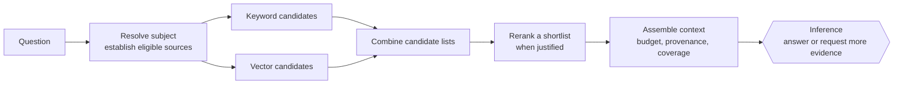
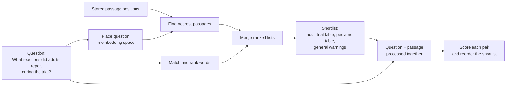
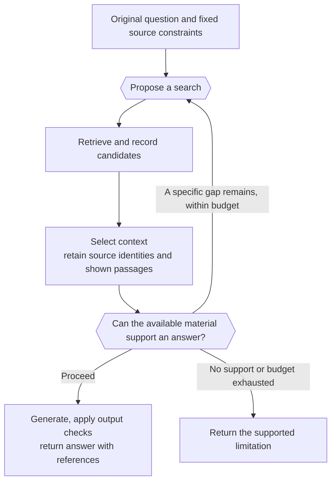

# From a Question to Useful Evidence

*Searching, ranking, and assembling context for inference*

Someone asks what reactions adults reported during a trial of a particular medicine. The label may call them “adverse reactions,” put the population in a section heading, and describe the observation period in a table footnote. The question and the evidence concern the same thing, but they do not necessarily use the same words. We have to locate that evidence before the model can use it.

In [Before the Model Can Answer](before-the-model-can-answer.md), I followed the preparation side of RAG through the familiar responsibilities of ETL. We selected sources, preserved their structure, published usable passages, and retained the identity and version of the material. Now those passages are available to search. The next problem is deciding which ones belong in the context of this particular request.

This is information retrieval with inference as its consumer. When a search engine returns links to a person, that person can open several results, notice the wrong product or edition, and refine the search. An agent can perform some of those steps too, but it can also turn the first plausible passage into a fluent answer. The architecture needs to preserve the distinction between a promising search result and evidence sufficient to support what the answer says.

The architectural problem is how to spend a limited amount of work finding enough of the right evidence. We can cheaply search for matching words, use a learned representation to reach beyond those words, or ask another model to read candidate passages against the question. Each choice spends time and capacity to resolve a different uncertainty. The label expert gives us a concrete question to follow through those choices, including deciding when the material is sufficient to answer and when another search is justified.

## Establish what the search is allowed to consider

The name of a medicine is doing a different job from the words describing the reaction. The name identifies the subject whose label we need. The remaining words describe information we want within that label. Combining everything into one similarity search asks a ranking function to resolve both responsibilities at once.

That is risky in a corpus whose documents share language. A table from the wrong medicine can be an excellent textual match for “adult trial adverse reactions.” A newer policy for the wrong business unit can match a question more closely than the applicable policy. Relevance does not establish eligibility. We need the source identity, version policy, and access constraints to restrict what the search can return.

The expert resolves a drug name to candidate labels before searching one of them. The application permits a search only for a label returned during that run, and the retrieval service applies the label identifier as an exact filter. The model still has a decision to make if several labels match; it can select the wrong one. Keeping resolution separate makes that decision visible instead of burying it inside a passage score. An application that requires clarification between products should enforce that before continuing.

The same boundary applies to permissions. A model can help interpret a request for “last year's policy,” but the caller's tenant and access rights come from trusted application context. They are not filters the model gets to relax because another document looks useful. Those eligibility rules must hold for every retrieval path, including query rewrites and subsequent searches.

## Start with the words in the question

We have selected the right medicine's label. Now we want to know what reactions adults reported during its trial. The most direct search is to look for words such as “reactions,” “adults,” and “trial” in the passages we prepared. A search engine can keep a list of the passages containing each word, so it can look up those lists instead of reading the label again for every question. That is the job of an [inverted index](https://www.elastic.co/docs/solutions/search/full-text/how-full-text-works). The text analysis around it can handle things like capitalization and singular or plural forms, making “reaction” and “reactions” searchable as the same term.

Finding matches leaves us with a problem of order. Suppose a long warnings section repeats “reactions” several times, while the adult trial table uses it once in the heading. Counting occurrences could put the warnings first. Counting every word in the question equally creates another problem: “reported” may appear throughout the collection, while “trial” does more to distinguish the material we want. We need to account for how words are distributed before deciding which match deserves our attention.

BM25 is a common way to do that. It gives more weight to words that appear in fewer indexed documents, limits how much extra credit a passage gets for repeating a word, and adjusts for passage length. A second occurrence contributes less than the first; a twentieth contributes very little extra. Length adjustment accounts for a long passage having more opportunities to contain the search terms. The score adds these contributions across the matching terms. [Lucene's implementation](https://lucene.apache.org/core/9_12_1/core/org/apache/lucene/search/similarities/BM25Similarity.html) exposes controls for the strength of the repetition and length effects, but the reason for them is already visible in our warnings-versus-table example.

That gives the adult trial table a way to compete with a much longer warnings section. The score accounts for repetition and length, but it still comes from matching words. We have improved the ranking without solving differences in vocabulary.

Now suppose the table is headed “Adverse events in adult participants,” with “controlled study” in the surrounding text. The person asking about “reactions during the trial” has not asked a different question, but some of our strongest matching words have disappeared. We can add synonyms or have the agent rewrite the query using the label's vocabulary. That works when we know which substitutions to make. As the ways of asking multiply, though, we would like the search to recognize related language without our maintaining every relationship ourselves.

## Search for the idea behind those words

We want a search for “reactions during the trial” to find a passage about “adverse events in a controlled study.” Matching words only takes us so far. We need to search for meaning, which is what semantic search brings to retrieval.

An embedding model gives us a way to represent that meaning in a shared vector space. It converts text into a vector whose direction carries information about its meaning. For the retrieval models we are discussing, related questions and passages are trained to align in that space. The [Dense Passage Retrieval paper](https://aclanthology.org/2020.emnlp-main.550.pdf) goes into how that relationship is learned.

We run the label's passages through the embedding model ahead of time and store their vectors alongside references to the original text. When the adult trial question arrives, we run it through the model too. Now we have the question and passages represented in the same space. The closer their directions align, the stronger the semantic match according to the model. This lets the table about adverse events compete even though it uses different words from the question.

To turn that relationship into a ranking, we need a calculation. Cosine similarity is a common choice, and the one used here. It measures the angle between two vectors: vectors pointing in the same direction receive the highest similarity, and the score falls as their directions diverge. For our search, we want that alignment to determine the score without vector length affecting it.

Normalization removes that length difference by scaling each vector to length one while preserving its direction. We then calculate cosine similarity with a dot product: multiply corresponding coordinates and add the results. That gives us a score for each passage against the question, which we can rank from highest to lowest. The [Faiss documentation](https://github.com/facebookresearch/faiss/wiki/MetricType-and-distances) explains the calculation in more detail.

These choices belong together in the architecture. The stored passages and incoming questions must use compatible embeddings, so the model version and encoding settings belong with the index configuration. Switching the question to an unrelated model leaves it searching in a different coordinate system. Moving to a model with a different embedding space means regenerating the passage embeddings and moving the query path to that space with them.

The similarity calculation and normalization are part of that same configuration. Using unnormalized dot products in place of cosine introduces vector length into the score. We can change the model or comparison, but we have to carry those changes through indexing and querying together and check the resulting rankings. They determine which material reaches the agent, even when the search API stays exactly the same.

## Find the nearest passages

The question and passages are now represented in the same space, with a defined way to compare them. We score each passage against the question, order the results by similarity, and keep the first few. That is k-nearest-neighbor search. The k is the number we keep: ask for five neighbors and we return the five closest passage vectors under that comparison, along with the text they refer to.

Doing this across every eligible passage gives us an exact search. For the adult trial question, that means comparing the question with every passage in the selected medicine's label. This is what the playground does. We have already narrowed the collection enough that comparing all of it is a straightforward choice.

Now extend that search to millions of passages. Every question requires millions of comparisons, each involving all the coordinates in a vector. We have a map, but we are checking every address on it to find the nearest ones. An index gives us a way to navigate toward the question's neighborhood without visiting the whole collection.

[HNSW](https://arxiv.org/abs/1603.09320) builds that navigation out of connections between passage vectors. It organizes them into layers: a sparse upper layer for moving across the space, and denser lower layers for exploring nearby points. Starting from an entry point, the search compares the question with connected vectors, follows routes toward closer ones, and descends through the layers to search locally. It keeps promising candidates as it explores, then returns the closest ones it found.

This is approximate nearest-neighbor search because it returns the best neighbors found along those routes, rather than checking every vector. The exploration budget controls how much of the neighborhood it visits. Increasing that budget spends more time searching for closer matches. The k value still controls how many results come back; it is a different setting from how much work we do to find them.

The source restriction has to remain part of this process. Finding five nearby passages across the whole library and then throwing away those from other medicines leaves holes in the result. A [filtered search](https://www.elastic.co/guide/en/elasticsearch/reference/8.19/knn-search.html) finds neighbors within the permitted collection. When that collection is just one label, exact comparison becomes attractive again. The size that matters is the set we actually need to search.

This also tells us where to look when the adult trial table is missing. If exact search finds it and approximate search does not, we inspect the index and its exploration settings. If both put it behind other passages, we inspect how the embedding model represents the question and table. Navigating the space more thoroughly cannot fix a relationship the model has placed poorly.

## Combine the two result lists

We now have two ways to find the adult trial table. Keyword search ranks passages by their words. Semantic search ranks them by their positions relative to the question. Each gives us an ordered list, and the lists will differ. A warnings section that repeats “reactions” can lead the keyword list while the table headed “adverse events” ranks higher in the semantic list.

We want to keep useful results from either route. Running both and merging their results is hybrid retrieval. The question is how to produce one order from two different kinds of score. A BM25 score of 12 and a cosine similarity of 0.8 measure different things; adding them makes the larger numerical scale dominate.

Rank fusion works with the order each search produced. Suppose, for our trial question, the keyword search puts general warnings first and the adult table second. The semantic search also puts the adult table second, but the warnings sixth. Both searches agree that the table belongs near the top. We want that agreement to count without requiring their raw scores to use the same scale.

[Reciprocal rank fusion](https://www.elastic.co/docs/reference/elasticsearch/rest-apis/reciprocal-rank-fusion) turns each list position into a contribution, then adds the contributions for each passage. Its rule is `1 / (constant + rank)`, with ranks starting at one. Using 60 for the constant, first place contributes 1/61 and second place contributes 1/62. A larger constant makes neighboring ranks contribute more similarly; a smaller one gives the highest positions more influence.

In our example, the adult table receives 1/62 from each search. The warnings receive 1/61 and 1/66. The table's total is slightly higher, so it moves ahead. A passage found only by semantic search contributes from that list alone and still participates in the combined result.

We have reconciled two rankings using their agreement and relative positions. No model has read the passages again at this stage. Fusion is arithmetic over the result lists, producing the shortlist for the next decision: which of these passages best answers the question?

## Read the shortlist against the question

The shortlist contains the adult trial table, a pediatric trial table, and general warnings about reactions. Each matches some part of the request. Now we want to judge the full question against each passage, giving “adults” and “during the trial” their place in that judgment.

With embeddings, we processed each passage ahead of time and stored its coordinates. At search time, we compared those coordinates with the question's coordinates. A reranker instead takes the question and passage together as one input. For our table, that input contains both “what reactions did adults report during the trial?” and the text describing adverse events in the adult study.

A [cross-encoder reranker](https://www.sbert.net/examples/sentence_transformer/applications/retrieve_rerank/README.html) is a model trained to score relevance from that paired input. Its attention connects words in the question directly with words in the passage. It can assess the population and study context together, rather than relying on two independently produced positions in an embedding space. The output is a relevance score for this question and this passage.

We repeat that operation for the pediatric table and the warnings, then sort the shortlist by the new scores. This is the second reading performed by the [BGE reranker in the playground](https://huggingface.co/BAAI/bge-reranker-v2-m3). The adult table is the result we want it to promote, because that passage addresses the population and circumstances the question specifies.

That closer reading costs more than comparing stored vectors. The model has to process every question-and-passage pair, and a new question means doing that work again. We use the earlier searches to reduce the collection to a shortlist, then spend the additional inference on those candidates.

The shortlist is the reranker's working set. Leaving the adult table out means there is nothing for it to promote, which is why we retrieve more candidates than we intend to show in the final context. Once the table reaches the top, the next decision is how much of it, and what surrounding information, the answer model needs to read.

## Choose what the model actually reads

The table's rows tell us which reactions were reported, its heading identifies the adults in the study, and its footnote gives the observation period. Sending the rows alone loses part of what makes them useful. Sending the entire label preserves that context but also fills the model's input with storage instructions, other populations, and warnings it may not need. Context assembly is the decision about what to include so the model can answer this question from the material it receives.

This creates several budgets. The candidate budget controls what a reranker can examine. The result budget controls how many passages the search returns. The context budget controls how much source material the answer model receives after accounting for its instructions, the conversation, and room for the output. Increasing one does not automatically increase the others. Retrieving twenty passages and showing five means the answer can only rely on the five it saw.

The preparation choices from the previous essay matter here. If each searchable passage already contains the table's heading and footnote, selecting it brings those qualifications along. If we searched smaller pieces, we can expand a hit to its containing section before supplying it. Several matching rows might then lead to the same section, which only needs to appear once. This lets us use small units to find the material and larger units to read it, while accounting for the space those larger units consume.

The expert records which passages were retrieved and which were shown. It supplies passages whole when they fit its reading allowance and only accepts citations to material actually supplied. Keeping that record alongside the search results lets us follow an omission through the system. If the answer leaves out the observation period, was the footnote lost in preparation, missed by search, excluded from context, or ignored during generation? Each explanation points to different work.

Sometimes assembling the context exposes a gap worth another search. The agent may have the reported reactions but lack the study duration, or have received only general warnings. It can formulate a more specific query and collect the missing material. That flexibility is useful, but every rewrite can also drift: it might drop the adult population, substitute a related outcome, or change a question about frequency into one about severity. The original request and source constraints need to remain in force as the search continues, with a limit on how much work it may trigger.

The loop also needs a way to stop. Finding the necessary material leads to an answer; a failed search, an exhausted budget, or a search that finds no support needs its own outcome. Returning a citation gives us a way to inspect what the agent used. We then evaluate whether that material supports the answer, alongside whether the search brought it into view.

## Decide how much of retrieval AWS should own

We now have a retrieval process that finds passages, selects what the model reads, and searches again when information is missing. The next architectural decision is how much of that process we want to operate ourselves.

For document retrieval, Amazon Bedrock Knowledge Bases offers two choices: Managed Knowledge Base and Customer-managed Knowledge Base. The difference starts with who owns the underlying pipeline and store. Within each offering, we then choose how the application retrieves information and who turns it into an answer.

### Amazon Bedrock Managed Knowledge Base

A [Managed Knowledge Base](https://docs.aws.amazon.com/bedrock/latest/userguide/kb-build-managed.html) takes on the ingestion, storage, indexing, and retrieval infrastructure. We connect the sources, and Bedrock provides embedding and reranking models by default, with supported options for selecting our own. The team does not have to provision and operate a vector store.

The tradeoff is control over the machinery we just discussed. Managed retrieval uses hybrid search and supplies default reranking; we work within the service's configuration rather than designing our own fusion and indexing pipeline. That removes operational work and gives us a working retrieval path sooner. The team still owns the quality and suitability of the source material, who is allowed to retrieve it, and how the application uses the results.

We can keep the application's loop simple. The [`Retrieve` API](https://docs.aws.amazon.com/bedrock/latest/userguide/kb-test-retrieve.html) returns passages and metadata, leaving context assembly and answer generation with us. Choosing Managed does not require handing over the agent's reasoning or completion rules.

For questions that need several searches, Managed also offers [`AgenticRetrieveStream`](https://docs.aws.amazon.com/bedrock/latest/userguide/kb-test-agentic-retrieve.html). Bedrock can break a question into searches, gather material, expand documents, and decide whether to search again. It returns traces and can either generate an answer or return the collected material for our application to use. This delegates more of the process, including the search plan, so its iteration budget and behavior become part of what we configure and evaluate.

### Customer-managed Knowledge Base

A [Customer-managed Knowledge Base](https://docs.aws.amazon.com/bedrock/latest/userguide/knowledge-base-build.html) leaves the choice and operation of the vector store with the team. Bedrock still provides ingestion and retrieval capabilities, while we select the embedding model, configure processing, and manage the underlying store. We get direct control of more of the pipeline without having to write every part ourselves.

This fits a requirement to own the store and its configuration. The cost is the work that comes with that ownership: capacity, scaling, index changes, and coordinating the embedding configuration with the stored data. [Retrieval options also depend on the backend](https://docs.aws.amazon.com/bedrock/latest/userguide/kb-test-config.html). Hybrid search requires a supported store configuration with searchable text; selecting a vector store alone does not establish that both search paths are available.

The application can use `Retrieve` to obtain passages, or [`RetrieveAndGenerate`](https://docs.aws.amazon.com/bedrock/latest/userguide/kb-test-retrieve-generate.html) to have Bedrock retrieve material and generate an answer with citations. The latter also offers query decomposition. The Managed offering's `AgenticRetrieveStream` loop is a separate capability; choosing Customer-managed does not bring that loop with it. If we need a custom iterative search process here, the application owns it.

### Choose around the team and the data

For a new team working with standard documents, I would start with Managed Knowledge Base. Use its ingestion and retrieval path, then spend the team's effort on selecting useful sources, setting access rules, and making the answers useful. Start with a retrieval call when that serves the question. Add agentic retrieval when questions actually need decomposition or repeated searches. Taking over the vector store later should follow a requirement the team encounters, rather than being treated as the inevitable next stage of maturity.

For a mature data team, I would first preserve the preparation pipeline it already trusts. Established ETL can publish prepared material into either Knowledge Base offering. Choose Customer-managed when owning the store and its configuration is part of the requirement. If the team already has a retrieval service that works, expose it to the agent and migrate its infrastructure on its own merits. Moving the application to AWS does not require replacing a working search system with a Knowledge Base.

For unusual sources, separate the preparation problem from the retrieval problem. Our label example needs transformations that retain the table's population, headings, and footnotes. We should own that transformation wherever the downstream search runs. Once the result is ordinary text with useful metadata, Managed retrieval is still an option. Choose Customer-managed when the required processing or store configuration needs that control; retain an application-owned retrieval service when the search behavior itself goes beyond what Knowledge Bases exposes.

A warehouse also deserves a different question: are we looking for passages, or asking for values and aggregates from structured records? Bedrock supports [Knowledge Bases connected to structured data stores](https://docs.aws.amazon.com/bedrock/latest/userguide/knowledge-base-build-structured.html), translating natural-language requests into queries over supported stores. That is a route to examine for an established warehouse. We should not turn tables into text embeddings merely because the consumer is an agent.

| Situation | Starting point | Why |
|---|---|---|
| Standard documents, limited retrieval experience | **Amazon Bedrock Managed Knowledge Base** | Delegate the store and retrieval infrastructure; focus on sources and application behavior. |
| Established pipelines with a requirement to control the vector store | **Customer-managed Knowledge Base** | Reuse the preparation pipeline and retain store ownership, accepting its operational work. |
| Unusual source formats or structures | **Managed Knowledge Base after custom preparation**, or **Customer-managed Knowledge Base** when its additional controls are required | Solve the source transformation first, then choose the retrieval service around the prepared material. |
| A working retrieval service already exists | **Keep application-owned retrieval**; this is an architecture choice, not another Knowledge Base type | Integrate the agent with the existing service and avoid replacing working behavior without a reason. |
| Questions over structured warehouse data | **Amazon Bedrock Knowledge Bases with a structured data store** | Query the records through a supported connection instead of forcing them through passage search. |

These choices follow the capabilities the business already has and the responsibilities it wants AWS to take on. Once that boundary is clear, the remaining commitment is operating the complete service the user will depend on.

## What the business is committing to operate

A successful demonstration can hide several favorable conditions: questions close to the document's wording, a small corpus, a single source per question, and little pressure on response time. The production decision needs to account for the mix the business actually expects. Exact identifiers, ambiguous product names, paraphrases, comparisons across documents, and questions the corpus cannot answer put different demands on retrieval. Selecting a larger model does not settle those demands for the system around it.

The quality target therefore needs to be paired with an operating budget. An interactive assistant and an overnight research process can justify different amounts of searching and model work even when they use the same sources. The business needs to agree on acceptable latency, how much work a request may trigger, and whether insufficient evidence should lead to clarification, a handoff, or a declined answer. A handoff also means someone needs to receive it. Those decisions determine the service and support process the team must deliver.

The funding decision should follow the problem we need to solve. If keyword search handles the required questions, additional stages need to earn their operating cost. Knowing whether useful evidence was missed by search, ranked too low, or left out of context lets the team fund a specific improvement and check its effect on the finished answer.

Someone also remains accountable for retrieval behavior after rollout: approving configuration changes, evaluating regressions, and investigating missed evidence. A managed service changes how that work is carried out and which controls are available; it does not assign that accountability within the business. Changing an embedding model, a filter, or a result budget changes what the agent gets to know, even when the application code stays the same.

Our opening question sounded straightforward: what reactions did adults report during the trial? Answering it depended on decisions about the source, the search, and the material supplied to the model. Those decisions are part of the product the business is adopting. The model can write the answer once the evidence is in front of it, but the organization still has to establish that this path works for the questions it intends to support, and provide a way forward for the ones it cannot answer.
