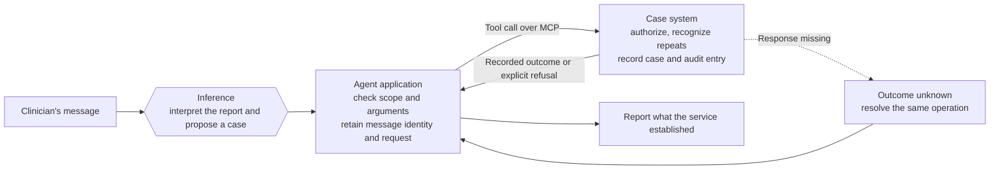
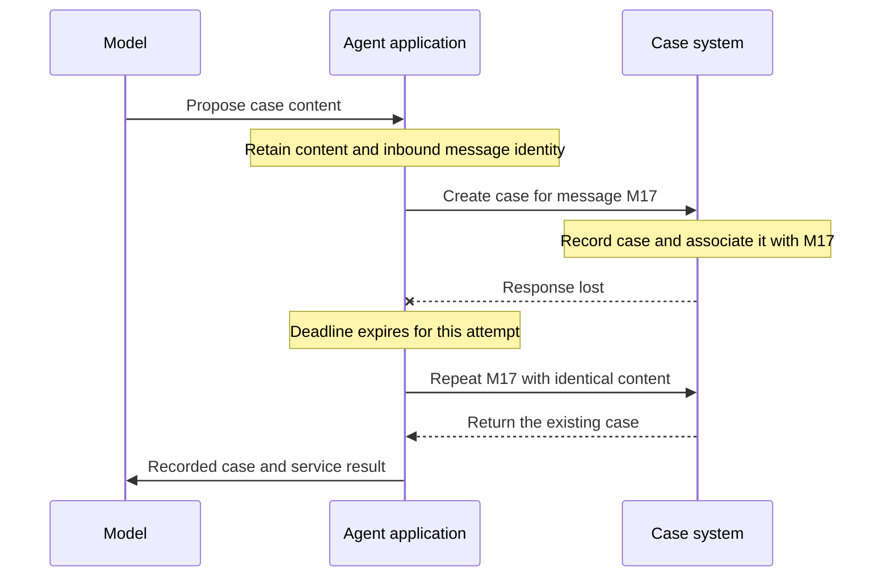
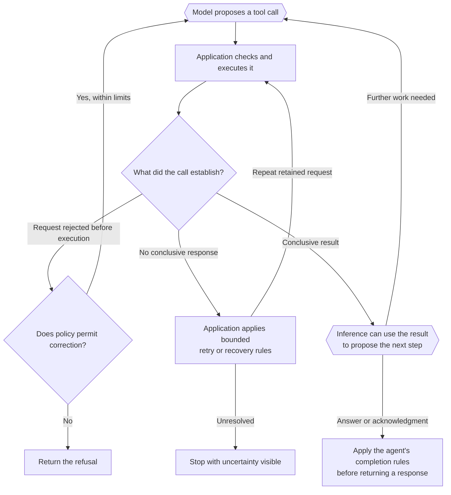

# The Tool Call Is a Distributed Transaction

A clinician reports that a patient developed a rash after taking a medicine. The intake agent in my AWS playground reads the message, identifies the information needed for an adverse event case, and asks the case system to record it. This is useful work for inference. The clinician can describe what happened in ordinary language, and the model can turn that description into a proposed operation without requiring them to fill out a form in the order our software expects.

Now suppose the case system records the case, but its response never reaches the agent. From the agent's side, the request timed out. It has no case identifier to return and no confirmation that the report was recorded. If we put that timeout into the conversation and ask the model to try again, it may produce another perfectly reasonable description of the same event. A sentence gets shortened, the symptoms are reordered, or the summary becomes a little clearer. To a person reading the two versions, it is the same report. To a service receiving a write, the content has changed.

We started with a lost response and have introduced a second decision about what to record. This is where inference complicates a problem we already understand.

In [Actors, Agents and Strands](actors-agents-and-strands.md), I used the actor model to reason about agents: components that receive messages, own state, and request work from other components, with inference participating in their decisions. Following a tool call across that boundary takes us into distributed transactions. Work is initiated in one place, performed in another, and the caller has to establish what happened before deciding what comes next. There is no shared database transaction covering the agent's conversation and the receiving service's state. We have to preserve the operation across messages, failures, and repeated delivery ourselves.

The useful starting point is how much of this we already know. Identity, idempotency, ordering, authorization, deadlines, and recovery remain the machinery that makes the operation reliable. Inference lets us arrive at that operation from ambiguous language. It also makes two decisions particularly important: which capabilities the agent may choose from, and when another model invocation would change the work we are trying to finish.

## Follow the call across the boundary

The model sees a tool's description and input schema and proposes arguments. Application code checks the proposal and executes it. When execution reaches another service, that service owns the result. MCP, an HTTP client, or a framework's tool wrapper gives us a way to carry the request; the receiving service still determines whether it is permitted and what it changes.

For the case agent, that means the model can extract a patient, reporter, drug, and event from the message, while the case system decides whether those fields are present and records the case's state. It can store an incomplete report without pretending the missing information was supplied. A person later judges whether the information is adequate. Each participant has a responsibility we can describe independently of how the model phrased the request.

The response is how the caller learns what the service did. Losing it does not reverse the write, and a timeout tells us only that the caller stopped waiting. AWS's guidance on [timeouts, retries, and backoff](https://aws.amazon.com/builders-library/timeouts-retries-and-backoff-with-jitter/) describes this familiar uncertainty: a request can have side effects even when no response arrives. The case may exist while the conversation still contains nothing but a failed tool call.

That separation between the service's state and the caller's knowledge is the problem recovery has to solve. Changing frameworks or improving the model's reasoning cannot make the missing response visible. We need a way to refer to the original work and ask the service about it again. Before doing that, though, we need to be clear about which work this agent had authority to initiate.

## The available tools define the scope of the decision

In an ordinary service, we write the code that chooses which operation to call. With an agent, we give inference some of that choice. The set of tools it receives therefore becomes part of the governance of the application. It defines which interpretations of a message can become actions, and which actions are unavailable regardless of what the model thinks would help.

The case agent can create a case, find a case, and add a follow-up. Approval belongs to a separate review interface. This lets inference help collect and organize information while leaving the decision to approve a case with a person. The service enforces that separation, including checking the reviewer's authority. A sentence in the prompt saying “do not approve cases” would leave us depending on the same inference we were trying to constrain.

The label expert has a different job, so it receives a different set of tools. It can find drug labels and search their contents. It has no case-writing tool. That is an architectural decision about the work it is responsible for, even though both agents sit in the same application and could use the same model. Connecting an agent to every tool in an estate because those tools are available would erase that distinction and ask the model to reconstruct it on every turn.

We also have to examine the capabilities in combination. An agent with private information or payment authority should not have unrestricted internet access. A private-record lookup and an arbitrary outbound HTTP tool together provide a route to send that information elsewhere. A narrowly defined business tool does little to constrain an agent that can reach the underlying system through a general database client or shell. The permissions and network paths behind the tools must preserve the same boundary as the tool list.

This still allows the case agent to contact its case service and the expert to contact retrieval. We can authorize those specific destinations without giving either agent arbitrary outbound access. If a task needs public web research as well, that work can belong to a separate agent without private records or payment authority, with explicit controls over what crosses the handoff. Separating the agents only helps if the handoff preserves the separation.

These choices are the operational form of the governance argument in my [compliance crosswalk](https://andrewphunter.com/writing/naic-and-the-crosswalk/). We decide what the system may do, assign responsibility, and enforce that decision where work executes. For the case agent, we can examine the tools it receives, the service's authorization checks, and the review interface to see how that decision is expressed. Once an allowed write leaves the agent, the next obligation is to preserve it accurately through delivery.

## A retry must not become a revision

This is where the language model's strength works against us. We want it to interpret different descriptions of an event, extract useful information, and produce a coherent case. Those abilities are valuable while forming the request. After the request has been sent, another interpretation can change the content of an operation that may already have completed.

The case system uses the inbound message identifier to recognize work it has seen before. A repeated create with that identifier and the same content returns the case already recorded. The same identifier with different content is refused. The identity belongs to the application handling the message; it is not something the model gets to invent again after a timeout. This is the relationship described in AWS's [guidance on idempotent APIs](https://aws.amazon.com/builders-library/making-retries-safe-with-idempotent-APIs/): the receiver recognizes the caller's operation and distinguishes a repeat from a conflicting use of its identity.

The intake agent's retry follows that contract. When a write gets no answer, code repeats it once with exactly the same content, within the run's remaining time. There is no inference call between the two attempts. The model has already done the useful interpretive work; the application now needs to deliver what it decided to send.

If that second attempt also gets no answer, the run fails with an explicit statement that whether the case was recorded is unknown. It does not ask the model to compose an acknowledgment. That would give the clinician a confident sentence while leaving the operation unresolved. A safe repeat can recover a lost response, but it cannot guarantee that the next response will arrive either.

The receiver is doing essential work here. Remembering an identifier only in the agent would not be enough: the agent could disappear after the case was created and before it recorded the result. The system that owns the effect has to coordinate duplicate recognition with recording that effect. Its retention rules also matter. A retry after the receiver has forgotten the original identity can become new work, so the recovery window has to fit the service's contract.

There are legitimate reasons to revise a case. A clinician may provide more information, and the agent can interpret that follow-up. The case system records it as another version and returns the case to review, rather than carrying an earlier approval forward over changed content. That makes the distinction concrete: repeating delivery preserves the operation; adding information creates a new change with its own consequences. Treating both as “try again” loses the relationship between what was submitted, what was reviewed, and what now exists.

## A read changes what the agent believes

The expert agent reaches the same boundary from the read side. It asks the retrieval service for label material, receives evidence, and uses that evidence to propose an answer. There is no case write to duplicate, but the next decision still depends on what the remote operation actually established. If a search failure becomes an empty result, the model can turn “the service did not answer” into “the label contains no information about this.” We have converted a transport failure into a claim about the source.

A successful search with no matches, a request rejected for invalid input, and a service that could not be reached need to remain distinct all the way back into the loop. The expert allows correction of invalid search input, while a connection failure or search timeout ends the run. Another application could permit a bounded retry of that failed read. Either way, the application has to preserve the meaning of the outcome rather than manufacture a search result so inference can continue.

Here inference also gives us something useful that a fixed request cannot. After a successful search, the model can recognize that the results do not address the question and formulate a better query. That is a new retrieval decision, with a different query and potentially different evidence. It should appear as such in the execution record. Rephrasing a search to investigate another angle is useful exploration; rephrasing it because a response was lost should not quietly masquerade as repeating the original request.

The distinction carries through to the answer. The expert records which retrieved passages were actually supplied to the model and accepts citations only to those passages. It checks quotations and numbers against the cited material and retains the source version with the reference. Those checks do not establish that every conclusion is correct; a number can be copied from the wrong row of a table. They preserve enough of the relationship between the tool result and the answer for evaluation and review to examine it.

The two agents enforce different parts of that boundary. Intake prevents an acknowledgment when a write remains unresolved; it otherwise relies on the model to describe the returned case result and does not validate every sentence of that description. The expert applies the additional source checks before releasing its answer. That distinction matters when deciding what a caller can trust: resolving a tool call establishes its outcome, while verifying the model's account of that outcome is another responsibility. The execution record gives us something concrete to check that account against.

## The operation can outlive the conversation

Both agents have limits on the work they can do. Without them, retries and further inference can keep consuming time and capacity long after the original request should have returned. Those limits have to account for the whole path: the framework, model client, tool client, and receiving service may each retry independently. A hook at the agent loop only sees failures that reach it. Backoff and jitter help spread repeated requests, but someone still has to own the total attempt and time budgets.

The response to an exhausted budget depends on the operation. The expert can end without releasing an answer because it could not obtain evidence. The case agent may have a write in flight, so ending the run leaves an obligation to determine what happened. Cancelling an [AgentCore Runtime session](https://docs.aws.amazon.com/bedrock-agentcore/latest/devguide/runtime-stop-session.html) cannot undo a case already recorded in another service. A restored conversation cannot establish the result either. Recovery needs the operation's identity, retained request, and a way to consult the service that owns it.

In the playground, the intake agent stops at identifying that uncertainty. Taking the same design into an operational service would require assigning the unresolved work to a durable recovery process or an operational queue. That owner could look up the original operation or repeat it where the receiver's contract makes that safe. A person taking over needs the same record. Manually submitting a fresh case because the agent timed out can duplicate work just as easily as an automatic retry.

For a longer process, a durable workflow can retain progress between steps. [Step Functions Standard workflows](https://docs.aws.amazon.com/step-functions/latest/dg/choosing-workflow-type.html) provide persisted execution state and an execution history, with task retries configured in the workflow. The task still needs to refer to the same downstream operation when repeated. If recording a case succeeds but a later notification fails, recovery should retry the notification rather than start the whole sequence again. The workflow knows where it was; the receiving service knows which effects already happened.

This gives the audit trail something useful to describe. We can connect the incoming message, the proposed operation, the authority under which it ran, its delivery attempts, and the service's recorded result. For a revised case, the versions and review decisions explain what changed. For a retrieved answer, the query and source references explain what evidence was available. We can retain those relationships through identifiers and controlled references without copying private information into every trace, and we can investigate the execution without asking the model to reconstruct it afterward.

## What the business is buying

At this point, picking a model because it can call tools tells us very little about whether the application will work as a business capability. Tool calling is available across the major frontier model families, including [Claude](https://platform.claude.com/docs/en/agents-and-tools/tool-use/overview), [OpenAI's models](https://developers.openai.com/api/docs/guides/function-calling), and [Gemini](https://ai.google.dev/gemini-api/docs/function-calling). We still need to evaluate how well a model interprets our requests and selects the right operations, at an acceptable cost and latency. But none of those choices supplies the receiving service's idempotency, assigns someone to unresolved work, or decides which parts of the estate an agent should be allowed to reach.

A demonstration can make those obligations easy to miss. The clinician describes an event, a case appears, and the agent acknowledges it. We have shown that inference can connect language to an operation, and that is a useful capability. The business, however, is taking responsibility for the report from the moment it accepts it. If the response disappears, someone still has to establish whether the case exists. If the content changes, the review has to apply to the right version. The demonstration's successful path has left those costs and responsibilities out of view.

That is where an apparent productivity gain can become more work for the people operating the system. Time saved entering reports can be consumed investigating duplicates, finding missing work, or checking acknowledgments nobody trusts. Giving the agent more tools so it can improvise around failures also expands what it can affect, without establishing that it can recover correctly. A stronger model may interpret more requests successfully, but it cannot reason an absent transaction record into existence. The engineering and operating costs remain part of the return on the investment, whether they appear in the delivery plan or arrive later in the support queue.

The distributed-transaction framing gives us a practical way to assess that investment before committing to it. Where services already expose bounded operations, recognize repeated delivery, and provide a way to establish outcomes, we have a foundation on which inference can make those services easier to use. Where those contracts are missing, building them belongs in the scope and cost of the project. We can then evaluate model quality against a defined responsibility, change models as the economics improve, and retain the business controls around the work they initiate.

For the case agent, the return would come from reducing the effort of getting a report recorded and ready for review, including the effort of handling exceptions. For the expert, it would come from helping someone reach a supported answer with less searching and verification. Those are outcomes we can evaluate across the whole process. Following the tool call through the distributed transaction lets us see how much work inference has actually removed, how much remains, and who is responsible for completing it after the conversation ends.
